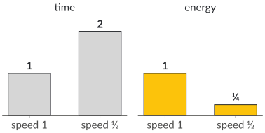
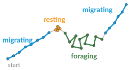
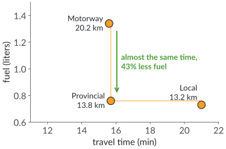
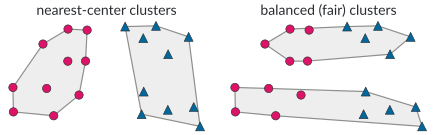
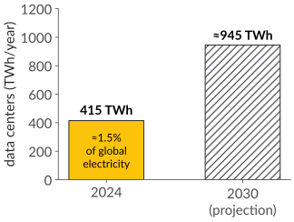

# Plan for today

1. What this course is about
2. Guest contribution: *Sustainability goals*, Dr. Henning Moldenhauer, Sustainability Office, TU Dortmund
3. Where algorithms meet the Sustainable Development Goals
4. The topic blocks: from a sustainability question to algorithms
5. Organization: tutorials, project, exam
6. Questions

::: notes
Timing (90 min): 10:15 welcome (slides 1–2) · 10:17 what this course is about (slides 3–9, about 13 min) · 10:30 guest contribution (slide 10, about 20 min plus questions) · 10:55 SDGs (slide 11) · 11:00 topic blocks (slides 12–21, about 5 min per block, plus about 3 min for the quizzes on slides 15 and 16) · 11:23 organization (slides 22–31) · 11:41 next steps and questions (slide 32). At the start, say that the lecture is recorded.
:::

# The guiding question

::: bigquestion
How can **algorithms research** contribute to addressing challenges of **sustainability**?
:::

This is an **algorithms course**. Sustainability supplies the questions and the motivation; our tools are algorithmic: modeling, design, analysis and engineering.

::: notes
Make the character of the course explicit right at the start. The next slides make it concrete: a warm-up quiz, four guiding questions, and the structure of each block.
:::

# Warm-up quiz

A processor running at speed $s$ consumes power $P(s) = s^3$. A job needs a fixed amount of work $w$. We run it at **half speed** instead of full speed.

[How much energy does the job use compared to full speed?]{.ask}

::: quiz
- [ ] the same
- [ ] half
- [x] a quarter
- [ ] an eighth
:::

::: notes
Let students vote by show of hands (or use the quiz buttons). Answer on the next slide: E = P(s) · w/s = w·s², so half speed gives a quarter of the energy, but the job takes twice as long.
:::

# From a calculation to an algorithm {.columns}

## {.left grow="3"}

::: incremental
- Energy = power × time: $E(s) = s^3 \cdot \frac{w}{s} = w\,s^2$
- Half speed: **a quarter of the energy**, but **twice the time**
- Many jobs with release times and deadlines: which speed when?
- Optimal offline schedule: Yao, Demers and Shenker (1995)
- Online, without knowing future jobs: competitive analysis
:::

→ Block 3: Energy-efficient algorithms

## {.right grow="2"}

{.nocap}

::: notes
A two-line calculation turns into a scheduling problem with a clean optimal algorithm (YDS) and online algorithms with provable competitive ratios. This is the flavor of the whole course.
:::

# Sustainability and algorithmic questions {.fourq}

::: columns-1-1-1-1
::: col
{.nocap}

**What did the animal do?**

trajectory analysis, dynamic programming
:::

::: col
{.nocap}

**Is the fastest route also the greenest?**

multi-criteria shortest paths, public transit routing
:::

::: col
{.nocap}

**How fast should a processor run?**

speed scaling, online algorithms
:::

::: col
{.nocap}

**How can we cluster fairly?**

fair clustering, approximation algorithms
:::
:::

::: notes
One question from each topic area (movement analysis, route planning, energy, fairness); each area has many more. Do not explain the figures in detail yet; each one comes back in the block overview after the guest contribution.
:::

# What to expect {.columns}

## In this course you will {.left}

- **model** a sustainability question as a precise computational problem
- **design** algorithms and **analyze** them: correctness, running time, approximation and competitive ratios, lower bounds
- **engineer** and **apply** them in a project: implement, evaluate, measure

## This course is not {.right}

- a course on machine learning or AI, although both matter for sustainability
- a course on sustainability policy, but every block starts from a real sustainability question
- a programming course, but your project involves implementation

# How the blocks are structured

::: columns-1-1-1-1
::: col
[1 · Question]{.step}

A **sustainability question**: why does it matter?
:::

::: col
[2 · Research]{.step}

**Research papers** on it lead to a precise **computational problem**
:::

::: col
[3 · Algorithms]{.step}

**Design and analysis**, sometimes also lower bounds and hardness
:::

::: col
[4 · Practice]{.step}

**Exercises** in the tutorial, **quizzes**, and your **project**
:::
:::

## Example: route planning {.info}

Is the fastest route also the greenest? → eco-routing field tests → shortest paths with two criteria (time, fuel) → Pareto-optimal paths by multi-criteria label setting → exercises and projects

::: notes
This is the structure that each block follows: a sustainability question, then research papers on it, which lead to a computational problem, then the algorithmic core, then practice. Announcing it now gives students a map for the semester.
:::

# The semester at a glance

::: {.tablefit .tablesmall}
| Weeks | Block | Algorithmic core | Guest talks |
|-------|-------|------------------|-------------|
| 1 | Introduction | | Henning Moldenhauer (today) |
| 2–4 | Computational Movement Analysis | similarity, clustering, segmentation | Andrea Kölzsch (28 Oct, tutorial) |
| 5–8 | Route Planning for Sustainable Mobility | shortest paths, multiple criteria, public transit | Sabine Storandt (17 Nov) |
| 9–10 | Energy-Efficient Algorithms | energy in software, speed scaling, online algorithms | |
|  | *no classes from 22 December to 6 January* | | |
| 11–12 | Algorithmic Fairness | fair clustering and beyond | |
| 13 | Further topics | | |
| 14 | Project presentations on 2 and 3 February | | |
:::

::: notes
Week 1 is 13 October; week 14 is 2/3 February, after three weeks without classes over the holidays. Week 13 is open for further topics. Guest talks: Andrea Kölzsch (Radboud University) on MoveApps in the tutorial on Wednesday 28 October; Sabine Storandt (University of Konstanz) on accessibility-aware route planning in the lecture on Tuesday 17 November.
:::

# Sustainability goals {.section}

Guest contribution: **Dr. Henning Moldenhauer**, Sustainability Office, TU Dortmund

::: notes
Henning presents his own slides (about 20 minutes plus questions). His slides are not part of this deck.
:::

# Where do algorithms meet the SDGs?

::: columns-1-1
::: {.col .sdglist}
**Movement analysis**

- [14]{.sdg .s14} Life below water
- [15]{.sdg .s15} Life on land
- [13]{.sdg .s13} Climate action

**Route planning**

- [11]{.sdg .s11} Sustainable cities and communities
- [3]{.sdg .s3} Good health and well-being
- [10]{.sdg .s10} Reduced inequalities
:::

::: {.col .sdglist}
**Energy efficiency**

- [7]{.sdg .s7} Affordable and clean energy
- [13]{.sdg .s13} Climate action
- [12]{.sdg .s12} Responsible consumption and production

**Fairness**

- [10]{.sdg .s10} Reduced inequalities
- [5]{.sdg .s5} Gender equality
- [16]{.sdg .s16} Peace, justice and strong institutions
:::
:::

## Your turn (2 minutes) {.fragment .ask}

With your neighbor, pick one SDG: which computational problem is hidden in it?

::: notes
Bridge from the guest contribution to the course. Example targets: 11.2 (access to safe, affordable, accessible and sustainable transport systems), 3.6 (road traffic deaths and injuries), 7.3 (double the rate of improvement in energy efficiency). Collect two or three answers.
:::

# Block 1 · Computational Movement Analysis {.columns}

## {.left grow="3"}

*Weeks 2–4*

- GPS tracking shows how animals move, and how land use and climate change affect them
- Large tracking data sets exist (e.g., in **Movebank**); turning them into conservation advice needs analysis methods
- Kölzsch et al. (2025): volunteer coders write analysis apps for wildlife conservation on **MoveApps**; guest talk by Andrea Kölzsch on 28 October

## {.right grow="2"}

{.nocap}

→ your project could be such an app

::: notes
Context paper: Kölzsch et al. (2025), Methods in Ecology and Evolution. Twelve volunteer coders developed MoveApps; the paper discusses community building, involvement and retention. Link to projects: a MoveApp is one of the project options.
:::

# Block 1 · From tracks to algorithms

- A **trajectory** is a sequence of time-stamped positions: a polygonal curve
- **Similarity:** the discrete Fréchet distance takes $O(nm)$ time by dynamic programming, and there is no strongly subquadratic algorithm unless SETH fails (Bringmann 2014)
- **Clustering:** $(k,\ell)$-center clustering of trajectories
- **Segmentation:** split a track into homogeneous phases, e.g., migrating and resting

# Block 2 · Route Planning for Sustainable Mobility {.columns}

## {.left grow="1"}

*Weeks 5–8*

Field test, three routes from Delft to Zoetermeer (Minett et al. 2011):

- **Motorway:** 15.6 min, 1.34 l fuel
- **Provincial road:** 15.7 min, 0.76 l
- **Local road:** 21.0 min, 0.73 l

The fastest route is not the most fuel-efficient one. Other criteria: safety and accessibility (guest lecture by Sabine Storandt, 17 Nov); other modes: public transit, cycling.

## {.right grow="1"}

{.nocap}

::: notes
Numbers: field-test averages for the direction Delft → Zoetermeer (Tables II and III in Minett et al. 2011). All three routes are Pareto-optimal for (time, fuel), which motivates multi-criteria routing.
:::

# Quiz: which routes are Pareto-optimal?

::: columns-1-1
::: col
| Route | Time | Fuel |
|-------|-----:|-----:|
| Motorway | 15.6 min | 1.34 l |
| Provincial road | 15.7 min | 0.76 l |
| Local road | 21.0 min | 0.73 l |
:::

::: col
A route **dominates** another if it is at least as good in both criteria and better in at least one. It is **Pareto-optimal** if no other route dominates it.

[Which routes are Pareto-optimal for (time, fuel)?]{.ask}
:::
:::

::: quiz
- [ ] only the provincial road
    - The motorway is the fastest route, and the local road uses the least fuel.
- [ ] motorway and provincial road
    - The local road uses the least fuel, so no route dominates it.
- [ ] provincial road and local road
    - The motorway is the fastest route, so no route dominates it.
- [x] all three
    - Motorway: fastest. Local road: least fuel. Provincial road: faster than the local road, less fuel than the motorway.
:::

::: notes
Let students vote on their phones (QR code and poll buttons in presenter mode) or by show of hands. Many expect the motorway to be dominated because the provincial road is almost as fast with 43% less fuel. But almost as fast is not as fast: the motorway is still 0.1 min faster. Which route a driver prefers depends on how they weigh time against fuel; this is why multi-criteria route planning computes the whole Pareto set. Next slide: algorithms for it.
:::

# Quiz: shortest paths

Route planning is based on computing **shortest paths**.

[Which of the following is *not* a shortest-path algorithm?]{.ask}

::: quiz
- [ ] Dijkstra's algorithm
    - Shortest paths from one source, for non-negative edge weights.
- [ ] Bellman–Ford algorithm
    - Shortest paths from one source, also with negative edge weights.
- [x] Kruskal's algorithm
    - It computes a minimum spanning tree: the cheapest network that connects all nodes.
- [ ] A* search
    - Dijkstra's algorithm, guided towards the target by a lower bound on the remaining distance.
:::

::: notes
Quick check of prior knowledge from DAP 2; let students vote on their phones or by show of hands. Kruskal's algorithm, like Prim's, computes a minimum spanning tree. If there is time: a minimum spanning tree does not contain shortest paths in general. In a triangle with edge weights 2, 2 and 3, the tree uses the two edges of weight 2, but the shortest path between the ends of the weight-3 edge is that edge. Next slide: shortest paths at scale.
:::

# Block 2 · From routes to algorithms

- **Shortest paths at scale:** Dijkstra, A\*, landmarks (ALT), contraction hierarchies; preprocessing time versus query time
- **Several criteria** (time, fuel, safety): Pareto-optimal paths, multi-criteria label setting
- **Public transit:** timetables instead of road graphs; Connection Scan Algorithm (CSA) and RAPTOR, with two lectures on public transit

# Block 3 · Energy-Efficient Algorithms {.columns}

## {.left grow="3"}

*Weeks 9–10*

- ICT causes an estimated **1.8–2.8%** of global greenhouse-gas emissions, possibly up to **3.9%** (Freitag et al. 2021)
- Data centers used about **415 TWh** in 2024, around 1.5% of global electricity; projected: about **945 TWh** in 2030 (IEA 2025)
- SDG target 7.3: double the global rate of improvement in energy efficiency by 2030

## {.right grow="2"}

{.nocap}

[Based on IEA (2025), Energy and AI, CC BY 4.0]{.source}

# Block 3 · From energy to algorithms

- **Measuring** energy: energy models, energy profiles of programs, measurement tools
- **Speed scaling:** schedule jobs with deadlines at minimum energy (Yao, Demers, Shenker 1995)
- **Online algorithms:** decide without knowing the future; competitive analysis
- Project idea: compare the energy consumption of algorithms (e.g., sorting) with the energy toolkit

# Block 4 · Algorithmic Fairness {.columns}

## {.left grow="1"}

*Weeks 11–12*

- Algorithms decide how people are grouped and served: school assignment, placing clinics
- Sustainability has a **social** dimension: [10]{.sdg .s10} Reduced inequalities
- Two notions of fair clustering:
    - balanced clusters with a fair mix of two groups (Chierichetti et al. 2017)
    - equally good service for every group (Ghadiri, Samadi, Vempala 2021)

## {.right grow="1"}

{.nocap}

::: notes
The figure shows the first notion. Left: clusters by location only, each cluster contains one group. Right: balanced clusters with both groups in equal proportion. The second notion asks that the clustering cost is small for each group, e.g., every group has short distances to its facility.
:::

# Block 4 · From fairness to algorithms

- **Clustering objectives:** $k$-center, $k$-median, $k$-means; NP-hard, so we design approximation algorithms
- **Fairness** as a constraint (balanced clusters, fairlets) or as an objective (minimize the cost of the worst-off group)
- **Price of fairness:** how much worse does the objective get?

::: notes
Week 13 (26 January): open for further topics.
:::

# Organization {.section}

# Lecturer and contact {.columns}

## Prof. Dr. Kevin Buchin {.left}

Chair of Algorithm Engineering

Research interests: computational geometry, geometric networks, geographic information science

In Dortmund since 2021

## Contact {.right}

- in the lecture and the tutorial
- Moodle forum, for questions others may have too
- by e-mail

# Meetings and materials

- **Lecture:** Tuesdays 10:15–11:45, OH 12, room 3.032
- **Tutorial:** Wednesdays 10:15–11:45, OH 12, room 3.032; first tutorial next week, 21 October
- **Recordings** of the lectures (slides and audio) on Moodle
- **No classes** from 22 December 2026 to 6 January 2027
- **Project presentations:** 2 and 3 February 2027
- **Moodle:** slides before each lecture, exercise sheets, quizzes, forum

# Tutorials and quizzes

- Exercise sheets on the lecture content: you solve them, then present and discuss your solutions in the tutorial
- Time for questions about your project and for practical guidance on frameworks, data and tools
- A short, optional **quiz** for each block to check your understanding

# Course project {.columns}

## {.left grow="3"}

- small project, roughly the size of a course assignment
- individually or in pairs
- usually builds on a framework from the course:
    - a **MoveApp** for Movebank data
    - a routing algorithm in **tour4me**
    - energy measurements with the **energy toolkit**
- own ideas are welcome, talk to me
- presentations on 2 and 3 February 2027

## Projects from 2025/26 {.right grow="2" .small}

- [Parallel Energy Toolkit](https://github.com/konradge/parallel-energy-toolkit)
- [Charging Station Touring Problem](https://github.com/MaxNeedsSnacks/gsp-proto)
- [State-Dependent Random Walks MoveApp](https://github.com/Omar-Chatila/random-walks-moveapp)
- [Cache Misses and Compression Algorithms](https://energy-cache-compression.streamlit.app/)
- [Biologically Plausible Tiger Shark Motion](https://github.com/polinochkachai/random-walks-python/tree/dev)
- [Public Transit Reachability with OpenTripPlanner](https://github.com/larsh3n/OpenTripPlanner-with-Reachability)

::: notes
Frameworks: MoveApps (moveapps.org), tour4me (tramectory.github.io/tour4me), energy toolkit (github.com/sse-labs/energy-toolkit).
:::

# Exam and course requirement

- **Oral exam** of 20–30 minutes in two parts:
    - **your project** (about half): what you did and the algorithmic decisions behind it
    - **the lecture content** (about half)
- A high-quality project can improve your grade
- **Course requirement** (Studienleistung): regular, active participation in the tutorial, presenting your solutions, and handing in and presenting your project results
- Exam periods: to be announced (February/March 2027)

# studium oecologicum

- The 6 credits of this course count towards the **studium oecologicum**
- Not studying computer science? You can take a **3-credit variant**:
    - attending the lecture is mandatory
    - no tutorial and no project
    - oral exam focusing on the fundamentals from the lectures
    - the 3 credits count only for the studium oecologicum

# Prerequisites

- Solid background in **algorithms and data structures**
- Interest in both the **theory** of algorithms and **application-driven** algorithm design
- Readiness for hands-on, project-based work
- Note: "Selected Topics in Algorithms" (Ausgewählte Kapitel der Algorithmik) is an advanced module in Algorithms and Complexity; you can take it only once, whatever its topic

## Question {.ask}

What is your background in algorithms?

::: notes
Ask by show of hands: DAP 2 or a comparable course, geometric algorithms, approximation or online algorithms.
:::

# Code of conduct

- At the Faculty of Computer Science, we promote a motivating and equal opportunity environment in which we learn, teach, and research together.
- Discrimination and sexual violence are not tolerated, vigorously prosecuted, and sanctioned to the fullest extent of the law.
- Unacceptable behavior includes, but is not limited to, harassing, abusive, discriminatory, intimidating, derogatory, and degrading behavior and language.

# Contact persons

If you experience or observe discrimination or sexual violence, or have questions about the topic, you can contact the following bodies:

- The teacher(s) of your course
- [Faculty Diversity Commission (Diversitätskommission der Fakultät)](https://cs.tu-dortmund.de/divko)
    - Feel free to contact the student representatives directly
    - Or via an [anonymous contact form](https://cs.tu-dortmund.de/divko/kontakt) to all members
- [Central advice center for protection against discrimination and sexual violence](https://stabsstelle-cfv.tu-dortmund.de/schuds/)
- [Vice Rector (Prorektorin) for International Affairs and Diversity](https://www.tu-dortmund.de/universitaet/organisation/hochschulleitung/rektorat/prorektorin-internationales/)

There is a website with the various contact points: <https://cs.tu-dortmund.de/divko/anlaufstellen/>

# Next steps

- **Tuesday, 20 October:** Block 1 starts with trajectory similarity
- **Wednesday, 21 October:** first tutorial
- **Guest talks:**
    - Andrea Kölzsch (Radboud University): MoveApps, in the tutorial on Wednesday, 28 October
    - Sabine Storandt (University of Konstanz): accessibility-aware route planning, in the lecture on Tuesday, 17 November
- Until then: look at the projects from 2025/26 and think about which block interests you most

## Questions and discussion {.ask}

What do you hope to get out of this course?

# References

::: refs
- Bringmann, K. (2014). Why walking the dog takes time: Fréchet distance has no strongly subquadratic algorithms unless SETH fails. *55th IEEE Symposium on Foundations of Computer Science (FOCS)*, 661–670.
- Chierichetti, F., Kumar, R., Lattanzi, S., Vassilvitskii, S. (2017). Fair clustering through fairlets. *Advances in Neural Information Processing Systems 30 (NIPS 2017)*, 5029–5037.
- Freitag, C., Berners-Lee, M., Widdicks, K., Knowles, B., Blair, G. S., Friday, A. (2021). The real climate and transformative impact of ICT: A critique of estimates, trends, and regulations. *Patterns* 2(9), 100340. <https://doi.org/10.1016/j.patter.2021.100340>
- Ghadiri, M., Samadi, S., Vempala, S. (2021). Socially fair k-means clustering. *ACM Conference on Fairness, Accountability, and Transparency (FAccT 2021)*, 438–448.
- IEA (2025). *Energy and AI*. <https://www.iea.org/reports/energy-and-ai>, License: CC BY 4.0.
- Kölzsch, A., et al. (2025). Citizen scientists for MoveApps: Innovations and insights from volunteer coders in wildlife conservation. *Methods in Ecology and Evolution* 16, 1550–1563. <https://doi.org/10.1111/2041-210X.70101>
- Minett, C. F., Salomons, A. M., Daamen, W., van Arem, B., Kuijpers, S. (2011). Eco-routing: comparing the fuel consumption of different routes between an origin and destination using field test speed profiles and synthetic speed profiles. *IEEE Forum on Integrated and Sustainable Transportation Systems*, Vienna, 32–39.
- Yao, F., Demers, A., Shenker, S. (1995). A scheduling model for reduced CPU energy. *36th IEEE Symposium on Foundations of Computer Science (FOCS)*, 374–382.
:::

# License and credits

::: small
- Slides © 2026 Kevin Buchin, TU Dortmund University, licensed under **CC BY 4.0** (<https://creativecommons.org/licenses/by/4.0/>). Suggested attribution: "Kevin Buchin, Algorithms and Sustainability, TU Dortmund University, CC BY 4.0", with a link to the course page.
- Not covered by this license: the TU Dortmund logo, the Decker software and its themes (own licenses), the guest slides by Dr. Henning Moldenhauer, and the code of conduct text of the Faculty of Computer Science.
- Figures: own work, CC BY 4.0. The eco-routing chart shows data from Minett et al. (2011).
- Data-center chart: based on IEA (2025), *Energy and AI*, <https://www.iea.org/reports/energy-and-ai>, License: CC BY 4.0. This is a work derived by Kevin Buchin from IEA material, and Kevin Buchin is solely liable and responsible for this derived work. The derived work is not endorsed by the IEA or its Member countries in any manner.
- The colors of the Sustainable Development Goals are used for orientation only; this material is not endorsed by the United Nations.
- Made with Decker: <https://github.com/decker-edu/decker>
:::
