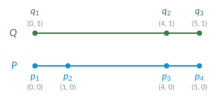
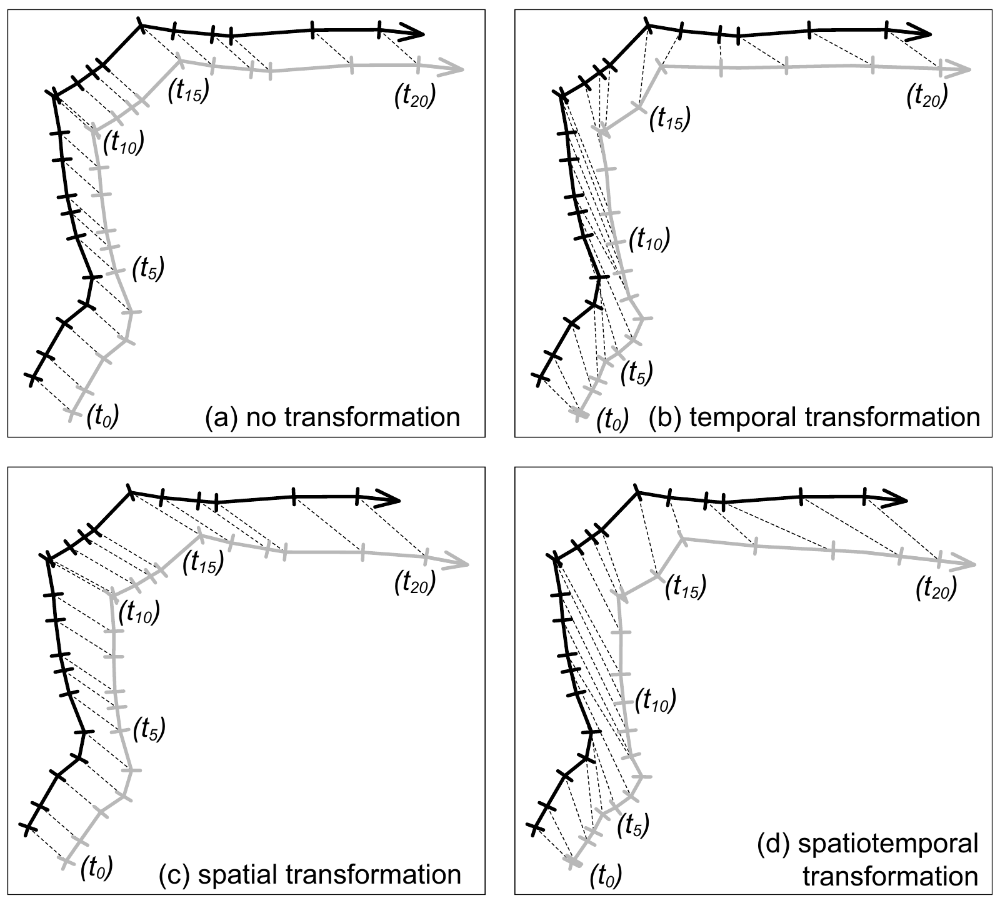

# Plan for today

1. Finish the course overview: algorithms and sustainability
2. Migration and conservation: what can tracking data tell us?
3. Trajectories as time series: what should similarity mean?
4. Discrete Fréchet distance and dynamic time warping (DTW)
5. Sampling, choosing a measure, and the next step: clustering

::: notes
Timing (90 min, main part slides 2–35): 10:15 plan (slide 2) · 10:17 course overview (slides 3–7, about 15 min) · 10:32 Block 1: question and data (slides 8–15, about 14 min) · 10:46 time series, Hausdorff and order (slides 16–19, about 9 min) · 10:55 Fréchet distance with the worked example and back to the storks (slides 20–26, about 20 min) · 11:15 DTW (slides 27–28, about 7 min) · 11:22 continuous curves, choosing a measure, comparative study (slides 29–31, about 8 min) · 11:30 running time (slides 32–33, about 5 min) · 11:35 clustering preview and next steps (slides 34–35) · about 6 min buffer. At the start, say that the lecture is recorded.

The overview is a hard limit of 15 minutes; otherwise the Fréchet distance starts later than 10:55. The algorithm names on slides 4–7 are signposts, not topics for today.

The times already assume the pace of lecture 1, where the introduction took about 1.3 times as long as planned. If time runs short: slide 33 in one sentence (first choice), slides 29 and 31 in two sentences each, slide 34 in one sentence; on slide 23 compute the two cells together with the class instead of in pairs. Earlier on, slide 3 without discussion. If time is left: the quiz on slide 37 (maximum or sum) or the exit question on slide 42.

Slides 36–42 are additional material for self-study and the tutorial. Voting: the quiz on slide 24 supports phone voting (QR code and poll buttons in presenter mode), otherwise show of hands; collect the votes before revealing the answer.
:::

# Where do algorithms meet the SDGs?

::: columns-1-1
::: {.col .sdglist}
**Movement analysis**

- [14]{.sdg .s14} Life below water
- [15]{.sdg .s15} Life on land
- [13]{.sdg .s13} Climate action

**Route planning**

- [11]{.sdg .s11} Sustainable cities and communities
- [3]{.sdg .s3} Good health and well-being
- [10]{.sdg .s10} Reduced inequalities
:::

::: {.col .sdglist}
**Energy efficiency**

- [7]{.sdg .s7} Affordable and clean energy
- [13]{.sdg .s13} Climate action
- [12]{.sdg .s12} Responsible consumption and production

**Fairness**

- [10]{.sdg .s10} Reduced inequalities
- [5]{.sdg .s5} Gender equality
- [16]{.sdg .s16} Peace, justice and strong institutions
:::
:::

## A computational question {.ask}

Which sites to protect? Which routes to offer? How to share limited resources?

::: notes
Bridge from last week's guest contribution to the course. Example targets: 11.2 (access to safe, affordable, accessible and sustainable transport systems), 3.6 (road traffic deaths and injuries), 7.3 (double the rate of improvement in energy efficiency). Use at most one minute here. Instead of a partner phase, name two examples yourself (11.2 leads to route planning, 7.3 to speed scaling).
:::

# Block 1 · Computational Movement Analysis {.columns}

## {.left grow="3"}

*Weeks 2–4*

- GPS tracking reveals migration routes, stopovers, and changes in movement
- **Algorithms:** similarity (Fréchet distance, DTW), $(k,\ell)$-center clustering, segmentation into phases
- Large data sets, e.g. **Movebank**, need analysis before they can inform conservation

## {.right grow="2"}

{.nocap}

**MoveApps:** an analysis app could be your project

::: notes
Today we develop similarity algorithms. Clustering follows next week, segmentation in week 4. Kölzsch et al. (2025) discuss volunteer coders developing MoveApps for wildlife conservation. Andrea Kölzsch's guest talk is on 28 October in the tutorial. The movement block follows in detail after this brief overview.
:::

# Block 2 · Route Planning for Sustainable Mobility {.columns}

## {.left grow="1"}

*Weeks 5–8*

Three routes from Delft to Zoetermeer (Minett et al. 2011):

- **Motorway:** 15.6 min, 1.34 l fuel
- **Provincial road:** 15.7 min, 0.76 l
- **Local road:** 21.0 min, 0.73 l

The provincial road takes almost the same time as the motorway, using much less fuel.

## {.right grow="1"}

{.nocap}

**Algorithms:** Dijkstra, A\*, contraction hierarchies; Pareto-optimal paths; public transit with CSA and RAPTOR

::: notes
All three routes are Pareto-optimal for (time, fuel). Explain the trade-off briefly, leaving the Pareto and shortest-path quizzes for the route-planning block. Other criteria include safety and accessibility; Sabine Storandt's guest lecture is on 17 November. Numbers are field-test averages for Delft to Zoetermeer, Tables II and III in Minett et al. (2011).
:::

# Block 3 · Energy-Efficient Algorithms {.columns}

## {.left grow="3"}

*Weeks 9–10*

- Data centers used about **415 TWh** in 2024; projected: about **945 TWh** in 2030 (IEA 2025)
- SDG target 7.3: improve **energy efficiency**
- **Algorithms:** speed scaling (Yao, Demers, Shenker 1995); online algorithms and competitive analysis
- **Practice:** measure and compare the energy consumption of programs

## {.right grow="2"}

{.nocap}

[Based on IEA (2025), Energy and AI, CC BY 4.0]{.source}

::: notes
Speed scaling (Yao, Demers, Shenker 1995) gives a precise scheduling model. Online algorithms and competitive analysis formalize decisions without knowing future jobs. Keep the distinction between reducing energy for a given computation and reducing total ICT energy demand. The numbers on the chart are the IEA's 2025 estimates and projections.
:::

# Block 4 · Algorithmic Fairness {.columns}

## {.left grow="1"}

*Weeks 11–12*

Placing clinics or assigning schools affects who receives good service.

- **Balanced clusters:** a fair mix of groups (Chierichetti et al. 2017)
- **Fair service:** low cost for every group (Ghadiri et al. 2021)
- **Algorithms:** fair *k*-center and *k*-means clustering (fairlets), approximation algorithms, price of fairness

## {.right grow="1"}

{.nocap}

Sustainability includes **social equity**: [10]{.sdg .s10} Reduced inequalities

::: notes
The figure illustrates balanced clusters. Fair service is a different notion: for example, each group should have short distances to its facilities. We will examine how much the clustering cost changes when fairness is required. Week 13 remains open for further topics. Now turn to movement analysis.
:::

# Block 1 · Computational Movement Analysis {.section}

Weeks 2–4 · today: how similar are two trajectories?

# The question

[1 · Question]{.step}

::: bigquestion
How do **migratory animals** respond to a changing world, and **where do they need protection**?
:::

- Many migratory species are declining
- Landscape fragmentation and climate change put new obstacles in their way
- Animals change their routes and wintering areas

::: notes
Like every block, Block 1 starts with a sustainability question (the four steps from last week: question, research, algorithms, practice). The next slides take up the three points: the decline and its causes, among them fragmentation and climate change (slide 10), and changing routes (slides 11–12). Then we see what this means for algorithms.
:::

# Migratory animals under pressure {.columns}

## {.left grow="2"}

UN report on the 1,189 species protected under the Convention on Migratory Species (CMS), 2024:

- **44%** have declining populations; **22%** are threatened with extinction
- Greatest threats: **overexploitation** and **habitat loss**; habitat loss, degradation and **fragmentation** affect 3 in 4 species
- **Climate change**, pollution and invasive species also have profound impacts
- **51%** of their Key Biodiversity Areas are unprotected

## {.right grow="1"}

::: sdglist
- [15]{.sdg .s15} Life on land
- [14]{.sdg .s14} Life below water
- [13]{.sdg .s13} Climate action
:::

Target 15.5: halt the loss of biodiversity and prevent the extinction of threatened species

[UNEP press release, 12 February 2024]{.source}

::: notes
Source: UNEP press release on the report "State of the World's Migratory Species" (12 February 2024). Overexploitation includes unsustainable hunting and overfishing. Three out of four CMS-listed species are impacted by habitat loss, degradation and fragmentation; climate change, pollution and invasive species also have profound impacts (press release). Migratory animals need protection in many places: breeding areas, stopover sites, wintering areas, and the routes in between. To protect them we need to know where they are and when.
:::

# Young white storks in their first winter

{.nocap height="430px"}

**71 juveniles** from eight populations, tracked from the nest in 2013/14

[Data: Flack et al. (2016), Movebank, CC0. Map: Natural Earth.]{.source}

::: notes
Point out the four juveniles from SW Germany that wintered at rubbish dumps in Morocco (Flack et al. 2016). Tracks until 31 January 2014, one position per day. First winter = median position in December and January: within 150 km of the nest means "did not migrate" (two juveniles from Uzbekistan, one from Armenia), south of 20°N means "crossed the Sahara". The Uzbek storks were thought to winter in Afghanistan and Pakistan; the authors suspect food at fish farms. A track ends when the bird dies or the tag stops; many juveniles do not survive their first migration.
:::

# Routes change

- **Energy:** human-associated food sources can make shorter migrations or nearby wintering areas attractive (Flack et al. 2016)
- **Survival:** juveniles wintering closer to home survived more often in a study of 169 GPS-tracked storks (Cheng et al. 2019)
- **Route choice:** migration timing helps explain western versus eastern flyway use among 151 juvenile storks (Jorzik et al. 2026)

## Conservation question {.info}

If animals change their routes or wintering areas, **where and when is protection needed now?**

::: notes
Flack et al. compared eight populations. Four juveniles from SW Germany wintered at rubbish dumps in Morocco, and some Uzbek juveniles did not migrate. Storks that crossed the Sahara flew 3.4 times as far as those wintering north of it but spent only 1.3 times as much energy on movement, estimated from body acceleration. Cheng et al.: 84% wintered in Europe or North Africa; the first autumn migration was the most dangerous phase. Jorzik et al. associate flyway choice mainly with fledging and departure timing and discuss a possible shift towards the western route. These examples motivate analysis; they do not establish that geometric route similarity alone explains survival or route choice.
:::

# A trajectory up close

[2 · Research]{.step}

{.nocap}

A **trajectory** is a sequence $P = \langle p_1, \ldots, p_n \rangle$ of time-stamped positions. Here: a GPS fix every 5 minutes for 18 hours a day, so **216 per day** and about **32,000** in five months.

::: notes
12 December 2013. Karamell, from Lake Constance, winters in northern Morocco and spends the day within 2 km. Yolo, from the same nest site, winters in Senegal and flies 119 km on this day. In December, they moved 4.9 km and 78 km per day on average. The solar-powered GPS tags with acceleration sensors weigh 66 g with the harness, about 2% of a stork's body mass (Flack et al. 2016). The data are published on Movebank under CC0.
:::

# From ecological questions to computational problems

::: tablefit
| Ecological question | Example study | Algorithmic direction |
|---------------------|-------|-----------------------|
| Does an animal fly the same route every year? | marsh harriers: timing is more repeatable than the route (Vardanis et al. 2011) | **similarity** of two trajectories (today) |
| Which route does a juvenile take, and is this shifting? | white storks at the migratory divide (Jorzik et al. 2026) | **classify** and **cluster** trajectories (week 3) |
| Which corridors need protection? | western and eastern flyways of white storks (Flack et al. 2016) | **common subtrajectories**, representative routes (week 3) |
| Where does an animal rest and feed? | rest days: less than 100 km (Flack et al. 2016) | **segmentation** into migration, rest and foraging (week 4) |
:::

::: notes
Similarity supports route comparison, classification, and clustering. Segmentation can instead use criteria such as speed and turning angle directly. The last column gives directions for this course, not the methods used in every cited study. Flack et al. (2016) use fixed thresholds: departure is the first day more than 0.5° of latitude south of the nest, a rest day has less than 100 km. Weeks 3 and 4 turn such rules into optimization problems, e.g., a segmentation into as few segments as possible, each satisfying a criterion.
:::

# How similar are two migration routes? {.columns}

## {.left grow="3"}

{.nocap}

## {.right grow="2"}

Three juveniles from Lake Constance:

- **Karamell** and **Eamy**: both in Morocco
- **Karamell** and **Yolo**: Morocco and Senegal

[In pairs: name a difference to count and one to ignore.]{.ask}

Goal: **group similar routes**.

[Daily samples to 31 Dec 2013. Flack et al. (2016), CC0.]{.source}

::: notes
Allow 90 seconds: 15 seconds to think, 45 seconds in pairs, and 30 seconds for two responses. Ask for a reason: should different departure days, stops, destinations, or a shared corridor change the grouping? Write down two suggestions and refer back to them when comparing lock-step comparison, Hausdorff, and Fréchet. No single answer is prescribed until the purpose of the grouping is specified. The numbers follow on slide 26, after the Fréchet distance is defined.

The introductory figure omits the distance values and couplings. The same observations can support different questions: whole migration routes, shared corridors, or similar movement behaviour. Do not equate a similar route with a similar conservation need.
:::

# Trajectories are time series

[3 · Algorithms]{.step}

A **time series** $X=\langle(t_1,x_1),\ldots,(t_n,x_n)\rangle$ has values $x_i\in\mathbb R^d$, e.g., electricity demand, speed, or **positions**: then $X$ is a trajectory.

**Lock-step comparison:** compare the values at the **same times**, e.g., ${d_{\mathrm{RMS}}(X,Y)=\sqrt{\tfrac1N\sum_{i=1}^N d(x_i,y_i)^2}}$

- Right for being close **at the same time**, or demand at the **same time of day**
- **For routes:** different departure days and stops make similar routes look different, so keep the positions and their order, but let different times match

::: notes
A trajectory is a multivariate time series with spatially meaningful values. What "similar" means depends on the observed values and on the treatment of time: demand profiles, activity patterns from speed, routes from positions. Lock-step comparison needs common observation times; calendar time, time of day and time since departure are different references, and interpolation is only sometimes meaningful. Tao et al. (2021) call the Euclidean version lock-step Euclidean distance. For scalar values d(x,y)=|x-y|; for positions on Earth a great-circle distance. The next measures change which observations correspond, not only how the distances are aggregated.
:::

# Comparing routes

Two trajectories $P = \langle p_1, \ldots, p_n \rangle$ and $Q = \langle q_1, \ldots, q_m \rangle$, usually with $n \neq m$

- For this question, we compare **ordered routes**, independently of departure time and traversal speed
- Distance $\lVert p - q \rVert$ between two points: here the distance on Earth in km
- A fixed index pairing need not match corresponding places: the sequences can have different lengths, speeds, and stops

::: notes
Eamy left Lake Constance a day after Karamell, and the storks stop for different times along the way, so the k-th positions of two routes need not correspond. A good distance should be small for Karamell and Eamy and large for Karamell and Yolo. For the maps we use great-circle distances; for small examples the Euclidean distance in the plane.
:::

# Hausdorff distance

$$d_H(P, Q) = \max\Big\{ \max_{i} \min_{j} \lVert p_i - q_j \rVert,\ \max_{j} \min_{i} \lVert p_i - q_j \rVert \Big\}$$

- Treat the sampled locations as **point sets**: every point must be close to some point in the other set
- $O(nm)$ time by brute force, faster with nearest-neighbor data structures
- Karamell and Eamy: 89 km; Karamell and Yolo: 2,442 km

**Order and repeated visits are discarded.** This can be useful for comparing spatial coverage.

[Would this distinguish an outward journey from a return journey?]{.ask}

::: notes
Give 20 seconds for the question: reversing the order of exactly the same samples leaves their point set unchanged, so the Hausdorff distance is zero. Ask for one justification, then show the real autumn–spring example, whose sampled locations also differ.

The formula compares sampled point sets, not every point of the interpolated curves. It ignores both order and multiplicity, so it does not measure time spent at a location. A weighted occupancy distribution would be a different representation. It can be dominated by an outlier.
:::

# Same route, opposite direction {.columns}

## {.left grow="3"}

{.nocap}

## {.right grow="2"}

Karamell, autumn and spring:

- Hausdorff: **193 km**
- Fréchet: **1,996 km**
- Fréchet, spring reversed: 193&nbsp;km

**Shared corridor?** Direction may not matter. **Same journey?** Order matters.

[One position per day. Data: Flack et al. (2016), CC0.]{.source}

::: notes
Autumn 2013: 10 August to 15 October, from Lake Constance to northern Morocco. Spring 2014: 5 April to 10 June, from Morocco to near Karlsruhe. Similar corridor, opposite direction. Frame this as a modelling choice, not a failure of Hausdorff for every task. The Fréchet value is a preview of the order-preserving comparison defined next. The longest leash of the Fréchet distance joins the end of the autumn route in Morocco with the end of the spring route in Germany. The dotted line is the pair that realizes the Hausdorff distance.
:::

# The Fréchet distance {.columns}

## {.left grow="1"}

A person walks along $P$, a dog along $Q$:

- both move **forward only**, and may wait
- the alignment ignores the animals' actual clock times
- the **shortest sufficient leash** measures how far apart they must get

The discrete version visits only the **sampled positions**.

## {.right grow="1"}

{.nocap}

**An alignment respects the order in which places are visited.**

::: notes
Named after Maurice Fréchet (1906). The metaphor describes allowed alignments, not the animals' actual simultaneous movements. Introduce the discrete coupling first. The continuous definition follows after the two dynamic programs, using the worked example to explain why interpolation changes the answer.
:::

# The discrete Fréchet distance

## Definition (lecture notes, Definition 1.1) {.info}

A **coupling** of $P = \langle p_1, \ldots, p_n \rangle$ and $Q = \langle q_1, \ldots, q_m \rangle$ is a sequence of index pairs $(i_1, j_1), \ldots, (i_L, j_L)$ with $(i_1, j_1) = (1, 1)$, $(i_L, j_L) = (n, m)$ and
$$(i_{k+1}, j_{k+1}) \in \{(i_k + 1, j_k),\ (i_k, j_k + 1),\ (i_k + 1, j_k + 1)\}.$$
$$\delta_{\mathrm{dF}}(P, Q) = \min_{\text{couplings}} \; \max_{k = 1, \ldots, L} \; \lVert p_{i_k} - q_{j_k} \rVert$$

In the $n\times m$ grid, a coupling is a path through index pairs. Each step advances one index or both. **Every observation is matched, and neither sequence is reordered.**

::: notes
There are exponentially many couplings, so trying all of them is no option. Next: dynamic programming over prefixes.
:::

# Dynamic programming

$C[i, j]$ = discrete Fréchet distance of the prefixes $\langle p_1, \ldots, p_i \rangle$ and $\langle q_1, \ldots, q_j \rangle$:

$$C[i, j] = \max\Big\{ \lVert p_i - q_j \rVert,\ \min\{ C[i-1, j],\ C[i, j-1],\ C[i-1, j-1] \} \Big\}$$

Initialize $C[0,0]=0$ and $C[i,0]=C[0,j]=\infty$ for $i,j>0$; apply the recurrence for $i,j\geq1$.

- $\delta_{\mathrm{dF}}(P, Q) = C[n, m]$; an optimal coupling follows by backtracking
- **Running time** $O(nm)$; memory $O(\min(n,m))$ for the distance alone

**Why it works:** the final pair is $(i,j)$; the previous pair must be one of its three predecessors.

[Eiter and Mannila (1994)]{.source}

::: notes
Correctness: every coupling of the prefixes ends with the pair (i, j); before it comes a coupling of one of the three smaller prefix pairs, and the maximum over the coupling splits accordingly. Fill the table row by row, or column by column.
:::

# Example

::: columns-1-1
::: col
{.nocap}
:::

::: col
Distances $\lVert p_i - q_j \rVert$:

| | $q_1$ | $q_2$ | $q_3$ |
|---|---:|---:|---:|
| $p_1$ | 1.00 | 4.12 | 5.10 |
| $p_2$ | 1.41 | 3.16 | 4.12 |
| $p_3$ | 4.12 | 1.00 | 1.41 |
| $p_4$ | 5.10 | 1.41 | 1.00 |
:::
:::

[Compute $C[2,2]$ and $C[3,2]$, then compare with a neighbour. Done early? Complete the table.]{.ask}

::: notes
Exercise, vote and solution together take about 6–7 minutes; this is where you see whether the recurrence is understood. Set up an empty 4 × 3 table on the whiteboard (W in presenter mode) and fill C[1,1]=1 together. Main task: C[2,2] and C[3,2], about two minutes alone and one minute with a neighbour; completing the table is the extension for fast students. C[2,2]=3.16 and C[3,2]=1.41 expose the difference between local distance and the best prefix coupling. Students who finish early should trace an optimal coupling.

Keep the completed table hidden until after the next slide's vote. For the debrief: row 1 is 1.00, 4.12, 5.10; row 2 is 1.41, 3.16, 4.12; row 3 is 4.12, 1.41, 1.41; row 4 is 5.10, 1.41, 1.41.
:::

# Quiz: the discrete Fréchet distance

{.nocap height="190px"}

[What is $\delta_{\mathrm{dF}}(P, Q)$ in the example?]{.ask}

::: quiz
- [ ] 1.00
    - The distance of p1 and q1; but every coupling also pairs p2 with some point of Q.
- [x] 1.41
    - Square root of 2: q1 waits while P moves from p1 to p2.
- [ ] 3.16
    - This is the distance between p2 and q2; an optimal coupling instead pairs p2 with q1.
- [ ] 5.10
    - The largest distance between a point of P and a point of Q.
:::

::: notes
Allow about 30 seconds for a vote by phone or show of hands, before showing the completed table. Ask for a justification of the most common wrong answer if there is disagreement. The 3.16 distractor diagnoses lock-step pairing; 1.00 neglects the requirement to match p2. Then the solution slide, within the 6–7 minutes for the whole exercise.
:::

# Solution {.columns}

## {.left grow="1"}

| $C[i,j]$ | $q_1$ | $q_2$ | $q_3$ |
|---|---:|---:|---:|
| $p_1$ | 1.00 | 4.12 | 5.10 |
| $p_2$ | 1.41 | 3.16 | 4.12 |
| $p_3$ | 4.12 | 1.41 | 1.41 |
| $p_4$ | 5.10 | 1.41 | **1.41** |

$\delta_{\mathrm{dF}}(P, Q) = C[4, 3] = \sqrt{2} \approx 1.41$

## {.right grow="1"}

{.nocap}

- Optimal coupling $(1,1), (2,1), (3,2), (4,3)$
- $q_1$ **waits** while $P$ moves from $p_1$ to $p_2$
- Pairing $p_2$ with $q_2$ would cost $\sqrt{10}\approx3.16$; allowing $q_1$ to wait avoids this mismatch

::: notes
Backtracking from C[4,3]: the minimum of the three predecessors leads to C[3,2], then C[2,1], then C[1,1]. Waiting is what makes the Fréchet distance work for animals that stop: one route waits while the other moves on.
:::

# Back to the storks {.columns}

## {.left grow="3"}

{.nocap}

## {.right grow="2"}

Discrete Fréchet distance:

- Karamell and Eamy: **89 km**
- Karamell and Yolo: **2,445 km**

Black: the **leash**.

Karamell and Yolo share the corridor to Gibraltar, then part ways. Next week: compare **parts** of trajectories.

[Daily samples to 31 Dec 2013. Flack et al. (2016), CC0.]{.source}

::: notes
This answers the question from slide 15. Grey dashed lines: pairs of an optimal coupling; black: the longest pair. The Hausdorff distance gives almost the same values here (89 and 2,442 km); the difference showed on the autumn–spring example. Whole routes can end far apart while sharing an important corridor: for corridor protection we should compare parts of trajectories (subtrajectory clustering, week 3).
:::

# Dynamic time warping

**DTW uses the same couplings**, but minimizes the sum of matched distances:

$$\operatorname{DTW}(P,Q)=\min_{\pi}\sum_{(i,j)\in\pi}d(p_i,q_j).$$

- **Discrete Fréchet:** minimize the largest discrepancy in an alignment
- **DTW:** minimize the accumulated discrepancy along an alignment
- Both preserve the order; one observation may match several

Here: **unsquared distances, no normalization**. For demand or speed, use ${|x_i-y_j|}$ instead; the same dynamic program applies.

::: notes
Introduce DTW as a generally applicable sequence-alignment method. The name does not mean that actual timestamps automatically enter the objective. Here the local costs are spatial distances and the coupling warps the correspondence. Say explicitly: for electricity demand or speed, replace the spatial distance by the difference between the observed values; the same dynamic program applies (additional slide 38 has a demand example). Other DTW conventions use squared costs, a final square root, different step weights, or normalization; state the convention before comparing numerical results. Reference: Müller (2007), Chapter 4, and the linked teaching notebook in the references.
:::

# The same grid, a different recurrence

Let $D[i,j]$ be the minimum accumulated cost for the two prefixes.

[What changes in the Fréchet recurrence when we minimize a sum?]{.ask}

::: {.fragment}

$$D[i,j]=d(p_i,q_j)+\min\{D[i-1,j],D[i,j-1],D[i-1,j-1]\}.$$

Initialize $D[0,0]=0$, with $D[i,0]=D[0,j]=\infty$ for $i,j>0$.

- $O(nm)$ time; two rows suffice for the score alone

:::

## Same example {.info .fragment}

The coupling $(1,1),(2,1),(3,2),(4,3)$ has costs $1,\sqrt2,1,1$.

**Fréchet:** $\sqrt2$; **DTW:** $3+\sqrt2\approx4.41$. This coupling is optimal for both here.

::: notes
Keep both fragments hidden initially. Allow 45 seconds for students to write a recurrence and 30 seconds to hear a proposal and its justification. The outer maximum becomes addition; the minimum over the three predecessor states stays. Advance once to show the recurrence and once more for the worked coupling. Explain that the last pair contributes its cost plus the best predecessor cost. No second full table is needed.

Backtracking through a full table recovers an optimal alignment. The optimal paths can differ in general. The shared state space and transitions allow two optimization objectives to use essentially the same dynamic program. The raw DTW score is a sum, not an average distance between routes.
:::

# Sampled points and continuous curves {.columns}

## {.left grow="1"}

{.nocap}

**Discrete Fréchet:** $\sqrt2$\
**Continuous Fréchet:** $1$

Connect successive samples by line segments. Matches may lie **between vertices**.

## {.right grow="1"}

For polygonal curves $P,Q:[0,1]\to\mathbb R^d$:

$$\delta_F(P,Q)=\inf_{\alpha,\beta}\max_{t\in[0,1]} d(P(\alpha(t)),Q(\beta(t))).$$

$\alpha,\beta$ are continuous, nondecreasing, onto $[0,1]$.

Changing the samples can change the reconstructed curve. Interpolation across missing data needs justification.

::: notes
The lesson is in the picture: allowing matches between the samples changes √2 to 1. Show the definition, but do not unpack every condition. The advantage of continuous measures for different sampling rates and gaps depends on interpolation being meaningful. The geometric curves in this example are parallel segments with the same x-range, hence distance 1. In the discrete version p2 has no sampled point immediately above it. Continuous Fréchet ignores traversal speed along a fixed curve, but changing which positions are sampled can change the interpolated geometry. Defer the free-space diagram and the continuous algorithm. Use the familiar notation rather than a new proof.
:::

# Choosing a similarity measure

::: tablefit
| What should correspondence preserve? | Measure | What contributes? |
|---|---|---|
| Matching observation times | Lock-step RMS | Squared discrepancies at those times |
| Spatial coverage | Hausdorff on point sets | Worst nearest-point distance |
| Visitation order | Discrete Fréchet | Largest distance in a coupling |
| Visitation order | DTW | Sum of distances in a coupling |
:::

Other options: **longest common subsequence (LCSS)** and **edit distance on real sequences (EDR)** use tolerance-based matching with skips or edits.

For conservation, decide whether to compare **routes, shared corridors, or activity patterns** before selecting the measure.

::: notes
This is a recap, not a second survey. LCSS is longest common subsequence and EDR is edit distance on real sequences; both introduce matching thresholds and different handling of unmatched observations. Do not derive their recurrences today. For sampled point sets Hausdorff discards multiplicity as well as order. Matching timestamps, changing the sampling, and discarding timestamps are different operations.
:::

# What a comparative study found

Tao et al. (2021) compared five similarity measures on bus and bird trajectories:

- **Value** and **ranking** of similarity can change with the measure
- In these data, **spatial** differences were easier to detect than **temporal** ones
- **Continuous** measures suit **different sampling rates and gaps** better
- **Maximum**-based measures are more sensitive to **outliers** than sum-based ones
- LCSS and EDR need **data-dependent thresholds**

**No measure fits every question:** check how sensitive your result is to the choice.

[Tao et al. (2021), GIScience & Remote Sensing 58(5), 643–669]{.source}

::: notes
Our own paper. The data: Dublin bus trajectories and oystercatchers whose behaviour (flight, foraging) was annotated. DTW, discrete and continuous Fréchet agreed more closely with the expected similarities than LCSS and EDR. In the experiments, maximum-based and sum-based measures behaved similarly, so outliers did not matter much in these data. Sampling: compare Karamell and Eamy, 71 km at full resolution and 89 km with one position per day (slide 32). Experiment 1 in detail: additional slides 39–40. Continuous measures help with different sampling and gaps only where interpolation is meaningful (slide 29).
:::

# How fast in practice?

Karamell's and Yolo's routes at full resolution, first 150 days after departure: about **32,000** positions each. [How many entries does the table $C$ have?]{.ask}

::: {.fragment}
$32{,}491 \times 32{,}398 \approx 1.05 \cdot 10^9$ table entries:

::: tablefit
| Computation | Time |
|-------------|-----:|
| C, one processor core | 4.3 s |
| plain Python, the same loop | about 9 min |
| all 91 pairs of the 14 fully tracked storks, in C | 6.5 min |
:::

- With one position per day (144 × 152 entries) it takes no time, but the result changes: Karamell and Eamy are 71 km apart at full resolution, 89 km with daily positions
:::

[Measured on one core of a 2.8 GHz Intel Xeon; Python extrapolated from 4 million entries.]{.source}

::: notes
First the question: take one or two estimates by show of hands (n times m, about one billion; 64,000 would be n + m), then advance. The C program uses squared chord lengths on the unit sphere, which are monotone in the great-circle distance, so the coupling is the same. Plain Python manages about 2 million table entries per second. With hundreds of tracked animals, or many years of data, quadratic time becomes the bottleneck.
:::

# Can we do better than quadratic time?

- For two general curves of size $N$, an $O(N^{2-\varepsilon})$ Fréchet algorithm for fixed $\varepsilon>0$ would contradict **SETH** (Bringmann 2014)
- This is a **conditional worst-case bound**, compatible with fast implementations and easier instances
- In practice: simplify trajectories, approximate, or exploit structure in the input

## The modelling trade-off {.info}

Reducing the number of samples saves computation, but can change the distance and hide a short detour or stopover.

::: notes
SETH is the Strong Exponential Time Hypothesis, concerning the worst-case complexity of Boolean satisfiability. State the conditional result briefly rather than defining k-SAT and deriving the reduction. The cited result covers discrete and continuous Fréchet, even a 1.001-approximation, for general inputs. Do not transfer this citation automatically to DTW. Driemel, Har-Peled, and Wenk (2012) give approximation algorithms under realistic-curve assumptions such as c-packedness. The classic continuous algorithm uses the free-space diagram and takes O(nm log(nm)); defer its derivation.
:::

# Next lecture: clustering trajectories

Find $k$ **representative routes** $C$, so that every route $P$ in the data $\mathcal T$ is close to one of them:

$$\min_{|C|=k}\;\max_{P\in\mathcal T}\;\min_{c\in C}d(P,c)$$

Next week: which curves may serve as representatives, and why the triangle inequality matters: Fréchet satisfies it, DTW does not.

::: notes
A preview of about one minute: the question and that the distance matters; the details are next week's content. For reference: this is the k-center objective, not the only clustering objective. Representatives can be restricted to input trajectories, or be new curves with at most ℓ vertices, which gives (k,ℓ)-center clustering. Metric approximation proofs use the triangle inequality, which ordinary DTW does not satisfy in general. In a formal metric-space treatment of Fréchet, identify equivalent zero-distance representations. Whole routes versus parts of routes: refer back to Karamell and Yolo (slide 26). Do not imply that a k-means average of synchronized coordinates automatically represents a cluster of differently sampled routes.
:::

# Next steps

[4 · Practice]{.step}

- **Wednesday, 21 October:** first tutorial: variants of the dynamic program (restricted couplings, different sampling rates)
- **Tuesday, 27 October:** clustering trajectories, representative routes
- **Wednesday, 28 October:** guest talk by Andrea Kölzsch (Radboud University) on MoveApps, in the tutorial
- **Week 4:** segmentation: migrating, resting, foraging
- Project idea: a MoveApp that compares migration routes

::: notes
Closing sentence: similarity measures help to find shared corridors and changes in migration; decisions on protection also need ecological knowledge and information on threats such as landscape fragmentation and climate change.
:::

# Additional material {.section}

For self-study and the tutorial

# Quiz: one large discrepancy or many small ones?

Scalar time series, with local cost $d(x,y)=|x-y|$:

$$X=(0,0,0,0,0),\quad A=(0,0,3,0,0),\quad B=(1,1,1,1,1).$$

[Which sequence is closer to $X$ under each measure?]{.ask}

::: quiz
- [ ] Both prefer $A$
    - Fréchet charges the largest matched distance: 3 for A but only 1 for B.
- [ ] Both prefer $B$
    - DTW accumulates discrepancies: A costs 3 but B costs at least 5.
- [ ] Fréchet: $A$; DTW: $B$
    - The objectives are reversed: the maximum favours B, while the sum favours A.
- [x] Fréchet: $B$; DTW: $A$
    - Fréchet gives 3 for A and 1 for B. DTW gives 3 for A and 5 for B.
:::

::: {.fragment}

**Fréchet:** $A:3$, $B:1$. **DTW:** $A:3$, $B:5$. A single GPS error affects **both**.

:::

::: notes
Allow two minutes: 30 seconds to decide individually, 30 seconds to compare reasons with a neighbour, 15 seconds to vote, and 45 seconds to explain. Keep the numerical solution hidden until after voting, then reveal the fragment. Ask why warping cannot reduce the cost for B below 5: every observation must be matched and every pair costs 1.

Every element must be matched. For X versus A the single value 3 contributes at least 3; all other costs can be zero. For X versus B each pair costs 1 and a shortest coupling has five pairs. The toy example demonstrates the objective's effect without computing another table. These are constructed scalar sequences, with unnormalized DTW using absolute differences, not points (time,value) in the plane. The different rankings reflect different objectives rather than a universally better measure. A sum is not automatically robust to outliers.
:::

# DTW beyond GPS {.columns}

## {.left grow="1"}

{.nocap}

[Illustrative hourly samples; arbitrary demand units.]{.source}

## {.right grow="1"}

**Same daily pattern?** DTW can align the shifted peak: here its cost is **0**.

**Demand at the same clock time?** Lock-step comparison keeps the one-hour shift visible.

Choose the values, their units, and the allowed time shift. A constraint can limit which observations may match.

::: notes
The recurrence works unchanged for scalar demand, speed, acceleration, or multivariate features. For the plotted sequences X=(1,1,4,1,1,1,1), Y=(1,1,1,4,1,1,1), an unrestricted DTW coupling matches equal values throughout, so the score is zero. RMS at matching hourly times is sqrt(18/7), approximately 1.60. For energy planning the shift can matter because supply and demand must coincide. Likewise, warping speed series can conceal stop-duration differences. An index window is not the same as a time window under irregular sampling. Scaling values or normalizing each series changes the question.
:::

# Comparing measures experimentally {.columns}

## {.left grow="3"}

{.nocap height="500px"}

## {.right grow="2"}

**Black:** original bus trajectory.

**Grey:** the same track, with different **sampling**, a **rotation**, or both. Panel (a) leaves it unchanged.

The grey curves are offset **for visibility**.

[Do the measures agree on the ranking?]{.ask}

[Tao et al. (2021), Figure 5, cropped. CC BY 4.0.]{.source}

::: notes
Additional material: this and the following slide give Experiment 1 in detail (about five minutes); the findings are summarized on slide 31. Experiment 1 changes temporal sampling, rotates the curve, and combines the two. The temporal transformation changes which samples represent the trajectory, rather than merely relabelling the same geometric curve with different timestamps. This distinction matters for continuous Fréchet invariance. Show the visual before the numbers.
:::

# The measure can change the ranking

Experiment 1, Tao et al. (2021):

| Measure | Rotated | Resampled and rotated |
|---|---:|---:|
| Continuous Fréchet | 497.84 m | 497.84 m |
| Discrete Fréchet | 497.84 m | 497.84 m |
| DTW, normalized | 270.19 m | **259.10 m** |

Fréchet ties these cases. DTW favours the **combined transformation**.

Compare rankings **within a row**. Different rankings can change nearest neighbours and clusters.

[Selected entries from Table 1. DTW as in the paper: sum of squared distances, divided by max(n, m), then the square root.]{.source}

::: notes
Values are from Experiment 1, Figure 5 and Table 1, journal page 659. The paper's DTW uses squared Euclidean local costs, divides the sum by max(n, m) and takes the square root, unlike the unsquared, unnormalized DTW on slide 28. The paper compares DTW, EDR, LCSS, discrete Fréchet, and continuous Fréchet across conceptual, theoretical, and empirical perspectives. The table illustrates different rankings, not a universally superior measure. The clustering implication follows from using different distances, rather than being a clustering experiment reported in this table. Source: https://doi.org/10.1080/15481603.2021.1908927.
:::

# How movement analysis can inform conservation

| Analysis | Potential contribution |
|---|---|
| Compare migration routes across years | Detect changes in route use |
| Group routes and find shared subtrajectories | Identify frequently used corridors for further assessment |
| Locate resting and foraging phases | Identify candidate stopover and feeding areas |

Whole routes can end far apart while sharing an important corridor. Sometimes we should compare **parts of trajectories**.

Protection decisions also need ecological evidence, habitat information, and knowledge of threats such as landscape fragmentation and climate change.

::: notes
Return to the opening question. These are potential contributions of the analysis methods, not a claim that all cited studies use Fréchet or clustering. A route cluster alone is not a conservation priority map. The distinction between migration route, shared corridor, and activity pattern explains why the choice of representation and similarity matters.
:::

# Check your understanding

Two animals use a similar corridor but migrate on different days. Their daily activity patterns also differ.

Write your choices, then compare with a neighbour.

1. What would you compare to study **route similarity**?
2. What would you compare to study **activity similarity**?
3. Which differences should each comparison retain or ignore?

## Possible choices {.fragment .info}

Compare ordered positions for routes and speed or acceleration for activity. Allow time warping only if the timing differences are irrelevant to the question.

::: notes
Allow two minutes in total: 45 seconds to write individually, 30 seconds to compare with a neighbour, and 45 seconds to hear contrasting choices and reveal the possible answer. Ask for the observed values and the treatment of time, not just a measure's name.

A corridor question might legitimately discard direction and use a point-set view, whereas directed route comparison should preserve order. Timing may be central to co-occurrence or stopover duration. There is no single universally correct measure; the required justification is the learning goal.
:::

# References: migration and movement

::: refs
- Cheng, Y., Fiedler, W., Wikelski, M., Flack, A. (2019). "Closer-to-home" strategy benefits juvenile survival in a long-distance migratory bird. *Ecology and Evolution* 9(16), 8945–8952. <https://doi.org/10.1002/ece3.5395>
- Flack, A., Fiedler, W., Blas, J., et al. (2016). Costs of migratory decisions: A comparison across eight white stork populations. *Science Advances* 2(1), e1500931. <https://doi.org/10.1126/sciadv.1500931>
- Flack, A., Fiedler, W., Blas, J., et al. (2015). Data from: Costs of migratory decisions: a comparison across eight white stork populations. Movebank Data Repository, CC0. <https://doi.org/10.5441/001/1.78152p3q>
- Jorzik, I., Fiedler, W., Kaatz, M., Rotics, S., Nathan, R., Wikelski, M., Flack, A. (2026). Timing shapes flyway selection in juvenile white storks at the European migratory divide. *Journal of Ornithology* 167(1), 131–142. <https://doi.org/10.1007/s10336-025-02322-z>
- Kölzsch, A., et al. (2025). Citizen scientists for MoveApps: Innovations and insights from volunteer coders in wildlife conservation. *Methods in Ecology and Evolution* 16, 1550–1563. <https://doi.org/10.1111/2041-210X.70101>
- UNEP (2024). Landmark UN report reveals shocking state of wildlife: the world's migratory species. Press release, 12 February 2024. <https://www.unep.org/news-and-stories/press-release/landmark-un-report-reveals-shocking-state-wildlife-worlds-migratory>
- Vardanis, Y., Klaassen, R. H. G., Strandberg, R., Alerstam, T. (2011). Individuality in bird migration: routes and timing. *Biology Letters* 7, 502–505. <https://doi.org/10.1098/rsbl.2010.1180>
:::

# References: trajectory similarity

::: refs
- Alt, H., Godau, M. (1995). Computing the Fréchet distance between two polygonal curves. *International Journal of Computational Geometry & Applications* 5(1–2), 75–91.
- Bringmann, K. (2014). Why walking the dog takes time: Fréchet distance has no strongly subquadratic algorithms unless SETH fails. *55th IEEE Symposium on Foundations of Computer Science (FOCS)*, 661–670.
- Driemel, A., Har-Peled, S., Wenk, C. (2012). Approximating the Fréchet distance for realistic curves in near linear time. *Discrete & Computational Geometry* 48(1), 94–127.
- Eiter, T., Mannila, H. (1994). Computing discrete Fréchet distance. Technical Report CD-TR 94/64, TU Wien.
- Müller, M. (2007). Dynamic Time Warping. Chapter 4 in *Information Retrieval for Music and Motion*. Springer. Teaching resources: <https://www.audiolabs-erlangen.de/resources/MIR/FMP/C3/C3S2_DTWbasic.html> and <https://www.audiolabs-erlangen.de/resources/MIR/FMP/C3/C3S2_DTWvariants.html>
- Tao, Y., Both, A., Silveira, R. I., Buchin, K., Sijben, S., Purves, R. S., Laube, P., Peng, D., Toohey, K., Duckham, M. (2021). A comparative analysis of trajectory similarity measures. *GIScience & Remote Sensing* 58(5), 643–669. <https://doi.org/10.1080/15481603.2021.1908927>
:::

# References: the other topic blocks

::: refs
- Chierichetti, F., Kumar, R., Lattanzi, S., Vassilvitskii, S. (2017). Fair clustering through fairlets. *Advances in Neural Information Processing Systems 30 (NIPS 2017)*, 5029–5037.
- Ghadiri, M., Samadi, S., Vempala, S. (2021). Socially fair k-means clustering. *ACM Conference on Fairness, Accountability, and Transparency (FAccT 2021)*, 438–448.
- IEA (2025). *Energy and AI*. <https://www.iea.org/reports/energy-and-ai>, License: CC BY 4.0.
- Minett, C. F., Salomons, A. M., Daamen, W., van Arem, B., Kuijpers, S. (2011). Eco-routing: comparing the fuel consumption of different routes between an origin and destination using field test speed profiles and synthetic speed profiles. *IEEE Forum on Integrated and Sustainable Transportation Systems*, Vienna, 32–39.
- Yao, F., Demers, A., Shenker, S. (1995). A scheduling model for reduced CPU energy. *36th IEEE Symposium on Foundations of Computer Science (FOCS)*, 374–382.
:::

# License and credits

::: refs
- Slides © 2026 Kevin Buchin, TU Dortmund University, licensed under **CC BY 4.0** (<https://creativecommons.org/licenses/by/4.0/>). Suggested attribution: "Kevin Buchin, Algorithms and Sustainability, TU Dortmund University, CC BY 4.0", with a link to the course page.
- Not covered by this license: the TU Dortmund logo and the Decker software and its themes (own licenses).
- Unless credited otherwise, figures: own work, CC BY 4.0. The eco-routing chart shows data from Minett et al. (2011). The stork figures are based on data from Flack et al. (2015), Movebank Data Repository, CC0; maps made with Natural Earth (public domain).
- Comparative-paper figure: cropped Figure 5 from Tao et al. (2021), *A comparative analysis of trajectory similarity measures*, CC BY 4.0, <https://doi.org/10.1080/15481603.2021.1908927>. The associated table reproduces selected results from Table 1.
- Electricity-demand chart and scalar sequences: constructed teaching examples, not measured data.
- Data-center chart: based on IEA (2025), *Energy and AI*, <https://www.iea.org/reports/energy-and-ai>, License: CC BY 4.0. This is a work derived by Kevin Buchin from IEA material, and Kevin Buchin is solely liable and responsible for this derived work. The derived work is not endorsed by the IEA or its Member countries in any manner.
- The colors of the Sustainable Development Goals are used for orientation only; this material is not endorsed by the United Nations.
- Made with Decker: <https://github.com/decker-edu/decker>
:::
