# Plan for today

1. Recap: comparing two trajectories
2. Which routes do storks take? Clustering in movement data
3. $k$-center clustering of points: Gonzalez's algorithm
4. Curve simplification
5. $(k,\ell)$-center clustering of curves
6. Other ways to cluster time series, and back to the storks

::: notes
Timing (90 min, main part slides 2–24): 10:15 plan and recap (slides 2–3, about 5 min) · 10:20 question, routes and the four kinds of clustering (slides 5–8, about 15 min) · 10:35 k-center and Gonzalez with the winter sites (slides 9–10, about 10 min) · 10:45 exercise and quiz (slides 11–13, about 8 min) · 10:53 2-approximation and its limits (slides 14–15, about 7 min) · 11:00 from points to curves, simplification, (k, ℓ)-center and the 3-approximation (slides 16–19, about 15 min) · 11:15 the stork routes, quality and choice of k (slides 20–21, about 7 min) · 11:22 other methods, back to the storks, next steps (slides 22–24, about 8 min) · about 15 min buffer. At the start, say that the lecture is recorded.

Last week ran out of time after slide 33: the clustering preview (slide 34) is today's topic, and DTW, continuous curves and the choice of measure were covered only briefly. Slide 3 recaps what today needs: the two measures and the triangle inequality.

If time runs short: slide 15 in two sentences, slide 21 without the discussion, slide 22 in one sentence (first choices); then the exercise on slide 11 with the whole class instead of in pairs. If time is left: DBA (slide 26) or k-center with outliers (slide 27).

Slides 25–30 are additional material for self-study and the tutorial. Voting: the quizzes on slides 8 and 12 support phone voting (QR code and poll buttons in presenter mode), otherwise show of hands.
:::

# Recap: comparing two trajectories {.columns}

## {.left grow="1"}

Coupling of $P$ and $Q$: both move forward, every position is matched.

| measure | best coupling minimizes |
|---|---|
| Fréchet $\delta_{\mathrm{dF}}$ | the **largest** distance |
| DTW | the **sum** of distances |

Both by dynamic programming in $O(nm)$ time.

## {.right grow="1"}

Today we also need the **triangle inequality**
$$d(P,R)\le d(P,Q)+d(Q,R).$$

- Fréchet distance: **yes**
- DTW: **no**

Proofs and a counterexample: exercise sheet 2.

::: notes
About 3 minutes. Recall the coupling picture from last week; do not repeat the dynamic programs. The triangle inequality is what today's approximation guarantees rely on (slides 14 and 19). Do not give the proof or a DTW counterexample: both are the first exercise on sheet 2. Formally, the discrete Fréchet distance is a pseudometric on sequences (repeating a point does not change it).
:::

# Block 1 · Computational Movement Analysis {.section}

Week 3 · today: from similar routes to typical routes

# The question

[1 · Question]{.step}

::: bigquestion
Which **routes** do young storks take, and **where** do they need protection?
:::

- Migration concentrates at **bottlenecks**: Strait of Gibraltar, Bosporus
- Tracked large birds died more often from **human** than natural causes; **49%** of the human-induced deaths: power lines and wind turbines (Serratosa et al. 2024)
- Routes and wintering areas change (lecture 2)

::: notes
Serratosa et al. (2024), Biological Conservation 293, 110525: 1,704 mortality records of 45 species (raptors, storks, cranes) from tracking studies along the African-Eurasian flyway, 2003–2021. Of 637 human-induced deaths with a known cause, 40.5% were electrocution, 21.7% illegal killing, 16.3% poisoning; electrocution, power-line collision and wind-farm collision together account for 49% of all human-induced deaths (abstract of the paper). These are mortality records from tracking studies, not population estimates.

Why routes matter for protection: knowing where many birds pass (corridors, bottlenecks, stopover sites) tells where measures such as making dangerous power poles safe for birds help the most. Today: find typical routes in tracking data.
:::

# 34 first migrations {.columns}

## {.left grow="3"}

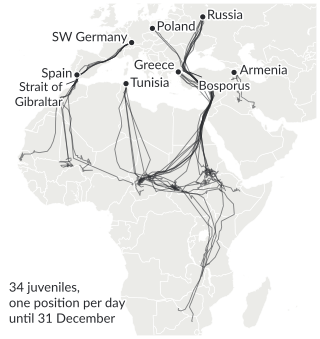{.nocap height="520px"}

## {.right grow="2"}

The juveniles of lecture 2 that **migrated** and were tracked **into the winter**: daily positions from departure to 31 December.

[Which typical routes do you see? How many?]{.ask}

Goal: a few **representative routes** that summarize all 34.

[Data: Flack et al. (2015), Movebank, CC0. Map: Natural Earth.]{.source}

::: notes
Allow about 2 minutes and collect suggestions; write the number k that the class proposes. Expected: a western flyway via Gibraltar (Spain, SW Germany), a central crossing of the Sahara from Tunisia, an eastern flyway via the Bosporus and the Levant that splits into the Sahel and East/southern Africa, and Armenia to the Middle East (eastern Turkey, Iraq, Iran). Of the 71 juveniles, 37 were tracked into December or January; 3 of these did not migrate (two from Uzbekistan, one from Armenia), so 34 routes remain. They are daily positions (closest fix to 12:00 UTC) from the day before departure until 31 December 2013, 32 to 152 positions per route; gaps occur when the tag sent no data.
:::

# Clustering in movement data

[2 · Research]{.step}

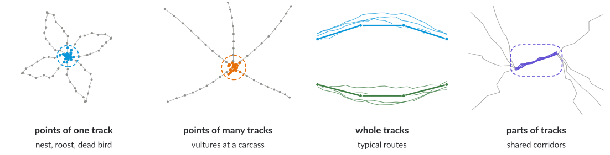{.nocap height="300px"}

**Points:** where positions accumulate, in any order. **Curves:** the order matters.

[Nests from revisits: Picardi et al. (2020). Carcasses from feeding vultures: Rast et al. (2024). Corridors: Buchin et al. (2011).]{.source}

::: notes
About 5 minutes. The first two rows are point clustering: order does not matter, only where positions accumulate. Andrea Kölzsch's MoveApps (guest talk tomorrow) have workflows for both: stationarity alerts for white storks (a stork that stops moving may have died, e.g., at a power line; one bird in Spain was found alive in a power plant and freed) and cluster alerts for vultures that rangers receive. Rast et al. (2024, Journal of Applied Ecology 61, 2936–2945) classify vulture behaviour from acceleration data, cluster the feeding positions with DBSCAN, and let a classifier decide which clusters contain a carcass; a ground team checked 1,900 clusters in Namibia, 580 with a carcass. Picardi et al. (2020, Movement Ecology) detect nests from repeated visits (R package nestR; wood storks, lesser kestrels, Mediterranean gulls).

The last two rows need curves: the order of positions matters. Whole tracks: today. Parts of tracks: subtrajectory clustering, which finds shared corridors even when routes start and end in different places (additional slide 29).
:::

# Quiz: points or curves?

[For which question do we need to cluster **curves** rather than points?]{.ask}

::: quiz
- [ ] Where did this stork build its nest?
    - Positions of one track that the bird visits again and again: a cluster of points.
- [ ] Where do vultures feed on carcasses?
    - Stationary feeding positions of many birds: points of many tracks.
- [x] Which flyways do the juveniles use?
    - A flyway is a route: the order of the positions matters, so we compare whole tracks.
- [ ] Where do the juveniles spend their first winter?
    - One position per bird, e.g. its median position in December and January: points.
:::

::: notes
About 2 minutes: 30 seconds to vote by phone or show of hands, then the explanations. The last option leads directly to the next slide, where the winter sites are the points for k-center.
:::

# $k$-center clustering {.columns}

[3 · Algorithms]{.step}

## {.left grow="1"}

## Definition {.info}

Objects $P$, distance $d$, number $k$: find **centres** $C$, $|C|=k$, minimizing the **radius**
$$r(C)=\max_{p\in P}\ \min_{c\in C}\ d(p,c).$$

NP-hard.

Other objectives: $k$-median (sum), $k$-means (sum of squares).

## {.right grow="1"}

{.nocap height="470px"}

::: notes
About 4 minutes. The centres may be any points of the space here (on the sphere: any position), unless we restrict them to input points. k-center guarantees something for every object: every object is within r of a centre. In the example, the objects are the first-winter sites: protect a few wintering regions such that every bird winters within r of one. The price: one unusual object can dominate the radius (we come back to this at the end). First winter = median position in December and January, as in lecture 2; for the three non-migrants this is near the nest. Distances: great-circle distances in km.
:::

# Gonzalez's algorithm {.columns}

## {.left grow="2"}

**Farthest first**

1. **Any** object: first centre
2. $k-1$ times: the object **farthest** from its nearest centre becomes a centre
3. Assign objects to the nearest centre

$O(kn)$ time

[Gonzalez (1985)]{.source}

## {.right grow="3"}

::: {.r-stack}
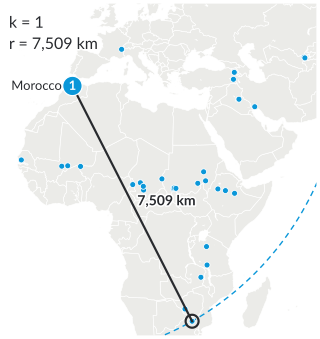{.nocap height="470px"}

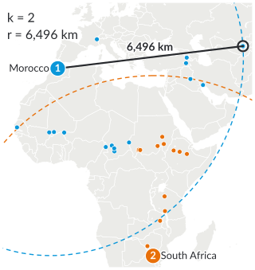{.fragment .nocap height="470px"}

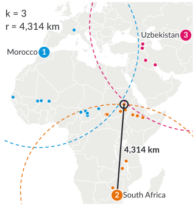{.fragment .nocap height="470px"}

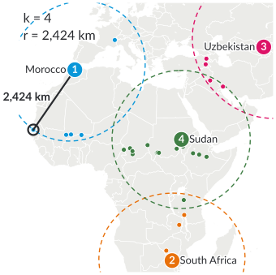{.fragment .nocap height="470px"}
:::

::: notes
About 6 minutes. Advance through the four steps (three clicks). Start: Karamell's winter site in Morocco. The black ring marks the farthest site, which becomes the next centre; the black line is its distance to the nearest centre, i.e. the current radius; the dashed circles have this radius. Sequence: Morocco (Karamell), South Africa (Pelopidas, 7,509 km away), Uzbekistan (Halim, a non-migrant, 6,496 km), Sudan (DER AR446, 4,314 km); with four centres the radius is 2,424 km, attained by Yolo's site in Senegal. Ask after step 2: which site comes next? Point out that Gonzalez picks extreme sites first. The algorithm needs only distances, which is why it will work for routes as well.
:::

# Your turn: Gonzalez by hand {.columns}

## {.left grow="1"}

{.nocap height="470px"}

## {.right grow="1"}

$k=3$, start at $a$, Euclidean distance.

1. Which points become the **second** and **third** centre?
2. What is the **radius**?

[Two minutes alone, one minute with your neighbour.]{.ask}

Done early? Is there a better choice of three centres?

::: notes
About 4 minutes including the vote on the next slide. Second centre: f (distance 9 from a). Third: h (8.06 from a, 8.60 from f; g is only 6.71 from a). Radius √5 ≈ 2.24, attained by c (to a) and d (to f). Centres anywhere: the groups {a, b, c} and {d, e, f} each fit into a circle of radius about 1.18, {g, h} into one of radius 0.71, so the optimum is about 1.18 and Gonzalez is a factor 1.9 off. With centres restricted to the eight points, 2.24 is optimal.
:::

# Quiz: the third centre

{.nocap height="230px"}

[Starting at $a$, which point does Gonzalez choose as the **third** centre?]{.ask}

::: quiz
- [ ] e
    - e is close to the second centre f (distance 1.41).
- [ ] g
    - g is 6.71 from a; h is farther from both a and f.
- [x] h
    - 8.06 from a and 8.60 from f: the largest distance to its nearest centre.
- [ ] c
    - c is only 2.24 from a.
:::

::: notes
Vote, then show the solution. The most likely mistake is g (closer to the centre of the picture) or e (farthest from a after f, if one forgets to update the distances).
:::

# Solution {.columns}

## {.left grow="1"}

{.nocap height="470px"}

## {.right grow="1"}

- Centres $a$, $f$, $h$
- Radius $\sqrt5\approx2.24$ ($c$ and $d$)
- Best centres anywhere: radius $\approx1.18$

Gonzalez is a factor **1.9** worse here. Can it be worse than a factor 2?

::: notes
Lead over to the guarantee: the answer is no.
:::

# Why a 2-approximation? {.columns}

## {.left grow="1"}

## Theorem (Gonzalez 1985) {.info}

Gonzalez's radius $r$ is at most $2r^*$ (optimal radius $r^*$).

**Proof.** $p_{k+1}$: farthest object after $k$ steps.

- $c_1,\dots,c_k,p_{k+1}$ are pairwise $\ge r$ apart
- Two lie in one optimal cluster
- Their distance is $\le 2r^*$

## {.right grow="1"}

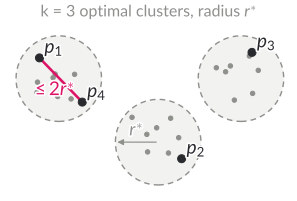{.nocap}

[Why pairwise $\ge r$? Where do we use the triangle inequality?]{.ask}

::: notes
About 5 minutes. The pigeonhole argument: k + 1 objects, k optimal clusters. Triangle inequality: d(p_i, p_j) ≤ d(p_i, c*) + d(c*, p_j) ≤ 2r*. Pairwise distance ≥ r: when c_j was chosen, its distance to the nearest earlier centre was the radius at that time, which is at least the final radius r; the same holds for p_{k+1}. Note that the algorithm never needs to know r*.
:::

# Can we do better?

- **Tight:** points $0,1,2$ on a line, $k=1$: starting at $0$ gives radius $2$, the optimum is $1$
- For general metric spaces, a $(2-\varepsilon)$-approximation in polynomial time would imply P = NP (Hsu and Nemhauser 1979)
- Even in the Euclidean plane, a factor below $1.82$ is NP-hard (Feder and Greene 1988)
- In practice often close to the best possible

::: notes
About 2 minutes. Hochbaum and Shmoys (1985) give another, also best-possible 2-approximation. Feder and Greene (1988) reduce from planar vertex cover.

Example for "in practice": on the winter sites with k = 4, Gonzalez gives 2,424 km; the best four centres among the sites (all 66,045 choices, a few seconds) give 2,302 km, only 5 % less. With centres anywhere on the sphere the optimum could be smaller, but it is at least 1,212 km (half the smallest distance among the five sites Gonzalez picks). Gonzalez picks extreme objects first, which prepares the discussion of outliers at the end.
:::

# From points to curves

Gonzalez needs only **distances** and the **triangle inequality**: use trajectories with the **discrete Fréchet distance**. Again a 2-approximation, but a centre is then **an input trajectory**, with every detour.

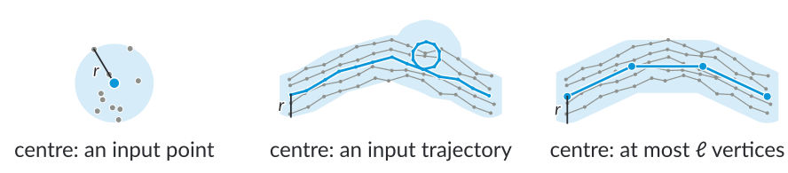{.nocap height="150px"}

## $(k,\ell)$-center clustering {.info}

Find $k$ curves $C$ with **at most $\ell$ vertices** each, minimizing $\max_{P}\min_{c\in C}\delta_{\mathrm{dF}}(P,c)$. NP-hard to approximate within $3-\varepsilon$, even for $k=1$ in the plane (Buchin et al. 2025).

##

- As centres: **simplifications** of the trajectories

::: notes
About 4 minutes. The picture: for points, everything within r of the centre is a disc; for curves, a band around the centre curve (only a sketch: the Fréchet distance also respects the order along the curves). An input trajectory as centre carries all its detours, e.g. a bird circling in its winter area; a centre with few vertices shows only the shape of the route. Ask briefly what a representative route should look like (a few vertices, no zig-zag in the winter area).

With ℓ unrestricted and k = 1, any input curve is a 2-approximation by the triangle inequality, but finding the optimal centre curve is NP-hard (additional slide 28). Lower bound: Buchin, Conradi, Deryckere, Hagedoorn and Rehs (EGC 2025) show that a (3 − ε)-approximation is NP-hard for any ε > 0, already for k = 1 and curves in the plane (also in higher dimensions), for the discrete and the continuous Fréchet distance. Before, the best lower bounds were about 2.598 (discrete) and 2.25 (continuous) (Buchin et al. 2019). Driemel, Krivošija and Sohler (2016) introduced (k, ℓ)-center and (k, ℓ)-median clustering for time series (one-dimensional curves).
:::

# Simplifying a curve {.columns}

## {.left grow="1"}

Best curve with **at most $\ell$ vertices** under the discrete Fréchet distance:

- Each of its vertices matches a **group of consecutive vertices** of the input
- Best vertex: centre of the group's **smallest enclosing circle**
- Error: the **largest radius**

Polynomial time (Bereg et al. 2008).

## {.right grow="1"}

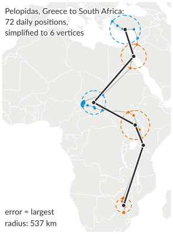{.nocap height="520px"}

::: notes
About 4 minutes. Why groups: in a coupling with a curve of ℓ ≤ n vertices, each vertex of the simplification is matched to a contiguous run of positions; we may assume the runs do not overlap. For a fixed group, the best vertex minimizes the largest distance to the group's positions: the centre of the smallest enclosing circle (on the sphere: spherical cap). Greedy test for a radius ε: extend each group as long as its smallest enclosing circle has radius ≤ ε; this needs the fewest groups. Then binary search for the smallest ε with at most ℓ groups. Pelopidas: 72 daily positions (gaps when the tag sent no data), error 537 km; the long group in the Sahel holds 43 positions from his stay there.
:::

# Gonzalez + simplification

1. Any input curve $p_1$; centre $q_1$ = its best simplification
2. Repeat: $p_i$ = curve **farthest** from its nearest centre curve; $q_i$ = its simplification
3. Assign curves to the nearest centre curve

## Theorem (Buchin et al. 2019) {.info}

Discrete Fréchet, any dimension: **3-approximation**, $O(kn\cdot\ell m\log(\ell+m))$ time ($n$ curves, $m$ vertices each).

Best possible in the plane: $3-\varepsilon$ is NP-hard (Buchin et al. 2025).

::: notes
About 2 minutes. The algorithm is Gonzalez's with one change: the centres are simplifications, not input curves. The running time is dominated by k n Fréchet distance computations between an input curve (m vertices) and a centre (ℓ vertices), plus the simplifications.

Lower bound (Buchin, Conradi, Deryckere, Hagedoorn and Rehs, EGC 2025): (3 − ε) is NP-hard already for k = 1, for curves in the plane and in higher dimensions. So the 3-approximation is best possible for the discrete Fréchet distance in any dimension d ≥ 2 and for the continuous Fréchet distance in the plane.
:::

# Why a 3-approximation? {.columns}

## {.left grow="3"}

**Proof.** $p_{k+1}$: farthest curve after $k$ steps, at distance $r$ from its nearest centre curve.

- $\delta(p_i,q_i)\le r^*$: optimal centres have $\le\ell$ vertices
- $\delta(p_j,q_i)\ge r$ for $i<j\le k+1$
- Two of $p_1,\dots,p_{k+1}$ share an optimal cluster: $\delta(p_i,p_j)\le2r^*$
- So $r\le\delta(p_j,q_i)\le\delta(p_j,p_i)+\delta(p_i,q_i)\le3r^*$

## {.right grow="2"}

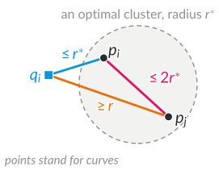{.nocap height="330px"}

[What if each $q_i$ is only within $\alpha r^*$ of $p_i$?]{.ask}

::: notes
About 4 minutes. The structure is the proof of slide 14 with one extra step: the centres q_i are not input curves, so the triangle inequality costs one r* more. In the picture, points stand for curves; each segment is one of the three inequalities. Why δ(p_j, q_i) ≥ r: when p_j was chosen, its distance to the nearest of the centres q_1, …, q_{j−1} was the radius at that time, and the radius only decreases; p_{k+1} is the curve farthest from all k centres, at distance exactly r.

Answer to the question: if the simplification error is at most α r*, the factor is 2 + α. For the continuous Fréchet distance, an optimal simplification is harder to compute; with a 4-approximate simplification the factor becomes 6, and in the plane a more careful argument gives 3 (Buchin et al. 2019).
:::

# Typical routes of the young storks {.columns}

## {.left grow="3"}

::: {.r-stack}
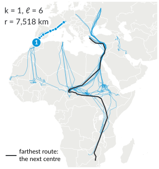{.nocap height="520px"}

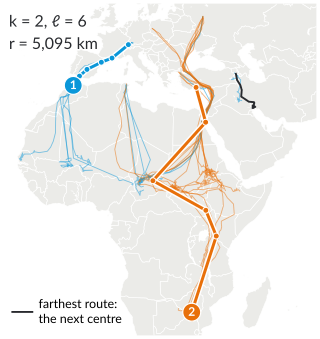{.fragment .nocap height="520px"}

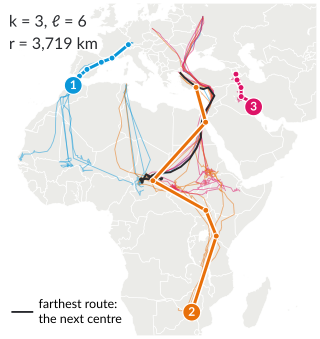{.fragment .nocap height="520px"}

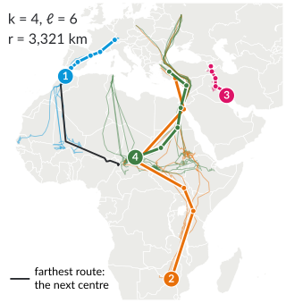{.fragment .nocap height="520px"}

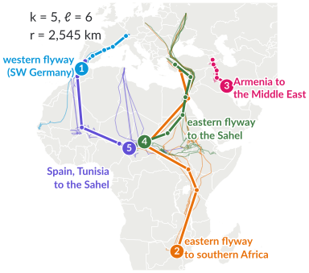{.fragment .nocap height="520px"}
:::

## {.right grow="2"}

$k=5$, $\ell=6$, start at Karamell:

1. Karamell (SW Germany)
2. Pelopidas (Greece)
3. BraveHeart (Armenia)
4. Silvia (Greece)
5. C708 (Spain)

Radius: 7,518 → 5,095 → 3,719 → 3,321 → **2,545 km**

[Data: Flack et al. (2015), Movebank, CC0.]{.source}

::: notes
About 4 minutes; four clicks. Black: the farthest route, which provides the next centre. The clusters: SW Germany to France, Morocco and West Africa, five of them via Gibraltar (6 routes); Greece, Russia and Poland to East and southern Africa (5); Armenia to eastern Turkey, Iraq and Iran (4); Greece, Russia and Poland to the Sahel and Ethiopia (10); Spain, Tunisia and Coco from SW Germany to the Sahel (9). The algorithm was told nothing about populations or flyways. With the input routes themselves as centres (no simplification), Gonzalez finds similar groups with radius 2,445 km for k = 5. Computing everything takes about half a minute in Python (tools/make_clustering_figures.py).
:::

# How good, and which $k$? {.columns}

## {.left grow="1"}

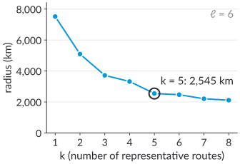{.nocap}

## {.right grow="1"}

- **Lower bound:** two of the 6 chosen routes share an optimal cluster, so $r^*\ge$ half their distance $\ge$ 1,133 km
- So 2,545 km is within a factor **2.25** of the optimum on these data
- $\ell=4,6,8$: 2,621, 2,545, 2,470 km

[Which $k$ would you choose, and why?]{.ask}

::: notes
About 3 minutes. The lower bound is the proof idea applied to the data: the six routes Karamell, Pelopidas, BraveHeart, Silvia, C708 and DER AR444 (the farthest after five steps) have pairwise discrete Fréchet distances of at least 2,266 km. Another lower bound is the largest optimal simplification error of any route (693 km for ℓ = 6), weaker here. Choice of k: after k = 5 the radius decreases only slowly; the remaining large distances come from differences in origin and destination within the clusters, not from new flyways. There is no single correct k; it depends on the question.
:::

# Other ways to cluster time series

::: tablefit
| Approach | Representative | Example |
|---|---|---|
| centre-based, simple centres | curve with $\le\ell$ vertices | $(k,\ell)$-center or median, Fréchet or CDTW |
| partitional with medoids | an input series | $k$-medoids with DTW |
| partitional with averages | an average series | $k$-means with **DBA** (DTW barycenter averaging) |
| hierarchical | a tree of merges | single or complete linkage on pairwise distances |
| density-based | dense regions | DBSCAN (vultures), subtrajectory clusters |
| feature- or model-based | features, models | speed and distance with $k$-means; mixtures of HMMs |
:::

Overviews: Liao (2005), Kotsakos et al. (2014), Aghabozorgi et al. (2015).

::: notes
About 3 minutes. The rows differ in what a cluster representative is and in what is compared. Both reviews are widely cited standard references; the chapter of Kotsakos, Trajcevski, Gunopulos and Aggarwal (in Aggarwal and Reddy's book Data Clustering) is a shorter textbook introduction. A whole book from a statistical point of view: Maharaj, D'Urso and Caiado (2019), Time Series Clustering and Classification. DBA (Petitjean et al. 2011): start from one series; align every series to the current average with DTW; replace each element of the average by the mean of the elements aligned to it; repeat. It is a heuristic: finding an optimal average (1-median) is NP-hard, also under DTW (Buchin, Driemel and Struijs 2020). For trajectories, DTW averages keep one vertex per element of the initial series; (k, ℓ)-medians under continuous DTW limit the complexity (Brankovic et al. 2020, our work). Details on additional slide 26. Feature-based methods compare summaries (e.g., distance flown, duration); model-based methods fit, e.g., hidden Markov models, which we meet next week for segmentation.
:::

# Back to the storks {.columns}

[4 · Practice]{.step}

## {.left grow="2"}

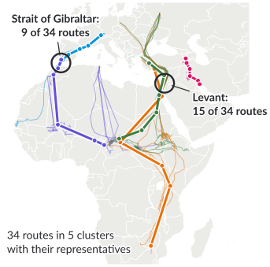{.nocap height="460px"}

## {.right grow="3"}

- **Which routes?** Five typical routes summarize 34 migrations
- **Where to protect?** Where clusters meet: bird-safe power poles there help many birds
- **Limits:** whole routes mix origin and destination; for corridors, cluster **parts**

## Clustering summarizes data {.info}

Protection also needs mortality, habitat and threat data.

::: notes
About 3 minutes. Return to the question of slide 5: which routes, and where do the storks need protection?

The picture: the representative routes of slide 20 and the routes of each cluster. Counted are routes that pass within 100 km (the same for 150 and 200 km): 9 of 34 pass the Strait of Gibraltar (5 of the 6 routes of the western flyway, and the 3 Spanish birds and Coco of the Spain–Tunisia cluster), 15 of 34 pass the Levant (all routes of both eastern clusters: Greece, Poland, Russia). Bottlenecks were visible in the raw data (slide 6); the clusters add which groups of birds share them. Electrocution at power poles is the largest human-induced cause of death (slide 5); making poles safe for birds (insulation, different pole designs) helps most where many birds pass.

Limits: the clusters group whole first migrations; birds from Spain and Tunisia end up together because they end in the Sahel, birds from Greece are split by destination. Corridors shared by routes with different origins and destinations: subtrajectory clustering (additional slide 29). Extreme routes come first; k-center with outliers ignores a given number of objects (additional slide 27). The data come from one year and juveniles only; adults use partly different routes and wintering areas.
:::

# Next steps

- **Wednesday, 28 October**, 10:15, OH12 3.032: guest talk by **Andrea Kölzsch** (MoveApps) in the tutorial
- **From 3 November:** tutorials on Tuesdays, 14:15–15:45, OH14 E02
- **Tuesday, 3 November:** segmentation: when does an animal migrate, rest or forage?
- Project idea: a **MoveApp** that finds typical routes or shared corridors (or does other interesting computations on tracking data)

::: notes
Closing sentence: clustering turns many tracks into a few representative routes; which representative makes sense depends on the question, and the guarantees depend on properties such as the triangle inequality. Mention that MoveApps so far mostly cluster points (nests, stopovers, carcasses); route clustering would be a new App, and other algorithms from this course could become Apps as well.
:::

# Additional material {.section}

For self-study and the tutorial

# DBA: averaging under DTW

**DTW barycenter averaging** (Petitjean et al. 2011):

1. Start with one series $A$ as the average
2. Align every series to $A$ with DTW
3. Replace each element of $A$ by the mean of all elements aligned to it
4. Repeat until $A$ no longer changes

- A heuristic that may stop in a local optimum
- An optimal average (1-median) is NP-hard, also under DTW (Buchin, Driemel and Struijs 2020)
- $k$-means with DBA: assign, then recompute the averages

::: notes
The average keeps the length of the initial series, so the complexity is not limited as in (k, ℓ)-clustering; Brankovic et al. (2020) combine a limited complexity with continuous DTW ((k, ℓ)-medians). In the step "mean of all elements aligned to it", one element of A can be aligned to several elements of a series and vice versa.
:::

# $k$-center with outliers

One GPS error far away from all other positions becomes a centre in Gonzalez's algorithm.

## $k$-center with $z$ outliers {.info}

Find $k$ centres that minimize the radius when the $z$ farthest objects may be ignored.

- 3-approximation (Charikar et al. 2001)
- In practice: clean the data first (lecture 2 and next week: segmentation)

::: notes
Charikar, Khuller, Mount and Narasimhan (2001) introduced facility location problems with outliers and gave a 3-approximation for k-center with outliers. The choice of z is a modelling decision, like the choice of k.
:::

# Why is $(k,\ell)$-center hard?

- With $k=1$ and $\ell$ unrestricted, any input curve is a 2-approximation: $\delta(P,Q)\le\delta(P,c^*)+\delta(c^*,Q)\le2r^*$
- Computing the optimal centre is nevertheless NP-hard
- Idea of a reduction: from the **shortest common supersequence** of strings over $\{A,B\}$; encode each string as a curve so that a centre curve corresponds to a common supersequence

[Buchin et al. (2019), Section 3]{.source}

::: notes
Example of a shortest common supersequence: ABB, BAAA and ABA have the common supersequence ABBAAA. Last year's slides contain the construction in detail.
:::

# Shared corridors: subtrajectory clusters

A **subtrajectory cluster** $C(m,\ell,d)$: at least $m$ parts of the trajectories that overlap in at most a point, one of them of length at least $\ell$, with pairwise Fréchet distance at most $d$.

- Deciding whether a cluster exists is NP-hard (reduction from maximum clique)
- A 2-approximation in $d$: use one part as reference curve; sweep over the free-space diagram

[Buchin, Buchin, Gudmundsson, Löffler and Luo (2011)]{.source}

::: notes
Application: detect commuting routes or corridors, also for map construction from GPS tracks. For the storks: corridors such as the flyway through the Levant are shared by routes from Russia, Poland and Greece with different destinations.
:::

# Check your understanding

1. Find an input where Gonzalez's first centre changes the clusters.
2. Why does the 2-approximation proof fail for DTW?
3. Where does the 3-approximation proof use an **optimal** simplification?
4. Why allow $k\ell$ vertices in total instead of $\ell$ per centre?

## Possible answers {.fragment .info}

1\. Points $0,4,5,9$, $k=2$: start at 0 gives $\{0,4\},\{5,9\}$, start at 4 gives $\{0,4,5\},\{9\}$. 2. No triangle inequality. 3. $\delta(p_i,q_i)\le r^*$. 4. Simple clusters need few vertices.

::: notes
Question 4 was raised in last year's lecture: with a common budget, straight clusters need few vertices and curved ones get more.
:::

# References: movement and conservation

::: refs
- Flack, A., Fiedler, W., Blas, J., et al. (2016). Costs of migratory decisions: A comparison across eight white stork populations. *Science Advances* 2(1), e1500931. <https://doi.org/10.1126/sciadv.1500931>
- Flack, A., Fiedler, W., Blas, J., et al. (2015). Data from: Costs of migratory decisions: a comparison across eight white stork populations. Movebank Data Repository, CC0. <https://doi.org/10.5441/001/1.78152p3q>
- Kölzsch, A., Davidson, S. C., Gauggel, D., et al. (2022). MoveApps: a serverless no-code analysis platform for animal tracking data. *Movement Ecology* 10, 30. <https://doi.org/10.1186/s40462-022-00327-4>
- Picardi, S., Smith, B. J., Boone, M. E., et al. (2020). Analysis of movement recursions to detect reproductive events and estimate their fate in central place foragers. *Movement Ecology* 8, 24. <https://doi.org/10.1186/s40462-020-00201-1>
- Rast, W., Portas, R., Shatumbu, G. I., et al. (2024). Death detector: Using vultures as sentinels to detect carcasses by combining bio-logging and machine learning. *Journal of Applied Ecology* 61, 2936–2945. <https://doi.org/10.1111/1365-2664.14810>
- Serratosa, J., Oppel, S., Santangeli, A., et al. (2024). Tracking data highlight the importance of human-induced mortality for large migratory birds at a flyway scale. *Biological Conservation* 293, 110525. <https://doi.org/10.1016/j.biocon.2024.110525>
:::

# References: clustering

::: refs
- Bereg, S., Jiang, M., Wang, W., Yang, B., Zhu, B. (2008). Simplifying 3D polygonal chains under the discrete Fréchet distance. *LATIN 2008*, LNCS 4957, 630–641.
- Buchin, K., Buchin, M., Gudmundsson, J., Löffler, M., Luo, J. (2011). Detecting commuting patterns by clustering subtrajectories. *International Journal of Computational Geometry & Applications* 21(3), 253–282.
- Buchin, K., Driemel, A., Gudmundsson, J., Horton, M., Kostitsyna, I., Löffler, M., Struijs, M. (2019). Approximating (k, ℓ)-center clustering for curves. *SODA 2019*, 2922–2938. <https://arxiv.org/abs/1805.01547>
- Buchin, K., Conradi, J., Deryckere, L., Hagedoorn, M., Rehs, C. (2025). Tight lower bound for approximating (k, ℓ)-center clustering under the Fréchet distance. *XXI Spanish Meeting on Computational Geometry (EGC 2025)*, Santander. <https://egc2025.unican.es/wp-content/uploads/2025/06/paper_20.pdf>
- Charikar, M., Khuller, S., Mount, D. M., Narasimhan, G. (2001). Algorithms for facility location problems with outliers. *SODA 2001*, 642–651.
- Driemel, A., Krivošija, A., Sohler, C. (2016). Clustering time series under the Fréchet distance. *SODA 2016*, 766–785.
- Feder, T., Greene, D. (1988). Optimal algorithms for approximate clustering. *STOC 1988*, 434–444.
- Gonzalez, T. F. (1985). Clustering to minimize the maximum intercluster distance. *Theoretical Computer Science* 38, 293–306.
- Hochbaum, D. S., Shmoys, D. B. (1985). A best possible heuristic for the k-center problem. *Mathematics of Operations Research* 10(2), 180–184.
- Hsu, W.-L., Nemhauser, G. L. (1979). Easy and hard bottleneck location problems. *Discrete Applied Mathematics* 1, 209–216.
:::

# References: time series

::: refs
- Aghabozorgi, S., Shirkhorshidi, A. S., Wah, T. Y. (2015). Time-series clustering – A decade review. *Information Systems* 53, 16–38.
- Brankovic, M., Buchin, K., Klaren, K., Nusser, A., Popov, A., Wong, S. (2020). (k, l)-medians clustering of trajectories using continuous dynamic time warping. *SIGSPATIAL 2020*, 99–110. <https://arxiv.org/abs/2012.00464>
- Buchin, K., Driemel, A., Struijs, M. (2020). On the hardness of computing an average curve. *SWAT 2020*, LIPIcs 162, 19:1–19:19. <https://doi.org/10.4230/LIPIcs.SWAT.2020.19>
- Kotsakos, D., Trajcevski, G., Gunopulos, D., Aggarwal, C. C. (2014). Time-series data clustering. In C. C. Aggarwal, C. K. Reddy (eds.), *Data Clustering: Algorithms and Applications*, Chapter 15. Chapman & Hall/CRC.
- Liao, T. W. (2005). Clustering of time series data – a survey. *Pattern Recognition* 38(11), 1857–1874.
- Maharaj, E. A., D'Urso, P., Caiado, J. (2019). *Time Series Clustering and Classification*. Chapman & Hall/CRC.
- Petitjean, F., Ketterlin, A., Gançarski, P. (2011). A global averaging method for dynamic time warping, with applications to clustering. *Pattern Recognition* 44(3), 678–693.
:::

# License and credits

::: refs
- Slides © 2026 Kevin Buchin, TU Dortmund University, licensed under **CC BY 4.0** (<https://creativecommons.org/licenses/by/4.0/>). Suggested attribution: "Kevin Buchin, Algorithms and Sustainability, TU Dortmund University, CC BY 4.0", with a link to the course page.
- Not covered by this license: the TU Dortmund logo and the Decker software and its themes (own licenses).
- Unless credited otherwise, figures: own work, CC BY 4.0, made with `tools/make_clustering_figures.py`. The stork figures are based on data from Flack et al. (2015), Movebank Data Repository, CC0; maps made with Natural Earth (public domain).
- The schematics (four kinds of clustering, from points to curves, why 3) and the exercise use constructed data, not measurements.
- Made with Decker: <https://github.com/decker-edu/decker>
:::
