# Plan for today

1. Recap: typical routes
2. Why are geese slow in spring? Segmenting time series
3. Criteria: greedy and dynamic programming
4. Change points: trends in global temperature
5. Hidden Markov models: Viterbi and the forward algorithm
6. New Year's Eve, an outlook, and back to the geese

::: notes
Timing (90 min, main part slides 2–33): 10:15 plan and recap (slides 2–3, about 3 min) · 10:18 the geese, one goose, the manual rule (slides 5–7, about 10 min) · 10:28 segmenting time series (slide 8, about 4 min) · 10:32 problem, exercise, greedy, why it works, quiz, increasing monotone, greedy fails, start-stop diagram, dynamic program, faster with range minima (slides 9–18, about 29 min) · 11:01 the goose segmented (slide 19, about 3 min) · 11:04 change points: optimal partitioning and global temperature (slides 20–21, about 7 min) · 11:11 hidden Markov models: the model, the four states of the goose, hour by hour (slides 22–24, about 7 min) · 11:18 Viterbi exercise, solved hour by hour, and the recurrence (slides 25–26, about 8 min) · 11:26 forward algorithm (slide 27, about 1 min) · 11:27 fitting (slide 28, about 3 min) · 11:30 New Year's Eve (slide 29, about 3 min) · 11:33 outlook: state-space models (slide 30, about 2 min) · 11:35 comparison, back to the geese, next steps (slides 31–33, about 5 min) · about 5 min buffer. At the start, say that the lecture is recorded.

If time runs short: slide 13 (quiz) by show of hands in one minute; slide 18 in one minute; slide 19 in two sentences; slide 30 in one sentence. If time is left: the pause and the surge (slide 38), the Kalman filter (slide 40), stable criteria (slide 36) or the questions on slide 42.

Slides 35–41 are additional material for self-study and the tutorial. Voting: the quiz on slide 13 supports phone voting (QR code and poll buttons in presenter mode), otherwise show of hands. The tutorial this afternoon (14:15, OH14 E02) is the first in the new room.
:::

# Recap: typical routes {.columns}

## {.left grow="1"}

- **$k$-center:** Gonzalez picks the farthest object next; factor 2
- **Routes:** discrete Fréchet distance and centres with $\le\ell$ vertices; factor 3
- 34 stork routes, 5 typical routes

[Which property of the Fréchet distance did both guarantees use?]{.ask}

## {.right grow="1"}

Last week: compare and group **whole routes**.

Today: look **inside one track**. When does a goose fly, and when does it stop?

::: notes
About 2 minutes. Answer: the triangle inequality (slides 14 and 19 of lecture 3). Then switch the perspective: last week a route was one object; today we split one track into phases. The running example is a goose, and later in the lecture a time series that has nothing to do with animals.
:::

# Block 1 · Computational Movement Analysis {.section}

Week 4 · today: from routes to phases

# The question {.columns}

## {.left grow="1"}

[1 · Question]{.step}

{.nocap height="170px"}

::: bigquestion
Why do geese need **twice as long** in spring?
:::

[Mostly time at **stopovers** (Kölzsch et al. 2016, 65 geese with GPS)]{.fragment}

## {.right grow="1"}

{.nocap height="440px"}

[Photo: Frank Schulenburg, Wikimedia Commons, CC BY-SA 4.0. Tracks: Kölzsch et al. (2016), Movebank, CC0.]{.source}

::: notes
About 4 minutes. Ask first: why could spring migration take longer? Collect two or three answers (weather, snow, food, waiting), then show the answer (one click).

Kölzsch et al. (2016, Oikos 125, 1496–1507): 65 greater white-fronted geese, tagged in the Netherlands and on Kolguev Island, tracked between western Europe and the Russian Arctic. Spring migration took 83 days on average, autumn migration 42 days, "mainly determined by time spent at stopovers" (abstract). In spring the geese spread out and stop at many sites to refuel: they need to arrive at the breeding grounds with energy stores. In autumn they fuel up near the breeding grounds and wait for good winds; flight speeds are similar in both seasons. This contradicts the textbook expectation that birds hurry in spring.

Why this matters for conservation: the spring stopovers are where the geese refuel for breeding. The paper points to food availability during spring migration, to changes in agricultural land use in Russia (fields left uncultivated, grass too long for foraging) and to hunting pressure. To study this, we need to know where and how long each goose stops: segmentation. Photo: a greater white-fronted goose in California (same species, other population). The map shows all GPS tracks of the data set (Movebank Data Repository, doi:10.5441/001/1.31c2v92f, CC0; 79,234 fixes of 65 geese).
:::

# One goose, spring 2014

::: {.r-stack}
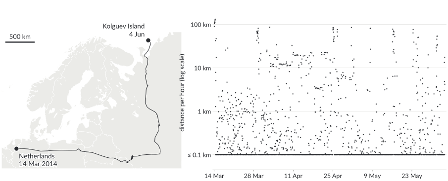{.nocap height="410px"}

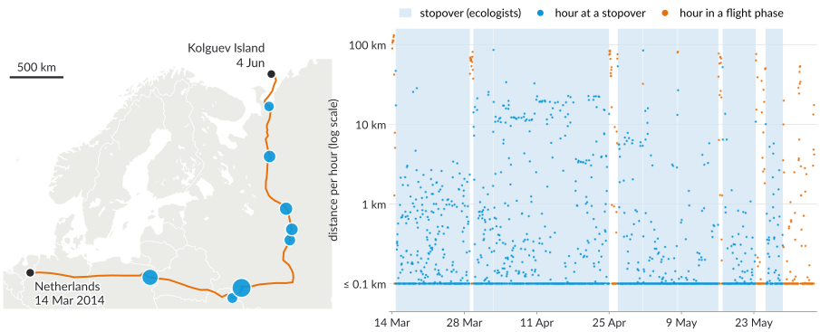{.fragment .nocap height="410px"}
:::

Goose 3104: 82 days, 2,923 km in a straight line, one position per hour. [Where would you cut?]{.ask} [Ecologists: **8 stopovers**, 70 of 82 days.]{.fragment}

[Data: Kölzsch et al. (2016), Movebank, CC0; every GPS fix carries the ecologists' label. Map: Natural Earth.]{.source}

::: notes
About 4 minutes. One of the 2014 geese: 3,922 GPS fixes every 30 minutes from 14 March (Netherlands) to 4 June (Kolguev Island, Russian Arctic), 2,923 km in a straight line. For the lecture: one position per hour (the fix nearest to the full hour), 1,960 positions. The plot shows the distance between consecutive hourly positions on a log scale; 60% of the hours are at or below 0.1 km (GPS noise; the goose sits). Ask the class where they would cut: the bursts of 30 to 130 km per hour are migration flights; between them, the goose stays in an area but still moves (bands around 10–20 km per hour: daily flights between roost and fields).

Two clicks: the ecologists' labels, then the numbers. Eight stopovers: north-eastern Poland 14 days, Ukraine 4 days, Russia 22 days (near Kursk), then five more in Russia (5, 7, 8, 6 and 3 days); 85% of the time. The last six days, from 29 May, are labelled flight, although the goose mostly sits (orange dots at the floor): conventions at the end of a migration. The fastest hour: 131 km (night of 14/15 March, the first flight: 1,102 km in 16.5 hours).
:::

# How were the stopovers found?

> Stopovers: sites where a bird "did not displace further than 30 km for at least 48 h", "manually extracted" [(Kölzsch et al. 2016)]{.source}

A **precise rule**, applied **by hand**. An algorithm would be fast, consistent and **reproducible**.

[Can an algorithm cut a track into stopovers and flights?]{.ask}

## Criteria for geese {.info}

::: columns-1-1
::: col
**Stopover:** within a disk of radius 30 km for at least 48 h

**Flight:** at least 80% of the headings within an arc of 1.7 rad (97°) [Alewijnse et al. (2014)]{.source}
:::
::: col
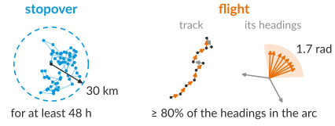{.nocap height="190px"}
:::
:::

::: notes
About 2 minutes. The rule in the Oikos paper also allowed "maximally one detour", i.e., one excursion out of the disk; tolerating a few outliers makes a criterion neither decreasing nor increasing monotone (slides 13–15). The stopover criterion (30 km, 48 h) is the ecologists' rule; for flights, M. Buchin, Kruckenberg and Kölzsch (2013) bounded the change in heading (120°), Alewijnse et al. (2014) used an angular range of 1.7 rad with 20% outliers, the version on the slide. 1.7 rad ≈ 97°.
:::

# Segmenting time series

[2 · Research]{.step}

**Segmentation:** split a time series into consecutive **segments** of homogeneous behaviour; **classification:** label them with **states**.

::: tablefit
| We specify | Solved by | Used for |
|---|---|---|
| **criteria**: what a valid segment is | greedy,\ dynamic\ programming | bird\ stopovers;\ stays\ and\ trips\ of\ people |
| **change points**: a model and a penalty per segment | dynamic\ programming | animal\ behaviour,\ climate,\ sensor\ data |
| **hidden states**: a probabilistic model | dynamic\ programming\ (Viterbi) | animal\ behaviour,\ speech,\ genomes |
:::

**Who defines the states?** Criteria: **experts**, from what they know about the animal. Change points and hidden states: the **data**; experts interpret the result afterwards.

[Edelhoff et al. (2016), Gurarie et al. (2009, 2016), Truong et al. (2020)]{.source}

::: notes
About 4 minutes. A trajectory is a time series of positions (lecture 2), and segmentation is a general task for time series. The three rows are today's three parts, and all three are solved by dynamic programming: the recurrence S(j) over the start-stop diagram (slide 17), the same recurrence with a cost and a penalty per segment (slide 20), and Viterbi over the states (slide 25).

The last line is the trade-off. Criteria encode the experts' knowledge, and their assumptions, about the behaviour: what a stopover is (30 km, 48 h). The result is directly interpretable and answers the ecologists' question, but it is only as good as the definition, and thresholds transfer poorly to other species or sampling rates. Change points only assume what "homogeneous" means (a model per segment) and a penalty; the data decide where the changes are, and experts still have to say what the segments mean. A hidden Markov model assumes a statistical structure (number of states, a distribution per state, a Markov chain), but the data decide what the states look like and how often they switch; experts interpret them afterwards (is state 3 of the goose "local flights"?), and in return we get probabilities and switching rates. So: knowledge-driven and directly interpretable, or data-driven and flexible. Gurarie (course material) contrasts synthesizing approaches such as BCPA, with few assumptions about the movement but little explanation, and full process models, which assume more and explain more.

Change points are standard in movement ecology too: behavioural change point analysis (BCPA, Gurarie, Andrews and Laidre 2009) moves a window along the track and looks for changes in the mean, variance and autocorrelation of the velocity; segclust2d (Patin et al. 2020) cuts tracks into stationary phases and groups similar segments. Elsewhere: climate records (slide 21), sensor data, finance. Hidden Markov models are standard in speech recognition, bioinformatics (gene finding) and, by now, animal movement. PELT (a faster exact variant of the change point recurrence) and the forward algorithm (the likelihood of an HMM, needed for fitting) come later (slides 37 and 27).

Edelhoff, Signer and Balkenhol (2016, Movement Ecology 4:21) structure path segmentation by research question: description of patterns, detection of change points, identification of hidden states. Gurarie et al. (2016, Journal of Animal Ecology 85, 69–84; "What is the animal doing?") review and compare such methods, including their assumptions and how interpretable their output is. Truong, Oudre and Vayatis (2020) review change point methods.
:::

# Criteria-based segmentation

[3 · Algorithms]{.step}

## Problem (Buchin et al. 2011) {.info}

Positions $p_0,\dots,p_n$ and a **criterion** for segments. Find break points ${0=b_0<b_1<\dots<b_k=n}$, as **few** as possible, such that every segment $p_{b_{i-1}},\dots,p_{b_i}$ satisfies the criterion.

**Criteria** from attributes, combined with AND / OR:

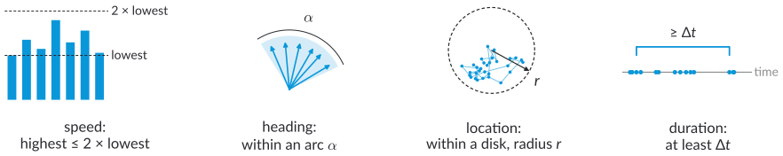{.nocap height="170px"}

Stopover = disk AND duration; valid segment = stopover OR flight.

::: notes
About 2 minutes. Consecutive segments share the break point. This is the discrete version: break points at data points. Buchin, Driemel, van Kreveld and Sacristán (2011, Journal of Spatial Information Science 3, 33–63) mainly study break points anywhere on the trajectory (continuous segmentation). The objective "fewest segments" is a modelling choice: it prefers long phases; we will see its effect on slide 19.
:::

# Your turn: cut the speeds

::: {.r-stack}
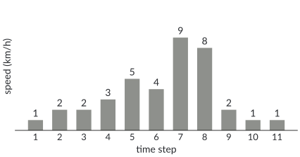{.nocap height="340px"}

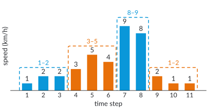{.fragment .nocap height="340px"}
:::

Cut into **as few segments as possible** such that in each segment the highest speed is **at most twice** the lowest.

[Two minutes with your neighbour. How many segments? Can you prove that fewer are impossible?]{.ask}

::: notes
About 5 minutes; one click for the solution. Greedy: extend the segment as long as the criterion holds: [1, 2, 2] (3 > 2·1), [3, 5, 4] (9 > 2·3), [9, 8] (2 is too small), [2, 1, 1]: four segments. Why not fewer: steps 1 and 4 cannot share a segment (3 > 2·1), nor steps 4 and 7 (9 > 2·3), nor steps 7 and 9 (9 > 2·2); since segments are intervals, steps 1, 4, 7 and 9 lie in four different segments. Ask how they found their solution: most will have worked from left to right, i.e. greedily.

Convention: step $t$ is the move from $p_{t-1}$ to $p_t$; steps $i..j$ form the segment $p_{i-1},\dots,p_j$. Slide 9 counts positions with shared break points, the examples count steps; both describe the same segmentations.
:::

# Why greedy works {.columns}

## {.left grow="1"}

**Greedy:** make the current segment as long as possible (the longest valid one), then start a new one.

## Decreasing monotone {.info}

If a segment satisfies the criterion, so does every **subsegment**.

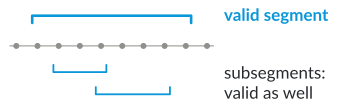{.nocap}

Examples: speed ratio, heading arc, disk.

## {.right grow="1"}

## Theorem (Buchin et al. 2011) {.info}

For decreasing monotone criteria, greedy finds a segmentation with the **fewest** segments.

Proof: greedy **stays ahead** (next slide).

Time: $O(n)$ for constant-time updates (speed, heading); $O(n\log n)$ for the disk.

::: notes
About 3 minutes. Decreasing monotone: shrinking a valid segment keeps it valid. The examples: a subsegment has a smaller range of speeds, its headings fit into the same arc, its positions into the same disk. Combinations: AND and OR of decreasing monotone criteria are again decreasing monotone.

Running times (Buchin et al. 2011): with a test that can be updated in constant time when a point is added (range of speeds, arc of headings via the extreme values), greedy takes O(n). For the disk criterion an update is not constant; with exponential search followed by binary search (double-and-search) and a smallest-enclosing-disk computation as test, O(n log n) (their Theorem 9; additional slide 35).
:::

# Greedy stays ahead

{.nocap height="355px"}

After $k$ segments, greedy is at least as far as any valid segmentation: $g_k\ge o_k$.

If $g_k\ge o_k$, the other segmentation's next segment, cut at $g_k$, is still valid (decreasing monotone). So greedy gets at least as far, $g_{k+1}\ge o_{k+1}$, and needs the fewest segments.

::: notes
About 3 minutes. The speeds of slide 10: greedy's four segments end at steps 3, 6, 8 and 11; another valid segmentation, [1, 2], [2, 3], [5, 4], [9, 8], [2, 1, 1], needs five and ends at 2, 4, 6, 8, 11. Claim: g_k ≥ o_k for every k, by induction. k = 1: greedy takes the longest valid first segment. Step: if g_k ≥ o_k, the other segmentation's (k+1)-th segment runs from o_k to o_{k+1}; the part after g_k is a subsegment, hence valid, so greedy's (k+1)-th segment reaches at least o_{k+1} (if g_k ≥ o_{k+1} already, there is nothing to show). Hence greedy reaches the end after at most as many segments as any valid segmentation, in particular an optimal one. Where the proof breaks: if subsegments can become invalid, as with "at least 48 h", the cut segment may be too short (slides 13–15; question 1 on slide 42).
:::

# Quiz: which criterion breaks the proof?

[Which criterion is **not** decreasing monotone?]{.ask}

::: quiz
- [ ] The highest speed is at most twice the lowest
    - A subsegment has a smaller range of speeds: still valid.
- [ ] All positions lie within a disk of radius 30 km
    - The same disk contains the positions of every subsegment.
- [x] The segment lasts at least 48 h
    - A subsegment can be shorter: increasing monotone (every supersegment stays valid).
- [ ] All headings lie within an arc of 1.7 rad
    - The headings of a subsegment fit into the same arc.
:::

::: notes
About 2 minutes: 30 seconds to vote by phone or show of hands, then the explanations. Minimum duration is increasing monotone. The stopover criterion combines a decreasing (disk) and an increasing (duration) criterion and is neither: this is what the next two slides are about. The criterion "at least 80% of the headings within an arc" is also neither.
:::

# Increasing monotone

If a segment satisfies the criterion, so does every **supersegment**.

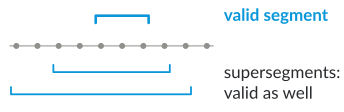{.nocap height="170px"}

- Examples: duration at least $\Delta t$; at least 2 steps
- Alone it is easy: if any segment is valid, the whole track is one valid segment
- Stopover = disk (**decreasing**) AND duration (**increasing**): neither

::: notes
About 2 minutes. The quiz answer: a minimum duration is increasing monotone; every supersegment of a valid segment is valid. On its own such a criterion is easy: if any segment is valid, so is the whole track, which is then the best segmentation. The difficulty is the combination: a stopover is a disk (decreasing) AND a duration (increasing), so a subsegment can be too short and a supersegment can leave the disk. The heading criterion with 20% outliers is also neither: adding headings can make an invalid segment valid again, and a part of a valid segment can consist mostly of outliers.
:::

# Increasing + decreasing monotone: greedy fails {.columns}

## {.left grow="3"}

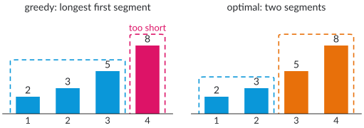{.nocap}

## {.right grow="2"}

Criterion: **at least 2 steps** (increasing) AND **range at most 4** (decreasing), like "48 h AND within 30 km".

- Greedy: $[2,3,5]$, then $[8]$ alone: **stuck**
- Optimal: $[2,3]$, $[5,8]$

Taking the longest first segment can be wrong.

::: notes
About 2 minutes. The minimum duration makes short segments invalid; combined with the range it is neither decreasing nor increasing monotone. Greedy could be repaired here by backtracking, but in general we need to consider all possible last segments: dynamic programming. Ask: what would you do instead of greedy?
:::

# The start-stop diagram {.columns}

## {.left grow="1"}

::: {.r-stack}
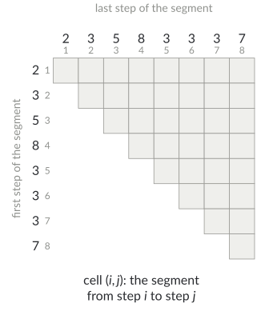{.nocap height="520px"}

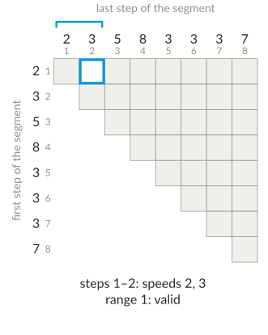{.fragment .nocap height="520px"}

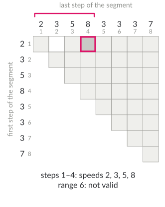{.fragment .nocap height="520px"}

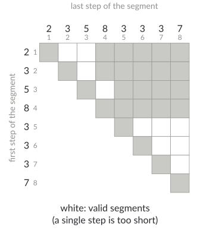{.fragment .nocap height="520px"}

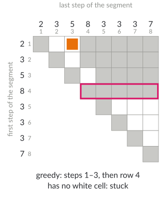{.fragment .nocap height="520px"}

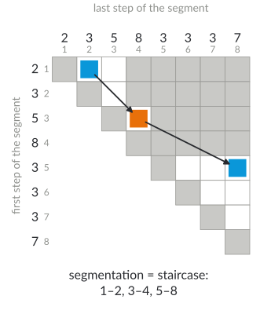{.fragment .nocap height="520px"}
:::

## {.right grow="1"}

Speeds $2,3,5,8,3,3,3,7$, same criterion.

- Cell $(i,j)$: steps $i$ to $j$ form a **valid** segment (white)
- A segmentation is a **staircase**: after cell ${(i,j)}$, the next segment starts in row ${j+1}$

[Find a staircase with three cells.]{.ask}

[Aronov et al. (2016)]{.source}

::: notes
About 3 minutes; five clicks. (1) Cell (1, 2): steps 1 to 2, valid. (2) Cell (1, 4): range 6, not valid. (3) All cells. (4) Greedy: the longest first segment is (1, 3); then the next segment must start at step 4, and row 4 has no white cell: stuck, as on slide 15. Ask now for a staircase with three cells. (5) The staircase. Rows: first step of a segment; columns: last step (step numbers in grey, speeds in black). The diagonal is grey because a single step is too short. Segment [2, 3] is cell (1, 2); after it, the next segment starts at step 3, i.e. in row 3. The staircase (1, 2) → (3, 4) → (5, 8) gives [2, 3], [5, 8], [3, 3, 3, 7]. Aronov, Driemel, van Kreveld, Löffler and Staals (SODA 2013; ACM Transactions on Algorithms 2016) introduced the start-stop diagram for non-monotone criteria; for continuous segmentation (break points anywhere), finding the best staircase is NP-hard in general, but polynomial for criteria such as outlier-tolerant ranges or bounded standard deviation. With break points at data points, as here, a simple dynamic program works (next slide).
:::

# Dynamic programming {.columns}

## {.left grow="1"}

::: {.r-stack}
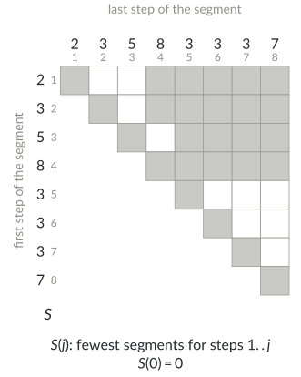{.nocap height="520px"}

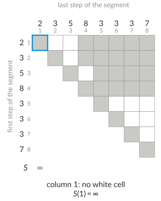{.fragment .nocap height="520px"}

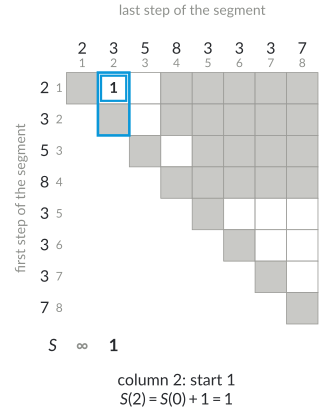{.fragment .nocap height="520px"}

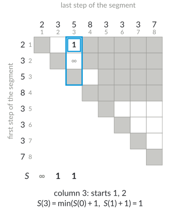{.fragment .nocap height="520px"}

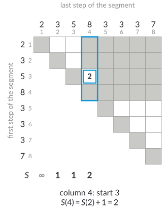{.fragment .nocap height="520px"}

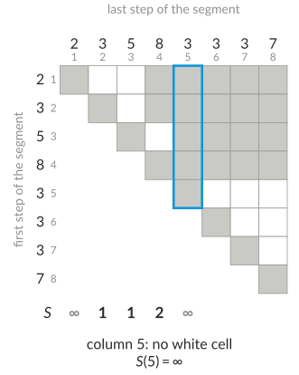{.fragment .nocap height="520px"}

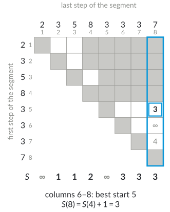{.fragment .nocap height="520px"}

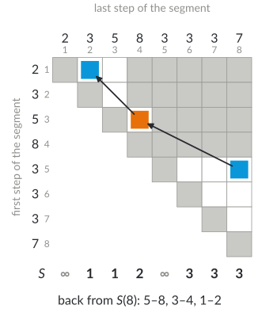{.fragment .nocap height="520px"}
:::

## {.right grow="1"}

$S(j)$: fewest segments for steps $1,\dots,j$

$$S(0)=0,\qquad S(j)=\min_{i\le j:\ \text{steps } i..j \text{ valid}} S(i-1)+1$$

- $S(j)=\infty$: no segmentation can end at step $j$
- $O(n^2)$ validity tests

[What are the subproblems? Why is ${S(5)=\infty}$?]{.ask}

::: notes
About 5 minutes; this is the core of the first part, take the time it needs. Seven clicks: columns 1 to 5 one at a time, then columns 6–8 together, then the backtracking; ask for each value before clicking. In a column, the white cells are the possible last segments; each gives S(start − 1) + 1 (written in the cell), and S(j) is the smallest. S(1) = ∞ (one step is too short), S(2) = 1 ([2, 3]), S(3) = 1 ([2, 3, 5]), S(4) = 2 ([2, 3] + [5, 8]), S(5) = ∞ (every segment ending at step 5 contains 8 and 3 or is too short), S(6) = 3 (S(4) + [3, 3]), S(7) = 3 (S(4) + [3, 3, 3]), S(8) = 3 (S(4) + [3, 3, 3, 7]). The staircase is recovered from where each minimum came from.

The same recurrence works for any criterion; the start-stop diagram can have Θ(n²) valid cells, so this is O(n²) tests, each of which may cost more than constant time (e.g., the disk). For the goose (slide 19): 1,960 hourly positions, 1.9 million cells, 160,942 of them valid; one column at a time with numpy, about a minute (most of it for the heading arcs). Faster: next slide; the general case of "stable" criteria (Alewijnse et al. 2014): additional slide 36.
:::

# Faster: one range-minimum query per block {.columns}

## {.left grow="1"}

::: {.r-stack}
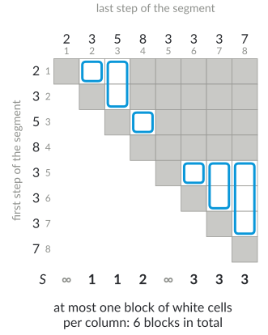{.nocap height="520px"}

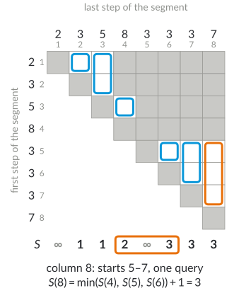{.fragment .nocap height="520px"}
:::

## {.right grow="1"}

**Criteria:** AND / OR of a constant number of increasing and decreasing monotone criteria

- Each criterion: one block per column (top or diagonal); together $O(1)$ per column, $O(n)$ **blocks** in total
- Per block one **range-minimum query** $\min S(i-1)$: $O(\log n)$
- Total $O(n\log n)$ + finding the blocks

[Alewijnse et al. (2014)]{.source}

::: notes
About 2 minutes; one click. The idea of the faster dynamic program; the general version for "stable" criteria is on additional slide 36. For a decreasing monotone criterion, a valid segment stays valid when we drop steps at its start, so in each column (fixed last step) the valid starts form one block that ends at the diagonal. For an increasing monotone criterion, a valid segment stays valid when we add steps in front, so the valid starts form one block that starts at the top. An AND or OR of a constant number k of such criteria has O(k) blocks per column: O(n) blocks in total, whereas the white cells alone can be Θ(n²). Here: at most one block per column, six in total (columns 1 and 5 have none).

Click: for a block of starts a..b in column j, the recurrence needs the minimum of S(a−1), …, S(b−1), consecutive entries of the row S: a range-minimum query. With a balanced search tree over S(0), S(1), … that stores subtree minima, each query and each insertion of a new value S(j) takes O(log n). Column 8: starts 5–7, min(S(4), S(5), S(6)) = min(2, ∞, 3) = 2, so S(8) = 3. In total O(n log n), provided the blocks are computed within this time (Alewijnse et al. 2014 do this for their criteria). Aside: in this example both ends of the block only move to the right, so a sliding-window minimum would even give O(n).
:::

# The goose, segmented

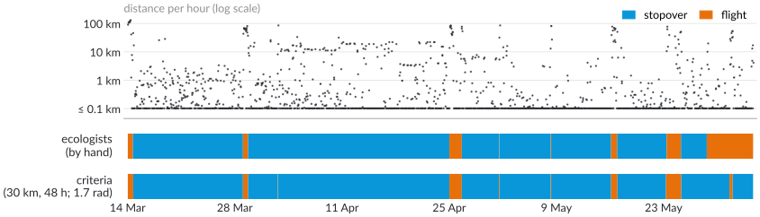{.nocap height="360px"}

Geese criteria, dynamic program: **37 segments** in 18 phases (neighbouring segments of the same kind share a colour); same label as the ecologists for **93%** of the hours.

[Where do the two differ, and why?]{.ask}

::: notes
About 3 minutes. Criteria as on slide 7 (disk of 30 km for at least 48 h, or 80% of the headings within 1.7 rad), ties broken towards long stopovers; 37 segments, 18 phases when consecutive segments of the same kind are merged. Agreement: 92.8% of the 1,959 hours.

Where they differ: of the 142 hours with different labels, 135 are in the last week. The ecologists label 29 May to 4 June as flight, the final leg to the breeding site; but in these 135 hours the goose covers only about 100 km: it sits on 30–31 May and again on 2–3 June, with a flight on 1 June in between. The criteria call the two sitting periods stopovers (25 May to 1 June inside one disk of radius 30 km, then 1 to 4 June near Kolguev). Whether a pause just before arrival is a stopover is a matter of definition, not of the algorithm. The other 7 hours are short runs (five single hours, one of two hours) at the start or end of a flight. Not visible in the colours: the 22-day stopover in Russia is two segments (on 10 April the goose moved about 40 km to the north-north-east, and together the positions do not fit into one disk of radius 30 km; the ecologists treat it as one site), and flights consist of several segments (10 on 25–27 April), because the heading changes between night flights and rests; "fewest segments" does not care, the phases are the same. The track-wise agreement of 93% is in line with Alewijnse et al. (2014), who reported 96.3% and 92.6% for two goose tracks.
:::

# Change points: optimal partitioning

Each segment: **one simple model** (here its mean). Cost: **misfit** + **penalty $\beta$ per segment**.

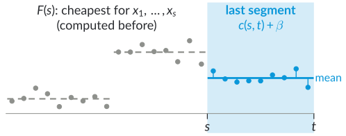{.nocap height="225px"}

$$F(t)=\min_{s<t}\ \big(F(s)+c(s,t)+\beta\big),\qquad F(0)=0$$

Try every start of the **last segment**. Slide 17: ${c\in\{0,\infty\}}$ (valid or not), ${\beta=1}$.

[Jackson et al. (2005)]{.source}

::: notes
About 3 minutes. Read the formula from the picture: F(t) is the cost of the cheapest segmentation of the first t values. Its last segment starts at some s + 1; before it, the cheapest segmentation of x_1, …, x_s costs F(s), which we know already; the last segment costs its misfit c(s, t) (for a constant model: the squared deviations from its mean, the sum of (x_i − mean)² over i = s+1, …, t; the vertical lines in the picture) plus β. Trying every s gives F(t). The penalty decides how many segments we get: with β = 0 every value would be its own segment (misfit 0), a huge β gives a single segment.

This is optimal partitioning (Jackson et al. 2005): the dynamic program of slide 17 with costs; there, c was 0 for a valid segment and infinity otherwise, and β = 1. O(n²) evaluations of c; PELT (Killick et al. 2012) prunes candidates and is often linear (additional slide 37). Change points say where the behaviour changes; what the segments mean is up to us.
:::

# Global temperature: when did the trend change?

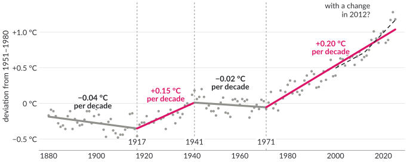{.nocap height="300px"}

Yearly **global mean surface temperature** (land and ocean), 1880–2025, as deviation from the 1951–1980 mean. Model: one **line** per segment, joined at 3 change points, found by trying all combinations of years.

[A pause after 1998? A surge since 2012?]{.ask}

[Data: NASA GISTEMP v4; Cahill et al. (2015), Beaulieu et al. (2024)]{.source}

::: notes
About 4 minutes. Cahill et al. (2015): change points around 1912, 1940 and 1970; Beaulieu et al. (2024): no change after the 1970s once autocorrelation is modelled. NASA's global annual mean temperature 1880–2025 (GISTEMP v4), relative to 1951–1980. The model here is a line per segment, joined at the change points (continuous), fitted by least squares; with three change points the best years are 1917, 1941 and 1971 (exhaustive search over the years; continuity couples neighbouring segments, so the plain recurrence does not apply directly). Since 1971: +0.20 °C per decade. Cahill, Rahmstorf and Parnell (2015) found three change points (about 1912, 1940, 1970) and no change after the 1970s: the "pause" after 1998 is not supported. Our check: adding a change in 1998 reduces the squared error by only 0.05 and increases BIC (with independent errors).

Which penalty, which noise model? With independent errors, BIC prefers a fourth change point in 2012 (dashed: +0.35 °C per decade since then). Beaulieu, Gallagher, Killick, Lund and Shi (2024) model autocorrelated errors (AR(1)) and find no detectable change in the warming rate after the 1970s yet; an acceleration would have to be larger or last longer to be detectable. Lesson: the penalty and the noise model decide what counts as a change; claims about pauses or surges must state them. Warming itself is not in question.

Answer to the question: no pause; a change in 1998 makes BIC worse, and 1998 was an exceptionally warm El Niño year, a classic cherry-pick. A surge since 2012 is preferred by BIC only with independent errors; with autocorrelated errors it is not detectable yet (Beaulieu et al. 2024). Details on additional slide 38.

For the goose, change points on the log distance per hour (penalty 8, constant mean per segment) give 19 segments and 90% agreement with the ecologists (slide 31).
:::

# Hidden Markov models

- **Hidden states** form a **Markov chain**: the next state depends only on the current one; from $r$ to $s$ with probability $a_{rs}$
- Each state **generates** the distance of its hour, drawn from **its own distribution** $b_s$

{.nocap height="215px"}

We see only the distances. **Fitting:** estimate $a_{rs}$, $b_s$ (slide 28). **Decoding:** the most likely state sequence, with **Viterbi** (slide 25).

[Langrock et al. (2012), McClintock et al. (2020)]{.source}

::: notes
About 3 minutes. Read the picture from top to bottom. First the model produces a sequence of hidden states; the state of the next hour depends only on the current state (a Markov chain; here: stay with probability 0.9, switch with 0.1). Then the state of each hour produces the observation of that hour, here the distance flown, drawn from the distribution of that state (right: resting gives short distances, flying long ones). In data we see only the bottom row; the states are hidden. A single distance can be ambiguous (3 km: a slow flight, or restless resting?), but the chain makes long runs of the same state likely. Two tasks: fitting estimates the transition probabilities and the distributions from the data (slide 28; maximum likelihood, computed with the forward algorithm); decoding finds the most likely state sequence for given parameters, with the Viterbi algorithm (slides 25–26). For the goose: first fitted, then decoded; the colours on slides 24 and 31 are the Viterbi path. Nobody tells the model what the states mean; we name them afterwards. The numbers here are a schematic example, not fitted.

In movement ecology, hidden Markov models are a standard tool (R packages moveHMM and momentuHMM; introduction with extensions such as semi-Markov models: Langrock et al. 2012; review: McClintock et al. 2020); usually with step lengths (gamma distribution) and turning angles (von Mises), and covariates in the transition probabilities.
:::

# Fitted to goose 3104: four states

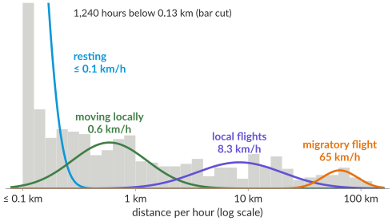{.nocap height="330px"}

Fitted to the 1,959 hours of goose 3104: **four states**, each with its own distribution of the distance (curves). The model only finds the groups; the **names** are given afterwards. Also fitted: the transition probabilities, e.g. after an hour of migratory flight, another one with probability 0.77.

::: notes
About 2 minutes. The observation is the logarithm of the distance per hour, with a normal distribution per state (a log-normal distribution of the distance). Nobody said what the states mean: the model finds four groups; we interpret them afterwards. Medians: at most 0.1 km per hour (resting; 71% of the hours), 0.6 km per hour (moving locally; 16%), 8.3 km per hour (local flights; 10%), 65 km per hour (migratory flight; 3%, 58 hours). Probability to stay in the state for another hour: 0.81, 0.40, 0.33 and 0.77 (expected stays 5.4, 1.7, 1.5 and 4.3 hours). Why four states: slide 28.
:::

# Four days of goose 3104, hour by hour

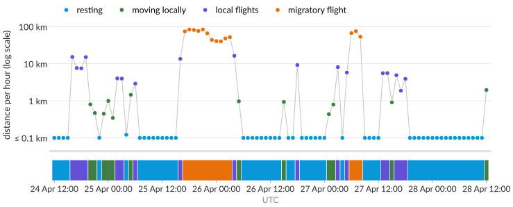{.nocap height="340px"}

Dots: distance per hour; colour and bar: the **most likely state sequence** (how to compute it: next slide). An 11-hour night flight on 25/26 April; in total, 14 hours of migratory flight cover 886 km.

[What does the model not know about stopovers?]{.ask}

::: notes
About 2 minutes. 24 April 12:00 to 28 April 12:00 (UTC): at the stopover near Kursk the goose rests (blue) and makes local flights (purple), e.g. between roost and fields; on 25 April from 16:00 the migratory flight (orange, 75–84 km per hour at first, then 40–66) lasts 11 hours, until 26 April 03:00; after a day of rest and local movement, three more hours on 27 April. In total 14 hours in the migratory state cover 886 km.

Answer to the question: nothing about 30 km or 48 hours. The model describes behaviour hour by hour; a stopover is a definition on a scale of days. To get stopovers from the states, we add a rule (e.g., at least 48 hours without migratory flight) or a model with explicit state durations (hidden semi-Markov model, slide 28).
:::

# The most likely state sequence: Viterbi

::: {.r-stack}
{.nocap height="360px"}

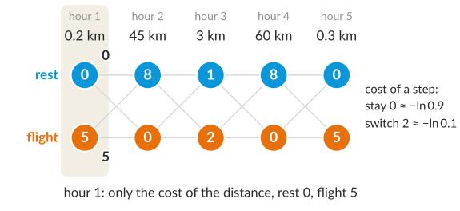{.fragment .nocap height="360px"}

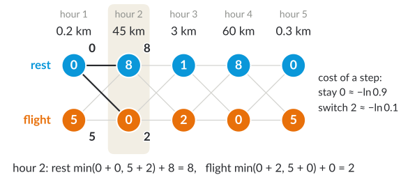{.fragment .nocap height="360px"}

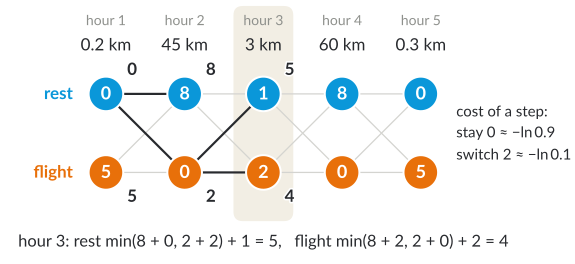{.fragment .nocap height="360px"}

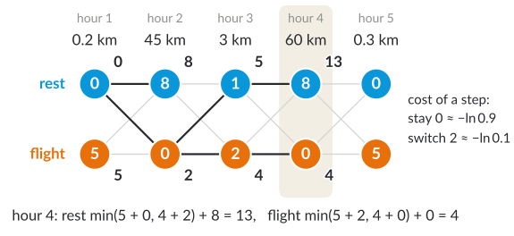{.fragment .nocap height="360px"}

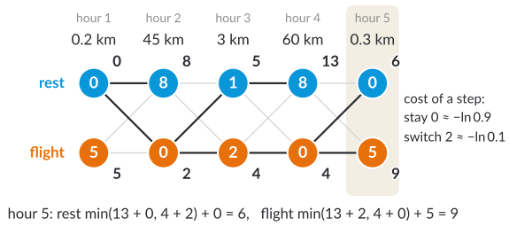{.fragment .nocap height="360px"}

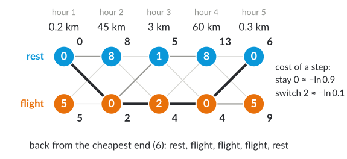{.fragment .nocap height="360px"}
:::

**Path** = state sequence; **cost** = node costs + step costs (number next to a node: cheapest cost to reach it). Costs are $-\ln$ of probabilities: cheapest path = **most likely** sequence.

[Find the cheapest path. What changes if switching is free?]{.ask}

::: notes
About 6 minutes; two minutes in pairs, then six clicks. A path through the trellis is a state sequence; its cost is the sum of the costs in its nodes (the cost of that hour's distance in that state) plus the transition costs (staying 0, switching 2). Costs are negative logarithms of probabilities (rounded), so the cheapest path is the most likely state sequence: probabilities multiply along a path, costs add. The transition costs come from slide 22: switching with probability 0.1 costs −ln 0.1 ≈ 2.3, staying with 0.9 costs −ln 0.9 ≈ 0.1. The node costs are constructed.

Clicks: (1) hour 1, only the node costs; (2)–(5) hour by hour, each node takes the cheaper of its two predecessors plus its own cost, and the chosen edge is drawn; ask for each column before clicking. Hour 2: rest min(0 + 0, 5 + 2) + 8 = 8, flight min(0 + 2, 5 + 0) + 0 = 2. Hour 3: rest min(8 + 0, 2 + 2) + 1 = 5, flight min(8 + 2, 2 + 0) + 2 = 4. Hour 4: rest min(5 + 0, 4 + 2) + 8 = 13, flight min(5 + 2, 4 + 0) + 0 = 4. Hour 5: rest min(13 + 0, 4 + 2) + 0 = 6, flight min(13 + 2, 4 + 0) + 5 = 9. (6) The cheapest end is rest with 6; following the chosen edges backwards gives rest, flight, flight, flight, rest. The 3-km hour stays "flight": labelling it "rest" would save only 1 but needs two more switches (cost 4). With free switching, every hour takes its cheapest state: rest, flight, rest, flight, rest with cost 1 (with switching costs 2 this path would cost 9). The switching cost acts like the penalty per change point.
:::

# Viterbi: the recurrence

$V_t(s)$ = cost of the cheapest state sequence for hours $1,\dots,t$ that **ends in state $s$**:

$$V_t(s)=c_s(x_t)+\min_{s'}\big(V_{t-1}(s')+c_{s's}\big),\qquad V_1(s)=c_s(x_1)\ \text{(all start states equally likely)}$$

- $c_s(x_t)=-\ln b_s(x_t)$: cost of the distance $x_t$ in state $s$ (a node)
- $c_{s's}=-\ln a_{s's}$: cost of the step from state $s'$ to state $s$ (an edge)
- Best value: $\min_s V_n(s)$; the states by **backtracking** the minimizing $s'$
- A **shortest path** in a layered graph with $nK$ nodes ($K$ states): $O(nK^2)$ time

[Viterbi (1967), Rabiner (1989)]{.source}

::: notes
About 2 minutes. This is what we just did on slide 25: the cheapest way to be in state s in hour t is the cost of that hour's distance in s plus the cheapest way to arrive, over all states s' of the previous hour, including the cost of the step from s' to s. Storing the minimizing s' for every node and following these choices back from the best final state gives the sequence. Here every start state is equally likely; with start probabilities π, add −ln π_s to V_1(s). Same pattern as S(j) on slide 17 and F(t) on slide 20: try every option for the last step.

The trellis is a directed acyclic graph with K nodes per hour; Viterbi is the shortest-path computation in topological order (next week: shortest paths in road networks, where the graph is not acyclic). Each of the n·K nodes looks at K predecessors: O(nK²).
:::

# The forward algorithm: sum instead of min

**For fitting** we need the probability of the observed data, the **likelihood**: summed over **all** state sequences, not only the best one.

$$\alpha_t(s)=b_s(x_t)\sum_{s'}\alpha_{t-1}(s')\,a_{s's},\qquad P(x_1,\dots,x_n)=\sum_s\alpha_n(s)$$

$\alpha_t(s)$: probability of $x_1,\dots,x_t$ and state $s$ in hour $t$; start $\alpha_1(s)=\pi_s\,b_s(x_1)$ ($\pi_s$: probability to start in $s$).

**Otherwise the same dynamic program as Viterbi:** probabilities instead of costs, and a **sum** over the previous states instead of the best one.

[Rabiner (1989)]{.source}

::: notes
About 1 minute; only the idea. Fitting (next slide) needs the likelihood, the probability of the data summed over all state sequences. The forward algorithm computes it with the same table as Viterbi: each node sums over its predecessors instead of taking the best one. α_t(s) is the probability of the first t observations together with state s in hour t; start α_1(s) = π_s b_s(x_1) with start probabilities π. In practice we scale or work with logarithms to avoid underflow.

Only if asked, the link to lecture 2: the same dynamic program with other operations along a path and over all paths. Discrete Fréchet: maximum along a coupling, minimum over couplings; DTW: sum and minimum; Viterbi with costs: sum and minimum (with probabilities: product and maximum); forward: product and sum. Mathematically, these are semirings; the dynamic program works in any of them.
:::

# Fitting a hidden Markov model

- **Estimated** by maximum likelihood: transition probabilities $a_{rs}$, distributions $b_s$
- The forward algorithm gives the probability of the data; maximize it numerically (moveHMM) or by EM (Baum–Welch). **Local optima:** start several times
- **Our choice:** the number of states $K$. Goose 3104: $K=2$ resting vs moving; $K=4$ also local vs migratory flights
- **Assumptions:** equal time steps; distances independent given the states; geometric time in a state. Minimum durations such as 48 h: **hidden semi-Markov** models

[Langrock et al. (2012), Michelot et al. (2016), Pohle et al. (2017), Glennie et al. (2023)]{.source}

::: notes
About 3 minutes. Baum–Welch alternates two steps: compute, with the forward and the backward algorithm, the probability of each state at each time (and of each transition) under the current parameters; then re-estimate the parameters as weighted averages. Each round does not decrease the likelihood; it converges to a local optimum. moveHMM instead maximizes the likelihood from the forward algorithm with a general-purpose optimizer.

Number of states: for goose 3104, two states give medians of 0.1 and 2.2 km per hour (resting vs everything else); three states separate 0.7 and 18 km per hour, still mixing local and migratory flights; four states give the four on slide 23. Here BIC also points to four states (among two to five), but in general information criteria tend to favour too many states; choose a number you can interpret (Pohle et al. 2017).

Assumptions: the transition probabilities refer to one time step, so the data need equal steps (or a continuous-time model); given the states, observations are independent, which ignores autocorrelation within a state; the time in a state is geometrically distributed (the most likely duration is one step). A hidden semi-Markov model specifies the distribution of durations directly, e.g. at least 48 hours for a stopover. Pitfalls of more advanced HMMs, and opportunities: Glennie et al. (2023).
:::

# New Year's Eve: fireworks make geese fly

[4 · Example]{.step}

{.nocap height="320px"}

New Year's night, 0:00–0:30: **43%** of all fixes in the **flight** state; other nights: about **3%**.

[697 tracks of 345 geese (4 species) wintering in the Netherlands, Germany and Denmark, 2013/14 to 2020/21; states from our HMM (3 states, GPS speed). Data: Kölzsch et al. (2022), Movebank, CC0; study: Kölzsch et al. (2023).]{.source}

::: notes
About 3 minutes. Newer open data from Andrea Kölzsch and colleagues (Conservation Letters 2023, "Wild goose chase"): geese of four species (white-fronted, bean, barnacle and pink-footed geese) wintering in the Netherlands, northern Germany and Denmark, tracked around New Year from 2013/14 to 2020/21; in the published data the median interval between fixes is 30 minutes (the study: 702 tracks of 347 geese; we use the 697 tracks with ground speeds). Here: a three-state hidden Markov model on the logarithm of the GPS ground speed of each fix (medians 0.1, 0.3 and 11 m/s), fitted on 120 tracks and decoded for all 697. Left: one pink-footed goose (3G, 2018/19, a fix every 10 to 20 minutes), resting almost all evening, two fixes in flight right after midnight (8 and 19 m/s), then resting again; every fix gets a state, and the right panel counts the flight state over all tracks. Between 0:00 and 0:30 on New Year's night, 43% of the fixes are in the flight state; on the other nights (evenings of 20–30 December and 2–9 January) about 3%. By species at 0:00–0:30: bean geese 65%, white-fronted geese 53%, barnacle geese 36%, pink-footed geese 16%. Caveat: the fixes are not equally spaced, which the model ignores.

The paper's findings: the geese fly 40–150 m higher on average (altitudes up to 700 m) and farther (5–16 km more on average, single flights up to 500 km), change their roost more often, and forage longer during at least the following 11 days, which suggests compensation for the extra energy (an estimated 1–10% more on that day). The responses persisted in 2020/21, when the sale or ignition of fireworks was banned in all countries with tagged geese except Denmark, at least in white-fronted and bean geese (in our data, all species in 2020/21: 56% of the fixes in flight at 0:00–0:30). The paper used the MoveApps workflow "Roost and Foraging Site Extraction", i.e., segmentation in practice; Andrea presented MoveApps last week.
:::

# Outlook: state-space models

- **State-space model:** a hidden state that changes over time, seen through noisy observations; an HMM has **finitely many** states
- **Continuous** state, e.g. the **true position** behind noisy fixes (Argos: errors of kilometres)
- Or a drifting **movement parameter**, e.g. **move persistence**: 0 = turning, 1 = straight
- **Kalman filter:** the forward algorithm for linear-Gaussian models, linear time (slide 40)

[For GPS geese, with errors of metres: what would a continuous state add?]{.ask}

[Patterson et al. (2008), Jonsen et al. (2005, 2023), Auger-Méthé et al. (2021)]{.source}

::: notes
About 2 minutes. In ecology, "state-space model" means: a hidden process (the state) and an observation model; an HMM is the special case with finitely many states. With a continuous state, two uses are common. First, the true location as the state and the GPS or Argos fix as a noisy observation: the model filters measurement error and regularizes irregular time steps (e.g., the continuous-time correlated random walk of Johnson et al. 2008). Second, a behavioural parameter that changes smoothly: move persistence γ_t between 0 (turning, staying) and 1 (directed travel), estimated by aniMotum (Jonsen et al. 2023); segmentation then means thresholding γ_t, or reading it as a continuous index instead of discrete states.

Algorithmically, the Kalman filter (Kalman 1960) is the forward algorithm when the state is a vector with a Gaussian distribution: each step predicts (mean and covariance) and updates with the new observation, in constant time per step for fixed dimension; additional slide 40. Answer to the question: for GPS data of geese with errors of metres, the location error is not the problem; a continuous index could still describe behaviour that is not well captured by a few discrete states.
:::

# Three methods, one goose

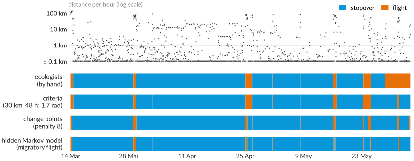{.nocap height="345px"}

Each row: every hour **stopover** or **flight** (HMM: migratory flight). Same label as the ecologists in **93%** (criteria), **90%** (change points), **88%** (HMM) of the hours.

[Which segmentation would you use, and for which question?]{.ask}

::: notes
About 2 minutes. Agreement with the ecologists, hour by hour: criteria 92.8%, change points (penalty 8; segments with a mean above 1 km per hour count as flight) 89.9%, hidden Markov model (migratory-flight state as flight, all other states as stopover) 88.2%. The methods agree with each other on 95–97% of the hours. The largest difference to the ecologists is the same for all three: the final six days, which the ecologists call flight. The HMM and the change points also call only the flying hours "flight", whereas the ecologists' flight phases include rests between flights.

Which method for which question: to measure stopovers as the ecologists define them, use the criteria (they encode the definition); to find where the behaviour changes without a definition, change points; to describe behaviour hour by hour (resting, local and migratory flights), the HMM. This is Gurarie's observation in small: broad agreement, differences where the assumptions differ.
:::

# Back to the geese

- An algorithm labels **all** tracks the same way; the ecologists' labels (79,234 GPS fixes) are a **test bed**
- Spring stopovers: refuelling for breeding; food depends on **land use** (Kölzsch et al. 2016)
- New Year: flights at midnight cost **energy** in winter (Kölzsch et al. 2023)

## Segmentation defines the phases {.info}

Criteria, penalty or model decide what a "stopover" is: report them with the results.

::: notes
About 2 minutes. Alewijnse et al. (2014) segmented two spring tracks of white-fronted geese with the criteria of slide 7 and compared with the manual segmentation by the ecologists: 96.3% and 92.6% of the positions got the same label; today's goose: 92.8%. Back to the question of slide 5: knowing where and how long geese stop in spring tells where food and protection matter; Kölzsch et al. (2016) mention changing land use in Russia and hunting pressure in spring. The New Year study adds a winter disturbance: fireworks make the geese fly at night, with effects on the following days.
:::

# Next steps

- **Today**, 14:15–15:45, OH14 E02: tutorial on Assignment 2 (from now on on Tuesdays)
- **Tuesday, 10 November:** route planning: shortest paths for cycling

::: notes
Closing sentence: segmentation turns a time series into phases; greedy suffices for decreasing monotone criteria, stopovers need dynamic programming, and the same recurrence underlies change point detection and the Viterbi algorithm; the forward algorithm sums where Viterbi minimizes. Next week the topic changes to route planning; Viterbi was already a shortest path in a layered graph.
:::

# Additional material {.section}

For self-study and the tutorial

# Greedy for the disk criterion

Test: do positions $p_i,\dots,p_j$ fit into a disk of radius $r$? Smallest enclosing disk: $O(j-i)$ expected (Welzl).

- Adding one point can change the disk completely: no constant-time update
- **Double and search:** test $j=i+1,i+2,i+4,\dots$ until invalid, then binary search
- One segment of length $m$: $O(m\log m)$ time; all segments: $O(n\log n)$

[Buchin et al. (2011), Theorem 9]{.source}

::: notes
The doubling step overshoots by at most a factor 2, so the tests in the doubling and in the binary search cost O(m) each and there are O(log m) of them. Summed over segments of lengths m_1 + … + m_k = n: O(n log n).
:::

# Faster for stable criteria

**Stable criterion:** $O(n)$ switches between valid and invalid in the start-stop diagram, summed over all columns. Examples: monotone criteria, AND / OR of stable criteria, outliers up to an approximate fraction.

- Store each column **run-length encoded**: $O(n)$ runs in total, computed in $O(n\log n)$
- For a run of valid starts $i\in[a,b]$: $\min_{a\le i\le b}S(i-1)$ is one **range-minimum query**
- Balanced search tree over $S(0),S(1),\dots$ with subtree minima: query and update $O(\log n)$; total $O(n\log n)$

[Alewijnse et al. (2014)]{.source}

::: notes
The idea on the example: slide 18. For the goose of slide 19, the diagram has 1,919,820 cells, of which 160,942 are valid, in long runs: triangles for the stopovers, bands for the flights. Alewijnse, Buchin, Buchin, Kölzsch, Kruckenberg and Westenberg (2014): if a criterion is stable, the dynamic program processes a run of valid cells with one range-minimum query instead of one cell at a time. The augmented search tree is the textbook construction (augmenting data structures, Cormen et al., Chapter 14 in the third edition); a segment tree or a sparse table works as well.
:::

# Change points: PELT and binary segmentation

- **Optimal partitioning:** $F(t)=\min_{s<t}F(s)+c(s,t)+\beta$, $O(n^2)$
- **PELT:** if $F(s)+c(s,t)\ge F(t)$, then $s$ can never be the last change point after $t$: drop it. Often $O(n)$
- **Binary segmentation:** split at the best single change point, recurse: fast, not always optimal
- Penalty: e.g., $\beta\propto\log n$ (BIC); or plot the number of segments against $\beta$

[Killick et al. (2012), Truong et al. (2020)]{.source}

::: notes
The pruning rule needs that adding a change point never increases the cost (true up to a constant for the usual costs). Truong, Oudre and Vayatis (2020) review cost functions, search methods and penalties, with the Python package ruptures; R: changepoint. For the goose (log distance per hour, constant mean per segment): penalty 3 gives 83 segments, 8 gives 19, 20 gives 8.
:::

# A pause? A surge?

::: tablefit
| Model for 1880–2025 | Change points | Since the last change |
|---|---|---|
| continuous trends, 3 changes | 1917, 1941, 1971 | +0.20 °C per decade |
| + a change in 1998 ("pause") | BIC worse | +0.24 °C per decade |
| + a change in 2012, independent errors | BIC better | +0.35 °C per decade |
| autocorrelated errors (Beaulieu et al. 2024) | none after the 1970s | |
:::

- Choosing the start year by eye: 1998–2012 gives +0.13 °C per decade, 1970–1997 +0.16
- Segment boundaries are part of the result: **search** them, with a stated penalty and noise model

[Cahill et al. (2015), Beaulieu et al. (2024); data: NASA GISTEMP v4]{.source}

::: notes
Continuous piecewise-linear fits by least squares; change years searched exhaustively (at least 10 years apart; for four change points first every second year, then refined year by year). Squared errors: 3 changes 1.445; with 1998 added 1.391 (BIC −624.6 instead of −629.0, i.e., worse); with 2012 added 1.332 (BIC −630.9, better), assuming independent errors. Beaulieu et al. (2024) use a penalized likelihood with autocorrelated (AR(1)) errors, computed with PELT, on four temperature records up to 2023; with autocorrelation, the post-1970 changes disappear. The 1998 start is a classic cherry-pick: 1998 was an exceptionally warm El Niño year.
:::

# Hidden Markov models in practice

- Observations per step: **step length** (gamma) and **turning angle** (von Mises)
- States: e.g. resting, foraging, travelling; chosen number $K$
- Transition probabilities may depend on **covariates** (time of day, habitat)
- Check the fit: pseudo-residuals; R packages: moveHMM, momentuHMM; durations: hidden semi-Markov models

[Langrock et al. (2012), Michelot et al. (2016), McClintock et al. (2020)]{.source}

::: notes
Panigada et al. (2024) used a two-state HMM (area-restricted search, read as foraging, and transit) for 11 fin whales in the Mediterranean (last year's example): most of the time was spent outside protected areas. A hidden semi-Markov model can express "a stopover lasts at least 48 h" through the distribution of state durations, which brings HMMs closer to the criteria; the forward algorithm then also runs over durations, at higher cost.
:::

# The Kalman filter

Hidden state $z_t$ (e.g. position and velocity), observation $x_t$ (e.g. a GPS fix): motion ${z_t=Az_{t-1}+w_t}$, measurement ${x_t=Hz_t+v_t}$, Gaussian noise ${w_t\sim\mathcal N(0,Q)}$, ${v_t\sim\mathcal N(0,R)}$.

- **Predict** $z_t$ from the estimate (mean $m_{t-1}$, covariance $P_{t-1}$): mean $Am_{t-1}$, covariance $AP_{t-1}A^\top+Q$
- **Update** with $x_t$: weighted average of prediction and observation (weight: the Kalman gain)
- The forward algorithm with Gaussian distributions: exact, $O(n)$ for a fixed state dimension

[Kalman (1960), Johnson et al. (2008)]{.source}

::: notes
In the forward algorithm, α_t is a distribution over finitely many states; in the Kalman filter, the distribution of the state given the observations so far is Gaussian and is described by its mean and covariance, so the sum over states becomes an integral that can be computed in closed form. The smoother (forward and backward pass) corresponds to the forward-backward algorithm. For nonlinear models or non-Gaussian errors: extended or unscented Kalman filters, particle filters, or the Laplace approximation (via TMB) used by aniMotum. Johnson, London, Lea and Durban (2008) fit a continuous-time correlated random walk with the Kalman filter (R package crawl).
:::

# Model-based segmentation

When no criterion is known: assume a **movement model** with a parameter, e.g. a Brownian bridge with diffusion coefficient $\sigma^2$.

- Each segment gets its own parameter; score = $-$log-likelihood + penalty per segment (information criterion)
- Dynamic programming like Viterbi (penalty = switching cost): $O(nm)$ time for $m$ candidate values of the parameter
- Then classify segments by their parameter

[Alewijnse et al. (2018); dynamic Brownian bridges: Kranstauber et al. (2012)]{.source}

::: notes
This was the last part of last year's lecture (fisher example). With the negative log-likelihood of a segment as cost, the recurrence of slide 20 needs O(n²) segment evaluations per parameter value. For a fixed parameter value the cost is a sum over the points, so a Viterbi-like dynamic program over the m candidate values, with the penalty as switching cost (slides 25–26), takes O(nm).
:::

# Check your understanding

1. Why does the proof of slide 12 fail for "at least 48 h"?
2. How do you recover the segments from the values $S(j)$?
3. In the Viterbi example, for which switching costs is the path with four switches optimal?
4. Why does the forward algorithm need sums where Viterbi takes minima?

## Possible answers {.fragment .info}

1\. The subsegment $[g_k, o_{k+1}]$ may be too short. 2. Store for each $j$ the $i$ that attains the minimum; backtrack from $n$. 3. $c\le 1/2$ per switch: $1+4c\le 2+2c$ (the only optimum for $c<1/2$). 4. It computes the probability of the data, summed over all state sequences.

# References: movement and conservation

::: refs
- Edelhoff, H., Signer, J., Balkenhol, N. (2016). Path segmentation for beginners: an overview of current methods for detecting changes in animal movement patterns. *Movement Ecology* 4, 21. <https://doi.org/10.1186/s40462-016-0086-5>
- Gurarie, E., Bracis, C., Delgado, M., Meckley, T. D., Kojola, I., Wagner, C. M. (2016). What is the animal doing? Tools for exploring behavioural structure in animal movements. *Journal of Animal Ecology* 85(1), 69–84. <https://doi.org/10.1111/1365-2656.12379>
- Kölzsch, A., Müskens, G. J. D. M., Kruckenberg, H., Glazov, P., Weinzierl, R., Nolet, B. A., Wikelski, M. (2016). Towards a new understanding of migration timing: slower spring than autumn migration in geese reflects different decision rules for stopover use and departure. *Oikos* 125(10), 1496–1507. <https://doi.org/10.1111/oik.03121>
- Kölzsch, A., Kruckenberg, H., Glazov, P., Müskens, G. J. D. M., Wikelski, M. (2016). Data from: Towards a new understanding of migration timing: slower spring than autumn migration in geese reflects different decision rules for stopover use and departure. Movebank Data Repository, CC0. <https://doi.org/10.5441/001/1.31c2v92f>
- Kölzsch, A., Lameris, T. K., Müskens, G. J. D. M., Schreven, K. H. T., Buitendijk, N. H., Kruckenberg, H., Moonen, S., Heinicke, T., Cao, L., Madsen, J., Wikelski, M., Nolet, B. A. (2023). Wild goose chase: Geese flee high and far, and with aftereffects from New Year's fireworks. *Conservation Letters* 16(1), e12927. <https://doi.org/10.1111/conl.12927>; data: Kölzsch et al. (2022), Movebank Data Repository, CC0, <https://doi.org/10.5441/001/1.g51fs0jv>
- Panigada, V., et al. (2024). Targeting fin whale conservation in the North-Western Mediterranean Sea: insights on movements and behaviour from biologging and habitat modelling. *Royal Society Open Science* 11(3), 231783.
:::

# References: segmentation algorithms

::: refs
- Alewijnse, S. P. A., Buchin, K., Buchin, M., Kölzsch, A., Kruckenberg, H., Westenberg, M. A. (2014). A framework for trajectory segmentation by stable criteria. *SIGSPATIAL 2014*, 351–360. <https://doi.org/10.1145/2666310.2666415>
- Alewijnse, S. P. A., Buchin, K., Buchin, M., Sijben, S., Westenberg, M. A. (2018). Model-based segmentation and classification of trajectories. *Algorithmica* 80(8), 2422–2452. <https://doi.org/10.1007/s00453-017-0329-x>
- Aronov, B., Driemel, A., van Kreveld, M., Löffler, M., Staals, F. (2016). Segmentation of trajectories on nonmonotone criteria. *ACM Transactions on Algorithms* 12(2), 26. <https://doi.org/10.1145/2660772>
- Buchin, M., Driemel, A., van Kreveld, M., Sacristán, V. (2011). Segmenting trajectories: A framework and algorithms using spatiotemporal criteria. *Journal of Spatial Information Science* 3, 33–63. <https://doi.org/10.5311/JOSIS.2011.3.66>
- Buchin, M., Kruckenberg, H., Kölzsch, A. (2013). Segmenting trajectories by movement states. In S. Timpf, P. Laube (eds.), *Advances in Spatial Data Handling*, Springer, 15–25. <https://doi.org/10.1007/978-3-642-32316-4_2>
- Gurarie, E., Andrews, R. D., Laidre, K. L. (2009). A novel method for identifying behavioural changes in animal movement data. *Ecology Letters* 12(5), 395–408.
- Kranstauber, B., Kays, R., LaPoint, S. D., Wikelski, M., Safi, K. (2012). A dynamic Brownian bridge movement model to estimate utilization distributions for heterogeneous animal movement. *Journal of Animal Ecology* 81(4), 738–746.
- Patin, R., Etienne, M.-P., Lebarbier, E., Chamaillé-Jammes, S., Benhamou, S. (2020). Identifying stationary phases in multivariate time series for highlighting behavioural modes and home range settlements. *Journal of Animal Ecology* 89(1), 44–56. <https://doi.org/10.1111/1365-2656.13105>
:::

# References: change points and climate

::: refs
- Beaulieu, C., Gallagher, C., Killick, R., Lund, R., Shi, X. (2024). A recent surge in global warming is not detectable yet. *Communications Earth & Environment* 5, 576. <https://doi.org/10.1038/s43247-024-01711-1>
- Cahill, N., Rahmstorf, S., Parnell, A. C. (2015). Change points of global temperature. *Environmental Research Letters* 10(8), 084002. <https://doi.org/10.1088/1748-9326/10/8/084002>
- GISTEMP Team (2026). GISS Surface Temperature Analysis (GISTEMP), version 4. NASA Goddard Institute for Space Studies. Dataset accessed 2026-10-30 at <https://data.giss.nasa.gov/gistemp/>
- Jackson, B., Scargle, J. D., Barnes, D., et al. (2005). An algorithm for optimal partitioning of data on an interval. *IEEE Signal Processing Letters* 12(2), 105–108.
- Killick, R., Fearnhead, P., Eckley, I. A. (2012). Optimal detection of changepoints with a linear computational cost. *Journal of the American Statistical Association* 107(500), 1590–1598.
- Lenssen, N., Schmidt, G. A., Hendrickson, M., Jacobs, P., Menne, M., Ruedy, R. (2024). A NASA GISTEMPv4 observational uncertainty ensemble. *Journal of Geophysical Research: Atmospheres* 129(17), e2023JD040179.
- Truong, C., Oudre, L., Vayatis, N. (2020). Selective review of offline change point detection methods. *Signal Processing* 167, 107299.
:::

# References: hidden Markov models

::: refs
- Glennie, R., Adam, T., Leos-Barajas, V., Michelot, T., Photopoulou, T., McClintock, B. T. (2023). Hidden Markov models: Pitfalls and opportunities in ecology. *Methods in Ecology and Evolution* 14(1), 43–56.
- Langrock, R., King, R., Matthiopoulos, J., Thomas, L., Fortin, D., Morales, J. M. (2012). Flexible and practical modeling of animal telemetry data: hidden Markov models and extensions. *Ecology* 93(11), 2336–2342.
- McClintock, B. T., Langrock, R., Gimenez, O., Cam, E., Borchers, D. L., Glennie, R., Patterson, T. A. (2020). Uncovering ecological state dynamics with hidden Markov models. *Ecology Letters* 23(12), 1878–1903.
- Michelot, T., Langrock, R., Patterson, T. A. (2016). moveHMM: an R package for the statistical modelling of animal movement data using hidden Markov models. *Methods in Ecology and Evolution* 7(11), 1308–1315.
- Pohle, J., Langrock, R., van Beest, F. M., Schmidt, N. M. (2017). Selecting the number of states in hidden Markov models: pragmatic solutions illustrated using animal movement. *Journal of Agricultural, Biological and Environmental Statistics* 22(3), 270–293.
- Rabiner, L. R. (1989). A tutorial on hidden Markov models and selected applications in speech recognition. *Proceedings of the IEEE* 77(2), 257–286.
- Viterbi, A. J. (1967). Error bounds for convolutional codes and an asymptotically optimum decoding algorithm. *IEEE Transactions on Information Theory* 13(2), 260–269.
:::

# References: state-space models

::: refs
- Auger-Méthé, M., et al. (2021). A guide to state–space modeling of ecological time series. *Ecological Monographs* 91(4), e01470.
- Johnson, D. S., London, J. M., Lea, M.-A., Durban, J. W. (2008). Continuous-time correlated random walk model for animal telemetry data. *Ecology* 89(5), 1208–1215.
- Jonsen, I. D., Flemming, J. M., Myers, R. A. (2005). Robust state–space modeling of animal movement data. *Ecology* 86(11), 2874–2880.
- Jonsen, I. D., et al. (2023). aniMotum, an R package for animal movement data: Rapid quality control, behavioural estimation and simulation. *Methods in Ecology and Evolution* 14(3), 806–816.
- Kalman, R. E. (1960). A new approach to linear filtering and prediction problems. *Journal of Basic Engineering* 82(1), 35–45.
- Patterson, T. A., Thomas, L., Wilcox, C., Ovaskainen, O., Matthiopoulos, J. (2008). State–space models of individual animal movement. *Trends in Ecology & Evolution* 23(2), 87–94.
:::

# License and credits

::: refs
- Slides © 2026 Kevin Buchin, TU Dortmund University, licensed under **CC BY 4.0** (<https://creativecommons.org/licenses/by/4.0/>). Suggested attribution: "Kevin Buchin, Algorithms and Sustainability, TU Dortmund University, CC BY 4.0", with a link to the course page.
- Not covered by this license: the TU Dortmund logo and the Decker software and its themes (own licenses); the goose photo.
- Goose photo: Frank Schulenburg, "Greater white-fronted goose in flight", Wikimedia Commons, CC BY-SA 4.0 (<https://commons.wikimedia.org/wiki/File:Greater_white-fronted_goose_in_flight-1045.jpg>), cropped and scaled.
- Unless credited otherwise, figures: own work, CC BY 4.0, made with `tools/make_segmentation_figures.py`. Goose data: Kölzsch et al. (2016), Movebank Data Repository, doi:10.5441/001/1.31c2v92f, CC0, and Kölzsch et al. (2022), doi:10.5441/001/1.g51fs0jv, CC0; maps: Natural Earth (public domain). Temperature: NASA GISS/GISTEMP v4.
- The speed examples, the change point sketch and the Viterbi example use constructed data, not measurements; the figures of the criteria, of monotonicity and of the hidden Markov model are schematic.
- Made with Decker: <https://github.com/decker-edu/decker>
:::
