# Plan for today

1. Recap: typical routes
2. Why are geese slow in spring? Stopovers and segmentation
3. Criteria-based segmentation: greedy and dynamic programming
4. Change points and hidden Markov models
5. Back to the geese

::: notes
Timing (90 min, main part slides 2–22): 10:15 plan and recap (slides 2–3, about 4 min) · 10:19 geese, the manual stopover rule, Eamy's migration (slides 5–7, about 11 min) · 10:30 what is the animal doing: overview of methods (slide 8, about 5 min) · 10:35 problem, exercise, greedy and why it works, quiz (slides 9–12, about 16 min) · 10:51 stopovers break greedy, start-stop diagram, dynamic program, faster for stable criteria (slides 13–16, about 14 min) · 11:05 Eamy segmented, the stop near Madrid (slide 17, about 5 min) · 11:10 change points, hidden Markov model, comparison (slides 18–20, about 13 min) · 11:23 back to the geese, next steps (slides 21–22, about 4 min) · about 18 min buffer. At the start, say that the lecture is recorded.

If time runs short: slide 12 (quiz) by show of hands in one minute; slide 16 in two sentences; slide 18 without the formula, only the figure; then the comparison (slide 20) without discussion. If time is left: the greedy proof in detail (slide 11), range-minimum queries (slide 25) or Brownian bridges (slide 28).

Slides 23–29 are additional material for self-study and the tutorial. Voting: the quiz on slide 12 supports phone voting (QR code and poll buttons in presenter mode), otherwise show of hands. The tutorial this afternoon (14:15, OH14 E02) is the first in the new room.
:::

# Recap: typical routes {.columns}

## {.left grow="1"}

- **$k$-center:** Gonzalez picks the farthest object next; factor 2
- **Routes:** discrete Fréchet distance and centres with $\le\ell$ vertices; factor 3
- 34 stork routes, 5 typical routes

[Which property of the Fréchet distance did both guarantees use?]{.ask}

## {.right grow="1"}

Last week: compare and group **whole routes**.

Today: look **inside one route**. When does the bird fly, and when does it stop?

::: notes
About 2 minutes. Answer: the triangle inequality (slides 14 and 18 of lecture 3). Then switch the perspective: last week a route was one object; today we split one route into phases. The same storks appear again; one of them, Eamy, is today's running example.
:::

# Block 1 · Computational Movement Analysis {.section}

Week 4 · today: from routes to movement phases

# The question {.columns}

## {.left grow="1"}

[1 · Question]{.step}

{.nocap height="170px"}

::: bigquestion
Why do geese need **twice as long** in spring?
:::

[Mostly time at **stopovers** (Kölzsch et al. 2016, 65 geese with GPS)]{.fragment}

## {.right grow="1"}

{.nocap height="440px"}

[Photo: Frank Schulenburg, Wikimedia Commons, CC BY-SA 4.0. Tracks: Kölzsch et al. (2016), Movebank, CC0.]{.source}

::: notes
About 5 minutes. Ask first: why could spring migration take longer? Collect two or three answers (weather, snow, food, waiting), then show the answer (one click).

Kölzsch et al. (2016, Oikos 125, 1496–1507): 65 greater white-fronted geese, tagged in the Netherlands and on Kolguev Island, tracked between western Europe and the Russian Arctic. Spring migration took 83 days on average, autumn migration 42 days, "mainly determined by time spent at stopovers" (abstract). In spring the geese spread out and stop at many sites to refuel: they need to arrive at the breeding grounds with energy stores. In autumn they fuel up near the breeding grounds and wait for good winds; flight speeds are similar in both seasons. This contradicts the textbook expectation that birds hurry in spring.

Why this matters for conservation: the spring stopovers are where the geese refuel for breeding. The paper points to food availability during spring migration, to changes in agricultural land use in Russia (fields left uncultivated, grass too long for foraging) and to hunting pressure. To study this, we need to know where and how long each goose stops: segmentation. Photo: a greater white-fronted goose in California (same species, other population). The map shows all GPS tracks of the data set (Movebank Data Repository, doi:10.5441/001/1.31c2v92f, CC0; 79,234 fixes of 65 geese): in spring the geese spread over a wide front and stop often, in autumn they follow a narrow corridor.
:::

# How were the stopovers found?

> Stopovers: sites where a bird "did not displace further than 30 km for at least 48 h", "manually extracted" [(Kölzsch et al. 2016)]{.source}

A **precise rule**, applied **by hand**. An algorithm would be fast, consistent and **reproducible**.

[Can an algorithm cut a track into stopovers and flights?]{.ask}

## Criteria for geese {.info}

**Stopover:** within a disk of radius 30 km for at least 48 h

**Flight:** at least 80% of the headings within an arc of 1.7 rad (97°)

[Alewijnse et al. (2014)]{.source}

::: notes
About 3 minutes. The rule in the Oikos paper also allowed "maximally one detour", i.e., one excursion out of the disk; tolerating a few outliers is exactly what makes criteria non-trivial algorithmically (slide 16). The stopover criterion (30 km, 48 h) is the ecologists' rule; for flights, M. Buchin, Kruckenberg and Kölzsch (2013) bounded the change in heading (120°), Alewijnse et al. (2014) used an angular range of 1.7 rad with 20% outliers, the version on the slide. We come back to the results at the end (slide 21). 1.7 rad ≈ 97°.
:::

# Eamy's first migration

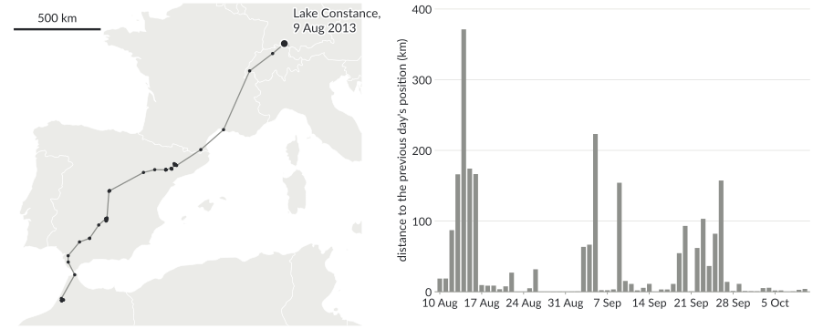{.nocap height="430px"}

[Which days are **stopovers**? Where would you cut?]{.ask}

[Data: Flack et al. (2016), Movebank, CC0. One position per day (12:00 UTC). Map: Natural Earth.]{.source}

::: notes
About 3 minutes. Eamy is one of the juvenile storks from Lake Constance (lectures 2 and 3; she wintered in Morocco like Karamell). One position per day, as last week; the bars show how far she moved since the previous day. Ask the class to name the stopovers from the bars; write them down for slide 17. Expected: 16 August to 2 September (near Lleida, with two short moves of about 30 km), 5–8 September (near Madrid), 9–18 September (La Mancha), and from 26 September in Morocco. Discuss briefly whether the 1-day pause on 20–21 September is a stopover (with the 48-h rule: no).

Note on the bars: the distance between consecutive noon positions, not the distance flown during the day.
:::

# What is the animal doing?

[2 · Research]{.step}

**Segmentation:** split a track into consecutive **segments** of homogeneous movement; **classification:** label them with **states**.

::: tablefit
| Question | Idea | Examples |
|---|---|---|
| describe | a measure along the track | first-passage time, residence time |
| where does it change? | change points in a time series | penalized contrasts, BCPA, PELT |
| which hidden state? | a model generates each step | hidden Markov models (moveHMM) |
| does it meet a definition? | criteria on segments | stopover: 30 km, 48 h (**today**) |
:::

From **descriptive** to **model-based**: fewer assumptions vs more explanation.

[Edelhoff et al. (2016), Gurarie et al. (2016)]{.source}

::: notes
About 5 minutes. Edelhoff, Signer and Balkenhol (2016, Movement Ecology 4:21) structure path segmentation by three kinds of research questions: quantitative description of movement patterns, detection of significant change points, and identification of underlying processes or hidden states. Gurarie et al. (2016, Journal of Animal Ecology 85, 69–84; "What is the animal doing?") compare first-passage time, Bayesian partitioning of Markov models, behavioural change point analysis (BCPA) and a multistate random walk (a hidden Markov model) on simulated tracks, a lamprey and a wolf. Their conclusions: the methods broadly agree on real tracks; they differ in their assumptions (low for BCPA, high for the multistate random walk) and in what they explain; methods that ignore autocorrelation find spurious change points; velocity-based methods miss changes that are defined spatially (e.g., settling in an area), where first-passage time works. They read the sequence from descriptive to modelled methods like the settings of a camera: the user chooses what to bring out.

General time series: change point detection (row 2) is used everywhere (sensor data, finance, climate); we come back to it on slide 18, and to hidden Markov models on slide 19. Criteria-based segmentation fits when we can say what a state is, as for the geese.
:::

# Criteria-based segmentation

[3 · Algorithms]{.step}

## Problem (Buchin et al. 2011) {.info}

Positions $p_0,\dots,p_n$ and a **criterion** for segments. Find break points $0=b_0<b_1<\dots<b_k=n$, as **few** as possible, such that every segment $T[b_{i-1},b_i]$ satisfies the criterion.

**Criteria** from attributes, combined with AND / OR:

::: columns-1-1
::: col
- speed: highest $\le2\times$ lowest
- heading: within an arc $\alpha$
:::
::: col
- location: within a disk, radius $r$
- duration: at least $\Delta t$
:::
:::

Stopover = disk AND duration; valid segment = stopover OR flight.

::: notes
About 3 minutes. Consecutive segments share the break point. This is the discrete version: break points at data points. Buchin, Driemel, van Kreveld and Sacristán (2011, Journal of Spatial Information Science 3, 33–63) also consider break points anywhere on the trajectory (continuous segmentation). The objective "fewest segments" is a modelling choice: it prefers long phases; we will see its effect on slide 17.
:::

# Your turn: cut the speeds

::: {.r-stack}
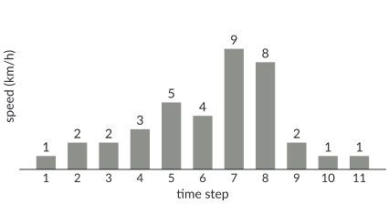{.nocap height="340px"}

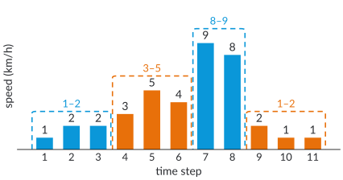{.fragment .nocap height="340px"}
:::

Cut into **as few segments as possible** such that in each segment the highest speed is **at most twice** the lowest.

[Two minutes with your neighbour. How many segments? Can you prove that fewer are impossible?]{.ask}

::: notes
About 5 minutes; one click for the solution. Greedy: extend the segment as long as the criterion holds: [1, 2, 2] (3 > 2·1), [3, 5, 4] (9 > 2·3), [9, 8] (2 is too small), [2, 1, 1]: four segments. Why not fewer: steps 1 and 4 cannot share a segment (3 > 2·1), nor steps 4 and 7 (9 > 2·3), nor steps 7 and 9 (9 > 2·2); since segments are intervals, steps 1, 4, 7 and 9 lie in four different segments. Ask how they found their solution: most will have worked from left to right, i.e. greedily.
:::

# Why greedy works {.columns}

## {.left grow="1"}

**Greedy:** extend the current segment as long as the criterion holds, then start a new one.

## Decreasing monotone {.info}

If a segment satisfies the criterion, so does every **subsegment**.

Examples: speed ratio, heading arc, disk.

## {.right grow="1"}

## Theorem (Buchin et al. 2011) {.info}

For decreasing monotone criteria, greedy finds a segmentation with the **fewest** segments.

**Greedy stays ahead:** after $k$ segments, greedy has reached at least as far as any valid segmentation with $k$ segments. The next optimal segment, cut at greedy's position, is still valid.

Time: $O(n)$ for constant-time updates (speed, heading); $O(n\log n)$ for the disk.

::: notes
About 6 minutes. Proof by induction on k: let g_k be greedy's k-th break point and o_k the k-th break point of an optimal segmentation; claim g_k ≥ o_k. If g_k ≥ o_{k+1} we are done. Otherwise the optimal segment [o_k, o_{k+1}] is valid and contains [g_k, o_{k+1}] (because o_k ≤ g_k), which is then valid by monotonicity; greedy extends at least that far, so g_{k+1} ≥ o_{k+1}. Hence greedy reaches the end after at most as many segments as the optimum.

Running times (Buchin et al. 2011): with a test that can be updated in constant time when a point is added (range of speeds, arc of headings via the extreme values), greedy takes O(n). For the disk criterion an update is not constant; with exponential search followed by binary search (double-and-search) and a smallest-enclosing-disk computation as test, O(n log n) (their Theorem 9). Combinations: AND and OR of decreasing monotone criteria are again decreasing monotone.
:::

# Quiz: which criterion breaks greedy?

[Which criterion is **not** decreasing monotone?]{.ask}

::: quiz
- [ ] The highest speed is at most twice the lowest
    - A subsegment has a smaller range of speeds: still valid.
- [ ] All positions lie within a disk of radius 30 km
    - The same disk contains the positions of every subsegment.
- [x] The segment lasts at least 48 h
    - A subsegment can be shorter: increasing monotone (every supersegment stays valid).
- [ ] All headings lie within an arc of 1.7 rad
    - The headings of a subsegment fit into the same arc.
:::

::: notes
About 2 minutes: 30 seconds to vote by phone or show of hands, then the explanations. Minimum duration is increasing monotone. The stopover criterion combines a decreasing (disk) and an increasing (duration) criterion and is neither: this is what the next slide is about. The criterion "at least 80% of the headings within an arc" is also neither.
:::

# Stopovers break greedy {.columns}

## {.left grow="3"}

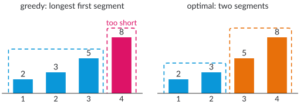{.nocap}

## {.right grow="2"}

Criterion: **at least 2 steps** AND **range at most 4**, like "48 h AND within 30 km".

- Greedy: $[2,3,5]$, then $[8]$ alone: **stuck**
- Optimal: $[2,3]$, $[5,8]$

Taking the longest first segment can be wrong.

::: notes
About 3 minutes. The minimum duration makes short segments invalid; combined with the range it is neither decreasing nor increasing monotone. Greedy could be repaired here by backtracking, but in general we need to consider all possible last segments: dynamic programming. Ask: what would you do instead of greedy?
:::

# The start-stop diagram {.columns}

## {.left grow="1"}

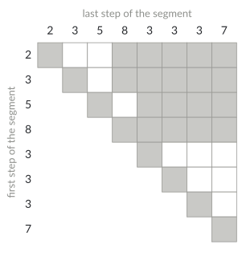{.nocap height="500px"}

## {.right grow="1"}

Speeds $2,3,5,8,3,3,3,7$, same criterion.

- Cell $(i,j)$: steps $i$ to $j$ form a **valid** segment (white)
- A segmentation is a **staircase**: the next segment starts after the last column

[Find a staircase with three cells.]{.ask}

[Aronov et al. (2016)]{.source}

::: notes
About 4 minutes. Rows: first step of a segment; columns: last step (values shown along both axes). The diagonal is grey because a single step is too short. Segment [2, 3] is cell (1, 2); after it, the next segment starts at step 3, i.e. in row 3. The staircase (1, 2) → (3, 4) → (5, 8) gives [2, 3], [5, 8], [3, 3, 3, 7]. Aronov, Driemel, van Kreveld, Löffler and Staals (SODA 2013; ACM Transactions on Algorithms 2016) introduced the start-stop diagram for non-monotone criteria; for continuous segmentation (break points anywhere), finding the best staircase is NP-hard in general, but polynomial for criteria such as outlier-tolerant ranges or bounded standard deviation. With break points at data points, as here, a simple dynamic program works (next slide).
:::

# Dynamic programming {.columns}

## {.left grow="1"}

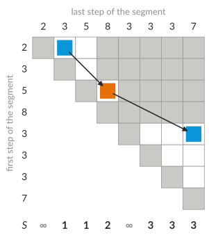{.nocap height="500px"}

## {.right grow="1"}

$S(j)$: fewest segments for steps $1,\dots,j$

$$S(0)=0,\qquad S(j)=\min_{i\le j:\ \text{steps } i..j \text{ valid}} S(i-1)+1$$

- $S(j)=\infty$: no segmentation can end at step $j$
- $O(n^2)$ validity tests

[What are the subproblems? Why is $S(5)=\infty$?]{.ask}

::: notes
About 5 minutes; this is the core of today, take the time it needs. Let the class fill in a few values before revealing them (the figure shows them all; cover the bottom row or ask before switching to the slide). S(1) = ∞ (one step is too short), S(2) = 1 ([2, 3]), S(3) = 1 ([2, 3, 5]), S(4) = 2 ([2, 3] + [5, 8]), S(5) = ∞ (every segment ending at step 5 contains 8 and 3 or is too short), S(6) = 3 (S(4) + [3, 3]), S(7) = 3 (S(4) + [3, 3, 3]), S(8) = 3 (S(4) + [3, 3, 3, 7]). The staircase is recovered from where each minimum came from.

The same recurrence works for any criterion; the start-stop diagram can have Θ(n²) valid cells, so this is O(n²) tests, each of which may cost more than constant time (e.g., the disk). Compare with greedy (O(n) or O(n log n)) for decreasing monotone criteria.
:::

# Faster for stable criteria {.columns}

## {.left grow="1"}

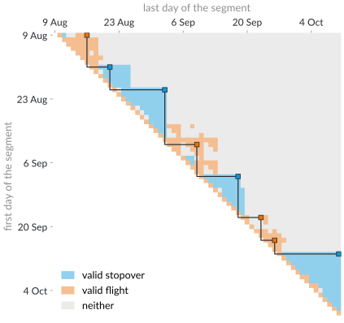{.nocap height="480px"}

## {.right grow="1"}

Eamy, geese criteria: 1,953 cells, 382 valid.

**Stable criterion:** $O(n)$ switches between valid and invalid, summed over all columns.

- Run-length encoding of the diagram
- Range-minimum queries over runs
- $O(n\log n)$ instead of $\Theta(n^2)$

Stable: monotone criteria, AND / OR, outliers up to an approximate fraction.

[Alewijnse et al. (2014)]{.source}

::: notes
About 2 minutes; keep it short. Eamy's diagram (one cell per pair of days) shows the structure: long runs of valid cells, triangles for the stopovers (blue) and bands for the flights (orange). Alewijnse, Buchin, Buchin, Kölzsch, Kruckenberg and Westenberg (2014): if a criterion is stable, the start-stop diagram can be stored compressed (run-length encoded, O(n) runs), computed in O(n log n), and the dynamic program processes a run of valid cells with one range-minimum query instead of one cell at a time: O(n log n) in total. Decreasing and increasing monotone criteria are stable, and so are AND / OR combinations of stable criteria. Details: additional slide 25.
:::

# Eamy, segmented

::: {.r-stack}
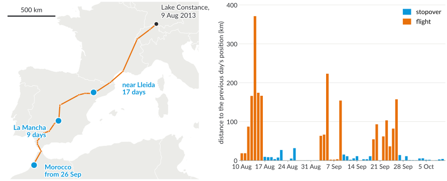{.nocap height="440px"}

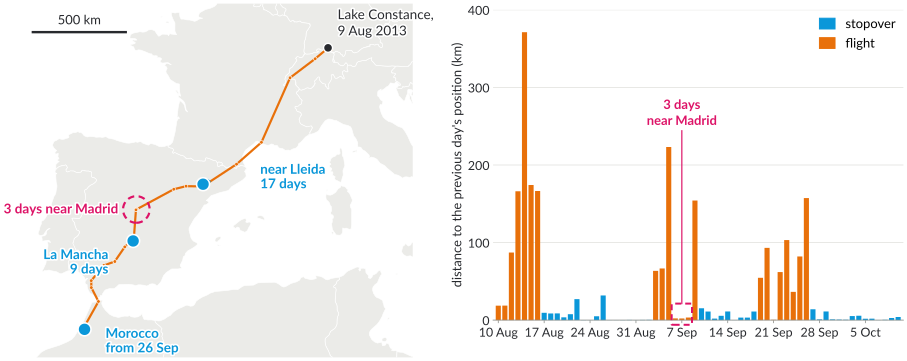{.fragment .nocap height="440px"}
:::

Geese criteria (30 km, 48 h; 1.7 rad, 20% outliers): 8 segments, 6 phases. [Compare with your stopovers: what is missing, and why?]{.ask}

::: notes
About 5 minutes. Compare with the class's stopovers from slide 7. The algorithm finds 8 segments; consecutive segments with the same state form 6 phases: flight 9–16 August, stopover near Lleida 16 August to 2 September (two segments, because she moved about 57 km within the area), flight 2–9 September, stopover in La Mancha 9–18 September, flight 18–26 September (two segments: the heading turns south at Gibraltar), Morocco from 26 September.

Let the class compare with their list from slide 7; someone should notice the stop near Madrid. Then one click: the three days near Madrid (5–8 September, 14 km from the city centre, daily moves of 2–3 km) are labelled flight. Why? The flight criterion only looks at headings: in the segment 2–9 September, 6 of the 7 daily headings lie within an arc of 1.7 rad; the GPS jitter of two of the three stationary days happens to point southwest. Fewest segments then prefers one flight segment over flight + stopover + flight. The geese criteria were made for 4–5 positions per day; with one position per day a 48-h stop has only 2–3 headings, which the 20% outliers can swallow. Fixes: add a minimum distance per day to the flight criterion, or use more positions per day. Lesson: criteria, sampling and objective together define what we find.
:::

# Change points: the same recurrence

**Optimal partitioning:** a constant per segment, penalty $\beta$ per segment; $O(n^2)$, PELT often $O(n)$.
$$F(t)=\min_{s<t}\ F(s)+\textstyle\sum_{i=s+1}^{t}(y_i-\bar y_{s+1..t})^2+\beta$$

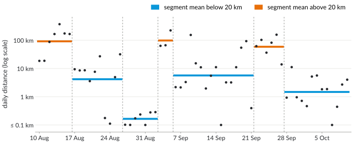{.nocap height="295px"}

[Jackson et al. (2005), Killick et al. (2012). Here $\beta=3$: 7 segments; $\beta=1$: 16.]{.source}

::: notes
About 4 minutes. This is change point detection for time series in general (sensor data, climate, finance); here y_t is the logarithm of Eamy's daily distance. The recurrence is the one from slide 15: S(j) used cost 1 for a valid segment and infinity otherwise; now the cost of a segment is its squared deviation from its mean plus the penalty β. The penalty is the knob: β = 1 gives 16 segments, β = 3 gives 7. The segments are not labelled; colours here: segment mean above or below 20 km per day.

What it finds: the stops near Madrid and in La Mancha form one stationary segment (5–21 September): the single 154-km day between them (8–9 September) is not worth a penalty of 2β. PELT (Killick, Fearnhead and Eckley 2012) discards candidates s that can never be optimal again, which gives linear expected time under conditions on the change points. Binary segmentation (split recursively at the best change point) is a fast heuristic. Software: R package changepoint, Python package ruptures; in movement ecology: penalized contrasts (Lavielle 2005, adehabitatLT), BCPA (Gurarie et al. 2009).
:::

# Hidden Markov models {.columns}

## {.left grow="1"}

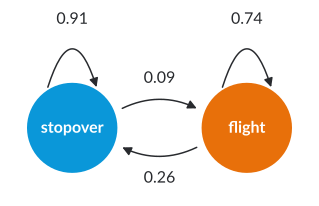{.nocap height="215px"}

- A **hidden state** per day: a Markov chain
- Each state **generates** the daily distance
- Fit: EM (Baum–Welch)

## {.right grow="1"}

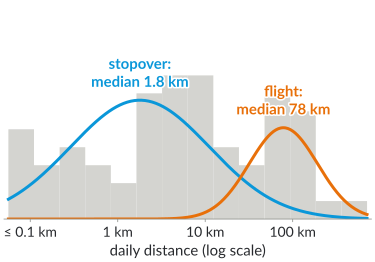{.nocap height="250px"}

Most likely states: **Viterbi**, again dynamic programming, $O(nK^2)$:
$$V_t(s)=\log b_s(x_t)+\max_{s'}\big(V_{t-1}(s')+\log a_{s's}\big)$$

::: notes
About 6 minutes. The two-state model fitted to Eamy's 62 daily distances (log scale): stopover state with median 1.8 km, flight state with median 78 km; from stopover she stays with probability 0.91 (expected stay 1/(1 − 0.91) ≈ 11 days), from flight with 0.74 (about 4 days). Viterbi computes, for every day t and state s, the log-probability V_t(s) of the most likely state sequence that ends in s at day t; backtracking gives the states. Compared to the criteria, nobody had to say what a stopover is: the model learns the two distributions. But we chose the number of states, the observed variable and the distributions.

In practice (moveHMM, momentuHMM): step lengths (gamma distribution) and turning angles (von Mises), several states (e.g., resting, foraging, travelling), covariates in the transition probabilities. Langrock et al. (2012), Michelot, Langrock and Patterson (2016). The HMM ignores the location: it would not notice a bird that moves in circles within an area unless the steps or angles reveal it (Gurarie et al. 2016 made the same point).
:::

# Three methods, one stork

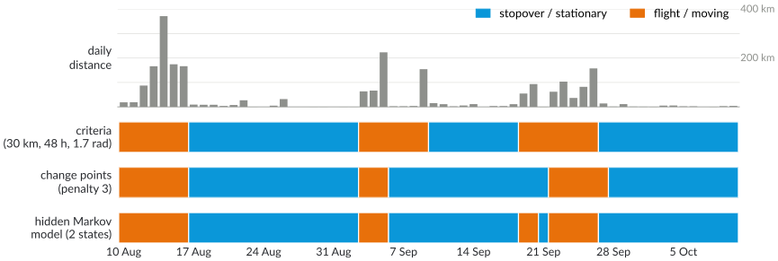{.nocap height="370px"}

Agreement on **87–95%** of the days. Different: the stop near Madrid, the flight on 8–9 September, the pause on 20–21 September.

[Which segmentation would you trust, and for which question?]{.ask}

::: notes
About 3 minutes. Criteria vs change points agree on 87% of the 62 days, criteria vs HMM on 92%, change points vs HMM on 95%. Criteria: miss the stop near Madrid (slide 17), but only call something a stopover if it lasts 48 h. Change points and HMM: see Madrid, but merge it with La Mancha because one flight day is not worth a switch; the HMM also labels the 1-day pause on 20–21 September as a stopover. This is Gurarie's observation in small: broad agreement, differences where the assumptions differ. For the geese question (how long are stopovers?) the definition matters, so state it.
:::

# Back to the geese

[4 · Practice]{.step}

- Criteria-based segmentation of two goose tracks agrees with the **manual** labelling on **96.3%** and **92.6%** of the positions (Alewijnse et al. 2014; first: M. Buchin et al. 2013)
- An algorithm labels **all** tracks the same way; the published data (79,234 GPS fixes) carry the ecologists' labels: a test bed
- Spring stopovers: refuelling for breeding; food depends on **land use** (Kölzsch et al. 2016)

## Segmentation defines the phases {.info}

Criteria, penalty or model decide what a "stopover" is: report them with the results.

::: notes
About 3 minutes. Alewijnse et al. (2014) segmented two spring tracks of white-fronted geese with the criteria of slide 6 (disk 30 km, 48 h; angular range 1.7 rad, 20% outliers; ties broken towards long stopovers) and compared with the manual segmentation by the ecologists: 96.3% and 92.6% of the positions got the same label. M. Buchin, Kruckenberg and Kölzsch (2013) had shown that criteria-based segmentation largely reproduces the expert's stopovers on these tracks. Back to the question of slide 5: knowing where and how long geese stop in spring tells where food and protection matter; Kölzsch et al. (2016) mention changing land use in Russia and hunting pressure in spring.
:::

# Next steps

- **Today**, 14:15–15:45, OH14 E02: tutorial (from now on on Tuesdays)
- **Tuesday, 10 November:** route planning: shortest paths for cycling
- Project idea: criteria-based segmentation as a **MoveApp**, or compare segmentations of the same tracks

::: notes
Closing sentence: segmentation turns a track into phases; greedy suffices for decreasing monotone criteria, stopovers need dynamic programming, and the same recurrence underlies change point detection and the Viterbi algorithm. Next week the topic changes to route planning; the algorithms (shortest paths, again with a dynamic-programming flavour) carry over.
:::

# Additional material {.section}

For self-study and the tutorial

# Greedy for the disk criterion

Test: do positions $p_i,\dots,p_j$ fit into a disk of radius $r$? Smallest enclosing disk: $O(j-i)$ expected (Welzl).

- Adding one point can change the disk completely: no constant-time update
- **Double and search:** test $j=i+1,i+2,i+4,\dots$ until invalid, then binary search
- One segment of length $m$: $O(m\log m)$ time; all segments: $O(n\log n)$

[Buchin et al. (2011), Theorem 9]{.source}

::: notes
The doubling step overshoots by at most a factor 2, so the tests in the doubling and in the binary search cost O(m) each and there are O(log m) of them. Summed over segments of lengths m_1 + … + m_k = n: O(n log n).
:::

# Range-minimum queries for the dynamic program

For a stable criterion, column $j$ of the start-stop diagram consists of $O(1)$ **runs** of valid cells on average.

- For a run of valid starts $i\in[a,b]$: $\min_{a\le i\le b} S(i-1)$, one **range-minimum query**
- Balanced binary search tree over $S(0),S(1),\dots$, each node stores the minimum of its subtree: query and update in $O(\log n)$
- Total: $O(n)$ runs, $O(n\log n)$ time

[Alewijnse et al. (2014)]{.source}

::: notes
This is the speed-up of slide 16 in detail. The augmented search tree is the textbook construction (augmenting data structures, Cormen et al., Chapter 14 in the third edition); a segment tree or a sparse table works as well.
:::

# Change points: PELT and binary segmentation

- **Optimal partitioning:** $F(t)=\min_{s<t}F(s)+c(s,t)+\beta$, $O(n^2)$
- **PELT:** if $F(s)+c(s,t)\ge F(t)$, then $s$ can never be the last change point after $t$: drop it. Often $O(n)$
- **Binary segmentation:** split at the best single change point, recurse: fast, not always optimal
- Penalty: e.g., $\beta\propto\log n$ (BIC); or plot the number of segments against $\beta$

[Killick et al. (2012), Truong et al. (2020)]{.source}

::: notes
The pruning rule needs that adding a change point never increases the cost (true up to a constant for the usual costs). Truong, Oudre and Vayatis (2020) review cost functions, search methods and penalties, with the Python package ruptures.
:::

# Hidden Markov models in practice

- Observations per step: **step length** (gamma) and **turning angle** (von Mises)
- States: e.g. resting, foraging, travelling; chosen number $K$
- Transition probabilities may depend on **covariates** (time of day, habitat)
- R packages: moveHMM, momentuHMM; extensions: hidden semi-Markov models (state durations)

[Langrock et al. (2012), Michelot et al. (2016)]{.source}

::: notes
Panigada et al. (2024) used a two-state HMM ("foraging" and "transiting") for 11 fin whales in the Mediterranean (last year's example): most of the time was spent outside protected areas. A hidden semi-Markov model can express "a stopover lasts at least 48 h" through the distribution of state durations, which brings HMMs closer to the criteria.
:::

# Model-based segmentation

When no criterion is known: assume a **movement model** with a parameter, e.g. a Brownian bridge with diffusion coefficient $\sigma^2$.

- Each segment gets its own parameter; score = likelihood + penalty per segment (information criterion)
- Dynamic programming over segments; $O(nm)$ time for $m$ candidate values of the parameter
- Then classify segments by their parameter

[Alewijnse et al. (2018); dynamic Brownian bridges: Kranstauber et al. (2012)]{.source}

::: notes
This was the last part of last year's lecture (fisher example). The dynamic program is once more the recurrence of slide 15, with the negative log-likelihood of a segment as cost.
:::

# Check your understanding

1. Give a decreasing monotone criterion for which greedy needs more than constant time per point.
2. Why does the proof of slide 11 fail for "at least 48 h"?
3. How do you recover the segments from the values $S(j)$?
4. What changes in the dynamic program if each segment has a cost instead of counting 1?

## Possible answers {.fragment .info}

1\. The disk criterion. 2. The subsegment $[g_k, o_{k+1}]$ may be too short. 3. Store for each $j$ the $i$ that attains the minimum; backtrack from $n$. 4. Add the cost instead of 1: optimal partitioning.

# References: movement and conservation

::: refs
- Edelhoff, H., Signer, J., Balkenhol, N. (2016). Path segmentation for beginners: an overview of current methods for detecting changes in animal movement patterns. *Movement Ecology* 4, 21. <https://doi.org/10.1186/s40462-016-0086-5>
- Flack, A., Fiedler, W., Blas, J., et al. (2016). Costs of migratory decisions: A comparison across eight white stork populations. *Science Advances* 2(1), e1500931. <https://doi.org/10.1126/sciadv.1500931>
- Flack, A., Fiedler, W., Blas, J., et al. (2015). Data from: Costs of migratory decisions: a comparison across eight white stork populations. Movebank Data Repository, CC0. <https://doi.org/10.5441/001/1.78152p3q>
- Gurarie, E., Andrews, R. D., Laidre, K. L. (2009). A novel method for identifying behavioural changes in animal movement data. *Ecology Letters* 12(5), 395–408.
- Gurarie, E., Bracis, C., Delgado, M., Meckley, T. D., Kojola, I., Wagner, C. M. (2016). What is the animal doing? Tools for exploring behavioural structure in animal movements. *Journal of Animal Ecology* 85(1), 69–84. <https://doi.org/10.1111/1365-2656.12379>
- Kölzsch, A., Müskens, G. J. D. M., Kruckenberg, H., Glazov, P., Weinzierl, R., Nolet, B. A., Wikelski, M. (2016). Towards a new understanding of migration timing: slower spring than autumn migration in geese reflects different decision rules for stopover use and departure. *Oikos* 125(10), 1496–1507. <https://doi.org/10.1111/oik.03121>
- Kranstauber, B., Kays, R., LaPoint, S. D., Wikelski, M., Safi, K. (2012). A dynamic Brownian bridge movement model to estimate utilization distributions for heterogeneous animal movement. *Journal of Animal Ecology* 81(4), 738–746.
- Panigada, V., et al. (2024). Targeting fin whale conservation in the North-Western Mediterranean Sea: insights on movements and behaviour from biologging and habitat modelling. *Royal Society Open Science* 11(3), 231783.
:::

# References: segmentation algorithms

::: refs
- Alewijnse, S. P. A., Buchin, K., Buchin, M., Kölzsch, A., Kruckenberg, H., Westenberg, M. A. (2014). A framework for trajectory segmentation by stable criteria. *SIGSPATIAL 2014*, 351–360. <https://doi.org/10.1145/2666310.2666415>
- Alewijnse, S. P. A., Buchin, K., Buchin, M., Sijben, S., Westenberg, M. A. (2018). Model-based segmentation and classification of trajectories. *Algorithmica* 80(8), 2422–2452. <https://doi.org/10.1007/s00453-017-0329-x>
- Aronov, B., Driemel, A., van Kreveld, M., Löffler, M., Staals, F. (2016). Segmentation of trajectories on nonmonotone criteria. *ACM Transactions on Algorithms* 12(2), 26. <https://doi.org/10.1145/2660772>
- Buchin, M., Driemel, A., van Kreveld, M., Sacristán, V. (2011). Segmenting trajectories: A framework and algorithms using spatiotemporal criteria. *Journal of Spatial Information Science* 3, 33–63. <https://doi.org/10.5311/JOSIS.2011.3.66>
- Buchin, M., Kruckenberg, H., Kölzsch, A. (2013). Segmenting trajectories by movement states. In S. Timpf, P. Laube (eds.), *Advances in Spatial Data Handling*, Springer, 15–25. <https://doi.org/10.1007/978-3-642-32316-4_2>
:::

# References: time series and hidden Markov models

::: refs
- Jackson, B., Scargle, J. D., Barnes, D., et al. (2005). An algorithm for optimal partitioning of data on an interval. *IEEE Signal Processing Letters* 12(2), 105–108.
- Killick, R., Fearnhead, P., Eckley, I. A. (2012). Optimal detection of changepoints with a linear computational cost. *Journal of the American Statistical Association* 107(500), 1590–1598.
- Langrock, R., King, R., Matthiopoulos, J., Thomas, L., Fortin, D., Morales, J. M. (2012). Flexible and practical modeling of animal telemetry data: hidden Markov models and extensions. *Ecology* 93(11), 2336–2342.
- Lavielle, M. (2005). Using penalized contrasts for the change-point problem. *Signal Processing* 85(8), 1501–1510.
- Michelot, T., Langrock, R., Patterson, T. A. (2016). moveHMM: an R package for the statistical modelling of animal movement data using hidden Markov models. *Methods in Ecology and Evolution* 7(11), 1308–1315.
- Rabiner, L. R. (1989). A tutorial on hidden Markov models and selected applications in speech recognition. *Proceedings of the IEEE* 77(2), 257–286.
- Truong, C., Oudre, L., Vayatis, N. (2020). Selective review of offline change point detection methods. *Signal Processing* 167, 107299.
- Viterbi, A. J. (1967). Error bounds for convolutional codes and an asymptotically optimum decoding algorithm. *IEEE Transactions on Information Theory* 13(2), 260–269.
:::

# License and credits

::: refs
- Slides © 2026 Kevin Buchin, TU Dortmund University, licensed under **CC BY 4.0** (<https://creativecommons.org/licenses/by/4.0/>). Suggested attribution: "Kevin Buchin, Algorithms and Sustainability, TU Dortmund University, CC BY 4.0", with a link to the course page.
- Not covered by this license: the TU Dortmund logo and the Decker software and its themes (own licenses); the goose photo.
- Goose photo: Frank Schulenburg, "Greater white-fronted goose in flight", Wikimedia Commons, CC BY-SA 4.0 (<https://commons.wikimedia.org/wiki/File:Greater_white-fronted_goose_in_flight-1045.jpg>), cropped and scaled.
- Unless credited otherwise, figures: own work, CC BY 4.0, made with `tools/make_segmentation_figures.py`. The stork figures are based on data from Flack et al. (2015), Movebank Data Repository, CC0; maps made with Natural Earth (public domain). The geese map shows the GPS data of Kölzsch et al. (2016), Movebank Data Repository, doi:10.5441/001/1.31c2v92f, CC0; the numbers (83 and 42 days) are from the paper.
- The speed examples use constructed data, not measurements.
- Made with Decker: <https://github.com/decker-edu/decker>
:::
