# Plan for today

1. Recap: segmentation
2. Why route planning needs more than the fastest route
3. Dijkstra's algorithm and why it is too slow
4. Bidirectional search and goal direction (A*, landmarks)
5. Contraction hierarchies

::: notes
DRAFT (24 October 2026). The Dortmund running example (bicycle, TU Dortmund Campus Nord → Phoenix-See, OpenStreetMap) is not in this draft: the maps will come from the routing-viz project or from an OSM extract (see prep/VL05-konzept-routenplanung.md). Where a map belongs, the notes say so.

Timing (90 min, main part slides 2–23): 10:15 plan and recap (slides 2–3, 3 min) · 10:18 motivation (slides 4–6, 7 min) · 10:25 Dijkstra, correctness, search spaces (slides 7–9, 12 min) · 10:37 bidirectional search and quiz (slides 10–11, 9 min) · 10:46 A* and landmarks (slides 12–13, 10 min) · 10:56 other ideas (slide 14, 2 min) · 10:58 contraction hierarchies (slides 15–20, 24 min) · 11:22 comparison, outlook, next steps (slides 21–23, 5 min) · about 18 min buffer. 2025 the same material took 93 minutes, of which transit node routing alone took 21; today it is one line on slide 14 and contraction hierarchies get the time.
:::

# Recap: segmentation {.columns}

## {.left grow="1"}

- Criteria: **greedy** for decreasing monotone criteria
- Stopovers (minimum duration): **dynamic programming** over the start-stop diagram
- Change points and hidden Markov models: the same recurrence

## {.right grow="1"}

[In $S(j)=\min_i S(i-1)+1$, what was $S(j)$?]{.ask}

Today: a different question, the same tool box. **Shortest paths** are dynamic programming, too.

::: notes
About 2 minutes. Answer: the fewest segments for the first j steps. Bridge: Dijkstra's algorithm computes distances by the same principle of optimal substructure (a shortest path consists of shortest paths), but in an order given by a priority queue.
:::

# Block 2 · Route Planning {.section}

Week 5 · today: fast shortest paths

# Not only the fastest route

[1 · Question]{.step}

::: columns-1-1
::: col
- **Cycling:** quiet routes instead of the fastest along main roads (Lovelace et al. 2024)
- **Emissions:** the fastest route is not the most fuel-efficient (lecture 1, Minett et al. 2011)
:::
::: col
- **Accessibility:** routes for blind pedestrians from OpenStreetMap (Cohen and Dalyot 2021); wheelchair users: guest lecture next week
- **Public transport:** timetables and transfers (lectures 6 and 7)
:::
:::

[Which route do you take to campus, and why that one?]{.ask}

::: notes
About 4 minutes. Collect two or three answers (fastest, safest, nicest, the bus); they lead to the criteria of the next weeks. Sources from last year's slides: Lovelace et al. (2024, European Transport Research Review 16:55, CRUSE) compare fast and quiet cycle routes for Cork; Minett et al. (2011): motorway 15.6 min and 1.34 l, provincial road 15.7 min and 0.76 l (lecture 1); Cohen and Dalyot (2021, Environment and Planning B 48(6), 1511–1526). Keep it short: the details follow in lectures 6 and 7.
:::

# One problem behind all of them

**Road network as a graph** $G=(V,E)$: junctions are nodes, road segments are edges, from OpenStreetMap.

**Edge weight** $c(e)\ge0$: travel time, length, CO₂, stress for cyclists, accessibility, ...

- Western Europe: about **18 million** nodes, **42 million** edges
- A navigation service answers many queries per second

## Shortest path problem {.info}

Given $s,t\in V$: find an $s$–$t$ path with the smallest total weight $\sum_e c(e)$.

::: notes
About 3 minutes. The weight function decides what "shortest" means; next week we keep several weights at once. The size is that of the classic DIMACS/PTV Western Europe road graph used in the route-planning literature (Bast et al. 2016). Running example (to come): the bicycle network of Dortmund from OpenStreetMap, from TU Dortmund Campus Nord to the Phoenix-See.
:::

# Dijkstra's algorithm {.columns}

## {.left grow="2"}

[3 · Algorithms]{.step}

- $d(s)=0$, all others $\infty$
- Repeat: **settle** the unsettled node $u$ with the smallest $d(u)$
- **Relax** its edges: $d(v)\gets\min(d(v),\,d(u)+c(u,v))$

[Which node is settled next?]{.ask}

## {.right grow="3"}

::: {.r-stack}
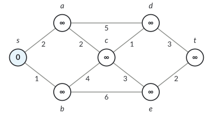{.nocap height="330px"}

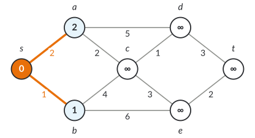{.fragment .nocap height="330px"}

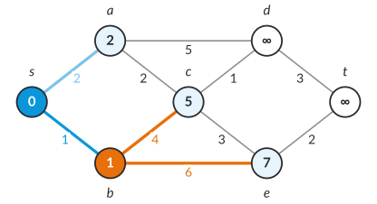{.fragment .nocap height="330px"}

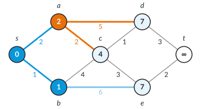{.fragment .nocap height="330px"}

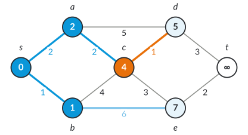{.fragment .nocap height="330px"}

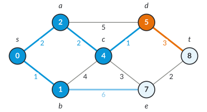{.fragment .nocap height="330px"}

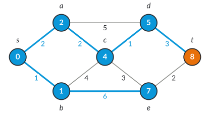{.fragment .nocap height="330px"}
:::

::: notes
About 7 minutes; six clicks. Orange: the node settled in this step and the edges it relaxes; blue: settled nodes and the current shortest-path tree; light blue: tentative distances. Ask before each click which node comes next. Order: s (0), b (1), a (2), c (4), d (5), e (7), t (8). Two improvements to point out: c from 5 (via b) to 4 (via a), d from 7 (via a) to 5 (via c). Shortest path s–a–c–d–t, length 8. The step where e is settled (nothing changes) is skipped.
:::

# Why Dijkstra is correct, and how fast

- Priority queue (binary heap): $O((n+m)\log n)$
- Graph as **adjacency array**: all edges of a node next to each other in memory
- Stop as soon as $t$ is settled

[Where does the proof use $c(e)\ge0$?]{.ask}

## Invariant {.info}

When $u$ is settled, $d(u)$ is the shortest distance. (Edge weights $\ge0$: any other path to $u$ leaves the settled set through a node with $d\ge d(u)$.)

::: notes
About 3 minutes. Proof sketch: suppose a shorter path P to u exists; let y be the first unsettled node on P and x its predecessor (settled); then d(y) ≤ d(x) + c(x, y) ≤ length of P < d(u), so y would have been settled before u. Non-negative weights make the rest of P non-negative. With a Fibonacci heap O(m + n log n); in practice a binary heap with lazy deletion (push again instead of decrease-key) is fast. Adjacency array = compressed sparse row: one offset array over the nodes and one array of edges.
:::

# Too slow for continental networks

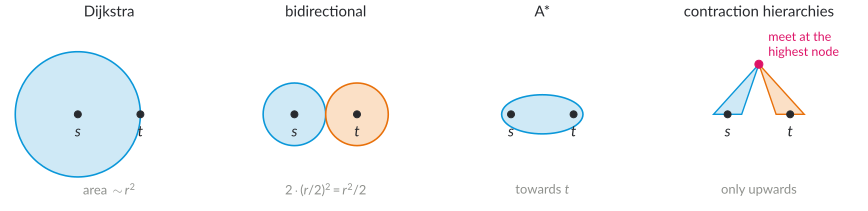{.nocap height="320px"}

- Dijkstra settles **every node closer than $t$**: on Western Europe seconds per query
- With preprocessing: **micro- to milliseconds** (Bast et al. 2016)

::: notes
About 2 minutes. Here the Dortmund map should show the Dijkstra search space from TU to the Phoenix-See (all nodes settled, coloured by the order of settling). Search space = set of settled nodes. The disk is the idealized picture: in a road network the search space follows the fast roads, as last year's hand-drawn map showed. The three ideas of today: search from both ends, search towards the target, and use a hierarchy.
:::

# Bidirectional search

- **Forward** from $s$, **backward** from $t$ (edges reversed), alternating
- $\mu$: shortest $s$–$t$ path found so far (whenever an edge connects the two searches)
- **Stop** when $\min$ queue forward $+$ $\min$ queue backward $\ge\mu$

## Careful {.warn}

The first node settled by both searches need not lie on a shortest path.

::: notes
About 4 minutes. The stopping rule: every path not yet found has length at least the sum of the two queue minima. Classic mistake: stop at the first node settled in both directions and return the path through it; the correct answer is μ, which may go through an edge between the two search spaces. On the map (to come): the two search spaces from TU and from the Phoenix-See.
:::

# Quiz: how much faster?

[How much faster is bidirectional Dijkstra than Dijkstra, roughly?]{.ask}

::: quiz
- [ ] Not at all
    - It settles fewer nodes: two smaller searches.
- [x] About 2 to 4 times
    - Two disks of radius r/2 have half the area of one disk of radius r; the two searches can also run in parallel.
- [ ] About 100 times
    - Not without preprocessing: that needs the techniques that follow.
:::

::: notes
About 2 minutes, from last year's slides. Model: search space proportional to the area, π r² versus 2 π (r/2)² = π r²/2: a factor 2; on road networks the gain is often somewhat larger, and the two searches parallelize.
:::

# Goal direction: A* {.columns}

## {.left grow="2"}

**Potential** $h(v)\le$ distance from $v$ to $t$.

Settle the node with the smallest $d(v)+h(v)$.

**Consistent:** $h(u)\le c(u,v)+h(v)$ for all edges. Then A* is Dijkstra with **reduced costs** $c(u,v)-h(u)+h(v)\ge0$.

## {.right grow="3"}

::: {.r-stack}
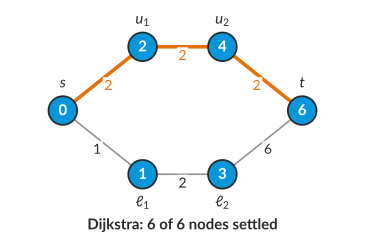{.nocap height="340px"}

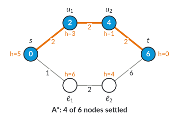{.fragment .nocap height="340px"}
:::

::: notes
About 5 minutes; one click. The lower nodes ℓ1, ℓ2 are cheap to reach (1, 3) but lead away from t; Dijkstra settles them before u2 and t, A* never does: the key of ℓ1 is 1 + 6 = 7 > 6 = distance to t. With h = 0, A* is Dijkstra. Reduced costs: every s–t path changes by the same constant h(t) − h(s), so shortest paths stay shortest, and consistency makes all reduced costs non-negative, which is all Dijkstra needs.
:::

# Which potential? Straight line and landmarks

- **Straight line:** $h(v)=\text{dist}(v,t)/v_{\max}$; weak for travel times (detours, slow streets)
- **Landmarks (ALT):** precompute distances from and to a few nodes $L$; triangle inequality:
  $$h(v)=\max_{L}\ \max\{\,d(v,L)-d(t,L),\;d(L,t)-d(L,v)\,\}$$
- Good landmarks lie **behind** $t$ as seen from $s$: choose them at the border (farthest first)

[Why is straight-line distance divided by $v_{\max}$ never too large?]{.ask}

::: notes
About 5 minutes. Triangle inequality again (lectures 2 and 3): d(v, L) ≤ d(v, t) + d(t, L) gives d(v, t) ≥ d(v, L) − d(t, L); similarly d(L, t) ≤ d(L, v) + d(v, t). Both bounds are consistent. Answer to the question: no route from v to t can be shorter than the straight line, and no edge is faster than v_max. Farthest-first landmark selection is Gonzalez's algorithm from lecture 3. ALT = A*, landmarks, triangle inequality (Goldberg and Harrelson 2005). Map (to come): A* and ALT search spaces in Dortmund.
:::

# Other ideas, in one line each

- **Arc flags:** partition the map; each edge stores for which target regions it lies on a shortest path
- **Transit node routing:** long routes leave a region through few **access nodes**; precompute distances between them
- **Hub labels:** for each node a list of hubs with distances; a query intersects two lists

Fast queries, but more preprocessing and memory. Details: additional slides.

::: notes
About 2 minutes. Last year transit node routing took 21 minutes; it is now additional material. Hub labels are the fastest exact method in practice (microseconds) at the price of a lot of memory; they are often built from a contraction hierarchy.
:::

# Contraction hierarchies: the idea

- Roads have a **hierarchy**: long routes use few important roads
- Order the nodes by **importance**; **contract** the least important node:
  remove it, add **shortcuts** so that all distances between the remaining nodes stay the same
- Query: search only **upwards** from $s$ and from $t$

## Why in detail? {.info}

The basis of many route planners (e.g., OSRM, GraphHopper) and of the multi-criteria variant next week.

::: notes
About 3 minutes. Geisberger, Sanders, Schultes and Delling (2008). "Importance" is defined by the contraction order itself; no road categories are needed, the hierarchy emerges from the graph. OSRM and GraphHopper (open-source route planners, GraphHopper with bicycle profiles) use contraction hierarchies among other techniques.
:::

# Contracting a node

Contract $v$; for each pair of neighbours $u,w$: **shortcut** $u\!-\!w$ of length $c(u,v)+c(v,w)$, unless a **witness** path that short avoids $v$ (found by a small Dijkstra from $u$ with a limit).

::: {.r-stack}
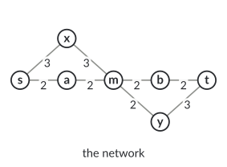{.nocap height="400px"}

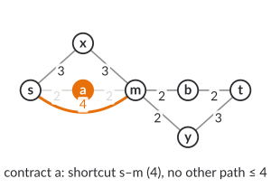{.fragment .nocap height="400px"}

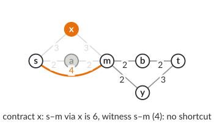{.fragment .nocap height="400px"}

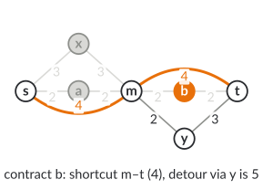{.fragment .nocap height="400px"}

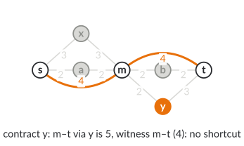{.fragment .nocap height="400px"}
:::

::: notes
About 6 minutes; four clicks. Order a, x, b, y, then s, t, m (m last: it is the most important). Contract a: s–a–m has length 4, the only other path s–x–m has 6 > 4, so the shortcut s–m (4) is needed. Contract x: s–x–m has 6, but the shortcut s–m (4) is a witness. Note that witnesses may use shortcuts. Contract b: m–b–t = 4, the detour m–y–t = 5 > 4: shortcut m–t (4). Contract y: m–y–t = 5, witness m–t (4). After that, s and t have only m as neighbour; contracting them adds nothing.
:::

# Your turn: contract $v$ {.columns}

## {.left grow="1"}

::: {.r-stack}
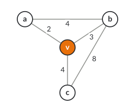{.nocap height="330px"}

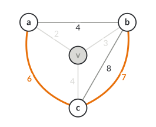{.fragment .nocap height="330px"}
:::

## {.right grow="1"}

Which **shortcuts** does contracting $v$ need?

[Two minutes with your neighbour; check all three pairs.]{.ask}

Then: how many edges does the graph have before and after?

::: notes
About 4 minutes; one click. Pairs: a–b via v = 5, witness a–b (4): no shortcut. a–c via v = 6, no other path of length ≤ 6 (a–b–c = 12): shortcut. b–c via v = 7, the edge b–c has 8 > 7: shortcut; it is parallel to the edge b–c (8), and only the shorter one is kept. Edges: 5 before (three at v, plus a–b and b–c), 3 after (a–b 4, a–c 6, b–c 7). Edge difference = shortcuts added − edges removed = 2 − 3 = −1: a good candidate to contract early (next slide).
:::

# In which order?

- Contract unimportant nodes first; **priority** e.g. **edge difference** = shortcuts added − edges removed
- Also: contract nodes spread over the map (number of contracted neighbours)
- Update priorities lazily while contracting
- Preprocessing: minutes for a continent

## Any order is correct {.info}

The order only changes the number of shortcuts and the query speed, never the distances.

::: notes
About 3 minutes. Edge difference from the exercise: −1. Typical priority terms (Geisberger et al. 2008): edge difference, number of deleted neighbours (uniformity), search space depth. With a bad order (e.g., contracting a hub early) many shortcuts appear; the answers stay correct because shortcuts preserve all distances. The routing-viz project will give the Dortmund numbers (shortcuts, preprocessing time, search space sizes).
:::

# The query

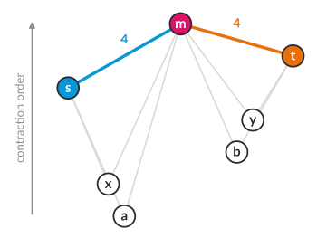{.nocap height="330px"}

- Bidirectional Dijkstra, both searches use only edges to **higher** nodes: from $s$: $s, m$; from $t$: $t, m$
- Answer: best meeting node ($m$: $4+4=8$); **unpack** shortcuts recursively ($s$–$a$–$m$, $m$–$b$–$t$)

::: notes
About 4 minutes. Upward search from s: s, then m via the shortcut (4); from t: t, then m (4); μ = 8. The forward search never goes down, the backward search never goes down (in reverse direction): two small trees. Unpacking: each shortcut stores its middle node (s–m via a, m–t via b). Map (to come): the two upward search spaces in Dortmund, a few hundred nodes instead of the whole city.
:::

# Why upward searches suffice

## Claim {.info}

For every $s,t$ there is a shortest path that first goes **up** and then **down** in the order (using shortcuts).

**Proof idea:** take a shortest path; if it has an inner node $v$ that is lower than both its neighbours on the path, then when $v$ was contracted, either a shortcut or an equally short witness was there: replace and repeat.

[Why does this process terminate?]{.ask}

::: notes
About 4 minutes. Termination: each replacement removes the lowest "valley" node (or shortens the number of edges), and there are finitely many. The highest node of the resulting path is where the two upward searches meet. This is the whole correctness argument of CH; it also shows why the witness search may have a limit: a missing witness only adds an unnecessary shortcut.
:::

# Comparison

::: tablefit
| | preprocessing | query | changing weights |
|---|---|---|---|
| Dijkstra, bidirectional | none | seconds (continent) | free |
| A* / ALT | landmark distances | faster, still large | partly |
| Contraction hierarchies | minutes | below a millisecond | recompute (or CCH) |
| Hub labels | more, lots of memory | microseconds | recompute |
:::

[Bast et al. (2016), Route Planning in Transportation Networks]{.source}

::: notes
About 2 minutes. Orders of magnitude only; the survey has exact numbers for Western Europe. "Changing weights" matters for sustainability: different users and criteria need different weights. Customizable CH (CCH) separates a metric-independent preprocessing from a fast customization per metric. Next week: what if a query needs several weights at once?
:::

# Outlook: several criteria

- Cyclist: fast **and** quiet; driver: fast **and** low CO₂
- With weights $\lambda\,c_1+(1-\lambda)\,c_2$: one shortest path per $\lambda$
- CH for **all** $\lambda$ at once: the witness test becomes "is there a $\lambda$ for which $u\!-\!v\!-\!w$ is optimal?" (Funke and Storandt 2013)

::: notes
About 1 minute. Teaser for lecture 6; Sabine Storandt (guest next week) is a co-author of the multi-criteria CH.
:::

# Next steps

- **Tuesday, 17 November:** guest lecture **Sabine Storandt** (University of Konstanz): accessibility-aware route planning
- **Tuesday, 24 November:** several criteria; timetables
- Exercise: implement Dijkstra and a CH query on the Dortmund network

::: notes
Closing sentence: fast route planning combines a simple algorithm (Dijkstra) with preprocessing that exploits the structure of road networks; contraction hierarchies are the most important example. The exercise line is a suggestion; adapt it to the sheet that is actually handed out.
:::

# Additional material {.section}

For self-study and the tutorial

# A* is Dijkstra on reduced costs

$c_h(u,v)=c(u,v)-h(u)+h(v)$. For any $s$–$t$ path $P$: $c_h(P)=c(P)-h(s)+h(t)$.

- Same shortest paths; consistent $h$ ⇒ $c_h\ge0$ ⇒ Dijkstra correct
- Dijkstra on $c_h$ settles by $d(v)-h(s)+h(v)$: the A* order
- $h=$ exact distance to $t$: only nodes on shortest paths are settled

# Transit node routing (from last year)

- Long routes leave the neighbourhood of $s$ through a few **access nodes** $A(s)$
- Precompute distances between all **transit nodes** $T$ and from each node to its access nodes
- Query: $\min\{d(s,u)+d(u,v)+d(v,t): u\in A(s), v\in A(t)\}$; short distances: another method

[Bast, Funke, Matijevic, Sanders, Schultes (2007)]{.source}

::: notes
Last year's quiz: with about 10,000 transit nodes the distance table has 10⁸ entries; with access-node distances for 18 million nodes the storage is in the gigabyte range.
:::

# Check your understanding

1. Give a graph with a negative edge where Dijkstra fails.
2. Why may bidirectional search not stop at the first node settled from both sides?
3. Which potential makes A* settle only nodes on a shortest path?
4. Contract the nodes of the exercise in a different order. What changes?

## Possible answers {.fragment .info}

1\. $s\to a$ (1), $s\to b$ (2), $b\to a$ ($-2$): $a$ is settled with 1, but the best is 0. 2. The best path may use an edge between the two search spaces. 3. The exact distance to $t$. 4. The shortcuts and the search spaces, not the distances.

# References

::: refs
- Bast, H., Delling, D., Goldberg, A., Müller-Hannemann, M., Pajor, T., Sanders, P., Wagner, D., Werneck, R. F. (2016). Route planning in transportation networks. In *Algorithm Engineering*, LNCS 9220, 19–80. <https://doi.org/10.1007/978-3-319-49487-6_2>
- Bast, H., Funke, S., Matijevic, D., Sanders, P., Schultes, D. (2007). In transit to constant time shortest-path queries in road networks. *ALENEX 2007*, 46–59.
- Cohen, A., Dalyot, S. (2021). Route planning for blind pedestrians using OpenStreetMap. *Environment and Planning B* 48(6), 1511–1526.
- Dijkstra, E. W. (1959). A note on two problems in connexion with graphs. *Numerische Mathematik* 1, 269–271.
- Funke, S., Storandt, S. (2013). Polynomial-time construction of contraction hierarchies for multi-criteria objectives. *ALENEX 2013*.
- Geisberger, R., Sanders, P., Schultes, D., Delling, D. (2008). Contraction hierarchies: faster and simpler hierarchical routing in road networks. *WEA 2008*, LNCS 5038, 319–333.
- Goldberg, A. V., Harrelson, C. (2005). Computing the shortest path: A* search meets graph theory. *SODA 2005*, 156–165.
- Hart, P. E., Nilsson, N. J., Raphael, B. (1968). A formal basis for the heuristic determination of minimum cost paths. *IEEE Transactions on Systems Science and Cybernetics* 4(2), 100–107.
- Lovelace, R., et al. (2024). Cycle route uptake and scenario estimation (CRUSE). *European Transport Research Review* 16, 55.
- Minett, C. F., Salomons, A. M., Daamen, W., van Arem, B., Kuijpers, S. (2011). Eco-routing: comparing the fuel consumption of different routes between an origin and destination using field test speed profiles and synthetic speed profiles. *IEEE Forum on Integrated and Sustainable Transportation Systems*, 32–39.
:::

# License and credits

::: refs
- Slides © 2026 Kevin Buchin, TU Dortmund University, licensed under **CC BY 4.0** (<https://creativecommons.org/licenses/by/4.0/>). Suggested attribution: "Kevin Buchin, Algorithms and Sustainability, TU Dortmund University, CC BY 4.0", with a link to the course page.
- Not covered by this license: the TU Dortmund logo and the Decker software and its themes (own licenses).
- Figures: own work, CC BY 4.0, made with `tools/make_routing_figures.py`; the example graphs are constructed, not measured.
- Made with Decker: <https://github.com/decker-edu/decker>
:::
