# Plan for today

1. Where we are: four blocks and their SDGs
2. Route planning for sustainable mobility: more than the fastest route
3. Dijkstra's algorithm, on paper and on the map of Dortmund
4. Faster: bidirectional search, A\* and landmarks
5. Contraction hierarchies
6. In practice: one profile per person, several criteria at once

::: notes
Timing (90 min, main part slides 2–28): 10:15 plan and overview of the blocks (slides 2–3, 3 min) · 10:18 block 2: which route is best, why it matters, research, one problem (slides 4–8, 13 min) · 10:31 Dijkstra: example, correctness, Dortmund (slides 9–11, 13 min) · 10:44 bidirectional search and quiz (slides 12–13, 6 min) · 10:50 A\*, heuristics, A\* and ALT in Dortmund (slides 14–16, 9 min) · 10:59 other ideas (slide 17, 1 min) · 11:00 contraction hierarchies: idea, contraction, exercise, order, query, correctness, Dortmund (slides 18–24, 21 min) · 11:21 comparison, customizable CH, several criteria, next steps (slides 25–28, 7 min) · about 17 min buffer. At the start, say that the lecture is recorded.

If time runs short: slide 10 with the picture only (one sentence); slide 15 without the formula; slide 21 in two sentences; slide 23 as claim only; slide 26 in one minute. Never cut slides 19–20 (contraction and exercise) or the live demos on slides 11 and 24. If time is left: the Dortmund model (slide 32), transit node routing (slide 31) or the questions on slide 33.

Live demos on slides 5, 11, 12, 16 and 24: an interactive map of Dortmund (works with `decker --server` and on the course web page, not in the PDF; the PDF shows the same runs as images). ▶ Run animates the search, Result shows it at once, Clear removes it. A click sets a new start, a second click the target (then the search runs); drag moves the map, the wheel zooms; ⋯ shows all controls (all algorithms, weights fast/quiet, speed). Arrow keys and the presenter still change slides when the map has the focus. Loading takes one or two seconds.
:::

# Where we are

::: tablefit
| Block | Weeks | Algorithms | SDGs |
|---|---|---|---|
| 1 · Movement analysis | 2–4, done | similarity, clustering, segmentation of animal tracks | [[14]{.sdg .s14} [15]{.sdg .s15} [13]{.sdg .s13}]{style="white-space:nowrap"} |
| **2 · Route planning** | **5–8, from today** | **shortest paths, several criteria, public transport** | [[11]{.sdg .s11} [3]{.sdg .s3} [10]{.sdg .s10}]{style="white-space:nowrap"} |
| 3 · Energy-efficient algorithms | 9–10 | speed scaling, online algorithms | [[7]{.sdg .s7} [13]{.sdg .s13} [12]{.sdg .s12}]{style="white-space:nowrap"} |
| 4 · Algorithmic fairness | 11–12 | fair clustering, fair sharing | [[10]{.sdg .s10} [5]{.sdg .s5} [16]{.sdg .s16}]{style="white-space:nowrap"} |
:::

Week 13: further topics · 2 February: project presentations

**Block 2:** [11]{.sdg .s11} sustainable cities · [3]{.sdg .s3} health · [10]{.sdg .s10} reduced inequalities

::: notes
About 2 minutes. Where we are in the course: block 1 (animal movement: life below water, life on land, climate) is done; today block 2 starts, route planning, with its goals: sustainable cities and communities (target 11.2: safe, affordable, accessible and sustainable transport for all, slide 6), good health and well-being (road safety, active mobility), reduced inequalities (accessibility). Today the algorithmic core, fast shortest paths; next week the guest lecture on accessibility; then several criteria and public transport (lectures 6 and 7). The SDGs per block are the same as on the overview in lecture 2.
:::

# Block 2 · Route Planning {.section}

Weeks 5–8 · today: shortest paths, fast

# Which cycling route is best? {.columns}

## {.left grow="2"}

[1 · Question]{.step}

From **Dortmund Hbf** to the **Phoenix-See** by bike, on OpenStreetMap data:

- **Fastest:** 19.2 min; 5.2 of its 5.6 km on busy main roads
- **Quieter:** 21.1 min; 0.2 km on busy roads

[Which one would you take? What else matters to you?]{.ask}

## {.right grow="3"}

<iframe class="demo" data-src="../static/routing-demo/index.html?ui=compact&amp;algo=compare&amp;s=hbf&amp;t=phoenix&amp;view=-300,-1700,7300,4400" title="Interactive map: fastest and quieter bicycle route from Dortmund Hbf to the Phoenix-See"></iframe>

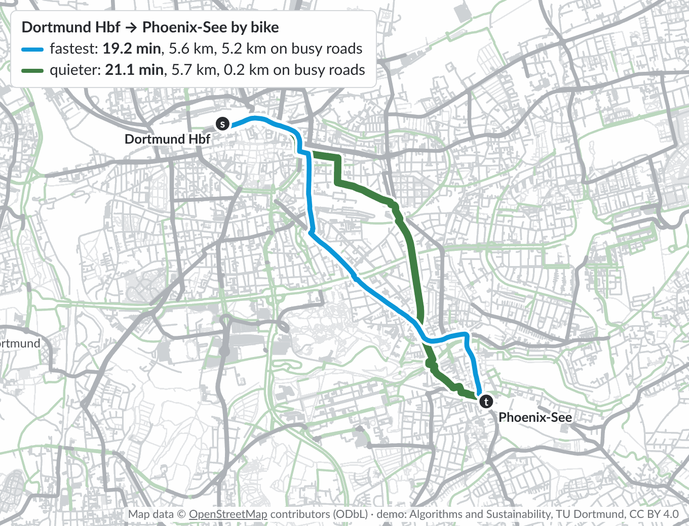{.demo-print .nocap}

::: notes
About 3 minutes. Let the students answer first; collect criteria (safety, quiet, air, hills, surface, lighting at night, fewer traffic lights, the nicer route). Then: two minutes more for 5 km less on busy roads. Both routes are computed with the same algorithm, only with a different edge weight (slide 8).

The fastest route runs along the Wall (Königswall, Schwanenwall), Heiliger Weg and Märkische Straße; the quieter one through residential streets east of the centre (Kaiserstraße, Kronprinzenstraße) and on paths (Hundeweg). Busy roads in our model: primary and secondary roads without a separate cycle track, and tertiary roads without any cycle facility outside 30 km/h zones (stress factor at least 1.5, slide 32). The model is ours, made for teaching; real cycling route planners use similar ingredients (road class, cycle infrastructure, speed limit).

In the live map, the panel shows both routes; a click sets a new start, a second click the target. Students may suggest their own trips.
:::

# Why route planning matters for sustainability

::: {.block .info}
## SDG target 11.2

"By 2030, provide access to **safe, affordable, accessible and sustainable transport systems for all**, improving road safety, notably by expanding public transport, with special attention to the needs of those in vulnerable situations, women, children, **persons with disabilities** and older persons."
:::

- Transport in Germany: **146 of 649 Mt CO₂e** in 2025 (23 %), **rising** (UBA 2026)
- Large German cities: **over 40 %** of car trips are **under 5 km** (MiD 2023)
- **7.8 million** people in Germany with a **severe disability** (9.4 %, Destatis 2026)

[[11]{.sdg .s11} sustainable cities · [13]{.sdg .s13} climate · [3]{.sdg .s3} health · [10]{.sdg .s10} reduced inequalities]{.source}

::: notes
About 3 minutes. One target names all criteria of this block: safe, affordable, accessible, sustainable, public transport, persons with disabilities. Route planning is not only "fast from A to B": it decides which options people see.

Numbers: Umweltbundesamt, press release 08/2026 (14 March 2026): 648.9 Mt CO₂e in total in 2025, transport 146.3 Mt (+2.1 Mt compared to 2024); transport and buildings rose while the total fell slightly. Short car trips: Umweltbundesamt, page on cycling, citing Mobilität in Deutschland 2023 (large cities): more than 40 % of car trips are shorter than five kilometres, a distance that is easy by bike; experts estimate that up to 30 % of urban car trips could shift to the bike. Destatis, press release 246 (13 July 2026): just over 7.8 million severely disabled people at the end of 2025, 9.4 % of the population; 10 % of them have restricted arms or legs and 4 % are blind or visually impaired. Accessible routes matter far beyond wheelchair users: older people, people with prams, temporary injuries.
:::

# Travel time is not everything

[2 · Research]{.step}

::: columns-1-1
::: {.col .chiplist}
- [3]{.sdg .s3} **Cyclists** weigh time against **suitability** (safety, traffic, lanes, hills), each differently (Ehrgott et al. 2012)
- [11]{.sdg .s11} Portland: **60 %** "interested but concerned" (Dill and McNeil 2013)
- [10]{.sdg .s10} **Blind pedestrians:** length, **turns**, **landmarks**, type of way (Cohen and Dalyot 2021)
:::
::: {.col .chiplist}
- [13]{.sdg .s13} **Emissions:** fastest is not most fuel-efficient: 15.6 min and 1.34 l vs. 15.7 min and 0.76 l (Minett et al. 2011)
- [10]{.sdg .s10} **Wheelchair users:** steps, kerbs, slopes, cobbles: **guest lecture next week**
- [11]{.sdg .s11} **Public transport:** timetables, transfers, bike and train: lectures 6, 7
:::
:::

::: notes
About 4 minutes. The SDG chips link each case to a goal: 3 road safety (target 3.6), 11 safe and sustainable transport for all (11.2), 10 inclusion, 13 climate. Conclusion (leads to the next slide): behind all of them are shortest paths, with another weight or with several weights at once. Ehrgott, Wang, Raith and van Houtte (2012, Transportation Research Part A 46(4), 652–663) model cyclists' route choice with two objectives, travel time and suitability (safety, traffic volume and speed, cycle lanes, terrain), because cyclists weigh these incommensurable objectives differently; a single cost does not fit them. Dill and McNeil (2013, Transportation Research Record 2387) tested the "four types of cyclists" typology in the Portland region: 60 % of the city's adults (56 % in the region) are "interested but concerned", a national survey (Dill and McNeil 2016) found a similar picture. These are the people that quiet routes can win.

Cohen and Dalyot (2021, Environment and Planning B 48(6), 1511–1526) plan routes for blind pedestrians from OpenStreetMap: besides length, the number of turns (complexity), landmarks that help orientation (e.g., bus stops) and the type of way (safety). Minett et al. (2011): field test in the Netherlands, already in lecture 1. Wheelchair users: Sabine Storandt (University of Konstanz) speaks next week; in Konstanz, the project "Inklusive Routenplanung im digitalen Zwilling" (Smart Green City) adds temporary obstacles from building sites and surfaces such as cobblestones, and lets people "ride" a route in the 3D city model in advance. Public transport and combined bike and train trips follow in lectures 6 and 7.
:::

# One problem behind all of them {.columns}

## {.left grow="1"}

**Street network as a graph** $G=(V,E)$: junctions are nodes, street pieces are edges

**Edge weight** $c(e)\ge0$: the criterion (time, length, CO₂, stress, accessibility, ...)

::: {.block .info}
## Shortest path problem

Given $s,t\in V$: find an $s$–$t$ path with the smallest total weight $\sum_e c(e)$.
:::

## {.right grow="1"}

**Dortmund by bike** (OSM, 9 Nov 2026):

- **112,743** nodes, **264,203** edges, 5,068 km
- **fast:** travel time; 18 km/h, slower on paths and cobbles
- **quiet:** time × stress, up to 3 on main roads

Western Europe: **18 million** nodes, **42 million** edges

::: notes
About 3 minutes. The weight function decides what "shortest" means. Our running example: all streets and paths of Dortmund (17 × 16 km) from OpenStreetMap, downloaded on 9 November 2026; one node per junction, one edge per street piece and direction; one-way streets count unless cyclists may ride both ways. The bicycle profile is a simple model for teaching (details on slide 32): 18 km/h on roads and cycleways, less on living streets, tracks and paths, unpaved or cobbled surfaces; footways where cycling is not allowed with 5 km/h (pushing); motorways and roads closed to bicycles are left out. The quiet weight multiplies the travel time by a stress factor of the road: 3 on primary roads, 2.2 on secondary, 1.6 on tertiary, less with a cycle lane or track or at 30 km/h.

Western Europe: the road graph of the route planning literature (Bast et al. 2016), 18,010,173 nodes and 42,188,664 edges, about 160 times our city.
:::

# Dijkstra's algorithm {.columns}

## {.left grow="2"}

[3 · Algorithms]{.step}

- $d(s)=0$, all others $\infty$
- Repeat: **settle** the unsettled node $u$ with the smallest $d(u)$
- **Relax** its edges: $d(v)\gets\min(d(v),\,d(u)+c(u,v))$

[Which node is settled next?]{.ask}

## {.right grow="3"}

::: {.r-stack}
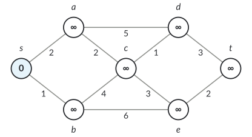{.nocap height="330px"}

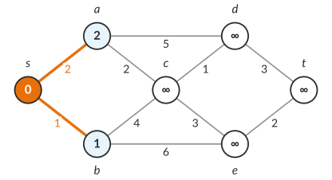{.fragment .nocap height="330px"}

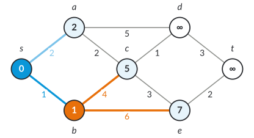{.fragment .nocap height="330px"}

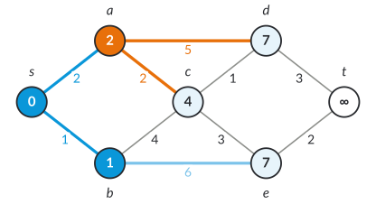{.fragment .nocap height="330px"}

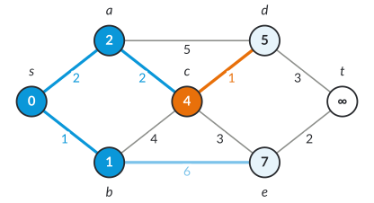{.fragment .nocap height="330px"}

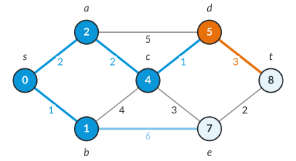{.fragment .nocap height="330px"}

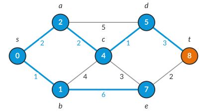{.fragment .nocap height="330px"}
:::

::: notes
About 7 minutes; six clicks. Orange: the node settled in this step and the edges it relaxes; blue: settled nodes and the current shortest-path tree; light blue: tentative distances. Ask before each click which node comes next. Order: s (0), b (1), a (2), c (4), d (5), e (7), t (8). Two improvements to point out: c from 5 (via b) to 4 (via a), d from 7 (via a) to 5 (via c). Shortest path s–a–c–d–t, length 8. The step where e is settled (nothing changes) is skipped.
:::

# Why Dijkstra is correct, and how fast {.columns}

## {.left grow="1"}

- **Adjacency lists:** for each node its outgoing edges; in practice one array, the edges of a node next to each other in memory
- **Priority queue** with $n$ inserts, $n$ delete-mins, $\le m$ decrease-keys:
  - binary heap: $O((n+m)\log n)$
  - **Fibonacci heap:** $O(m+n\log n)$
- Stop as soon as $t$ is settled

[Where does the proof use $c(e)\ge0$?]{.ask}

## {.right grow="1"}

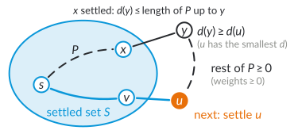{.nocap height="250px"}

::: {.block .info}
## Invariant

When $u$ is settled, $d(u)$ is the shortest distance: any other path $P$ has length $\ge d(y)\ge d(u)$.
:::

::: notes
About 4 minutes. Data structures first: adjacency lists, implemented as an adjacency array (compressed sparse row: one offset array over the nodes, one array of all edges); this is what our demo uses. Priority queue: n inserts, n delete-mins and at most m decrease-keys. Binary heap: every operation O(log n), together O((n + m) log n). Fibonacci heap (Fredman and Tarjan 1987): decrease-key in O(1) amortized, delete-min in O(log n) amortized, together O(m + n log n). That is optimal for Dijkstra's algorithm in the comparison model, because it settles the nodes sorted by distance. Recent research, if someone asks: Dijkstra with a suitable heap is even universally optimal (Haeupler, Hladík, Rozhoň, Tarjan and Tětek, FOCS 2024, best paper); for sparse directed graphs, Duan, Mao, Mao, Shu and Yin (STOC 2025) broke this sorting barrier with O(m log^(2/3) n), with an algorithm that does not settle the nodes in sorted order. In practice a binary heap is faster, often with lazy deletion (push again instead of decrease-key, skip outdated entries), as in our demo.

The picture, left to right: S is the set of settled nodes, u the next node, the one with the smallest tentative distance d(u). Suppose another s–u path P were shorter. P starts in S and ends outside, so it leaves S somewhere, over an edge from a settled node x to an unsettled node y. When x was settled, the edge (x, y) was relaxed, so d(y) ≤ length of P up to y. Because u was chosen with the smallest d, d(y) ≥ d(u). The rest of P from y to u is not negative, because the weights are not. Together: length of P ≥ d(y) ≥ d(u). Answer to the question: exactly in the last step; with a negative edge on the rest of P the argument breaks (question 1 on slide 33).
:::

# Dijkstra on the map of Dortmund {.columns}

## {.left grow="2"}

**TU Dortmund** → **Phoenix-See**: 27.4 min

- Settles **62,880** of 112,743 nodes: **all** closer than the target
- About 15 ms in the browser: enough for one city
- Western Europe: about **1.6 s** per query

[▶ Run: watch it grow.]{.ask}

## {.right grow="3"}

<iframe class="demo" data-src="../static/routing-demo/index.html?ui=compact&amp;algo=dijkstra&amp;view=-8800,-7200,9200,8300" title="Interactive map: Dijkstra's algorithm from TU Dortmund to the Phoenix-See"></iframe>

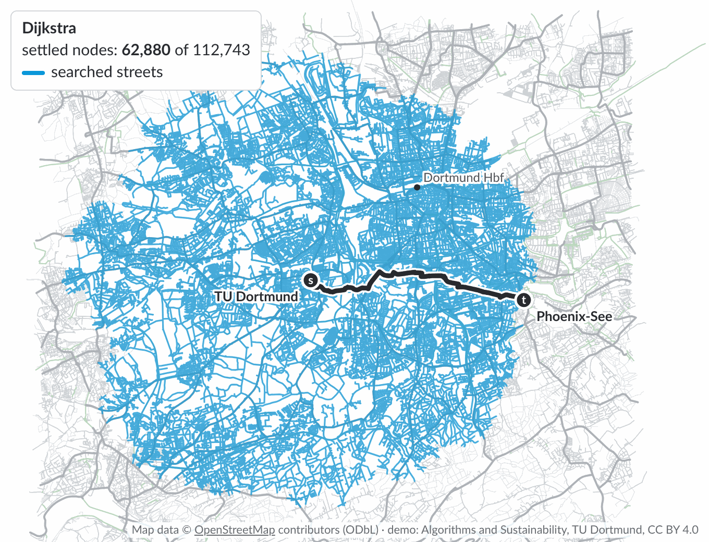{.demo-print .nocap}

::: notes
About 2 minutes. Press ▶ Run; the counter shows the settled nodes. The search grows like a disk in travel time around TU Dortmund (not a circle in kilometres: it is stretched along fast streets and paths and dented where there are none, e.g., at the motorway junction and the railway lines). It stops when the Phoenix-See is settled: everything closer has been settled before. Search space = set of settled nodes.

Honest point: for one city Dijkstra is fast enough; our JavaScript needs about 15 ms. The speed-up techniques matter for large networks (Western Europe: Dijkstra about 1.6 s per query, Dibbelt, Strasser and Wagner 2014), for servers that answer many queries per second, and for the harder problems of the next weeks (several criteria, timetables), where the basic search is much more expensive.
:::

# Bidirectional search {.columns}

## {.left grow="2"}

- **Forward** from $s$, **backward** from $t$ (edges reversed)
- $\mu$: best $s$–$t$ path seen so far
- **Stop** when the two queue minima add up to $\ge\mu$

::: {.block .warn}
## Careful

The first node settled from both sides need not lie on a shortest path.
:::

## {.right grow="3"}

<iframe class="demo" data-src="../static/routing-demo/index.html?ui=compact&amp;algo=bidir&amp;view=-8800,-7200,9200,8300" title="Interactive map: bidirectional Dijkstra from TU Dortmund and from the Phoenix-See"></iframe>

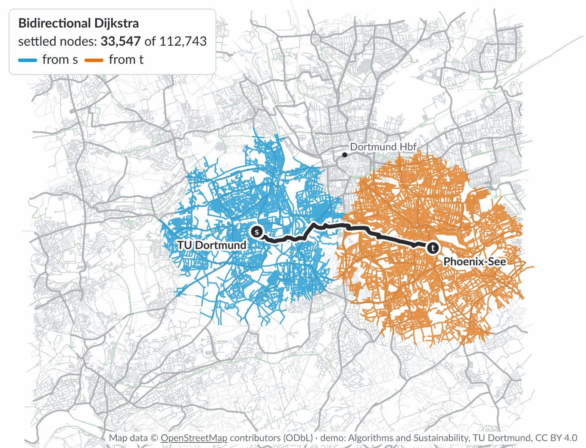{.demo-print .nocap}

::: notes
About 4 minutes. The stopping rule: every path not yet found has length at least the sum of the two queue minima. Classic mistake: stop at the first node settled in both directions and return the path through it; the correct answer is μ, which may go through an edge between the two search spaces. Our demo always expands the side with the smaller queue minimum. On the map: two smaller "disks" instead of one large one; 33,547 settled nodes instead of 62,880.
:::

# Quiz: how much faster?

[How much faster is bidirectional Dijkstra than Dijkstra, roughly?]{.ask}

::: quiz
- [ ] Not at all
    - It settles fewer nodes: two smaller searches.
- [x] About 2 to 4 times
    - Two disks of radius r/2 have half the area of one disk of radius r; Dortmund: 62,880 against 33,547 settled nodes, a factor of 1.9.
- [ ] About 100 times
    - Not without preprocessing: that needs the techniques that follow.
:::

::: notes
About 2 minutes, from last year's slides. Model: search space proportional to the area, π r² versus 2 π (r/2)² = π r²/2: a factor 2. Dortmund: 62,880 against 33,547 settled nodes (1.9); over 300 random pairs on average 54,587 against 34,990 (1.6), because many random pairs lie near the border of the map, where Dijkstra's disk is cut off. The two searches also run in parallel.
:::

# Goal direction: A\* {.columns}

## {.left grow="2"}

**Heuristic** $h(v)\le$ distance from $v$ to $t$.

Settle the node with the smallest $d(v)+h(v)$.

**Consistent:** $h(u)\le c(u,v)+h(v)$ for all edges. Then A\* is Dijkstra with **reduced costs** $c(u,v)-h(u)+h(v)\ge0$; hence route planning calls $h$ a **potential**.

## {.right grow="3"}

::: {.r-stack}
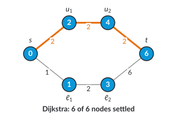{.nocap height="340px"}

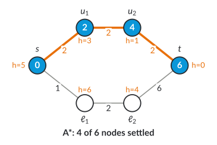{.fragment .nocap height="340px"}
:::

::: notes
About 4 minutes; one click. The lower nodes ℓ1, ℓ2 are cheap to reach (1, 3) but lead away from t; Dijkstra settles them before u2 and t, A\* never does: the key of ℓ1 is 1 + 6 = 7 > 6 = distance to t. With h = 0, A\* is Dijkstra. Reduced costs: every s–t path changes by the same constant h(t) − h(s), so shortest paths stay shortest, and consistency makes all reduced costs non-negative, which is all Dijkstra needs (slide 30).

Terminology: in A\* (Hart, Nilsson and Raphael 1968) and in AI, h is the heuristic, an estimate of the remaining distance; admissible means never larger than the distance to t, consistent means the condition on the slide (consistent with h(t) = 0 implies admissible). Route-planning papers (Goldberg and Harrelson 2005 and later) call the same function a potential, usually π: the word comes from node potentials and reduced costs in network flows (and in Johnson's algorithm). A consistent heuristic is a feasible potential: all reduced costs are non-negative.
:::

# Which heuristic? Straight line and landmarks

- **Straight line:** $h(v)=\text{dist}(v,t)/v_{\max}$; Dortmund: $v_{\max}=18$ km/h
- **Landmarks (ALT):** precompute distances from and to a few nodes $L$; triangle inequality:
  $$h(v)=\max_{L}\ \max\{\,d(v,L)-d(t,L),\;d(L,t)-d(L,v)\,\}$$
- Good landmarks lie **behind** $t$ or **behind** $s$: spread them out, **farthest first**

[Why is straight-line distance divided by $v_{\max}$ never too large?]{.ask}

::: notes
About 3 minutes. Triangle inequality again (lectures 2 and 3): d(v, L) ≤ d(v, t) + d(t, L) gives d(v, t) ≥ d(v, L) − d(t, L); similarly d(L, t) ≤ d(L, v) + d(v, t). Both bounds are consistent. The first is exact when t lies on a shortest path from v to L (L behind t), the second when v lies on a shortest path from L to t (L behind s). Answer to the question: no route from v to t can be shorter than the straight line, and no edge is faster than v_max. Farthest-first landmark selection is Gonzalez's algorithm from lecture 3; our demo uses 8 landmarks, chosen farthest first by travel time there and back. ALT = A\*, landmarks, triangle inequality (Goldberg and Harrelson 2005). A technical detail of the demo: the travel times are rounded up, so the straight-line bound stays a lower bound for every edge.
:::

# A\* and ALT on the map of Dortmund {.columns}

## {.left grow="2"}

- A\*, straight line: **8,725** settled nodes
- ALT, 8 landmarks: **6,123**
- The search runs **towards** the target
- ALT needs preprocessing: 16 Dijkstra runs

[Where does farthest first put the 8 landmarks? Which ones help here?]{.ask}

## {.right grow="3"}

<iframe class="demo" data-src="../static/routing-demo/index.html?ui=compact&amp;algo=astar&amp;algos=astar,alt&amp;view=-9700,-8600,10700,9300" title="Interactive map: A* and ALT from TU Dortmund to the Phoenix-See"></iframe>

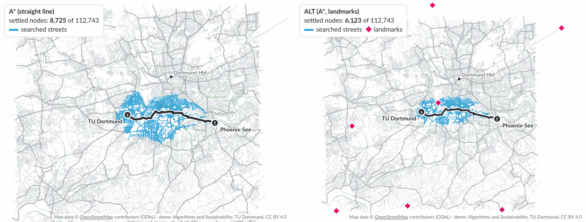{.demo-print .nocap}

::: notes
About 2 minutes. Switch between A\* and ALT with the two buttons. Answer to the question: seven landmarks lie at the border of the map (red diamonds; the north-western one is under the legend box), one lies in the middle, just north-east of the campus. Farthest first takes the four corners first; after them the middle is farthest from all landmarks so far (k-center, lecture 3), then the middles of the sides. Which ones help: for TU to Phoenix-See the landmark in the middle gives the best bound for 56 % of the settled nodes, the western one for 43 %; both lie behind the start as seen from the target. At the start, ALT estimates 23.7 min, the straight line 21.0 min; the true travel time is 27.4 min. A\* with the straight line is weak for travel times, because few routes run straight at top speed; landmarks give better bounds, because they know the actual network. Averages over 300 random pairs: A\* 13,775, ALT 4,896 settled nodes. Precomputing the landmark distances takes 16 runs of Dijkstra over the whole graph (from and to each landmark): about a quarter of a second in the browser.
:::

# Other ideas, in one line each

- **Arc flags:** partition the map; each edge stores for which target regions it lies on a shortest path
- **Transit node routing:** long routes leave a region through few **access nodes**; precompute distances between them
- **Hub labels:** for each node a list of hubs with distances; a query intersects two lists

Fast queries, but more preprocessing and memory. Details: additional slides.

::: notes
About 1 minute. Last year transit node routing took 21 minutes; it is now additional material (slide 31). Hub labels are the fastest exact method in practice (about a microsecond per query) at the price of a lot of memory; they are often built from a contraction hierarchy.
:::

# Contraction hierarchies: the idea

- Roads have a **hierarchy**: long routes use few important roads
- Order the nodes by **importance**; **contract** the least important node:
  remove it, add **shortcuts** so that all distances between the remaining nodes stay the same
- Query: search only **upwards** from $s$ and from $t$

::: {.block .info}
## Why in detail?

The basis of many route planners (e.g., OSRM, GraphHopper), of the customizable variant (slide 26) and of the multi-criteria variant next week.
:::

::: notes
About 2 minutes. Geisberger, Sanders, Schultes and Delling (2008). "Importance" is defined by the contraction order itself; no road categories are needed, the hierarchy emerges from the graph. OSRM and GraphHopper (open-source route planners, GraphHopper with bicycle profiles) use contraction hierarchies among other techniques.
:::

# Contracting a node

Contract $v$; for each pair of neighbours $u,w$: **shortcut** $u\!-\!w$ of length $c(u,v)+c(v,w)$, unless a **witness** path that short avoids $v$ (found by a small Dijkstra from $u$ with a limit).

::: {.r-stack}
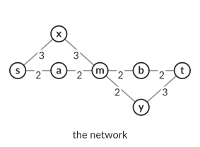{.nocap height="370px"}

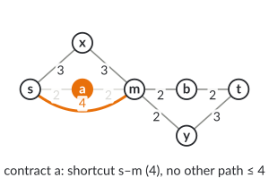{.fragment .nocap height="370px"}

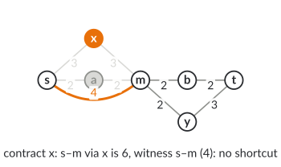{.fragment .nocap height="370px"}

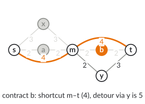{.fragment .nocap height="370px"}

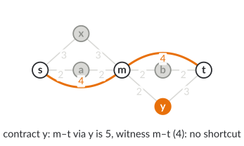{.fragment .nocap height="370px"}
:::

::: notes
About 6 minutes; four clicks. Order a, x, b, y, then s, t, m (m last: it is the most important). Contract a: s–a–m has length 4, the only other path s–x–m has 6 > 4, so the shortcut s–m (4) is needed. Contract x: s–x–m has 6, but the shortcut s–m (4) is a witness. Note that witnesses may use shortcuts. Contract b: m–b–t = 4, the detour m–y–t = 5 > 4: shortcut m–t (4). Contract y: m–y–t = 5, witness m–t (4). After that, s and t have only m as neighbour; contracting them adds nothing.
:::

# Your turn: contract $v$ {.columns}

## {.left grow="1"}

::: {.r-stack}
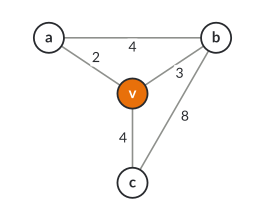{.nocap height="330px"}

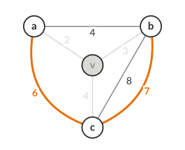{.fragment .nocap height="330px"}
:::

## {.right grow="1"}

Which **shortcuts** does contracting $v$ need?

[Two minutes with your neighbour; check all three pairs.]{.ask}

Then: how many edges does the graph have before and after?

::: notes
About 4 minutes; one click. Pairs: a–b via v = 5, witness a–b (4): no shortcut. a–c via v = 6, no other path of length ≤ 6 (a–b–c = 12): shortcut. b–c via v = 7, the edge b–c has 8 > 7: shortcut; it is parallel to the edge b–c (8), and only the shorter one is kept. Edges: 5 before (three at v, plus a–b and b–c), 3 after (a–b 4, a–c 6, b–c 7). Edge difference = shortcuts added − edges removed = 2 − 3 = −1: a good candidate to contract early (next slide).
:::

# In which order?

- Contract unimportant nodes first; **priority** e.g. **edge difference** = shortcuts added − edges removed
- Also: contract nodes spread over the map (number of contracted neighbours)
- Priorities change while we contract: recompute the neighbours' at once, the others only when they reach the top of the queue (**lazy updates**)
- Dortmund: **185,295 shortcuts** for 264,203 edges, about 10 s in JavaScript

::: {.block .info}
## Any order is correct

The order only changes the number of shortcuts and the query speed, never the distances.
:::

::: notes
About 2 minutes. Edge difference from the exercise: −1. Typical priority terms (Geisberger et al. 2008): edge difference, number of contracted neighbours (uniformity), search space depth. Lazy updates: contracting v changes the priorities of its neighbours (recomputed at once), but also, indirectly, those of other nodes, because witness searches can now use the new shortcuts. Recomputing all priorities after every contraction would be too expensive. Instead, the node at the top of the queue is evaluated again before it is contracted; if its priority is now larger than the next key, it goes back into the queue. Our demo uses 2 × edge difference + contracted neighbours, lazy updates, and witness searches that stop after 100 settled nodes (a missing witness only adds an unnecessary shortcut). With a bad order (e.g., contracting a hub early) many shortcuts appear; the answers stay correct because shortcuts preserve all distances. Continental networks: minutes of preprocessing in C++.
:::

# The query

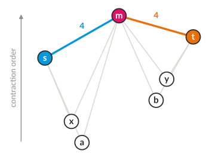{.nocap height="290px"}

- Bidirectional Dijkstra, both searches use only edges to **higher** nodes: from $s$: $s, m$; from $t$: $t, m$
- Answer: best meeting node ($m$: $4+4=8$); **unpack** shortcuts recursively ($s$–$a$–$m$, $m$–$b$–$t$)

::: notes
About 3 minutes. Upward search from s: s, then m via the shortcut (4); from t: t, then m (4); μ = 8. The forward search never goes down, the backward search never goes down (in reverse direction): two small trees. Each search may stop once its queue minimum reaches μ. Unpacking: each shortcut stores the two edges it replaces (s–m via a, m–t via b).
:::

# Why upward searches suffice {.columns}

## {.left grow="1"}

::: {.block .info}
## Claim

For every $s,t$ there is a shortest path that first goes **up** and then **down** in the order (using shortcuts).
:::

**Proof idea:** take the lowest **valley** $v$ of a shortest path. When $v$ was contracted, $u$ and $w$ were still there: a shortcut $u$–$w$ or a witness via higher nodes is at most as long. Replace, repeat.

[Why does this process terminate?]{.ask}

## {.right grow="1.25"}

{.nocap height="330px"}

::: notes
About 2 minutes; explain with the picture. Termination: we always take the lowest valley v; a replacement adds only nodes higher than v (the shortcut adds none, a witness consists of nodes contracted later), and u and w are higher anyway. So the rank of the lowest valley increases strictly with every step: at most n steps. Without "lowest" one needs a more careful argument. Why this proves the query correct: the up part of the final path is a path in the upward graph of s, the down part read backwards one in the upward graph of t; both searches reach its highest node m, so the best meeting value μ ≤ d(s,t); every candidate value is the length of a real path, so μ ≥ d(s,t). The searches do not need to know where t is. This is the whole correctness argument of CH; it also shows why the witness search may have a limit: a missing witness only adds an unnecessary shortcut.
:::

# Contraction hierarchies on the map of Dortmund {.columns}

## {.left grow="2"}

- Two upward searches settle **239** nodes (Dijkstra: 62,880)
- Their trees reach **important** junctions all over the city, often by **shortcuts** (dashed)
- Unpacking the shortcuts gives the same route: 27.4 min

[Why do the searches not stay near the route?]{.ask}

## {.right grow="3"}

<iframe class="demo" data-src="../static/routing-demo/index.html?ui=compact&amp;algo=ch&amp;view=-8800,-7200,9200,8300" title="Interactive map: contraction hierarchy query from TU Dortmund to the Phoenix-See"></iframe>

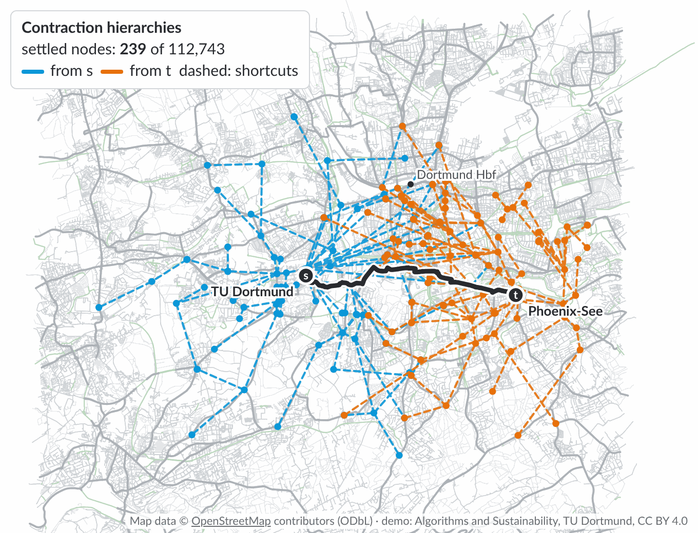{.demo-print .nocap}

::: notes
About 2 minutes. Press ▶ Run (slow on purpose: 239 nodes). Answer: the searches only go up in the order, to more important nodes, wherever they are; they do not know where t is. Important nodes are spread over the city (the order prefers uniformity), so the search trees look scattered, but they are tiny. Over 300 random pairs, the CH query settles 249 nodes on average.
:::

# How much faster?

[4 · Practice]{.step}

::: tablefit
| Dortmund by bike | preprocessing | settled nodes: TU → Phoenix-See | 300 random queries (mean) |
|---|---|---:|---:|
| Dijkstra | none | 62,880 | 54,587 |
| Bidirectional | none | 33,547 | 34,990 |
| A\*, straight line | none | 8,725 | 13,775 |
| ALT, 8 landmarks | 16 Dijkstra runs | 6,123 | 4,896 |
| Contraction hierarchies | 185,295 shortcuts, 10 s | 239 | 249 |
:::

Western Europe (18 million nodes), per query: Dijkstra **1.6 s**, customizable CH **0.41 ms**.

[Bast et al. (2016); Dibbelt, Strasser, Wagner (2014); Dortmund: our demo]{.source}

::: notes
About 2 minutes. All five methods give the same distances: the demo was checked against Dijkstra on 300 random pairs. Settled nodes measure the work independently of the computer. Times on Western Europe from Dibbelt, Strasser and Wagner (2014, Table 1 and 5): Dijkstra 1,560 ms per query, customizable CH 0.41 ms; plain CH queries take around a tenth of a millisecond and hub labels about a microsecond (Bast et al. 2016). For sustainability this matters where many routes are needed: route planners for millions of users, traffic simulations, accessibility analyses over all pairs of places.
:::

# One profile per person? {.columns}

## {.left grow="1"}

- Inclusive routing: a weight per **group** or **person**: wheelchair, pram, cautious cyclist, e-bike, ...
- A CH is built for **one** weight

[Recompute everything for every profile?]{.ask}

## {.right grow="1"}

::: {.block .info}
## Customizable contraction hierarchies

1. Order and shortcuts from the **graph alone** (nested dissection), once
2. **Customize** for a new weight: below **1 s** for Western Europe
3. Queries as in a CH: **0.41 ms**
:::

[Dibbelt, Strasser, Wagner (2014, 2016)]{.source}

::: notes
About 2 minutes. Answer: no. Customizable CH split the preprocessing into a metric-independent phase that uses only the topology of the graph (a nested dissection order: separators of the road network are contracted last) and a fast customization phase that computes the weights of all shortcuts for a given metric (0.74 s for Europe on 16 threads in the SEA 2014 paper, "below one second"). Queries take 0.41 ms. This is what makes personal profiles possible: a wheelchair user, a cyclist who avoids main roads, a weight that changes with traffic or building sites. Link to the guest lecture next week: accessibility-aware route planning needs exactly such individual metrics. In the demo, choose CH and switch the weight to "quiet": the hierarchy was built for travel time only.
:::

# Outlook: several criteria at once {.columns}

## {.left grow="1"}

- $P$ **dominates** $Q$: as good in **both** weights, better in one
- Hbf → Phoenix-See: **115 Pareto-optimal** routes
- Weighted sums $\lambda\,\text{time}+(1-\lambda)\,\text{quiet}$: only **13** of them

[Why does a weighted sum miss the others?]{.ask}

**Next time:** multi-criteria Dijkstra, CH for all $\lambda$

## {.right grow="1"}

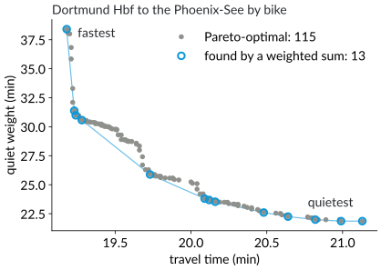{.nocap height="340px"}

::: notes
About 2 minutes. Answer: a weighted sum is a linear function; its optima lie on the lower convex hull of the Pareto front ("supported" routes), the routes in the dents are never optimal for any λ. Teaser numbers: we computed all Pareto-optimal routes with multi-criteria Dijkstra (Martins 1984): 115 routes, 1.36 million labels settled (Dijkstra settles each node at most once, here at most 112,743), about 7 seconds. The weighted sums: λ = 0, 0.01, …, 1. Many Pareto-optimal routes differ only slightly; next week: how to compute them, how many there can be, and the CH for all λ at once (Funke and Storandt 2013), whose witness test asks "is there a λ for which u–v–w is optimal?". Sabine Storandt, who speaks next week, is a co-author.
:::

# Next steps

- **Today**, 14:15–15:45, OH14 E02: in-class exercise, route planning by hand
- **Tuesday, 17 November:** guest lecture **Sabine Storandt** (University of Konstanz): accessibility-aware route planning
- **Tuesday, 24 November:** several criteria; public transport
- Try the map yourself: the live demo is part of the web version of these slides

::: notes
Closing sentence: fast route planning combines a simple algorithm (Dijkstra) with preprocessing that exploits the structure of road networks; contraction hierarchies are the most important example, and their customizable variant makes personal profiles feasible. Which weight we choose is the sustainability question. The in-class exercise this afternoon goes through all algorithms of today on a small graph.
:::

# Additional material {.section}

For self-study and the tutorial

# A\* is Dijkstra on reduced costs

$c_h(u,v)=c(u,v)-h(u)+h(v)$. For any $s$–$t$ path $P$: $c_h(P)=c(P)-h(s)+h(t)$.

- Same shortest paths; consistent $h$ ⇒ $c_h\ge0$ ⇒ Dijkstra correct
- Dijkstra on $c_h$ settles by $d(v)-h(s)+h(v)$: the A\* order
- $h=$ exact distance to $t$: only nodes on shortest paths are settled
- Hence the name **potential** for $h$, as for node potentials in min-cost flows

# Transit node routing (from last year)

- Long routes leave the neighbourhood of $s$ through a few **access nodes** $A(s)$
- Precompute distances between all **transit nodes** $T$ and from each node to its access nodes
- Query: $\min\{d(s,u)+d(u,v)+d(v,t): u\in A(s), v\in A(t)\}$; short distances: another method

[Bast, Funke, Matijevic, Sanders, Schultes (2007)]{.source}

::: notes
Last year's quiz: with about 10,000 transit nodes the distance table has 10⁸ entries; with access-node distances for 18 million nodes the storage is in the gigabyte range.
:::

# The Dortmund demo: data and model

::: small
- **Data:** OpenStreetMap, 9 November 2026: all ways with a `highway` tag in 51.42–51.56° N, 7.30–7.55° E; nodes are junctions; the largest strongly connected part (112,743 nodes) is kept
- **Fast:** 18 km/h on roads and cycleways; 16 on designated paths, 14 on good tracks and shared footways, 12 on other paths and service lanes, 10 on living streets; × 0.8 unpaved, × 0.75 cobbles; 5 km/h pushing on footways; no motorways, steps or roads closed to bicycles; one-way streets unless cyclists may ride both ways
- **Quiet:** travel time × stress: primary roads 3, secondary 2.2, tertiary 1.6, unclassified 1.2, otherwise 1; with a cycle track only 20 % of the extra stress, with a lane or 30 km/h 50 %; "busy" means stress at least 1.5
- **Algorithms:** binary heap with lazy deletion; ALT with 8 landmarks (farthest first); CH with priority 2 × edge difference + contracted neighbours, witness search limited to 100 settled nodes; all checked against Dijkstra
- **Code:** `tools/make_routing_demo.py` (graph), `tools/routing_prep.mjs` (CH, landmarks, checks), `static/routing-demo/` (algorithms and map)
:::

::: notes
The model is deliberately simple; it ignores hills, traffic lights, turn costs and the time of day. A good project idea: a better bicycle profile for Dortmund (elevation, surface, lighting) or an accessibility profile, with a customizable CH. The map data are © OpenStreetMap contributors and available under the Open Database License; the graph derived from it is therefore also under the ODbL.
:::

# Check your understanding

1. Give a graph with a negative edge where Dijkstra fails.
2. Why may bidirectional search not stop at the first node settled from both sides?
3. Which heuristic makes A\* settle only nodes on a shortest path?
4. Contract the nodes of the exercise in a different order. What changes?
5. Why can a weighted sum of two criteria miss Pareto-optimal routes?

::: {.fragment .block .info}
## Possible answers

1\. $s\to a$ (1), $s\to b$ (2), $b\to a$ ($-2$): $a$ is settled with 1, the best is 0. 2. The best path may cross between the two searches. 3. The exact distance to $t$. 4. Shortcuts and search spaces, not distances. 5. Its optima lie on the lower convex hull.
:::

# References: route planning

::: refs
- Bast, H., Delling, D., Goldberg, A., Müller-Hannemann, M., Pajor, T., Sanders, P., Wagner, D., Werneck, R. F. (2016). Route planning in transportation networks. In *Algorithm Engineering*, LNCS 9220, 19–80. <https://doi.org/10.1007/978-3-319-49487-6_2>
- Bast, H., Funke, S., Matijevic, D., Sanders, P., Schultes, D. (2007). In transit to constant time shortest-path queries in road networks. *ALENEX 2007*, 46–59.
- Dibbelt, J., Strasser, B., Wagner, D. (2014). Customizable contraction hierarchies. *SEA 2014*, LNCS 8504; journal version: *ACM Journal of Experimental Algorithmics* 21 (2016).
- Dijkstra, E. W. (1959). A note on two problems in connexion with graphs. *Numerische Mathematik* 1, 269–271.
- Fredman, M. L., Tarjan, R. E. (1987). Fibonacci heaps and their uses in improved network optimization algorithms. *Journal of the ACM* 34(3), 596–615.
- Funke, S., Storandt, S. (2013). Polynomial-time construction of contraction hierarchies for multi-criteria objectives. *ALENEX 2013*.
- Geisberger, R., Sanders, P., Schultes, D., Delling, D. (2008). Contraction hierarchies: faster and simpler hierarchical routing in road networks. *WEA 2008*, LNCS 5038, 319–333.
- Goldberg, A. V., Harrelson, C. (2005). Computing the shortest path: A\* search meets graph theory. *SODA 2005*, 156–165.
- Hart, P. E., Nilsson, N. J., Raphael, B. (1968). A formal basis for the heuristic determination of minimum cost paths. *IEEE Transactions on Systems Science and Cybernetics* 4(2), 100–107.
- Martins, E. Q. V. (1984). On a multicriteria shortest path problem. *European Journal of Operational Research* 16(2), 236–245.
:::

# References: sustainability and route choice

::: refs
- Cohen, A., Dalyot, S. (2021). Route planning for blind pedestrians using OpenStreetMap. *Environment and Planning B* 48(6), 1511–1526.
- Destatis (2026). 7,8 Millionen schwerbehinderte Menschen leben in Deutschland. Press release 246, 13 July 2026.
- Dill, J., McNeil, N. (2013). Four types of cyclists? Examination of typology for better understanding of bicycling behavior and potential. *Transportation Research Record* 2387, 129–138; and (2016) Revisiting the four types of cyclists. *Transportation Research Record* 2587, 90–99.
- Ehrgott, M., Wang, J. Y. T., Raith, A., van Houtte, C. (2012). A bi-objective cyclist route choice model. *Transportation Research Part A* 46(4), 652–663.
- Minett, C. F., Salomons, A. M., Daamen, W., van Arem, B., Kuijpers, S. (2011). Eco-routing: comparing the fuel consumption of different routes between an origin and destination using field test speed profiles and synthetic speed profiles. *IEEE Forum on Integrated and Sustainable Transportation Systems*, 32–39.
- OpenStreetMap contributors (2026). Street network of Dortmund, downloaded 9 November 2026 via the Overpass API. Open Database License. <https://www.openstreetmap.org/copyright>
- Umweltbundesamt (2026). Treibhausgasdaten 2025. Press release 08/2026, 14 March 2026; and: Radverkehr (web page, citing Mobilität in Deutschland 2023).
- United Nations. Sustainable Development Goal 11, target 11.2. <https://sdgs.un.org/goals/goal11>
:::

# License and credits

::: refs
- Slides © 2026 Kevin Buchin, TU Dortmund University, licensed under **CC BY 4.0** (<https://creativecommons.org/licenses/by/4.0/>). Suggested attribution: "Kevin Buchin, Algorithms and Sustainability, TU Dortmund University, CC BY 4.0", with a link to the course page.
- Not covered by this license: the TU Dortmund logo and the Decker software and its themes (own licenses).
- Maps and the Dortmund graph: data © OpenStreetMap contributors, Open Database License (<https://www.openstreetmap.org/copyright>); the graph of the demo is a derived database and also available under the ODbL. Map images and demo code: own work, CC BY 4.0 (`tools/make_routing_demo.py`, `tools/routing_prep.mjs`, `tools/routing_shots.mjs`, `static/routing-demo/`).
- Other figures: own work, CC BY 4.0, made with `tools/make_routing_figures.py`, `tools/make_routing_sketches.py` and `tools/make_routing_pareto.py`; the small example graphs are constructed, not measured. The bicycle profile is a model for teaching.
- Made with Decker: <https://github.com/decker-edu/decker>
:::
