# Plan for today

1. Recap: contraction hierarchies
2. Several criteria: Pareto-optimal routes
3. Multi-criteria Dijkstra
4. Contraction hierarchies for several criteria
5. Public transit: timetables, models, Connection Scan

::: notes
DRAFT (24 October 2026). The Dortmund running example (bicycle, TU Dortmund Campus Nord → Phoenix-See, OpenStreetMap) is not in this draft; where its maps belong, the notes say so. The public transit example uses real stop names, a simplified network and invented times; it is replaced by VRR data once the GTFS feed is available.

Timing (90 min, main part slides 2–27): 10:15 plan and recap (slides 2–3, 3 min) · 10:18 several criteria and Pareto optimality (slides 4–8, 12 min) · 10:30 multi-criteria Dijkstra (slides 9–12, 16 min) · 10:46 contraction hierarchies for several criteria (slides 13–17, 15 min) · 11:01 public transit: terms, GTFS, queries, graph models (slides 18–22, 14 min) · 11:15 Connection Scan (slides 23–25, 12 min) · 11:27 outlook and next steps (slides 26–27, 3 min) · about 15 min buffer. 2025 the same material took about 105 minutes in two lectures (multi-criteria about 65, public transit basics about 38); the cuts: shorter motivation (lecture 5 had it), the Pareto set of a point set as a quiz instead of a derivation, the adaptations of the other speed-up techniques as one table.
:::

# Recap: contraction hierarchies {.columns}

## {.left grow="1"}

- Contract nodes in order of importance; add **shortcuts** where no **witness** exists
- Query: two **upward** searches that meet at the highest node
- Any order is correct; a good order gives few shortcuts

## {.right grow="1"}

[When contracting $v$, what exactly does the witness search check?]{.ask}

Today: what if "shortest" is not a single number?

::: notes
About 2 minutes. Answer: whether there is a path from u to w that avoids v and is at most as long as u–v–w. Link to last week's guest lecture (Sabine Storandt, accessibility-aware route planning): there, too, a route has several costs (length, slope, surface, steps). Ask what students remember from the guest lecture.
:::

# Block 2 · Route Planning {.section}

Week 7 · today: several criteria, and timetables

# Which cycling route?

[1 · Question]{.step}

::: columns-1-1
::: col
- **Cycling in Prague:** travel time, **comfort** (surface, traffic) and **elevation gain** (Hrnčíř et al. 2017)
- **Driving in the Saarland:** 37 min for €4.61, 44 min for €3.81, or 40 min for €3.87 (Funke and Storandt 2013)
:::
::: col
- Faster is often **louder, steeper or dirtier**
- No single "best" route: it depends on the person
:::
:::

[Which of the three Saarland routes would you take, and why?]{.ask}

::: notes
About 3 minutes. Most students pick the 40-minute route: almost as cheap as the cheapest, only 3 minutes slower than the fastest. That intuition is the "fair trade-off" of today. The fuel prices are from the figure in Funke and Storandt (2013), computed on OpenStreetMap data. Map (to come): three bicycle routes from TU Dortmund Campus Nord to the Phoenix-See (fastest, quietest, flattest) from the routing-viz project.
:::

# Three ways to combine criteria

[2 · Problem]{.step}

Each edge has several costs, e.g. $c(e)=(\text{time},\ \text{stress})$.

| model | question | difficulty |
|---|---|---|
| weighted sum | minimise $\lambda\cdot\text{time}+(1-\lambda)\cdot\text{stress}$ | one Dijkstra |
| constrained | fastest route with stress $\le B$ | NP-hard in general |
| Pareto set | all routes not beaten in every criterion | can be exponentially large |

[Storandt (2012): exact constrained cycle routes with a contraction hierarchy]{.source}

::: notes
About 2.5 minutes. Weighted sum: just a new edge weight. Constrained shortest path: weakly NP-hard (pseudo-polynomial dynamic programming exists); Storandt (2012) solves it exactly for bicycle routes with a bound on the height difference. Pareto set: the most complete answer; the user picks afterwards. Today mostly the Pareto set and the weighted sum.
:::

# Quiz: which routes are Pareto-optimal? {.columns}

## {.left grow="2"}

$P$ **dominates** $Q$: $P$ is at least as good as $Q$ in every criterion and better in at least one.

**Pareto-optimal:** no other route dominates it.

[Which of the nine routes are Pareto-optimal?]{.ask}

## {.right grow="3"}

::: {.r-stack}
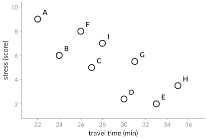{.nocap height="400px"}

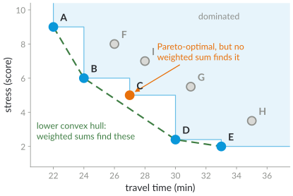{.fragment .nocap height="400px"}
:::

::: notes
About 4 minutes; one click. Pareto-optimal: A (22, 9), B (24, 6), C (27, 5), D (30, 2.4), E (33, 2). Dominated: F by B, I by B and C, G by C and D, H by D and E. How to compute the Pareto set of many points efficiently is left to the exercise sheet on Pareto sets; do not give the answer here. The green dashed line is the lower convex hull; the next slide explains why C is special.
:::

# Weighted sums miss some Pareto routes

- Weight $\lambda\in[0,1]$: minimise $\lambda\cdot\text{time}+(1-\lambda)\cdot\text{stress}$
- The best route for some $\lambda$ always lies on the **lower convex hull** of the Pareto set
- **C** is Pareto-optimal, but no $\lambda$ makes it the best: an **unsupported** route

[Why can no weighted sum pick C?]{.ask}

## For later today {.info}

The contraction hierarchy for several criteria keeps exactly the routes that are best for some $\lambda$.

::: notes
About 2 minutes. Answer: C lies above the segment between B and D; for every λ, the weighted cost of C is at least the smaller of those of B and D (a weighted sum is a linear function, and on a segment a linear function is minimised at an end point). So weighted sums cannot produce every Pareto route, but they produce good trade-offs quickly, and they can be computed with ordinary shortest-path machinery.
:::

# Multi-criteria Dijkstra

[3 · Algorithms]{.step}

**Labels** instead of distances: a label $(x_1,x_2)$ at $v$ is the cost of one path from $s$ to $v$.

- Each node $v$ keeps a **bag** $B_v$ of labels that dominate each other nowhere
- Priority queue of labels, **lexicographic** order
- Extract the smallest label $\ell$ at $u$; for each edge $(u,v)$: $\ell'=\ell+c(u,v)$
- If no label in $B_v$ dominates or equals $\ell'$: insert $\ell'$, delete the labels of $B_v$ that $\ell'$ dominates

[Martins (1984), label setting]{.source}

::: notes
About 3 minutes. Compare line by line with Dijkstra from lecture 5: distance → bag of labels, settle a node → settle a label, relax → insert unless dominated. Lexicographic order: first by the first criterion, ties by the second. Any order that is compatible with dominance works (e.g. by the sum).
:::

# Multi-criteria Dijkstra, step by step

::: {.r-stack}
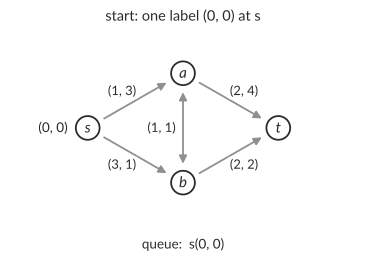{.nocap height="500px"}

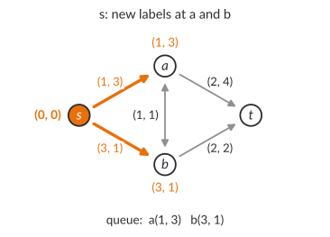{.fragment .nocap height="500px"}

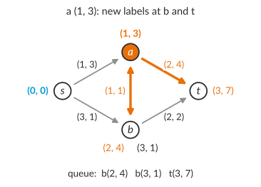{.fragment .nocap height="500px"}

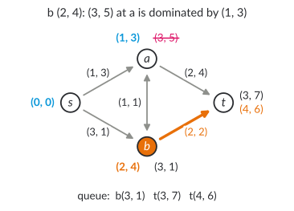{.fragment .nocap height="500px"}

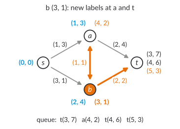{.fragment .nocap height="500px"}

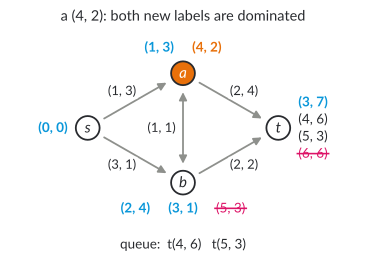{.fragment .nocap height="500px"}

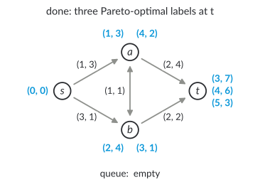{.fragment .nocap height="500px"}
:::

::: notes
About 7 minutes; six clicks. Ask before each click which label comes next (lexicographic: smallest time first). Colours: orange = label extracted now and the edges it relaxes; blue = final labels; black = in the queue; red, struck = rejected. The three routes to t: s–a–t (3, 7), s–a–b–t (4, 6), s–b–t (5, 3). Note b gets two labels, (2, 4) via a and (3, 1) directly: neither dominates the other. The steps where a label at t is extracted (nothing to relax) are skipped.
:::

# Why it is correct, and when to stop

- An extracted label is **never dominated later**: all later labels are lexicographically larger, and costs are $\ge0$
- So every extracted label at $t$ is a Pareto-optimal route
- The first label at $t$ is **not** the end: continue until the queue is empty, or discard labels that a label at $t$ already dominates (**target pruning**)

[Where does the argument need non-negative costs?]{.ask}

::: notes
About 2 minutes. Proof sketch: a later label ℓ'' at v comes from a label extracted later, so it is lexicographically at least as large; extending by non-negative costs keeps it at least as large, so ℓ'' cannot be strictly smaller in the first criterion with the second also not larger, i.e. it cannot dominate an extracted label. With a negative cost, a later path could become cheaper in every criterion.
:::

# How many Pareto-optimal routes?

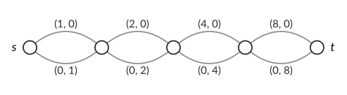{.nocap height="170px"}

- Here: **all** $2^4=16$ paths are Pareto-optimal; with $k$ sections $2^k$
- **Practice, cycling in Prague:** about **1,650** Pareto routes per query on neighbourhood graphs (≈10 km²), about **3,000** for the whole city (Hrnčíř et al. 2017)
- Faster: goal direction (NAMOA\*, BOA\*), and **approximate** Pareto sets: ~80 ms on neighbourhood graphs, 56 % of the routes exact

[Why are all 16 paths Pareto-optimal?]{.ask}

::: notes
About 4 minutes. Answer: x + y = 15 for every path, so if one path is better in x it is worse in y. The chain is the standard example that the Pareto set can be exponential, so no algorithm that outputs it is polynomial. Prague numbers (Hrnčíř et al. 2017, tri-criteria: travel time, comfort, elevation gain): exact label setting on neighbourhood graphs returns 1647 routes on average; the fastest heuristic combination (ellipse pruning, ratio pruning, ε-dominance) runs in about 81 ms, according to the paper four orders of magnitude faster than exact multi-criteria label setting, with 56 % of its routes identical to optimal ones; on the whole city (69,544 nodes) NAMOA* returns 2984 routes on average in 106 s, the heuristics about 5 s. Nobody wants to look at 3000 routes: a planner shows a few diverse ones.
:::

# Contraction hierarchies for several criteria {.columns}

## {.left grow="1"}

- Weight $\lambda$ chosen **at query time**; preprocessing once for **all** $\lambda\in[0,1]$
- Shortcut $u\!-\!v\!-\!w$ needed iff it is the best $u$–$w$ path for **some** $\lambda$
- Each path is a line over $\lambda$: needed iff it touches the **lower envelope**

[Funke and Storandt (2013)]{.source}

## {.right grow="1"}

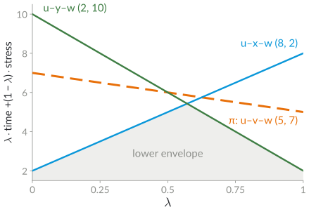{.nocap height="400px"}

::: notes
About 3 minutes. Two views of the same thing (duality): a point (time, stress) on the lower convex hull, as in the quiz, corresponds to a line on the lower envelope. In the example, π = u–v–w costs (5, 7), u–x–w (8, 2), u–y–w (2, 10). π is Pareto-optimal (neither alternative is better in both criteria) but it is above the segment between the two others: it is unsupported, like route C in the quiz. So no shortcut is needed, although no single path is a witness.
:::

# The witness search

::: {.r-stack}
![Contracting v: is u–v–w optimal for some lambda? Start with the interval [0, 1]](figures/mcch-witness-0.svg){.nocap height="390px"}

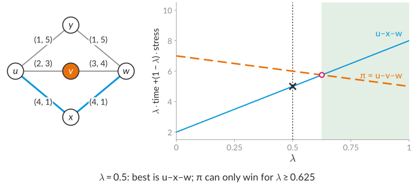{.fragment .nocap height="390px"}

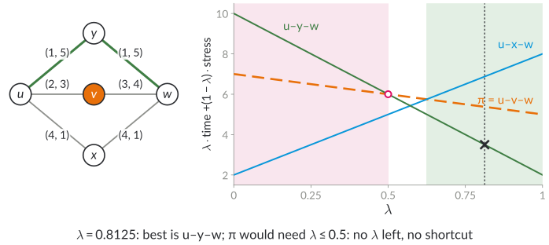{.fragment .nocap height="390px"}
:::

- Dijkstra for the middle $\lambda$ of the interval where $u\!-\!v\!-\!w$ can still win
- Finds $u\!-\!v\!-\!w$: **shortcut**; interval empty: **no shortcut**

::: notes
About 5 minutes; two clicks. Algorithm 2 of Funke and Storandt (2013): low = 0, upp = 1; λ = (low + upp)/2; p = best u–w path for λ (one Dijkstra in G_λ, including v); if p = π: shortcut; if p dominates π: no shortcut; else compute the λ' where the lines of p and π cross; if λ' is outside [low, upp]: no shortcut; else shrink the interval to the side where π is below p. Example: λ = 0.5: u–x–w (8, 2) has weighted cost 5, π (5, 7) has 6; lines cross at λ' = 0.625; π is below u–x–w only for λ > 0.625. λ = 0.8125: u–y–w (2, 10) has 3.5, π has 5.375; crossing at 0.5, but π would need λ < 0.5: empty, no shortcut. Together u–x–w and u–y–w are the witness.
:::

# Why few Dijkstra runs suffice

- The interval where $u\!-\!v\!-\!w$ can still win at least **halves** in every round
- Integer costs $\le M$, $n$ nodes: corners of the lower envelope are at least $1/(n^2M^2)$ apart
- So $O(\log(nM))$ Dijkstra runs per witness search: **polynomial** preprocessing, although the envelope can have many corners
- Experiments: at most **8** rounds in a single witness search (California)

[Funke and Storandt (2013)]{.source}

::: notes
About 2 minutes. The interval halves because λ is always the midpoint and the found path p is below π at λ, so π can only survive on one side of the midpoint. The minimum distance of the corners comes from writing the crossing λ as a fraction with small integers (path costs are at most nM). Funke and Storandt also extend the idea to more than two criteria (polyhedral argument), which we skip.
:::

# Does it pay off?

::: tablefit
| graph (OSM) | nodes | Dijkstra | CH query | speed-up | preprocessing |
|---|---|---|---|---|---|
| Baden-Württemberg | 2.5 million | 410 ms | 0.42 ms | ≈ 1,000 | 2 min |
| California | 11.3 million | 2,100 ms | 1.98 ms | ≈ 1,000 | 18 min |
:::

- Travel time and fuel cost, $\lambda$ random per query; the CH graph is about twice the original size
- About 0.05 % of the nodes stay **uncontracted** (too many shortcuts among them)
- A "quiet" criterion (prefers slow roads) costs about 11 % more edges and slower queries

[Funke and Storandt (2013), Table 2; single core, 2013]{.source}

::: notes
About 3 minutes. Numbers: Baden-Württemberg 2,459,354 nodes, Dijkstra 409.77 ms, CH query 0.42 ms (speed-up 965 as given in their Table 2), preprocessing 121 s; California 11,283,833 nodes, 2097.42 ms vs 1.98 ms (speed-up 1059), preprocessing 1078 s. The uncontracted core: contraction stopped at about 99.95 % of the nodes; the remaining nodes are treated as one level at the top. For the quiet metric see their Figure 9 (more CH edges and slower queries; check the exact values before quoting them).
:::

# The other speed-up techniques

::: tablefit
| technique | with several criteria | works? |
|---|---|---|
| bidirectional | multi-criteria Dijkstra from both ends; stopping is tricky | partly |
| A\* / landmarks | landmark distances per criterion, vector of potentials (NAMOA\*) | yes |
| arc flags | flag: edge on **some** Pareto route into the region (Pareto-SHARC) | if Pareto sets are small |
| contraction hierarchies | keep shortcuts that are Pareto-optimal, or best for some $\lambda$ | yes, for weighted sums |
| transit node routing | store **all** Pareto distances between transit nodes | too much memory |
:::

::: notes
About 2 minutes; optional, skip if late. From last year's slides, compressed. Pareto-SHARC: Delling and Wagner (2009). The general lesson: techniques that store one distance per pair suffer most, because with several criteria a "distance" becomes a set.
:::

# Public transit {.section}

Week 7, part 2: timetables

# Timetables

[1 · Question]{.step}

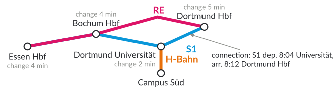{.nocap height="265px"}

- **Stop**; **trip**: one run of a vehicle; **route**: trips with the same stops; **connection**: one hop of a trip
- **Transfer**: change time at a stop, or a footpath; **journey**: trips and transfers

[Stop names real, network simplified, times invented]{.source}

::: notes
About 4 minutes. Public transport is the backbone of SDG target 11.2 (accessible and sustainable transport systems for all); the algorithmic question is journey planning. Why not just Dijkstra on the network? Because the cost of an edge depends on the time you arrive there: you wait for the next train. Example: from Campus Süd (H-Bahn) at 7:50 to Essen Hbf.
:::

# Timetables as data: GTFS

::: bigcode
```
stop_times.txt
trip_id,arrival_time,departure_time,stop_id,stop_sequence
REb,08:17:00,08:17:00,DO,1
REb,08:27:00,08:27:00,BO,2
REb,08:39:00,08:39:00,E,3

transfers.txt
from_stop_id,to_stop_id,transfer_type,min_transfer_time
DO,DO,2,300
```
:::

- General Transit Feed Specification: CSV files `stops`, `routes`, `trips`, `stop_times`, `calendar`, `transfers`
- The VRR publishes its timetable as GTFS (open data, CC BY)

::: notes
About 2.5 minutes. One line of stop_times per stop of a trip; connections are consecutive lines of the same trip. transfer_type 2 means a minimum transfer time (in seconds) is required. The VRR data ("Soll-Fahrplandaten VRR", OpenVRR on opendata-oepnv.de) covers the whole Rhine-Ruhr area; Germany-wide feeds exist from DELFI and gtfs.de. Last year students used GTFS in a project (OpenTripPlanner).
:::

# Which journey?

- **Earliest arrival:** depart at $s$ not before $\tau$, arrive at $t$ as early as possible
- **Profile:** the best journeys for **all** departure times in a range
- **Several criteria:** arrival time **and** number of transfers (Pareto, as before)

[From Campus Süd at 7:50 to Essen Hbf: arrive 8:39 with two changes, or 9:01 with one change. Which one?]{.ask}

::: notes
About 3 minutes. Both journeys come from the example timetable: H-Bahn, S1 to Dortmund Hbf, RE to Essen (8:39, two changes) versus H-Bahn and the next S1 westwards (9:01, one change). The earliest-arrival query only finds the first; the Pareto set over (arrival, number of trips) contains both. Today: earliest arrival; next week: RAPTOR for the Pareto version.
:::

# Timetables as graphs

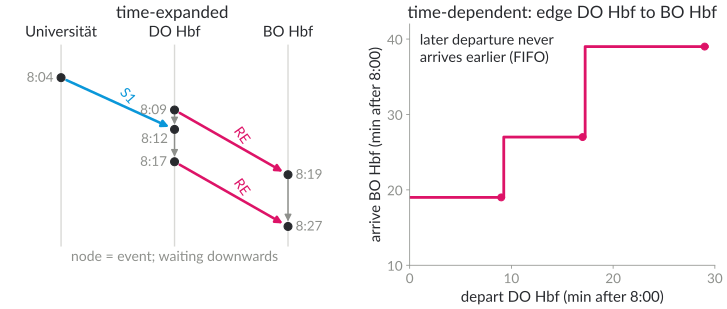{.nocap height="370px"}

- **Time-expanded:** node per event; plain Dijkstra works, but the graph is huge
- **Time-dependent:** node per stop; edge cost depends on the arrival time; Dijkstra works if a later departure never arrives earlier (**FIFO**)

::: notes
About 4 minutes. Time-expanded: for one day of a country-wide timetable tens of millions of nodes; transfers need extra transfer nodes per stop (not shown). Time-dependent: edge = function "arrive at τ, reach the other end at f(τ)"; the step function in the figure is f for Dortmund Hbf → Bochum Hbf with RE trains at 8:09, 8:17 and 8:29 (invented). FIFO: f is non-decreasing, so waiting never helps, and Dijkstra with labels "earliest arrival time" stays correct. Transfers are modelled with route nodes and station nodes (last year's slides).
:::

# Connection Scan Algorithm

[3 · Algorithms]{.step}

Preprocessing: sort all connections by **departure time**.

- Arrival time $d[v]$ per stop ($d[s]=\tau$, others $\infty$); flag "reached" per trip
- Scan connections $c$ in order: $c$ is **usable** if its trip is already reached, or $d[\text{from}(c)]+\text{change}\le\text{dep}(c)$
- If usable: mark the trip, $d[\text{to}(c)]\gets\min(d[\text{to}(c)],\,\text{arr}(c))$
- **Stop** as soon as $\text{dep}(c)\ge d[t]$

[Dibbelt, Pajor, Strasser, Wagner (2018)]{.source}

::: notes
About 3 minutes. No priority queue, no graph: one array of connections, one array of arrival times, one array of trip flags. At the source no change time is needed (we are already there). Footpaths: after improving d[v], also update the stops reachable on foot from v. Journey extraction: remember for each trip the connection where it was entered, and for each stop the connection that improved it.
:::

# Connection Scan, step by step

::: {.r-stack}
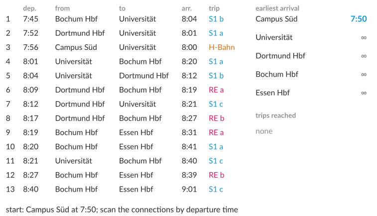{.nocap height="530px"}

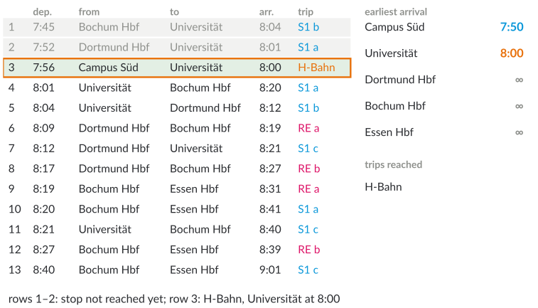{.fragment .nocap height="530px"}

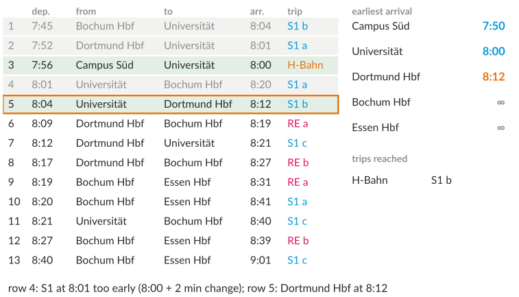{.fragment .nocap height="530px"}

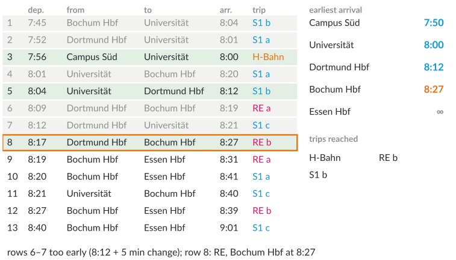{.fragment .nocap height="530px"}

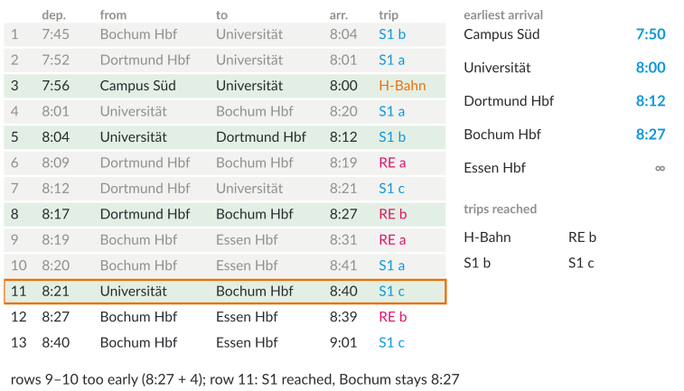{.fragment .nocap height="530px"}

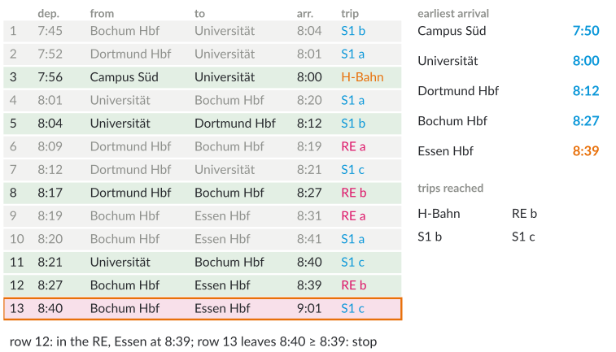{.fragment .nocap height="530px"}
:::

::: notes
About 6 minutes; five clicks. Green: usable; grey: not usable; orange frame: the connection just scanned; red: stop. Change times: Universität 2 min, Dortmund Hbf 5, Bochum Hbf 4. Row 4: S1 at 8:01 from Universität, but we arrive there at 8:00 and need 2 minutes. Rows 6–7: we are at Dortmund Hbf at 8:12 and need until 8:17. Rows 9–10: at Bochum 8:27 + 4 = 8:31 > 8:19, 8:20. Row 11: S1 c is reachable from Universität (8:02 ≤ 8:21), the trip is marked, but 8:40 does not improve Bochum (8:27). Row 12: RE b is already reached: Essen 8:39. Journey: H-Bahn 7:56–8:00, S1 8:04–8:12, RE 8:17–8:39.
:::

# Why CSA is correct, and fast

- Sorted by departure time = a **topological order** of the time-expanded graph: when $c$ is scanned, every connection that can lead to it was scanned before
- One linear pass over an array: no priority queue, cache-friendly
- **London** (4.85 million connections): 41 ms, with start and stop criterion 2.7 ms; **Germany** (46 million): 329 ms and 68 ms

[Where does the argument use that trips never go back in time?]{.ask}

[Dibbelt, Pajor, Strasser, Wagner (2018), Tables 1 and 2]{.source}

::: notes
About 3 minutes. Correctness: like Dijkstra on a DAG in topological order (lecture 4: dynamic programming over a DAG). Every connection departs after the arrival of its predecessor in the trip, and transfers need time ≥ 0, so a journey uses connections in increasing departure time. Start criterion: skip connections that depart before τ (binary search). Stop criterion: stop when dep(c) ≥ d[t]. Numbers: London 20,843 stops, 4,850,431 connections; Germany 252,374 stops, 46,218,148 connections; averages over 10,000 random queries (2017 hardware).
:::

# Outlook: more criteria, more modes

- Earliest arrival is not enough: **fewer transfers**, walking or cycling to the stop
- Next week: **RAPTOR** (rounds = number of trips), its multi-criteria version, and journeys with a bike on the first and last mile
- The same theme as today: Pareto sets, and preprocessing that keeps them small

::: notes
About 2 minutes. Teaser: in the example, RAPTOR finds both journeys (8:39 with three trips, 9:01 with two). Next week: RAPTOR, McRAPTOR, Trip-Based Routing, ULTRA, with examples from the VRR network.
:::

# Next steps

- **Tuesday, 1 December:** public transit, part 2 (RAPTOR and beyond)
- **8 December:** block 3, energy-efficient algorithms
- Exercise: Pareto sets and the Connection Scan Algorithm by hand

::: notes
Closing sentence: several criteria turn a distance into a set of trade-offs; algorithms either compute the whole Pareto set (exponential in the worst case, often large in practice) or restrict to weighted sums, which keeps the speed-up techniques fast. The exercise line is a suggestion; adapt it to the sheet that is actually handed out.
:::

# Additional material {.section}

For self-study and the tutorial

# Bi-objective search: NAMOA\* and BOA\*

- **NAMOA\***: multi-criteria A\*, potentials per criterion; key = label + potentials (Mandow and Pérez de la Cruz 2010)
- **BOA\***: for two criteria a dominance check in **constant time** per label (Hernández et al. 2023)
- Also for exact Pareto sets: improved label setting (Maristany de las Casas et al. 2021)

# The witness search in detail

For the reference path $\pi$ and the best path $p$ for weight $\lambda$:

$$\lambda'=\frac{\text{stress}(p)-\text{stress}(\pi)}{\text{time}(\pi)-\text{stress}(\pi)-\text{time}(p)+\text{stress}(p)}$$

is where their lines cross. If $\text{stress}(\pi)>\text{stress}(p)$, then $\pi$ can only win for $\lambda>\lambda'$: low $\gets\lambda'$; otherwise upp $\gets\lambda'$. If $\lambda'\notin[\text{low},\text{upp}]$: no shortcut.

[Funke and Storandt (2013), Algorithm 2]{.source}

# Profiles with CSA

- Scan the connections in **decreasing** departure time
- Per stop a **profile**: list of (departure time, arrival time at $t$) pairs, Pareto-optimal
- One pass gives the best journeys for **all** departure times

[Dibbelt, Pajor, Strasser, Wagner (2018)]{.source}

# Check your understanding

1. Give two routes with costs $(a,b)$ and $(b,a)$ and a third Pareto-optimal route that no weighted sum finds.
2. Why must multi-criteria Dijkstra continue after the first label at $t$?
3. In the witness search, why does the interval at least halve?
4. Why does CSA not need a priority queue?

## Possible answers {.fragment .info}

1\. $(1,5)$, $(5,1)$ and $(3,3.5)$: it lies above the segment between the two others. 2. Other Pareto labels at $t$ may still be in the queue. 3. The midpoint $\lambda$ is on the side where $p$ beats $\pi$. 4. Sorting by departure time already gives an order in which all predecessors come first.

# References: several criteria

::: refs
- Delling, D., Wagner, D. (2009). Pareto paths with SHARC. *SEA 2009*, LNCS 5526, 125–136.
- Funke, S., Storandt, S. (2013). Polynomial-time construction of contraction hierarchies for multi-criteria objectives. *ALENEX 2013*.
- Hernández, C., Yeoh, W., Baier, J. A., Zhang, H., Suazo, L., Koenig, S., Salzman, O. (2023). Simple and efficient bi-objective search algorithms via fast dominance checks. *Artificial Intelligence* 314, 103807.
- Hrnčíř, J., Žilecký, P., Song, Q., Jakob, M. (2017). Practical multicriteria urban bicycle routing. *IEEE Transactions on Intelligent Transportation Systems* 18(3), 493–504.
- Mandow, L., Pérez de la Cruz, J. L. (2010). Multiobjective A* search with consistent heuristics. *Journal of the ACM* 57(5), 27.
- Maristany de las Casas, P., Sedeño-Noda, A., Borndörfer, R. (2021). An improved multiobjective shortest path algorithm. *Computers & Operations Research* 135, 105424.
- Martins, E. Q. V. (1984). On a multicriteria shortest path problem. *European Journal of Operational Research* 16(2), 236–245.
- Storandt, S. (2012). Route planning for bicycles – exact constrained shortest paths made practical via contraction hierarchy. *ICAPS 2012*, 234–242.
:::

# References: public transit

::: refs
- Bast, H., Delling, D., Goldberg, A., Müller-Hannemann, M., Pajor, T., Sanders, P., Wagner, D., Werneck, R. F. (2016). Route planning in transportation networks. In *Algorithm Engineering*, LNCS 9220, 19–80.
- Delling, D., Pajor, T., Werneck, R. F. (2015). Round-based public transit routing. *Transportation Science* 49(3), 591–604.
- Dibbelt, J., Pajor, T., Strasser, B., Wagner, D. (2018). Connection scan algorithm. *ACM Journal of Experimental Algorithmics* 23, 1.7. <https://doi.org/10.1145/3274661>
- General Transit Feed Specification (GTFS), schedule reference: <https://gtfs.org/documentation/schedule/reference/>
- United Nations: Sustainable Development Goal 11, target 11.2: <https://sdgs.un.org/goals/goal11>
:::

# License and credits

::: refs
- Slides © 2026 Kevin Buchin, TU Dortmund University, licensed under **CC BY 4.0** (<https://creativecommons.org/licenses/by/4.0/>). Suggested attribution: "Kevin Buchin, Algorithms and Sustainability, TU Dortmund University, CC BY 4.0", with a link to the course page.
- Not covered by this license: the TU Dortmund logo and the Decker software and its themes (own licenses).
- Figures: own work, CC BY 4.0, made with `tools/make_multicriteria_figures.py` and `tools/make_transit_figures.py`; the examples are constructed. In the public transit example the stop names are real, the network is simplified and the times are invented.
- Made with Decker: <https://github.com/decker-edu/decker>
:::
