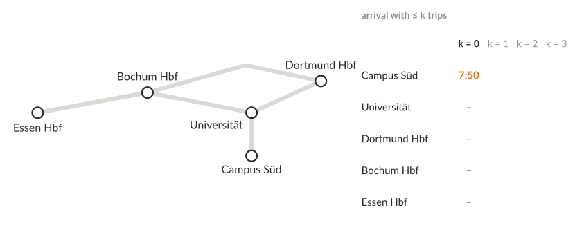
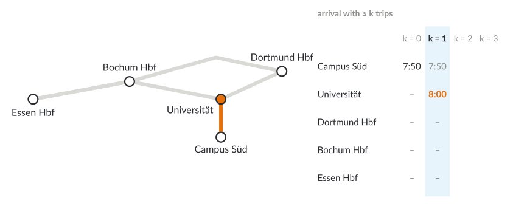
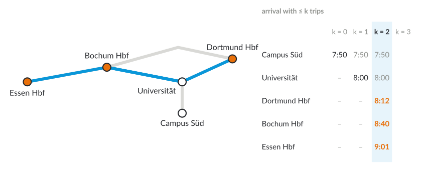
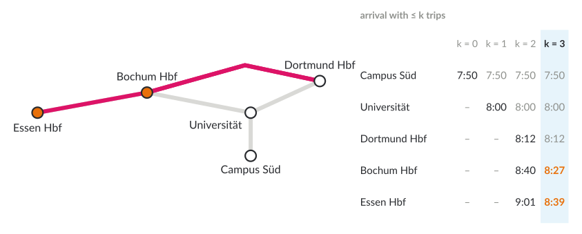
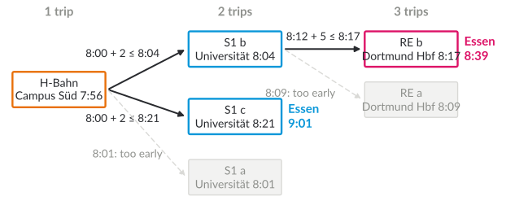

# Plan for today

1. Recap: Connection Scan
2. Journey planners in practice
3. RAPTOR: rounds instead of a priority queue
4. Several criteria: McRAPTOR and profiles
5. Trip-Based routing
6. Bike and train: the first and last mile

::: notes
DRAFT (24 October 2026). The example is the same as in lecture 6: real stop names around TU Dortmund, a simplified network and invented times; it can be replaced by VRR data. An animation on the real network would come from the routing-viz project.

Timing (90 min, main part slides 2–19): 10:15 plan and recap (slides 2–3, 4 min) · 10:19 practice (slides 4–5, 5 min) · 10:24 RAPTOR (slides 6–9, 22 min) · 10:46 profiles and several criteria (slides 10–11, 9 min) · 10:55 Trip-Based routing (slides 12–13, 11 min) · 11:06 bike and train (slides 14–15, 10 min) · 11:16 overview, block summary, projects, next steps (slides 16–19, 8 min) · about 21 min buffer.
:::

# Recap: Connection Scan {.columns}

## {.left grow="1"}

- Connections sorted by departure time; one pass
- Per stop the earliest arrival, per trip a flag "reached"
- Example: Campus Süd 7:50 → Essen Hbf **8:39**, with two changes

## {.right grow="1"}

[CSA found 8:39 with two changes. Which journey did it not report, and why might you want it?]{.ask}

::: notes
About 3 minutes. Answer: H-Bahn and the S1 at 8:21 directly to Essen, arrival 9:01 with only one change. CSA optimises one criterion (arrival time); a traveller with luggage, a bike or a wheelchair may prefer fewer changes. Today: algorithms that return both, the Pareto set over (arrival time, number of trips).
:::

# Block 2 · Route Planning {.section}

Week 8 · today: public transit, part 2

# Journey planners in practice

[1 · Question]{.step}

| planner | algorithm | where |
|---|---|---|
| OpenTripPlanner 2 | multi-criteria range RAPTOR | open source; many regions |
| R5 (r5r) | RAPTOR, McRAPTOR | open source; accessibility studies |
| MOTIS (Transitous) | RAPTOR, Trip-Based | open source; ~1,300 feeds, 48 countries |
| HAFAS (DB), EFA (VRR) | not published | proprietary |

[Which planner do you use, and does it show you trade-offs?]{.ask}

::: notes
About 4 minutes. Sources: OpenTripPlanner documentation (OTP2 uses a multi-criteria range RAPTOR for transit, A* for walking and cycling); Pereira et al. (2021) for r5r; MOTIS/nigiri implements RAPTOR and Trip-Based routing; Transitous (transitous.org) runs MOTIS on community-collected feeds (about 1,300 feeds from 48 countries, FOSSGIS 2025). For HAFAS (Deutsche Bahn) and EFA (Mentz; the VRR journey planner runs at efa.vrr.de) there is no public description of the algorithms; do not guess. Last year's slide listed VRR under HAFAS. Last year a project extended OpenTripPlanner with reachability analysis.
:::

# RAPTOR: rounds

[3 · Algorithms]{.step}

- **Round $k$:** earliest arrival at every stop with at most $k$ trips: $\tau_k(p)$
- Round $k$ only starts from stops that **improved** in round $k-1$ (**marked**)
- Each **route** (trips with the same stop sequence) is scanned at most **once per round**
- No graph, no priority queue: arrays of stops, routes and trips

[Delling, Pajor, Werneck (2015)]{.source}

::: notes
About 4 minutes. Rounds = number of trips = transfers + 1. After round k, τ_k(t) is the best arrival with at most k trips, so the rounds directly give the Pareto set over (arrival time, number of trips): keep τ_k(t) whenever it improves on τ_{k-1}(t). Usually few rounds are needed: journeys with more than about five trips are rarely useful.
:::

# Scanning a route

Walk along the stops of the route, from the first marked stop:

- **Get off:** if the current trip reaches stop $p$ earlier than $\tau^*(p)$ (best so far): $\tau_k(p)\gets$ arrival, mark $p$
- **Get on:** if $\tau_{k-1}(p)$ plus change time allows an **earlier** trip at $p$: switch to it
- After all routes: walk along **footpaths** from the marked stops

## Pruning {.info}

Only mark $p$ if the arrival is also earlier than $\tau^*(t)$: a journey that is already later than the best at the target cannot win.

::: notes
About 5 minutes. Draw one route as a line of stops on the board: the "current trip" starts empty; at each stop first check getting off (it may improve the stop), then getting on (an earlier trip may be catchable from what we had with k−1 trips). Trips of a route are sorted by departure, and trips of a route do not overtake each other, so "earliest catchable trip" is a binary search or a linear step back. Local pruning: compare with τ*(p), the best arrival at p in any round, not only τ_{k-1}(p).
:::

# RAPTOR, round by round

::: {.r-stack}
{.nocap height="470px"}

{.fragment .nocap height="470px"}

{.fragment .nocap height="470px"}

{.fragment .nocap height="470px"}
:::

[What does round 4 do?]{.ask}

::: notes
About 8 minutes; three clicks. Round 1: route H-Bahn from Campus Süd: board 7:56, get off at Universität 8:00. Round 2: marked: Universität. S1 eastwards: board S1 b at 8:04 (8:00 + 2 min change), Dortmund Hbf 8:12. S1 westwards: S1 a at 8:01 is too early, board S1 c at 8:21: Bochum 8:40, Essen 9:01. Round 3: marked Dortmund Hbf, Bochum, Essen. RE from Dortmund Hbf: RE a (8:09) too early, RE b at 8:17: Bochum 8:27, Essen 8:39. Answer: round 4 starts from Bochum (8:27) but finds no improvement (the next S1 from Bochum arrives at 9:01); no stop is marked, RAPTOR stops. Result: Essen with 2 trips at 9:01, with 3 trips at 8:39: both Pareto-optimal.
:::

# Why RAPTOR is fast, and correct

- After round $k$: $\tau_k(p)$ is the earliest arrival with at most $k$ trips (induction over $k$)
- Work per round: each route scanned once, each stop of it once
- Memory access in long arrays: cache-friendly, easy to parallelise over routes
- London: all Pareto-optimal journeys (arrival, transfers) **an order of magnitude faster** than earlier graph-based methods, fast enough for interactive use

[Delling, Pajor, Werneck (2015)]{.source}

[Why must a route be scanned from its first marked stop, not from where the trip was boarded last round?]{.ask}

::: notes
About 5 minutes. Induction: a best journey with k trips consists of a best journey with k−1 trips to some stop p, a change, and one trip from p; round k tries exactly these trips. Answer to the question: in round k a better label may now be available at an earlier stop of the route, which allows an earlier trip from there.
:::

# Profiles: rRAPTOR

- Question: best journeys for **every** departure between 7:00 and 9:00
- Run RAPTOR once per departure time at $s$, **latest first**
- Do **not** reset the labels between runs: later departures can only arrive later, so their labels prune the earlier runs

::: notes
About 4 minutes. rRAPTOR (range RAPTOR, Delling et al. 2015). Self-pruning: a journey departing earlier that arrives later than one departing later is dominated. This is what "range" means in OpenTripPlanner's "multi-criteria range RAPTOR".
:::

# More criteria: McRAPTOR

- Per stop and round a **bag** of labels instead of one arrival time
- Criteria: arrival time, number of trips, plus e.g. walking time, fare zones, CO₂
- Route scan: a bag of active trips; merge into the stop bags with dominance checks
- Pareto sets grow fast: practice uses **restricted** Pareto sets (only journeys close to the best in each criterion)

[Delling, Pajor, Werneck (2015); Delling, Dibbelt, Pajor (2019)]{.source}

::: notes
About 5 minutes. Same idea as Martins' bags in lecture 6, now per round. Restricted Pareto sets (Delling, Dibbelt, Pajor 2019): only keep journeys that are not much worse than the best one in any criterion, and compute them much faster. OpenTripPlanner 2 uses multi-criteria range RAPTOR with such restrictions (filters on slack in arrival time and transfers).
:::

# Trip-Based routing

- Preprocessing: **transfers** to the earliest catchable trip of each route; delete useless ones
- Query: breadth-first search over **trips**; level $k$ = reachable with $k$ trips

{.nocap height="300px"}

[Witt (2015)]{.source}

::: notes
About 7 minutes. The example: H-Bahn (level 1) → S1 b and S1 c (level 2) → RE b (level 3); arrivals at Essen 9:01 (level 2) and 8:39 (level 3): the same Pareto set as RAPTOR. Deleting transfers: U-turns (the next stop of the new trip is the previous stop of the current trip; dropped if changing at that previous stop was possible), and transfers that never lead to an earlier arrival anywhere. The queue holds trip segments (trip, first stop reached); each trip is processed from the earliest stop at which it was reached.
:::

# Even faster, and a warning

- **FLASH-TB** (arc flags + Trip-Based): about 0.5 ms per query for Germany with less than 1 GB (Großmann et al. 2026)
- **T-REX:** under 10 ms for Europe, real-time updates in seconds (Sauer, Steil, Witt, ESA 2026)
- **Warning:** in 2023 a subtle error in the published transfer preprocessing of Trip-Based variants was found; some queries had been answered incorrectly

[Why is it useful to keep a simple algorithm like CSA around, even if it is slower?]{.ask}

::: notes
About 4 minutes. Großmann, Sauer, Schulz, Steil (SEA 2023, Arc-Flags meet Trip-Based routing) describe the previously unnoticed error in the transfer precomputation that made TB-CST and Arc-Flag TB answer some queries incorrectly (check before the lecture whether this is in the SEA 2023 paper or in the FLASH-TB journal version). Answer to the question: a simple, obviously correct algorithm is the reference for testing (compare answers on many random queries). The T-REX paper is very recent (ESA 2026); check the final numbers before the lecture.
:::

# Bike and train

[1 · Question]{.step}

- Most trips start and end **off** the network: walking or cycling to the stop
- With a bike, many more stops are reachable: transfers between **all** nearby stop pairs
- Naive: all walking/cycling paths as footpaths: far too many

[Would you cycle 4 km to a faster train? How would a planner know?]{.ask}

::: notes
About 4 minutes. Sustainability link: bike + train can replace car trips that neither mode alone could replace. Map (to come): stops reachable by bike in 10 minutes from TU Dortmund versus on foot.
:::

# ULTRA: shortcuts for the first and last mile

- Preprocessing: find the walking/cycling **transfers** that some optimal journey actually needs, store them as shortcuts
- Query: RAPTOR, CSA or Trip-Based with these shortcuts, plus walking/cycling at start and end
- **McULTRA:** walking/cycling time as an extra criterion
- **Bike sharing:** an ULTRA extension (Sauer, Wagner, Zündorf 2020)

[Baum, Buchhold, Sauer, Wagner, Zündorf (2019); Potthoff, Sauer (2022); Sauer, Wagner, Zündorf (2020)]{.source}

::: notes
About 6 minutes. ULTRA = UnLimited TRAnsfers. Key insight: although walking between any two stops is allowed, only few such transfers are part of an optimal journey; the preprocessing finds them by running small searches in the combined network. Then any timetable algorithm works as with ordinary footpaths. Potthoff and Sauer (2022): three criteria (arrival, trips, walking or cycling time). Delays: Bez and Sauer (2024) make the shortcuts robust to delays (additional slide).
:::

# Overview

::: tablefit
| algorithm | idea | preprocessing | criteria |
|---|---|---|---|
| time-dependent Dijkstra | graph with time-dependent edges | none | arrival |
| CSA | scan connections by departure | sorting | arrival (profiles) |
| RAPTOR | rounds over routes | none | arrival, trips (Mc: more) |
| Trip-Based | breadth-first search over trips | transfers | arrival, trips |
| Transfer Patterns | precomputed transfer sequences | heavy | Pareto |
| ULTRA | shortcuts for walking/cycling | moderate | arrival, trips; McULTRA: + walking/cycling time |
:::

::: notes
About 3 minutes. Transfer patterns (Bast et al. 2010) were covered last year in detail; now one line (additional slide). The choice in practice: RAPTOR variants when flexibility (criteria, real-time changes) matters, preprocessing-based methods for the fastest answers on static timetables.
:::

# Block 2 in one slide

- **Roads:** Dijkstra, goal direction, contraction hierarchies
- **Several criteria:** Pareto sets, multi-criteria Dijkstra, CH for weighted sums
- **Timetables:** CSA, RAPTOR, Trip-Based; **bike and train:** ULTRA
- The same pattern everywhere: a simple exact algorithm, then preprocessing that exploits structure

[Which of these would you need for a planner for wheelchair users in Dortmund?]{.ask}

::: notes
About 3 minutes. Answer (open): accessibility criteria on the road and station network (lecture 6 and the guest lecture), timetables with step-free transfers (longer change times, only accessible stops), multi-criteria journeys (arrival time against walking distance or number of lifts). Good project topic.
:::

# Projects from this block

- Bike + S-Bahn in the Ruhr area: OpenTripPlanner with OpenVRR data
- Multi-criteria bicycle routes in Dortmund on OpenStreetMap: fast, quiet, flat
- Accessibility: which stops are step-free reachable within 30 minutes?

::: notes
About 1 minute; only if the project assignment is still open. Ideas, not a fixed list.
:::

# Next steps

- **Tuesday, 8 December:** block 3, energy-efficient algorithms
- Exercise: RAPTOR by hand, Trip-Based transfers

::: notes
Teaser for block 3: a farm with solar panels and a feed mill: when should the mill run? (literature in prep/energie-pv-scheduling-literatur.md). The exercise line is a suggestion; 2025 sheet A5 had CSA and RAPTOR (Witten Hbf to TU Dortmund).
:::

# Additional material {.section}

For self-study and the tutorial

# RAPTOR in pseudocode

::: bigcode
```
τ_0(s) ← τ_dep; mark s
for k = 1, 2, ...:
    Q ← routes serving marked stops, with their first marked stop
    unmark all stops
    for each (route r, stop p) in Q:
        trip ← none
        for each stop p_i of r from p on:
            if trip ≠ none and arr(trip, p_i) < min(τ*(p_i), τ*(t)):
                τ_k(p_i) ← τ*(p_i) ← arr(trip, p_i); mark p_i
            if τ_{k-1}(p_i) + change(p_i) ≤ dep(trip, p_i):
                trip ← earliest trip of r catchable at p_i
    relax footpaths from marked stops
    if no stop is marked: stop
```
:::

# Transfer patterns (from last year)

- Observation: even long journeys use few **sequences of transfer stops** ("patterns")
- Preprocessing: for pairs of stations, all patterns of optimal journeys (with hubs to keep it small)
- Query: time-dependent Dijkstra on the small graph of patterns

[Bast et al. (2010)]{.source}

# Delays

- Real timetables change: delays, cancellations, missed connections
- **Robust journeys:** minimise the **expected** arrival time, with fallback options (CSA variant: Dibbelt, Strasser, Wagner 2014)
- **Delay-robust ULTRA:** shortcuts that stay valid under delays (Bez and Sauer 2024)

# Check your understanding

1. Why does RAPTOR return the Pareto set over arrival time and number of trips for free?
2. In round $k$, why is $\tau_{k-1}(p)$ used for getting on, but $\tau^*(p)$ for pruning?
3. Which transfers can Trip-Based routing delete in preprocessing?
4. Why can unlimited walking not simply be modelled as footpaths between all stops?

## Possible answers {.fragment .info}

1\. Round $k$ is exactly "at most $k$ trips". 2. Getting on must respect the trip budget $k-1$; pruning may use any better label. 3. U-turns and transfers that never improve any arrival. 4. Quadratically many pairs, mostly useless; ULTRA keeps only those needed by some optimal journey.

# References (1)

::: refs
- Bast, H., Carlsson, E., Eigenwillig, A., Geisberger, R., Harrelson, C., Raychev, V., Viger, F. (2010). Fast routing in very large public transportation networks using transfer patterns. *ESA 2010*, LNCS 6346, 290–301.
- Baum, M., Buchhold, V., Sauer, J., Wagner, D., Zündorf, T. (2019). UnLimited TRAnsfers for multi-modal route planning: an efficient solution. *ESA 2019*, LIPIcs 144, 14.
- Bez, D., Sauer, J. (2024). Fast and delay-robust multimodal journey planning. *ALENEX 2024*, 105–117.
- Delling, D., Dibbelt, J., Pajor, T. (2019). Fast and exact public transit routing with restricted Pareto sets. *ALENEX 2019*.
- Delling, D., Pajor, T., Werneck, R. F. (2015). Round-based public transit routing. *Transportation Science* 49(3), 591–604.
:::

# References (2)

::: refs
- Dibbelt, J., Strasser, B., Wagner, D. (2014). Delay-robust journeys in timetable networks with minimum expected arrival time. *ATMOS 2014*.
- Großmann, E., Sauer, J., Schulz, C., Steil, P. (2023). Arc-flags meet Trip-Based public transit routing. *SEA 2023*, LIPIcs 265, 16.
- Großmann, E., Sauer, J., Schulz, C., Steil, P., Witt, S. (2026). FLASH-TB: integrating arc-flags and Trip-Based public transit routing. *Transportation Science* 60(2), 242–263.
- Pereira, R. H. M., Saraiva, M., Herszenhut, D., Braga, C. K. V., Conway, M. W. (2021). r5r: rapid realistic routing on multimodal transport networks with R5 in R. *Findings*.
- Potthoff, M., Sauer, J. (2022). Fast multimodal journey planning for three criteria. *ALENEX 2022*, 145–157.
- Sauer, J., Steil, P., Witt, S. (2026). T-REX: fast and dynamic journey planning for continental-scale public transit networks. *ESA 2026*, LIPIcs 388, 9.
- Sauer, J., Wagner, D., Zündorf, T. (2020). Faster multi-modal route planning with bike sharing using ULTRA. *SEA 2020*, LIPIcs 160, 16.
- Witt, S. (2015). Trip-Based public transit routing. *ESA 2015*, LNCS 9294, 1025–1036.
:::

# License and credits

::: refs
- Slides © 2026 Kevin Buchin, TU Dortmund University, licensed under **CC BY 4.0** (<https://creativecommons.org/licenses/by/4.0/>). Suggested attribution: "Kevin Buchin, Algorithms and Sustainability, TU Dortmund University, CC BY 4.0", with a link to the course page.
- Not covered by this license: the TU Dortmund logo and the Decker software and its themes (own licenses).
- Figures: own work, CC BY 4.0, made with `tools/make_transit_figures.py`; stop names real, network simplified, times invented.
- Made with Decker: <https://github.com/decker-edu/decker>
:::
