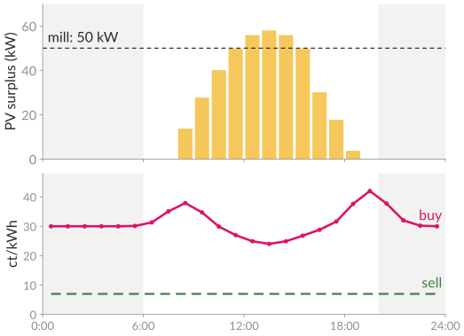
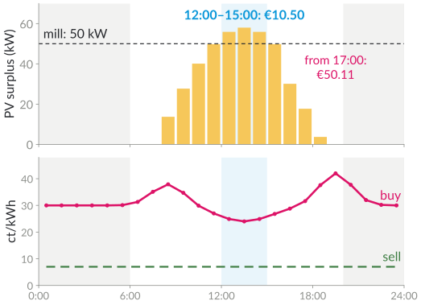
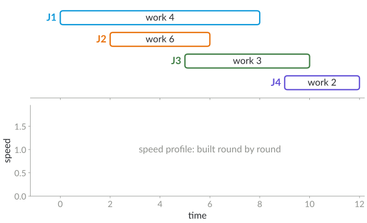
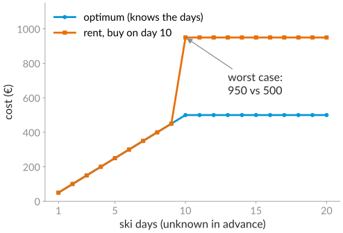

# Plan for today

1. When should the feed mill run? Scheduling with prices and sunshine
2. Speed scaling: the YDS algorithm
3. Online: ski rental, power-down, waiting for a good price
4. Outlook: predictions and carbon-aware computing

::: notes
DRAFT (24 October 2026), proposal for the second lecture of block 3. The date follows the plan in the handover document (8 December: energy efficiency in software engineering, 15 December: energy-efficient algorithms); swap if needed. Running example: a student's family farm with solar panels and a feed mill . All farm numbers are invented for illustration; for the lecture a real price profile from SMARD (Bundesnetzagentur, CC BY 4.0) would be better. Literature: prep/energie-pv-scheduling-literatur.md.

Timing (90 min, main part slides 2–21): 10:15 plan, block overview, the farm question (slides 2–5, 10 min) · 10:25 scheduling with prices (slide 6, 6 min) · 10:31 speed scaling and YDS (slides 7–12, 25 min) · 10:56 online algorithms (slides 13–17, 24 min) · 11:20 predictions, carbon-aware, the farm revisited (slides 18–20, 8 min) · 11:28 next steps (slide 21, 2 min) · about 15 min buffer.
:::

# Block 3 · Energy-Efficient Computing {.section}

Week 10 · today: energy-efficient algorithms

# When should the feed mill run? {.columns}

## {.left grow="3"}

{.nocap height="470px"}

## {.right grow="2"}

[1 · Question]{.step}

- Feed mill: **50 kW for 3 hours**, any time between 6:00 and 20:00
- Own solar power first; buy the rest, sell what is left over

[When would you run the mill?]{.ask}

[Invented numbers for illustration]{.source}

::: notes
About 4 minutes. The example comes from a student's family farm: solar panels on the roof, fixed loads (milking in the morning and evening, cooling), and flexible loads such as the feed mill, which only has to have ground enough feed by the evening. In Germany the day-ahead prices for the next day are known around noon (15-minute slots since October 2025), so a farm with a dynamic tariff knows tomorrow's prices. Let students suggest times; most say "around noon".
:::

# The cheapest window {.columns}

## {.left grow="3"}

{.nocap height="470px"}

## {.right grow="2"}

- Cost of $x$ kWh in slot $t$: lost feed-in for own power, buying price for the rest: **convex** in $x$
- One job, fixed length: try every window: $O(T)$ for $T$ slots

::: notes
About 3 minutes. Cost in slot t with PV surplus r_t, buying price p_t and feed-in price q_t: f_t(x) = q_t · min(x, r_t) + p_t · max(x − r_t, 0). Numbers (invented): 12:00–15:00 costs €10.50 (only own power, since the surplus is at least 50 kW in all three hours: just the lost feed-in, 3 · 50 kWh · 7 ct), 11:00 or 13:00 cost €10.54, a start at 17:00 €50.11. The optimum is flat around noon; what matters is to avoid the evening. Sliding window: update the window sum by one slot each step.
:::

# Scheduling with prices: what is known

[2 · Problem]{.step}

| setting | result |
|---|---|
| one job, fixed length | sliding window, $O(T)$ |
| interruptible jobs | cheapest slots in the window, min-cost flow |
| several non-interruptible jobs | NP-hard, no constant-factor approximation |
| one "valley" of cheap slots (one sunny day) vs several | polynomial vs hard |

[Wan and Qi (2010); Fang et al. (2016); Chen and Zhang (2019); Chen et al. (2021)]{.source}

::: notes
About 6 minutes. Single machine, time slots with given prices (time-of-use tariffs). Interruptible unit jobs with windows: a min-cost flow from jobs to slots (with convex costs as in the farm). Several jobs that must run without interruption: NP-hard and no constant-factor approximation unless P = NP (Fang et al. 2016); Chen, Megow, Rischke, Stougie, Verschae (2021) note a reduction from Partition that works even with only two prices, 0 and ∞. With interruptions the problem is polynomial (Fang et al. 2016). Chen and Zhang (2019), without interruptions: at most one valley of cheap slots is polynomial, more than one valley is NP-hard and not approximable within a constant factor: one sunny day versus several days. With a battery the problem becomes a linear program (or a dynamic program over time and charge level): see P2 in prep/energie-pv-scheduling-literatur.md.
:::

# Speed scaling

[3 · Algorithms]{.step}

- Processor at speed $s$: power $P(s)=s^\alpha$ with $\alpha\approx3$ (lecture 1)
- Work $w$ at speed $s$: time $w/s$, energy $w\,s^{\alpha-1}$: slower saves energy
- Jobs $j$ with release time $r_j$, deadline $d_j$, work $w_j$
- **Goal:** meet all deadlines with minimum energy

[Which speed when? Run fast when much work is due soon.]{.ask}

::: notes
About 3 minutes. Recap of the warm-up quiz of lecture 1: half speed, a quarter of the energy, twice the time. The feed mill is a speed-scaling job, too, if its speed (throughput) can be set. Preemption is allowed (jobs can be interrupted and resumed).
:::

# The YDS algorithm

Repeat until no job is left:

1. Find the interval $[a,b]$ with maximum **density** $\dfrac{\text{work of the jobs inside } [a,b]}{\text{free time in } [a,b]}$
2. Run these jobs at exactly this speed, in order of deadlines (EDF)
3. Block the interval and remove its jobs

[Yao, Demers, Shenker (1995)]{.source}

::: notes
About 4 minutes. "Inside" means r_j ≥ a and d_j ≤ b. Instead of blocking, the original paper removes the interval and compresses time; blocking is the same thing on the original time axis. Running time: the candidate intervals have release times and deadlines as end points, O(n²) per round, n rounds: O(n³) naive (faster implementations exist).
:::

# YDS, step by step

::: {.r-stack}
{.nocap height="450px"}

![Round 1: interval [2, 6] has density 6/4 = 3/2; J2 runs at speed 3/2](figures/yds-step-1.svg){.fragment .nocap height="450px"}

![Round 2: interval [0, 10] without the blocked [2, 6]: work 4 + 3 = 7 in 6 time units, speed 7/6 for J1 and J3](figures/yds-step-2.svg){.fragment .nocap height="450px"}

![Round 3: J4 in the remaining free time [10, 12] at speed 1](figures/yds-step-3.svg){.fragment .nocap height="450px"}
:::

::: notes
About 9 minutes; three clicks. Before each click, let students compute densities. Round 1: candidates: [2, 6] with J2: 6/4 = 1.5; [0, 8] with J1, J2: 10/8 = 1.25; [0, 10] with J1–J3: 13/10 = 1.3; [0, 12]: 15/12 = 1.25. Maximum: [2, 6]. Round 2 (free time outside [2, 6]): [0, 10] contains J1 and J3: 7 units of work in 2 + 4 = 6 free time units: 7/6 ≈ 1.17; [0, 8]: J1 alone 4/4 = 1. EDF: J1 (deadline 8) in [0, 2] and [6, 7.43], J3 in [7.43, 10]. Round 3: J4 in [10, 12]: 2/2 = 1. Energy with α = 3: 901/36 ≈ 25.0.
:::

# Why YDS is optimal

- **Convexity:** for a fixed amount of work in a fixed time, constant speed is best ($s^\alpha$ is convex)
- The densest interval needs **at least** its density on average: every schedule must do this work in this time
- So run exactly at that speed there, and the rest is a smaller instance of the same problem

[Why can't we simply run at the average speed $15/12$ all the time?]{.ask}

::: notes
About 4 minutes. Answer: J2 needs 6 units of work between 2 and 6, so the speed there must average at least 1.5; constant speed 1.25 misses J2's deadline (it would use 23.4 energy units, less than YDS's 25.0, but it is not feasible). The full proof shows that in an optimal schedule the speed in the densest interval is constant and equal to the density, and that no job outside the interval is run inside it.
:::

# Speed scaling with a solar cell

- Now the energy comes from a **solar cell** that recharges a battery
- Goal: meet all deadlines with the **smallest recharge rate** (the smallest solar cell)
- A convex program; the YDS schedule needs at most **twice** the optimal rate (Bansal, Chan, Pruhs 2008)

[What would this mean for the farm?]{.ask}

::: notes
About 3 minutes. The farm analogy: how many kWp of panels (plus battery) are needed so that the mill can do its daily work from own power? Bansal, Chan and Pruhs (AAIM 2008) study exactly this question for processors: the problem is a convex program, the KKT conditions give an efficient optimality check, the energy-optimal YDS schedule is a 2-approximation for the recharge rate, and the online algorithm BKP is O(1)-competitive. Keep it short; it is a hook for projects.
:::

# Summary so far

- Known prices: windows, flows, YDS: **offline** algorithms
- Day-ahead prices are known; sunshine, load and tomorrow's jobs are **not**
- Next: decide now, without knowing the future

::: notes
About 2 minutes, bridge to the online part.
:::

# Online algorithms {.section}

Deciding without knowing the future

# Competitive ratio

- **Online:** decisions are made as the input arrives, and cannot be undone
- Algorithm $A$ is **$c$-competitive** if for every input $I$: $\text{cost}_A(I)\le c\cdot\text{OPT}(I)$
- $\text{OPT}$: the best offline solution, which knows the whole input

[Why compare with OPT, and not with an absolute bound?]{.ask}

::: notes
About 3 minutes. Answer: an absolute bound says nothing on inputs that are expensive for everyone; the ratio measures the price of not knowing the future. Alternative: regret (additive), mentioned last year.
:::

# Ski rental {.columns}

## {.left grow="1"}

{.nocap height="430px"}

## {.right grow="1"}

- Rent for 50 € per day or buy for 500 €; how many days will you ski?
- Rent until the rent paid would reach the price, then buy: $2-\tfrac{1}{10}$
- No deterministic strategy is better than $2-\tfrac{1}{10}$; for large prices: 2, randomised $\tfrac{e}{e-1}\approx1.58$

::: notes
About 8 minutes. Let students propose strategies first. Lower bound: the adversary stops right after you buy; if you buy on day k, you pay 50(k − 1) + 500 against min(50k, 500). The best k is 10: ratio 1.9 = 2 − 1/10, so the break-even rule is optimal here; the bound tends to 2 for large prices. Randomised: buy on a random day with a suitable distribution (Karlin et al. 1994), against an oblivious adversary; for a price of 10 days of rent the best ratio is 1/(1 − 0.9^10) ≈ 1.54, tending to e/(e − 1) ≈ 1.58.
:::

# Power-down is ski rental

- Idle machine (or mill): keep it **on** (pay idle power per minute, "rent") or switch it **off** (pay the start-up energy, "buy")
- Break-even: stay on until the idle energy equals the start-up energy, then switch off
- Same guarantee: at most twice the optimum

[Which devices around you do this?]{.ask}

::: notes
About 4 minutes. Examples: laptops and phones going to sleep, servers in data centres (right-sizing), the display after a timeout. With several sleep states the problem becomes multi-state power-down (Irani, Shukla, Gupta 2003), still with constant competitive ratios.
:::

# Waiting for a good price

- Buy one block of energy, all at once, before a deadline; prices arrive one by one, between $L$ and $U$
- **Reservation price:** buy as soon as the price is at most $\sqrt{LU}$: ratio $\sqrt{U/L}$, best possible (deterministic)
- The mill: $k$ slots of grinding, each start and stop costs: **pause and resume**

[Lechowicz et al. (2023); El-Yaniv et al. (2001)]{.source}

[What happens to the guarantee if prices can drop to $L = 0$ (no feed-in payment at negative prices)?]{.ask}

::: notes
About 9 minutes. Online search (El-Yaniv, Fiat, Karp, Turpin 2001): with prices in [L, U], the reservation price √(LU) gives ratio √(U/L), and no deterministic algorithm is better. Lechowicz et al. (2023): online pause and resume, with an application to carbon-aware load shifting: a job needs k slots, prices or carbon intensities are revealed online, switching costs. Answer: in the farm model own power costs the lost feed-in (7 ct), so L > 0; but new plants get nothing at negative prices (slide 24), and with L = 0 the ratio √(U/L) is unbounded: worst-case guarantees break down, which motivates forecasts and predictions (next slide).
:::

# With predictions

- Forecasts of sunshine and prices are good, but not always
- **Learning-augmented algorithms:** use a prediction, but stay safe
- **Consistency:** close to optimal if the prediction is good; **robustness:** bounded if it is bad

::: notes
About 3 minutes. Active research area since about 2018 (algorithms with predictions); the online problems of today all have learning-augmented versions. Example: ski rental with a predicted number of days (Purohit, Svitkina, Kumar, NeurIPS 2018): with a trust parameter λ in (0, 1), buy early (day ⌈λb⌉) if the prediction says at least b days, late (day ⌈b/λ⌉) otherwise, where b = 10 is the price in days of rent; this is (1 + λ)-consistent and (1 + 1/λ)-robust. Project idea: use a real PV forecast and compare a threshold algorithm with and without the forecast on SMARD price data.
:::

# Carbon-aware computing

- Same algorithms, different price: the **carbon intensity** of the electricity (g CO₂ per kWh)
- Shift flexible computing jobs to hours with much wind and sun
- Energy-aware (use less) versus carbon-aware (use it when it is clean)

[Is shifting load always good for the climate?]{.ask}

::: notes
About 3 minutes. Answer (discussion): shifting helps when it uses power that would otherwise be curtailed; if everyone shifts to the same hours, the effect changes (and so do prices). Lechowicz et al. (2023) use carbon-aware load shifting as their application.
:::

# The farm, revisited

- **Offline** (day-ahead prices): windows, flows; with a battery a linear program
- **Online** (uncertain sunshine): reservation prices, pause and resume, predictions
- The same questions as in data centres, at a smaller scale

[Project idea: the farm's real load and PV data (if the family agrees)]{.source}

::: notes
About 2 minutes. A project could take the student's real data (with consent), a SMARD price profile and compare: always at noon, the offline optimum, an online threshold strategy, and a strategy with forecasts.
:::

# Next steps

- **12 January:** block 4, algorithmic fairness
- Exercise: YDS by hand; ski rental with a different price; the mill with your own price profile

::: notes
Closing sentence: energy-efficient algorithms decide when and how fast to compute (or grind), knowing the prices or not; the same tools, from scheduling and online algorithms, apply to farms and data centres. The exercise line is a suggestion.
:::

# Additional material {.section}

For self-study and the tutorial

# Scheduling on several machines (from last year)

- $m$ identical machines; jobs arrive one by one; minimise the makespan
- **Greedy** (least loaded machine): $\left(2-\tfrac1m\right)$-competitive
- Proof idea: the last job starts by $(\text{total} - p_{\text{last}})/m$; add $p_{\text{last}}$; compare with OPT $\ge$ total$/m$ and OPT $\ge p_{\text{last}}$

[Graham (1966)]{.source}

# Electricity in Germany (check before the lecture)

- Day-ahead auction (EPEX SPOT): prices for the next day around noon, **15-minute** slots since 1 October 2025
- Price data: SMARD (Bundesnetzagentur), CC BY 4.0
- Since 2025, every supplier must offer a dynamic tariff to customers with a smart meter (§ 41a EnWG)
- New PV plants: no feed-in payment at negative prices (Solarspitzengesetz 2025)

::: notes
All facts from prep/energie-pv-scheduling-literatur.md; re-check in December (a reform of the feed-in rules was in parliament in autumn 2026).
:::

# Check your understanding

1. Give two jobs where running at constant average speed misses a deadline.
2. Why is the farm's cost per slot convex in the energy used?
3. Show that buying on day 1 is not better than 10-competitive in the ski rental example.
4. What is the reservation price for prices between 4 and 36 ct/kWh, and its guarantee?

## Possible answers {.fragment .info}

1\. Job A: $[0,1]$, work 2; job B: $[0,4]$, work 2: average speed 1, but A needs speed 2. 2. First own power at the low feed-in price, then grid power at the higher buying price: the marginal cost increases. 3. Ski only one day: 500 against 50. 4. $\sqrt{4\cdot36}=12$ ct/kWh, ratio $\sqrt{36/4}=3$.

# References

::: refs
- Albers, S. (2010). Energy-efficient algorithms. *Communications of the ACM* 53(5), 86–96.
- Bansal, N., Chan, H.-L., Pruhs, K. (2008). Speed scaling with a solar cell. *AAIM 2008*, LNCS 5034, 15–26.
- Chen, L., Megow, N., Rischke, R., Stougie, L., Verschae, J. (2021). Optimal algorithms for scheduling under time-of-use tariffs. *Annals of Operations Research* 304, 85–107.
- Chen, B., Zhang, X. (2019). Scheduling with time-of-use costs. *European Journal of Operational Research* 274(3), 900–908.
- El-Yaniv, R., Fiat, A., Karp, R. M., Turpin, G. (2001). Optimal search and one-way trading online algorithms. *Algorithmica* 30(1), 101–139.
- Fang, K., Uhan, N. A., Zhao, F., Sutherland, J. W. (2016). Scheduling on a single machine under time-of-use electricity tariffs. *Annals of Operations Research* 238(1), 199–227.
- Lechowicz, A., Christianson, N., Zuo, J., Bashir, N., Hajiesmaili, M., Wierman, A., Shenoy, P. (2023). The online pause and resume problem. *Proc. ACM Meas. Anal. Comput. Syst.* 7(3), 45.
- Wan, G., Qi, X. (2010). Scheduling with variable time slot costs. *Naval Research Logistics* 57(2), 159–171.
- Yao, F., Demers, A., Shenker, S. (1995). A scheduling model for reduced CPU energy. *FOCS 1995*, 374–382.
- Graham, R. L. (1966). Bounds for certain multiprocessing anomalies. *Bell System Technical Journal* 45(9), 1563–1581.
:::

# License and credits

::: refs
- Slides © 2026 Kevin Buchin, TU Dortmund University, licensed under **CC BY 4.0** (<https://creativecommons.org/licenses/by/4.0/>). Suggested attribution: "Kevin Buchin, Algorithms and Sustainability, TU Dortmund University, CC BY 4.0", with a link to the course page.
- Not covered by this license: the TU Dortmund logo and the Decker software and its themes (own licenses).
- Figures: own work, CC BY 4.0, made with `tools/make_energy_figures.py`; the farm day and its prices are invented for illustration.
- Made with Decker: <https://github.com/decker-edu/decker>
:::
