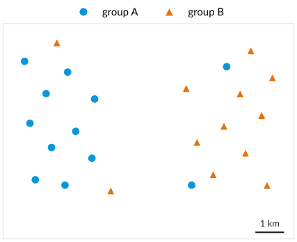
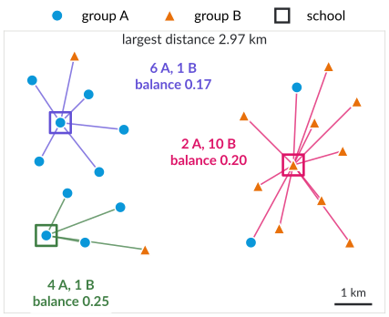
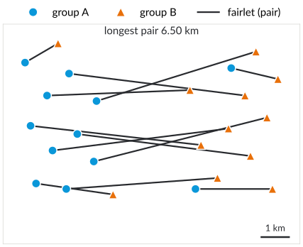
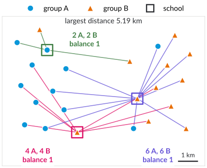
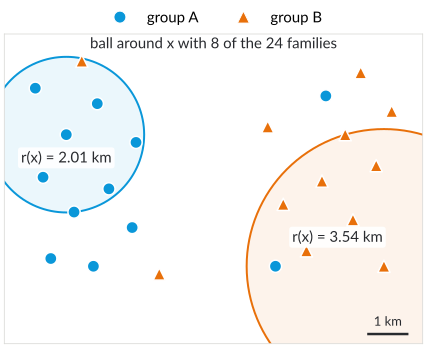

# Plan for today

1. Fairness and sustainability: leave no one behind
2. Individual and group fairness
3. Balanced clusters: fairlets and the price of fairness
4. Fair centres, fair costs, fair radii

::: notes
DRAFT (24 October 2026), proposal for the first lecture of block 4. The running example is a constructed town (24 families in two groups, three schools); all numbers come from tools/make_fairness_figures.py. If a guest speaks on 12 January (2025: Melanie Schmidt on fairness in geometric clustering), this deck can move to 19 January; then slides 8–12 become a short recap.

Timing (90 min, main part slides 2–21): 10:15 plan, block overview, leave no one behind, the town (slides 2–6, 12 min) · 10:27 fairness notions (slide 7, 6 min) · 10:33 balance, fairlets, price of fairness, exercise (slides 8–12, 23 min) · 10:56 more groups, fair centres, social fairness (slides 13–15, 12 min) · 11:08 individual fairness (slides 16–17, 10 min) · 11:18 which notion when, conflicts, summary (slides 18–20, 8 min) · 11:26 next steps (slide 21, 1 min) · about 18 min buffer.
:::

# Block 4 · Algorithmic Fairness {.section}

Week 11 · today: fair clustering

# Leave no one behind

[1 · Question]{.step}

- 2030 Agenda: "we pledge that no one will be left behind"
- [10]{.sdg .s10} Reduced inequalities · [11]{.sdg .s11} Inclusive cities · [4]{.sdg .s4} Inclusive education
- Algorithms decide **where** services go and **who** is grouped with whom: schools, clinics, charging points, bus stops

[Who is far from the next school, and who goes to school with whom?]{.ask}

[United Nations (2015), Transforming our world: the 2030 Agenda, A/RES/70/1, §4]{.source}

::: notes
About 3 minutes. The social dimension of sustainability, as announced in lecture 1 (block 4). "Leave no one behind" is the central promise of the 2030 Agenda. Today's question: when an algorithm places facilities and assigns people to them, how do we make sure that no group and no individual is systematically worse off?
:::

# A town and three schools {.columns}

## {.left grow="3"}

{.nocap height="470px"}

## {.right grow="2"}

- 24 families in **two groups** A and B
- Build $k = 3$ schools at family locations; every family goes to the nearest school
- Objective as in lecture 3: **$k$-center**, the largest distance

[Constructed example, distances in km]{.source}

[Where would you put the schools?]{.ask}

::: notes
About 3 minutes. The groups stand for any attribute that should not decide how people are treated (in the literature: gender, ethnicity, income). Group A lives mostly in the west, group B mostly in the east, with a few families of each group elsewhere: a segregated town, as many real towns are to some degree.
:::

# The $k$-center solution {.columns}

## {.left grow="3"}

{.nocap height="470px"}

## {.right grow="2"}

- Largest distance **2.97 km**: short ways for everyone
- But each school is dominated by one group: 6 A and 1 B, 2 A and 10 B

[Is this fair?]{.ask}

::: notes
About 3 minutes. Optimal 3-center with centres at family locations, computed exactly (all 2,024 triples). Fair with respect to distance (no family is far away), unfair with respect to composition: the schools mirror the segregation of the town. Both views are legitimate; which one matters depends on the application. That is the theme of today.
:::

# Notions of fairness

[2 · Research]{.step}

| | treat **similar individuals** similarly | treat **groups** equally |
|---|---|---|
| idea | individual fairness (Dwork et al. 2012) | group fairness, no disparate impact (Feldman et al. 2015) |
| in clustering | every family has a centre nearby: $d(x, C) \le r(x)$ | balanced clusters; fair share of centres; equal cost per group |
| today | slides 16–17 | slides 8–15 |

::: notes
About 6 minutes. Dwork, Hardt, Pitassi, Reingold, Zemel (2012): "similar individuals should be treated similarly", formalised as a Lipschitz condition for classifiers. Group fairness comes from the legal notion of disparate impact (US law, e.g. Griggs v. Duke Power Co., 1971); Feldman et al. (2015) carried it to machine learning. In clustering, the group view has two flavours: composition (who is in a cluster together) and cost (how well is each group served). Ask for examples from the students' own experience: school catchment areas, assignment to tutorial groups, placement of services.
:::

# Balanced clusters

[3 · Algorithms]{.step}

- Groups A and B; for a cluster $S$: $$\text{balance}(S) = \min\left(\frac{\#A(S)}{\#B(S)},\ \frac{\#B(S)}{\#A(S)}\right)\in[0,1]$$
- Balance of a clustering: the **smallest** balance of its clusters
- **Fair $k$-center:** minimise the radius among clusterings with balance at least $t$

[Chierichetti, Kumar, Lattanzi, Vassilvitskii (2017)]{.source}

[What is the balance of the $k$-center solution, and the best possible in our town?]{.ask}

::: notes
About 4 minutes. Answer: the k-center solution shown has balance min(1/4, 1/6, 2/10) = 1/6 ≈ 0.17 (the town has 29 optimal 3-center solutions, with balance between 1/8 and 1/5). The town has 12 A and 12 B, so balance 1 is possible: every school gets as many A as B families. Balance 1 is the strictest version; with balance t = 1/2 a cluster may have up to twice as many families of one group.
:::

# Fairlets {.columns}

## {.left grow="2"}

1. Split the families into **fairlets**: small sets that are already balanced (here: pairs A–B)
2. Pick one family per fairlet as **representative**; cluster the representatives
3. Every fairlet joins the cluster of its representative

Cost $\le$ fairlet cost + clustering cost

## {.right grow="3"}

{.nocap height="450px"}

::: notes
About 6 minutes. Every balanced cluster (balance 1) can be split into A–B pairs, so the fairlet decomposition loses nothing structurally. For k-center the best pairs come from a bottleneck perfect matching: binary search over the threshold, check for a perfect matching in the bipartite graph of pairs within the threshold. Then Gonzalez on the representatives. Cost: a family is at most (its partner's distance) + (representative's distance to its centre) from the centre: the triangle inequality gives the sum. In the town the longest pair is 6.50 km: the west has more A families, the east more B families, so some pairs must cross the town.
:::

# Fair $k$-center: guarantees

- Balance 1: bottleneck matching, then Gonzalez on the representatives: radius at most **4 · OPT**
- Why: pairs inside an optimal fair cluster are at most $2\,\mathrm{OPT}$ long; Gonzalez costs at most $2\,\mathrm{OPT}$; triangle inequality
- Other balances: fairlets from a min-cost flow; $k$-median: $2+\sqrt3+\varepsilon$ for balance 1
- An optimal $(1, t')$-fairlet decomposition is NP-hard for $t' \ge 3$

[Chierichetti et al. (2017); Bercea et al. (2019)]{.source}

::: notes
About 4 minutes. A simple bound of 4 that students can follow (OPT = radius of an optimal fair clustering): (1) Pair A and B families inside each cluster of an optimal fair solution; both are within OPT of the cluster's centre, so the pairs have length at most 2·OPT, and the bottleneck matching t ≤ 2·OPT. (2) The centres of the optimal fair solution cover all representatives within OPT, so Gonzalez on the representatives finds radius at most 2·OPT. (3) Triangle inequality: every family is within t + 2·OPT ≤ 4·OPT of its centre. The conference version of Chierichetti et al. states factor 3 (Theorem 9), but its argument bounds the bottleneck by OPT, which fails: on a line with k = 1, A at −1, −1, 0 and B at 0, 1, 1 give OPT = 1 and bottleneck 2. Bercea et al. (2019) cite the factor 4. Town: t = 6.50 ≤ 2 · 5.19. The k-median result uses a min-cost perfect matching and the (1+√3+ε)-approximation of Li and Svensson.
:::

# The price of fairness {.columns}

## {.left grow="3"}

{.nocap height="470px"}

## {.right grow="2"}

- Balance 1 in every school: **5.19 km** instead of 2.97 km, a factor of **1.75**
- Fairlets with the best 3-center of the representatives: 8.63 km, 1.66 times the fair optimum (guarantee: 4)

[Why does fairness cost so much in this town?]{.ask}

::: notes
About 5 minutes. Optimum with balance 1 computed exactly, with every school in its own cluster: for every triple of centres, binary search over the radius R, feasible if there is a perfect A–B matching in which both families of a pair are within R of a common centre (a pair with a school family must use that school). Answer to the question: segregation. The more the groups live apart, the farther some families must travel to a mixed school. The price of fairness is a property of the instance, not of the algorithm. The fairlet algorithm is far from optimal here because its pairs are fixed before the centres are chosen.
:::

# Your turn

Two groups on a line: A at 0 and 1, B at 10 and 11; $k = 2$.

1. Optimal 2-center without fairness?
2. Optimal 2-center with balance 1?
3. The price of fairness?

::: notes
About 4 minutes, in pairs. Answers (also in the prep document): 1. Centres at 0 and 10 (or 1 and 11): radius 1, balance 0. 2. Each cluster needs one A and one B: pairs {0, 10} and {1, 11}; centres at family locations: radius 10 (e.g. centre 0 for {0, 10}, centre 1 for {1, 11}). 3. Factor 10. If centres may be anywhere on the line: radius 5 and 5 against 0.5, still factor 10.
:::

# More groups, softer constraints

- Several groups: **bounded representation**, every group between a lower and an upper fraction of each cluster
- Exact balance is often impossible or very expensive: allow a **small additive violation** ("essentially fair")
- Typical tool: solve an LP for the fair assignment to given centres, then round

[Rösner and Schmidt (2018); Bercea et al. (2019); Bera, Chakrabarty, Flores, Negahbani (2019)]{.source}

::: notes
About 4 minutes. Rösner and Schmidt (ICALP 2018): fair k-center for any number of colours (14-approximation) and privacy constraints (lower bounds on cluster sizes). Bercea, Groß, Khuller, Kumar, Rösner, Schmidt, Schmidt (APPROX 2019): with exact fairness a 5-approximation for k-center with several groups; for k-supplier, k-median, k-means and facility location constant factors for "essentially fair" clusterings (each group off by at most one per cluster). Bera et al. (NeurIPS 2019): bounded representation for overlapping groups via LP rounding with small additive violation.
:::

# Fair centres

- Data summary: choose $k$ representatives, $k_i$ of them from group $i$
- $k$-center under this constraint: **3-approximation** in linear time

[Kleindessner, Awasthi, Morgenstern (2019); Jones, Nguyen, Nguyen (2020)]{.source}

[Where could fair centres matter for sustainability?]{.ask}

::: notes
About 3 minutes. Example: a summary of images or documents should not show only one group. Kleindessner et al. (ICML 2019) gave a linear-time algorithm with a constant factor for few groups; Jones, Nguyen and Nguyen (ICML 2020) a 3-approximation in linear time for any number of groups. Possible answers: committees or citizens' panels, choosing pilot sites in different districts, representative measurement stations.
:::

# Equal service for every group

- Cost of group $j$: $\sum_{x\in \text{group } j} d(x,C)^p$ ($p = 1$: $k$-median, $p = 2$: $k$-means)
- **Socially fair clustering:** minimise the **largest** group cost (or average cost per group)
- $O(\ell)$-approximations for $\ell$ groups, then $O(\log \ell / \log\log \ell)$ for fixed $p$

[Ghadiri, Samadi, Vempala (2021); Abbasi, Bhaskara, Venkatasubramanian (2021); Makarychev, Vakilian (2021)]{.source}

::: notes
About 5 minutes. With the sum over all families, a large group dominates the objective and a small group can be served badly; socially fair clustering protects the worst-off group (a min-max objective over groups). For k-center (p = ∞) the objective is already a maximum over everyone, so it is socially fair by definition: this is why our k-center solution was fair in distance. Makarychev and Vakilian (COLT 2021): e^{O(p)} · log ℓ / log log ℓ, and the natural LP has integrality gap Ω(ℓ). Use in practice: e.g. placing clinics so that rural and urban families have similar average travel distances.
:::

# Individual fairness {.columns}

## {.left grow="2"}

- $r(x)$: radius of the smallest ball around $x$ that contains $n/k$ families
- Fair: every family has a centre within $r(x)$
- Idea: $n/k$ families could "afford" their own centre

[Jung, Kannan, Lutz (2020)]{.source}

## {.right grow="3"}

{.nocap height="450px"}

::: notes
About 4 minutes. Here n/k = 8, so r(x) is the distance to the 7th nearest other family. Dense neighbourhoods have small r(x) and are entitled to closer service; sparse ones larger. Exact fairness (factor 1) may be impossible; optimising the factor is NP-hard (Jung et al.).
:::

# A 2-approximation

1. Go through the families by **increasing** $r(x)$
2. Open a centre at $x$ if no open centre is within $2\,r(x)$

- Every family has a centre within $2\,r(x)$
- At most $k$ centres: balls $B(x, r(x))$ of open centres are **disjoint** and each holds $n/k$ families
- Town: 2 schools suffice, every family within $1.26\,r(x)$

[Why are the balls disjoint?]{.ask}

::: notes
About 6 minutes. Answer: if y is opened after x, then r(y) ≥ r(x) and d(x, y) > 2r(y) ≥ r(x) + r(y), so the balls do not overlap. Disjoint balls with n/k families each: at most k of them. Like Gonzalez, a greedy algorithm with a ball argument. In the town the greedy algorithm opens two schools (families 5 and 15) and every family is within 1.26 r(x); the optimal 3-center solution is already individually fair here (within 0.86 r(x)), because the town has no strongly dense area. A third school can be added freely.
:::

# Which notion when?

[4 · Practice]{.step}

| application | what matters | notion |
|---|---|---|
| school catchment areas | who learns with whom | balance |
| clinics, charging points | distance for everyone | $k$-center, individual fairness |
| average service per district | worst-off group | socially fair |
| summary, panel | who is represented | fair centres |

[Which notion would you choose for bus stops in Dortmund?]{.ask}

::: notes
About 4 minutes. There is no single right notion; the choice is a value judgement and should be made explicit, ideally with those affected. For bus stops: distance for everyone (individual or k-center), plus attention to groups that depend on public transport (socially fair over groups such as households without a car); this links to block 2 (accessibility, lecture by Sabine Storandt).
:::

# Fairness notions conflict

- The town: fair in distance, unfair in composition, and vice versa
- Every balanced clustering leaves some family at least 5.19 km from its school: farther than any neighbourhood radius (at most 3.91 km)
- Fairness has a **price**; algorithms make the trade-off **measurable**

::: notes
About 3 minutes. Similar to the impossibility results for fairness in classification (calibration versus equal error rates). The algorithmic contribution: approximation algorithms with guarantees for each notion, so the price of a choice can be computed instead of guessed.
:::

# Summary

- Fair clustering: constraints (balance, fair centres, $r(x)$) or objectives (worst-off group)
- Fairlets reduce fair clustering to ordinary clustering: 4-approximation for fair $k$-center
- Greedy by neighbourhood radius: every family within $2\,r(x)$
- Fairness costs: here a factor 1.75, because the town is segregated

::: notes
About 1 minute.
:::

# Next steps

- **19 January:** more fairness (beyond clustering)
- Exercise: fairlets by hand; the greedy algorithm for $r(x)$; the price of fairness on a line
- Projects: presentations on 2 February

::: notes
The exercise line is a suggestion; exercise sheet A10 "More fairness" (new) still has to be written.
:::

# Additional material {.section}

For self-study and the tutorial

# Proportional fairness

- Any $n/k$ families are entitled to their **own** centre
- Blocking coalition: $n/k$ families that all prefer a new centre
- Proportional solutions need not exist, for $\rho < 2$ not even $\rho$-proportional ones; greedy capture is always $(1+\sqrt2)$-proportional

[Chen, Fain, Lyu, Munagala (2019)]{.source}

# Check your understanding

1. Compute the balance of a clustering with clusters (3 A, 1 B) and (2 A, 4 B).
2. Why can every cluster with balance 1 be split into A–B pairs?
3. Why is $k$-center already "socially fair" with respect to distance?
4. What happens to the neighbourhood radius $r(x)$ when $k$ grows?

## Possible answers {.fragment .info}

1\. $\min(1/3, 2/4) = 1/3$. 2. It has as many A as B families; pair them arbitrarily. 3. Its objective is the maximum over all families, hence over every group. 4. $n/k$ shrinks, so $r(x)$ does not grow (it shrinks or stays the same): with more centres, every family is entitled to a centre at least as close.

# References

::: refs
- Abbasi, M., Bhaskara, A., Venkatasubramanian, S. (2021). Fair clustering via equitable group representations. *FAccT 2021*.
- Bera, S. K., Chakrabarty, D., Flores, N. J., Negahbani, M. (2019). Fair algorithms for clustering. *NeurIPS 2019*.
- Bercea, I. O., Groß, M., Khuller, S., Kumar, A., Rösner, C., Schmidt, D. R., Schmidt, M. (2019). On the cost of essentially fair clusterings. *APPROX/RANDOM 2019*, LIPIcs 145.
- Chen, X., Fain, B., Lyu, L., Munagala, K. (2019). Proportionally fair clustering. *ICML 2019*, PMLR 97, 1032–1041.
- Chierichetti, F., Kumar, R., Lattanzi, S., Vassilvitskii, S. (2017). Fair clustering through fairlets. *NIPS 2017*.
- Dwork, C., Hardt, M., Pitassi, T., Reingold, O., Zemel, R. (2012). Fairness through awareness. *ITCS 2012*, 214–226.
- Feldman, M., Friedler, S. A., Moeller, J., Scheidegger, C., Venkatasubramanian, S. (2015). Certifying and removing disparate impact. *KDD 2015*, 259–268.
- Ghadiri, M., Samadi, S., Vempala, S. (2021). Socially fair k-means clustering. *FAccT 2021*.
- Jones, M., Nguyen, H., Nguyen, T. (2020). Fair k-centers via maximum matching. *ICML 2020*, PMLR 119.
- Jung, C., Kannan, S., Lutz, N. (2020). Service in your neighborhood: Fairness in center location. *FORC 2020*, LIPIcs 156, 5.
- Kleindessner, M., Awasthi, P., Morgenstern, J. (2019). Fair k-center clustering for data summarization. *ICML 2019*, PMLR 97, 3448–3457.
- Makarychev, Y., Vakilian, A. (2021). Approximation algorithms for socially fair clustering. *COLT 2021*, PMLR 134, 3246–3264.
- Rösner, C., Schmidt, M. (2018). Privacy preserving clustering with constraints. *ICALP 2018*, LIPIcs 107.
- United Nations (2015). Transforming our world: the 2030 Agenda for Sustainable Development. A/RES/70/1.
:::

# License and credits

::: refs
- Slides © 2027 Kevin Buchin, TU Dortmund University, licensed under **CC BY 4.0** (<https://creativecommons.org/licenses/by/4.0/>). Suggested attribution: "Kevin Buchin, Algorithms and Sustainability, TU Dortmund University, CC BY 4.0", with a link to the course page.
- Not covered by this license: the TU Dortmund logo and the Decker software and its themes (own licenses).
- Figures: own work, CC BY 4.0, made with `tools/make_fairness_figures.py`; the town is a constructed example.
- Made with Decker: <https://github.com/decker-edu/decker>
:::
