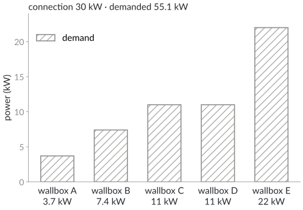
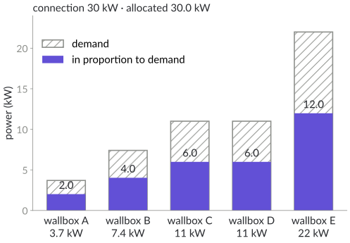
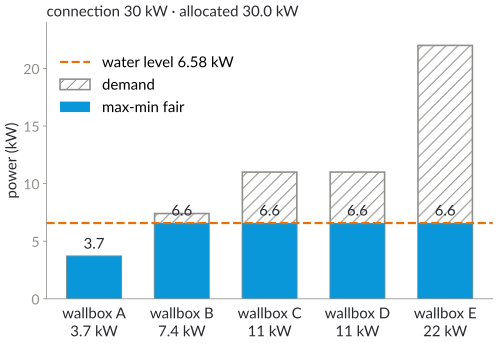
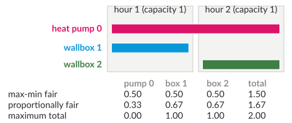

# Plan for today

1. Who gets how much? Energy sharing and congested grids
2. Max-min fairness: water-filling
3. Proportional fairness and the price of fairness
4. Indivisible charging slots: envy-free up to one slot

::: notes
DRAFT (24 October 2026), proposal for "More fairness" on 19 January. It connects block 4 with block 3 (energy). If lecture 10 moves to 19 January because of a guest on 12 January, this deck fits 26 January (further topics). All examples are constructed; the legal facts on slides 4–5 must be checked again before the lecture.

Timing (90 min, main part slides 2–18): 10:15 plan, block, energy sharing, congested grids (slides 2–5, 10 min) · 10:25 model, max-min fairness, water-filling, strategy-proofness, exercise (slides 6–10, 25 min) · 10:50 proportional fairness, price of fairness (slides 11–12, 12 min) · 11:02 indivisible slots, round robin, Nash welfare (slides 13–15, 15 min) · 11:17 which key, summary (slides 16–17, 7 min) · 11:24 next steps (slide 18, 2 min) · about 19 min buffer.
:::

# Block 4 · Algorithmic Fairness {.section}

Week 12 · today: sharing energy fairly

# Energy sharing

[1 · Question]{.step}

- Since June 2026, households in the same grid area in Germany may share electricity from a joint solar or wind plant over the public grid
- Their contract must fix a **distribution key**; the law does not say which
- [7]{.sdg .s7} Clean energy · [10]{.sdg .s10} Reduced inequalities

[Five households share 30 kW of solar power. How would you split it?]{.ask}

[§ 42c EnWG (energy sharing), from June 2028 also in neighbouring grid areas]{.source}

::: notes
About 3 minutes. The rule implements EU requirements on energy sharing. Participants: households, municipal facilities, small and medium enterprises; the plant must not mainly serve a commercial activity; storage of renewable power also counts; quarter-hourly metering at every consumption point. Collect proposals: equal shares, by investment, by demand.
:::

# When the grid is congested

- Since 2024, grid operators may **throttle** new wallboxes and heat pumps when the local grid is overloaded
- Every device keeps at least **4.2 kW**; in return, lower grid fees
- More such cases: a shared connection in a car park, a feeder full of solar inverters at noon

[Which wallbox should get how much?]{.ask}

[§ 14a EnWG; Bundesnetzagentur, steuerbare Verbrauchseinrichtungen]{.source}

::: notes
About 3 minutes. The rule applies to devices installed since 1 January 2024 with more than 4.2 kW (private wallboxes, heat pumps, air conditioners, batteries when charging). Throttling is meant to prevent acute damage or overload; in a transition period, operators without full grid monitoring may also throttle preventively for up to two hours a day. With an energy management system the operator sets a joint minimum for all devices. The details are set by the Bundesnetzagentur. Today's question in its simplest form: one bottleneck, several users, a fixed capacity.
:::

# The model {.columns}

## {.left grow="2"}

[2 · Research]{.step}

- Capacity $C$; household $i$ demands $d_i$
- Allocation: $0 \le x_i \le d_i$, $\sum_i x_i \le C$
- **Equal split:** wastes power if $d_i < C/n$
- **In proportion to demand:** rewards high demand

## {.right grow="3"}

::: {.r-stack}
{.nocap height="450px"}

{.fragment .nocap height="450px"}
:::

::: notes
About 5 minutes; one click. Constructed demands in the range of usual wallboxes (3.7 to 22 kW). Equal split: 6 kW each, but wallbox A needs only 3.7 kW, so 2.3 kW stay unused. In proportion to demand: wallbox A, the smallest user, is cut to 2.0 kW, while E keeps 12 kW; and anyone can get more by claiming more.
:::

# Max-min fairness {.columns}

## {.left grow="2"}

[3 · Algorithms]{.step}

- **Max-min fair:** to increase any share, you must decrease a share that is smaller or equal
- **Water-filling:** raise a common level $\lambda$, give $x_i = \min(d_i, \lambda)$, stop when $\sum_i x_i = C$ or all demands are met
- Sort the demands: $O(n \log n)$

## {.right grow="3"}

{.nocap height="450px"}

::: notes
About 6 minutes. Equivalent description: make the smallest share as large as possible, then the second smallest, and so on (lexicographic max-min). Water-filling: pour water into vessels of heights d_i; the level is the same in all vessels that are not full. Small demands are fully served; the others share the rest equally.
:::

# Water-filling, step by step

| step | open households | equal share of the rest | smallest open demand | action |
|---|---|---|---|---|
| 1 | A–E | $30/5 = 6$ | 3.7 (A) | A is full: $x_A = 3.7$ |
| 2 | B–E | $26.3/4 = 6.575$ | 7.4 (B) | $6.575 < 7.4$: level $\lambda = 6.575$ |

- Result: A 3.7 kW, B–E 6.575 kW each; all 30 kW used
- Nobody is throttled below 4.2 kW (A gets its full 3.7 kW)

::: notes
About 5 minutes. Step rule: when the smallest open demand is at most the equal share of the rest, fill it and continue; otherwise all remaining households get the equal share. Invariant: the equal share of the rest never decreases (d ≤ C'/k implies (C' − d)/(k − 1) ≥ C'/k). Correctness in both directions: (1) a max-min fair allocation uses all of C (or meets all demands), and no unsaturated household gets less than another (otherwise move power from the larger share to the smaller), so all unsaturated households share one level λ and the saturated ones are exactly those with d_i ≤ λ; (2) conversely, in the water-filling allocation, raising an unsaturated share (which equals λ) forces lowering another share, and every other share is at most λ.
:::

# Honest demands pay off

- Water-filling is the **uniform rule** of economics
- When demand exceeds supply: with single-peaked preferences it is the only rule that is **strategy-proof**, efficient and anonymous
- In proportion to demand: when power is scarce, claiming a little more always gets you more

[Sprumont (1991)]{.source}

[What happens with the proportional rule if everyone exaggerates?]{.ask}

::: notes
About 5 minutes. Strategy-proof: no household can gain by reporting a false demand. Under water-filling, reporting more than your true demand changes nothing if your demand is above the level (you get the level either way) and gives you power you do not want if it is below; reporting less can only hurt. Under the proportional rule everyone has an incentive to inflate the demand; if all claims are inflated up to a common cap, the split becomes an equal split in disguise and the reported demands carry no information. Single-peaked preferences: each household has a most preferred amount (its true demand), less or more is worse.
:::

# Your turn

A connection of 20 kW, four heat pumps with demands 2, 5, 8 and 10 kW.

1. The max-min fair split?
2. The split in proportion to demand?
3. Which household would like to exaggerate under rule 2?

::: notes
About 4 minutes. Answers: 1. 20/4 = 5 ≥ 2: give 2; 18/3 = 6 ≥ 5: give 5; 13/2 = 6.5 < 8: level 6.5. Split (2, 5, 6.5, 6.5). 2. Total demand 25, factor 0.8: (1.6, 4, 6.4, 8). 3. Everyone gains by inflating their claim, most visibly the households with 2 and 5 kW, which would get their full demand under rule 1.
:::

# Proportional fairness

- Maximise $\sum_i \log x_i$: a 1% loss counts the same for everyone; one bottleneck: same as water-filling
- Two congested hours: a heat pump at one setting needs both, each wallbox one

{.nocap height="300px"}

[Kelly (1997); Kelly, Maulloo, Tan (1998)]{.source}

::: notes
About 6 minutes. Proportionally fair: no other feasible allocation increases the sum of relative changes, Σ (y_i − x_i)/x_i ≤ 0. In the example: maximise log x0 + log x1 + log x2 with x0 + x1 ≤ 1 and x0 + x2 ≤ 1; with x1 = x2 = 1 − x0 the derivative 1/x0 − 2/(1 − x0) vanishes at x0 = 1/3. This is Kelly's two-link network: the heat pump plays the long flow that uses both links. Kelly introduced proportional fairness for rate control in communication networks; the same structure appears whenever one user needs several congested resources (hours, lines, transformers).
:::

# The price of fairness

- Total power: max-min fair 1.5, proportionally fair 1.67, maximum total 2
- Price of fairness: 25 % (max-min) and 17 % (proportional) less than the maximum total
- The heat pump needs both hours: should it get less?

[Bertsimas, Farias, Trichakis (2011)]{.source}

[Is it fair to switch the heat pump off completely?]{.ask}

::: notes
About 6 minutes. Discussion: maximum total switches the heat pump off; max-min treats all devices the same although the heat pump uses both hours; proportional fairness is in between. Bertsimas, Farias and Trichakis bound the price of fairness when the set of possible utilities is convex and every user could get the same maximum alone: for n = 3 at most 25 % for max-min (attained by this example) and about 17.9 % for proportional fairness (1 − (2√n − 1)/n).
:::

# Indivisible charging slots {.columns}

## {.left grow="1"}

- Six one-hour slots from 17:00 to 23:00; everyone prefers early slots (values 6, 5, 4, 3, 2, 1)
- Envy-free is impossible in general: one slot, two households
- **EF1:** the envy vanishes if one slot is removed from the other bundle

## {.right grow="1"}

**Round robin** (Ana, Ben, Cem pick in turn)

| | slots | own value |
|---|---|---|
| Ana | 17:00, 20:00 | 9 |
| Ben | 18:00, 21:00 | 7 |
| Cem | 19:00, 22:00 | 5 |

Cem envies Ana (9), but without 17:00 Ana's bundle is worth 3 for Cem

::: notes
About 5 minutes. Each household picks its favourite remaining slot in turn. Values are additive. Cem's own bundle 4 + 1 = 5; Ana's bundle in Cem's eyes 6 + 3 = 9, without the 17:00 slot 3 ≤ 5. Ben envies Ana, too (7 < 9), but 9 − 6 = 3 ≤ 7.
:::

# Why round robin is EF1

- Households $a$ and $b$; $a$ picks before $b$ in every round: $a$ values its $k$-th item at least as much as $b$'s $k$-th item, so no envy
- $b$ picks before $a$: drop $b$'s first item; then $a$'s $k$-th item beats $b$'s $(k+1)$-th item

[Why does the argument need additive values?]{.ask}

::: notes
About 5 minutes. Answer: the proof compares items one by one and sums the inequalities; with complementarities (two slots in a row are worth more than two separate slots) the sum argument fails. Round robin is simple, transparent and EF1, but not always efficient.
:::

# Maximum Nash welfare

- Choose the allocation that maximises $\prod_i v_i(A_i)$
- Pareto optimal **and** EF1 for additive values
- NP-hard to compute in general; small instances by integer programming

[Caragiannis et al. (2019)]{.source}

::: notes
About 5 minutes. The discrete analogue of proportional fairness (maximise the sum of logs). "The unreasonable fairness of maximum Nash welfare": EF1 holds although the definition does not mention envy. Pareto optimality is immediate when the best product is positive: a Pareto improvement would increase it. If some household must get value 0, maximise first the number of households with positive value, then the product of their values (as in the paper); otherwise EF1 can fail. Computing MNW is NP-hard (and APX-hard); for the lecture it suffices that small instances are easy to solve.
:::

# Which distribution key?

[4 · Practice]{.step}

| key | fair in which sense? | weak point |
|---|---|---|
| equal shares | equal treatment | wastes power |
| by investment | proportional to contribution | ignores need |
| max-min (water-filling) | strategy-proof, protects small users | ignores contribution |
| Nash welfare | balance of efficiency and fairness | harder to explain |

[Which key would you write into the contract?]{.ask}

::: notes
About 5 minutes. Keys can be combined: e.g. a base share by investment, the rest by water-filling on the demands. Transparency matters: households have to understand and accept the key. Project idea: simulate an energy community with real load profiles and compare the keys.
:::

# Summary

- One bottleneck: water-filling is max-min fair and strategy-proof
- Several bottlenecks: max-min fair, proportionally fair and efficient allocations differ: the price of fairness
- Indivisible slots: round robin gives EF1; maximum Nash welfare gives EF1 and Pareto optimality

::: notes
About 2 minutes.
:::

# Next steps

- **26 January:** further topics
- **2 February:** project presentations (both slots)
- Exercise: water-filling with a minimum per device; proportional fairness on two lines; round robin

::: notes
The exercise line is a suggestion for sheet A10.
:::

# Additional material {.section}

For self-study and the tutorial

# Measuring fairness: Jain's index

$$J(x) = \frac{\left(\sum_i x_i\right)^2}{n \sum_i x_i^2} \in \left[\tfrac1n, 1\right]$$

- $J = 1$ if all shares are equal, $1/n$ if one household gets everything
- Our wallboxes: in proportion to demand $J = 0.76$, max-min fair $J = 0.96$

[Jain, Chiu, Hawe (1984)]{.source}

# Fairness in decisions

- Risk scores (credit, recidivism): **calibration** and **equal error rates** for two groups cannot hold together, unless the base rates are equal or the prediction is perfect
- So "fair" needs a choice, as in clustering

[Kleinberg, Mullainathan, Raghavan (2017); Chouldechova (2017)]{.source}

# Check your understanding

1. Water-filling with $C = 12$ and demands 1, 2, 6, 9?
2. Why does reporting a larger demand not help under water-filling?
3. Give an instance with two households and one item that has no envy-free allocation.
4. What does round robin give for two households with identical values 4, 3, 2, 1?

## Possible answers {.fragment .info}

1\. $12/4 = 3 \ge 1$, $11/3 \ge 2$, $9/2 = 4.5 < 6$: split (1, 2, 4.5, 4.5). 2. Below the level you already get your demand; above it, you get the level, which does not depend on your report. 3. Both want the single item. 4. Values 4 + 2 = 6 and 3 + 1 = 4; the second envies the first, but not after removing the item worth 4.

# References

::: refs
- Bertsimas, D., Farias, V. F., Trichakis, N. (2011). The price of fairness. *Operations Research* 59(1), 17–31.
- Caragiannis, I., Kurokawa, D., Moulin, H., Procaccia, A. D., Shah, N., Wang, J. (2019). The unreasonable fairness of maximum Nash welfare. *ACM Transactions on Economics and Computation* 7(3), 12.
- Chouldechova, A. (2017). Fair prediction with disparate impact: A study of bias in recidivism prediction instruments. *Big Data* 5(2), 153–163.
- Jain, R., Chiu, D.-M., Hawe, W. R. (1984). A quantitative measure of fairness and discrimination for resource allocation in shared computer systems. DEC Research Report TR-301.
- Kelly, F. (1997). Charging and rate control for elastic traffic. *European Transactions on Telecommunications* 8(1), 33–37.
- Kelly, F. P., Maulloo, A. K., Tan, D. K. H. (1998). Rate control for communication networks: shadow prices, proportional fairness and stability. *Journal of the Operational Research Society* 49(3), 237–252.
- Kleinberg, J., Mullainathan, S., Raghavan, M. (2017). Inherent trade-offs in the fair determination of risk scores. *ITCS 2017*, LIPIcs 67, 43.
- Sprumont, Y. (1991). The division problem with single-peaked preferences: a characterization of the uniform allocation rule. *Econometrica* 59(2), 509–519.
- Energiewirtschaftsgesetz (EnWG), § 14a (steerable consumption devices) and § 42c (energy sharing).
:::

# License and credits

::: refs
- Slides © 2027 Kevin Buchin, TU Dortmund University, licensed under **CC BY 4.0** (<https://creativecommons.org/licenses/by/4.0/>). Suggested attribution: "Kevin Buchin, Algorithms and Sustainability, TU Dortmund University, CC BY 4.0", with a link to the course page.
- Not covered by this license: the TU Dortmund logo and the Decker software and its themes (own licenses).
- Figures: own work, CC BY 4.0, made with `tools/make_sharing_figures.py`; all examples are constructed.
- Made with Decker: <https://github.com/decker-edu/decker>
:::
