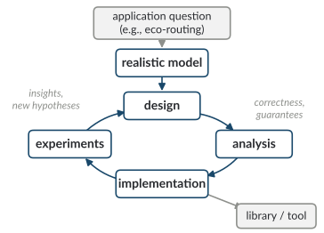
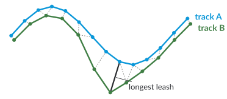

This course asks how **algorithms research** can contribute to addressing challenges of **sustainability**. This first chapter explains what we mean by algorithms and by sustainability, shows where the two meet, and gives an overview of the four topic blocks of the course. It accompanies Lecture 1.

After working through this chapter, you should be able to

- explain what algorithm design, algorithm analysis, and algorithm engineering are, and which questions each of them answers;
- explain the concepts of sustainable development, planetary boundaries, and the Sustainable Development Goals (SDGs);
- name, for each block of the course, a sustainability question and the algorithmic problem behind it;
- compute the energy of a job in the speed-scaling model and explain why running at constant speed is optimal for a single job with a deadline.

# 1.1 Algorithms, their analysis, and algorithm engineering

## Problems and algorithms

A **computational problem** specifies, for every admissible input, which outputs are correct. An **algorithm** is a well-defined computational procedure that takes an input and, after finitely many steps, produces an output. An algorithm is **correct** for a problem if, for every input, it halts with a correct output [Cormen et al. 2022].

::: example
**Example (shortest paths).** *Input:* a directed graph $G = (V, E)$ with non-negative edge lengths $\ell : E \to \mathbb{R}_{\geq 0}$, a source $s$, and a target $t$. *Output:* an $s$-$t$ path of minimum total length. Dijkstra's algorithm solves this problem; with a binary heap it runs in $O((|V| + |E|) \log |V|)$ time.
:::

The same real-world question can lead to different computational problems, depending on the model. "Find a good route" may mean the fastest route, the route with the lowest emissions, or all routes that are not dominated by another route, i.e., not at least as bad in every respect and worse in one (Section 1.3.2). Choosing the model is the first and often the most consequential step.

## Designing algorithms

**Algorithm design** is the task of finding an algorithm for a given problem. It rarely starts from scratch: we use general techniques such as greedy algorithms, divide and conquer, dynamic programming, and suitable data structures, and we adapt algorithms for related problems. Geometry plays a large role in this course, since much of the data we consider, such as GPS tracks or locations of facilities, consists of points in the plane.

## What we ask about an algorithm

Algorithm analysis answers questions that hold for *all* inputs, not just for the ones we happened to test:

- **Correctness:** does the algorithm always halt with a correct output?
- **Efficiency:** how do running time and memory grow with the input size? We usually state worst-case bounds in $O$-notation. In this course, **energy** is a further resource (Chapter 4).
- **Quality of the solution** when the exact optimum is out of reach. Both of the following measures are worst cases over all instances:
    - The **approximation ratio** bounds how far the solution of an algorithm for an optimization problem, typically an NP-hard one, can be from the optimum (Chapter 5).
    - The **competitive ratio** compares an **online algorithm**, which must make decisions before it knows the whole input, with an optimal solution that knows everything in advance (Chapter 4).
- **Lower bounds:** what can no algorithm achieve? Many lower bounds are conditional: NP-hardness rules out polynomial-time algorithms only if P ≠ NP, and some lower bounds, such as the one for the Fréchet distance in Section 1.3.1, rely on the Strong Exponential Time Hypothesis. Lower bounds on competitive ratios, in contrast, often hold unconditionally (Chapter 4).

## Algorithm engineering

Asymptotic analysis does not always predict which algorithm is fastest in practice: constant factors, the memory hierarchy, and the structure of real inputs matter. **Algorithm engineering** therefore combines design and analysis with implementation and experimental evaluation, in a cycle that is driven by applications and realistic models (Figure 1.1) [Sanders 2009; Müller-Hannemann and Schirra 2010]. Experiments lead to new hypotheses and better designs; good implementations end up in libraries and tools.

{width="70%"}

A success story of algorithm engineering is route planning in road networks. Dijkstra's algorithm is too slow for interactive queries on continental road networks; speed-up techniques such as contraction hierarchies answer such queries several orders of magnitude faster after a preprocessing step [Bast et al. 2016]. We return to them in Chapter 3.

This course combines theory and practice: we prove guarantees about algorithms, and we implement and evaluate them, in particular in your project.

## What this course is not about

This is not a course on machine learning or artificial intelligence, although both matter for sustainability: as tools for analyzing data, and as large consumers of energy. It is also not a course on sustainability policy. We take sustainability questions as the motivation and the source of problems, and we study them with the methods of algorithms research.

# 1.2 Sustainability

## Sustainable development

The report *Our Common Future* of the World Commission on Environment and Development [WCED 1987], often called the Brundtland report, describes sustainable development as development that satisfies today's needs while preserving the ability of future generations to satisfy theirs. Sustainability is commonly seen as having three interlinked dimensions: **ecological**, **economic**, and **social**. The sustainability strategy of TU Dortmund University builds on this understanding: it aims at the long-term functioning of the global ecological, economic, and social systems, so that the present generation can secure its quality of life without restricting future generations [TU Dortmund 2021].

## Planetary boundaries

Rockström et al. (2009) proposed nine **planetary boundaries**: for nine Earth-system processes, a boundary marks a *safe operating space for humanity*. Beyond a boundary, the risk of large-scale, possibly irreversible changes to the Earth system increases. In the current version of the framework [Richardson et al. 2023], the nine processes are climate change, change in biosphere integrity, land-system change, freshwater change, modification of biogeochemical flows, ocean acidification, increase in atmospheric aerosol loading, stratospheric ozone depletion, and the introduction of novel entities.

Richardson et al. (2023) found six of the nine boundaries transgressed. The *Planetary Health Check 2025* reports seven, as the ocean-acidification boundary is now also considered transgressed [Sakschewski et al. 2025].

## The Sustainable Development Goals

In 2015, the General Assembly of the United Nations adopted the *2030 Agenda for Sustainable Development* with **17 Sustainable Development Goals** and 169 targets [United Nations 2015]. The goals are meant to be integrated and indivisible: progress on one goal affects others. Table 1.1 lists the goals that the topic blocks of this course relate to most directly.

| Goal | Example target | Topic block |
|------|----------------|-------------|
| [3]{.sdg .s3} Good health and well-being | 3.6: halve global deaths and injuries from road traffic accidents (originally by 2020; renewed for 2030) | route planning |
| [5]{.sdg .s5} Gender equality | | fairness |
| [7]{.sdg .s7} Affordable and clean energy | 7.3: by 2030, double the global rate of improvement in energy efficiency | energy |
| [10]{.sdg .s10} Reduced inequalities | 10.2: by 2030, promote the social, economic, and political inclusion of all | fairness, route planning |
| [11]{.sdg .s11} Sustainable cities and communities | 11.2: by 2030, safe, affordable, accessible, and sustainable transport systems for all | route planning |
| [12]{.sdg .s12} Responsible consumption and production | | energy |
| [13]{.sdg .s13} Climate action | | movement analysis, energy, route planning |
| [14]{.sdg .s14} Life below water | | movement analysis |
| [15]{.sdg .s15} Life on land | 15.5: halt the loss of biodiversity and, by 2020, protect threatened species from extinction | movement analysis |
| [16]{.sdg .s16} Peace, justice and strong institutions | | fairness |

: Table 1.1: SDGs that the topic blocks of this course relate to, with example targets (paraphrased from United Nations 2015).

## Computing and sustainability: two directions

Computing relates to sustainability in two directions, and this course covers both:

- **Computing for sustainability.** Algorithms are tools for sustainability questions in other domains: analyzing animal movement for conservation, planning sustainable mobility, or allocating resources fairly.
- **Sustainability of computing.** Computing itself consumes energy and resources. Estimates put the share of information and communication technology (ICT) at 1.8–2.8% of global greenhouse-gas emissions, possibly up to 2.1–3.9% when the full supply chain is taken into account [Freitag et al. 2021]. Data centers used about 415 TWh of electricity in 2024, around 1.5% of global electricity consumption, and are projected to use about 945 TWh in 2030 [IEA 2025].

# 1.3 Four topic blocks

Each block of the course follows the same pattern:

1. **Question:** a sustainability question, and why it matters.
2. **Research:** research papers on the question lead to a precise computational problem.
3. **Algorithms:** we design and analyze algorithms, and sometimes prove lower bounds.
4. **Practice:** exercises, quizzes, and your project.

The following sections give a first impression of each block; Chapters 2 to 5 cover them in detail.

## 1.3.1 Computational movement analysis

**Context.** GPS tracking reveals how animals move, and how land use and climate change affect their movement. Large collections of tracking data exist, for instance in the online platform Movebank, but turning such data into advice for conservation requires analysis methods. Kölzsch et al. (2025) report on volunteer coders who developed analysis apps for wildlife conservation on the platform MoveApps, and discuss how to build and keep such a community.

**Problem.** A **trajectory** is a sequence $P = \langle p_1, \ldots, p_n \rangle$ of time-stamped positions, which we often view as a polygonal curve. A basic question is how similar two trajectories are. A popular image for the **Fréchet distance** is a person walking a dog: the person walks along one trajectory, the dog along the other, both only move forward, and we ask for the shortest leash that allows both to get from start to end. In the **discrete** version, both walk from point to point: in each step, the person, the dog, or both advance to their next point.

::: definition
**Definition 1.1 (discrete Fréchet distance).** For $P = \langle p_1, \ldots, p_n \rangle$ and $Q = \langle q_1, \ldots, q_m \rangle$, a *coupling* is a sequence of index pairs $(i_1, j_1), \ldots, (i_L, j_L)$ with $(i_1, j_1) = (1, 1)$ and $(i_L, j_L) = (n, m)$ such that
$$(i_{k+1}, j_{k+1}) \in \{(i_k + 1, j_k),\ (i_k, j_k + 1),\ (i_k + 1, j_k + 1)\} \quad \text{for } k = 1, \ldots, L - 1.$$
With the Euclidean distance $\lVert \cdot \rVert$ (of projected coordinates),
$$\delta_{\mathrm{dF}}(P, Q) = \min_{\text{couplings}} \; \max_{k = 1, \ldots, L} \; \lVert p_{i_k} - q_{j_k} \rVert .$$
:::

{width="60%"}

**Algorithms.** Dynamic programming computes $\delta_{\mathrm{dF}}$ in $O(nm)$ time [Eiter and Mannila 1994]. This is essentially the best we can hope for: there is no algorithm with running time $O((nm)^{1-\varepsilon})$ for any $\varepsilon > 0$ unless the Strong Exponential Time Hypothesis (SETH) fails [Bringmann 2014]. The block also covers clustering of trajectories and **segmentation**, which splits a track into phases of homogeneous movement, such as migrating and resting.

**Practice.** A project can be a MoveApp that makes such an analysis available to ecologists.

## 1.3.2 Route planning for sustainable mobility

**Context.** Minett et al. (2011) compared three routes between Delft and Zoetermeer in a field test (Table 1.2, Figure 1.3). The provincial road takes almost the same time as the motorway but needs 43% less fuel; the local road needs the least fuel but takes clearly longer. The fastest route is not the most fuel-efficient one.

| Route (Delft → Zoetermeer) | Distance | Travel time | Fuel |
|----------------------------|---------:|------------:|-----:|
| Motorway | 20.2 km | 15.6 min | 1.34 l |
| Provincial road | 13.8 km | 15.7 min | 0.76 l |
| Local road | 13.2 km | 21.0 min | 0.73 l |

: Table 1.2: Field-test averages from Minett et al. (2011), Tables II and III.

{width="55%"}

**Problem.** With several criteria, there is in general no single best route. In the **multi-criteria shortest path problem**, every edge $e$ has a cost vector $c(e) \in \mathbb{R}^k_{\geq 0}$, for instance travel time and fuel, and the cost of a path is the sum of the cost vectors of its edges.

::: definition
**Definition 1.2 (Pareto optimality).** A path $P$ *dominates* a path $P'$ if $c(P) \leq c(P')$ in every component and $c(P) < c(P')$ in at least one component. A path is *Pareto-optimal* if no other path dominates it. The *Pareto set* consists of the cost vectors of all Pareto-optimal paths. The multi-criteria shortest path problem asks for the Pareto set, together with one path for each of its cost vectors.
:::

Among the three routes of Table 1.2, none dominates another: the motorway is the fastest, the local road uses the least fuel, and the provincial road is faster than the local road and uses less fuel than the motorway.

**Algorithms.** Multi-criteria variants of Dijkstra's algorithm compute the Pareto set by label setting. The Pareto set can be exponentially large in the worst case, even for two criteria [Hansen 1980], which motivates restricted variants and heuristics. The block also covers speed-up techniques for road networks and journey planning in public transit, where timetables replace road graphs; for this, we study the Connection Scan Algorithm and RAPTOR. A guest lecture addresses route planning for accessibility.

**Practice.** A project can implement a routing algorithm in the framework tour4me, which plans round trips for cycling.

## 1.3.3 Energy-efficient algorithms

**Context.** As described in Section 1.2, computing has a growing energy footprint (Figure 1.4). SDG target 7.3 calls for doubling the global rate of improvement in energy efficiency by 2030. Algorithms influence energy consumption in several ways: through the amount of work they do, through how they use the hardware, and through decisions such as at which speed a processor runs.

{width="45%"}

**Problem.** In the **speed-scaling** model, a processor can run at any speed $s \geq 0$ and then consumes power $P(s) = s^{\alpha}$ for a constant $\alpha > 1$. For CMOS processors, $\alpha \approx 3$ is a common choice, the so-called cube-root rule [Brooks et al. 2000; Albers 2010]. If the speed at time $t$ is $s(t)$, the energy used in a time interval is the integral of $P(s(t))$ over the interval. A job with work $w$ that runs at constant speed $s$ takes time $w/s$ and uses the energy
$$E(s) = P(s) \cdot \frac{w}{s} = w\, s^{\alpha - 1}.$$
For $\alpha = 3$, running at half speed takes twice as long but needs only a quarter of the energy. Speed therefore trades time for energy, and the algorithmic question is how to choose speeds when jobs have deadlines.

::: theorem
**Lemma 1.1.** Let a job with work $w$ be released at time $0$ and have deadline $d$, and let $P$ be convex and non-negative with $P(0) = 0$. Among all speed functions $s(t)$ on $[0, d]$ that finish the job by its deadline, the constant speed $w/d$ minimizes the energy $\int_0^d P(s(t))\,dt$.

*Proof.* Such a $P$ is non-decreasing on $[0, \infty)$: for $0 \leq a < b$, convexity gives $P(a) \leq \frac{a}{b} P(b) + \left(1 - \frac{a}{b}\right) P(0) = \frac{a}{b} P(b) \leq P(b)$. A feasible speed function satisfies $\int_0^d s(t)\,dt \geq w$, and scaling it down to $\int_0^d s(t)\,dt = w$ does not increase the energy, so we may assume equality. Jensen's inequality for the convex function $P$ gives
$$\frac{1}{d} \int_0^d P(s(t))\,dt \;\geq\; P\!\left(\frac{1}{d}\int_0^d s(t)\,dt\right) = P\!\left(\frac{w}{d}\right).$$
Hence the energy is at least $d \cdot P(w/d)$, which is exactly the energy at constant speed $w/d$. [∎]{.qed}
:::

The assumption $P(0) = 0$ matters. Real processors also have *static* power that does not depend on the speed. If a processor can be switched off when it is idle, it can then pay off to run fast and switch off early ("race to idle"); models with static power and sleep states are part of Chapter 4.

**Algorithms.** With many jobs, each with its own release time and deadline, the problem becomes a scheduling problem. Yao, Demers, and Shenker (1995) gave an optimal offline algorithm: it repeatedly finds a time interval of maximum *density* (the total work of the jobs whose release time and deadline lie within the interval, divided by its length), runs these jobs at this density in earliest-deadline-first order, then removes the interval and contracts time, which shrinks the time windows of the remaining jobs. They also proposed online algorithms, which do not know future jobs, among them *Optimal Available*; Bansal, Kimbrel, and Pruhs (2007) proved that Optimal Available is exactly $\alpha^\alpha$-competitive for $P(s) = s^{\alpha}$. Besides such models, the block covers how to measure the energy consumption of programs.

**Practice.** A project can measure and compare the energy consumption of algorithms, for instance of sorting algorithms, with the energy toolkit of the Secure Software Engineering group at TU Dortmund.

## 1.3.4 Algorithmic fairness

**Context.** Sustainability has a social dimension ([10]{.sdg .s10} Reduced inequalities). Algorithms decide how people are grouped and served, for instance when students are assigned to schools or when locations for clinics are chosen. If such decisions optimize only efficiency, some groups may be systematically disadvantaged.

**Problem.** Clustering is a central example. Given a set $X$ of points in a metric space and a number $k$, a **clustering** consists of a partition of $X$ into $k$ clusters and a center for each cluster. The **$k$-center problem** minimizes the maximum distance of a point to the center of its cluster, the **$k$-median problem** minimizes the sum of these distances, and the **$k$-means problem** minimizes the sum of their squares. All three are NP-hard. Without additional constraints, each point is assigned to its nearest center; fairness constraints can require other assignments. Two notions of fairness for points that belong to groups:

::: definition
**Definition 1.3 (balance).** Let every point be red or blue. For a non-empty cluster $C$ with $r(C)$ red and $b(C)$ blue points, the *balance* of $C$ is $\min\{r(C)/b(C),\ b(C)/r(C)\}$ if both numbers are positive, and $0$ otherwise. The balance of a clustering is the minimum balance of its clusters, and a clustering is fair with respect to $t$ if its balance is at least $t$ [Chierichetti et al. 2017].

**Definition 1.4 (socially fair $k$-means).** Let the points be partitioned into groups $X_1, \ldots, X_g$. *Socially fair $k$-means* asks for $k$ centers that minimize the maximum, over all groups, of the average $k$-means cost of the group [Ghadiri et al. 2021].
:::

{width="60%"}

The two notions capture different concerns. Balance asks that every cluster represent all groups. Socially fair clustering minimizes the average cost of the worst-off group, so that no group is served much worse than the others.

**Algorithms.** Since the underlying problems are NP-hard, we study approximation algorithms for fair variants, and we ask about the **price of fairness**: how much worse does the objective get when we add a fairness constraint?

## 1.3.5 Further topics

The last week before the project presentations is open for further topics. Details follow during the semester.

# 1.4 About these notes

These notes accompany the lectures and grow chapter by chapter during the semester. They do not replace the lecture: the lectures contain more examples, and the tutorials contain the exercises. Organizational information on tutorials, the project, and the exam is on Moodle.

Corrections and suggestions are welcome, in the lecture, on Moodle, or by email.

# 1.5 Check your understanding

1. What is the difference between an approximation ratio and a competitive ratio?

    

    
Answer

    Both are worst cases over all instances. An approximation ratio compares the solution of an algorithm for an optimization problem, usually an NP-hard one, with an optimal solution of the same instance. A competitive ratio compares an online algorithm, which decides without knowing future input, with an optimal offline solution that knows the whole input in advance. The first measures the price of efficiency, the second the price of not knowing the future.
    

2. Name the three dimensions of sustainability and, for each of them, a topic of this course that relates to it.

    

    
Answer

    For example: ecological, movement analysis for wildlife conservation or energy-efficient computing; economic, fuel and energy costs in route planning and computing; social, fair clustering or accessible route planning.
    

3. In the speed-scaling model with $P(s) = s^3$, a job with work $w = 6$ must finish by deadline $d = 2$. What is the minimum energy?

    

    
Answer

    By Lemma 1.1, run at constant speed $w/d = 3$. The energy is $d \cdot P(3) = 2 \cdot 27 = 54$, which equals $w\,s^{2} = 6 \cdot 9$.
    

4. Lemma 1.1 assumes that $P$ is convex. Show by an example that constant speed is not always optimal for a concave power function.

    

    
Answer

    Take $P(s) = \sqrt{s}$, which is concave with $P(0) = 0$, and $w = d = 1$. Constant speed $1$ uses energy $1$. Running at speed $2$ for half the time and then idling also finishes the job, but uses energy $\frac{1}{2}\sqrt{2} \approx 0.71$.
    

5. A clustering has balance 1, so every cluster contains equally many red and blue points. Does this mean that both groups are served equally well? Give a small example.

    

    
Answer

    No. Take $k = 1$, red points at $-1$ and $1$, and blue points at $-10$ and $10$ on a line. The single cluster has balance 1, and the best center is $0$. The average squared distance to the center is $1$ for the red points but $100$ for the blue points. Socially fair clustering addresses exactly this.
    

6. Pick one SDG not discussed in this chapter. Which computational problem could support one of its targets?

# References

::: refs
- Albers, S. (2010). Energy-efficient algorithms. *Communications of the ACM* 53(5), 86–96.
- Bansal, N., Kimbrel, T., Pruhs, K. (2007). Speed scaling to manage energy and temperature. *Journal of the ACM* 54(1), Article 3.
- Bast, H., Delling, D., Goldberg, A., Müller-Hannemann, M., Pajor, T., Sanders, P., Wagner, D., Werneck, R. F. (2016). Route planning in transportation networks. In *Algorithm Engineering: Selected Results and Surveys*, LNCS 9220, 19–80. Springer.
- Bringmann, K. (2014). Why walking the dog takes time: Fréchet distance has no strongly subquadratic algorithms unless SETH fails. *55th IEEE Symposium on Foundations of Computer Science (FOCS)*, 661–670.
- Brooks, D. M., et al. (2000). Power-aware microarchitecture: design and modeling challenges for next-generation microprocessors. *IEEE Micro* 20(6), 26–44.
- Chierichetti, F., Kumar, R., Lattanzi, S., Vassilvitskii, S. (2017). Fair clustering through fairlets. *Advances in Neural Information Processing Systems 30 (NIPS 2017)*, 5029–5037.
- Cormen, T. H., Leiserson, C. E., Rivest, R. L., Stein, C. (2022). *Introduction to Algorithms*, 4th edition. MIT Press.
- Eiter, T., Mannila, H. (1994). Computing discrete Fréchet distance. Technical Report CD-TR 94/64, TU Wien.
- Freitag, C., Berners-Lee, M., Widdicks, K., Knowles, B., Blair, G. S., Friday, A. (2021). The real climate and transformative impact of ICT: A critique of estimates, trends, and regulations. *Patterns* 2(9), 100340. <https://doi.org/10.1016/j.patter.2021.100340>
- Ghadiri, M., Samadi, S., Vempala, S. (2021). Socially fair k-means clustering. *ACM Conference on Fairness, Accountability, and Transparency (FAccT 2021)*, 438–448.
- Hansen, P. (1980). Bicriterion path problems. In *Multiple Criteria Decision Making Theory and Application*, Lecture Notes in Economics and Mathematical Systems 177, 109–127. Springer.
- IEA (2025). *Energy and AI*. <https://www.iea.org/reports/energy-and-ai>, License: CC BY 4.0.
- Kölzsch, A., et al. (2025). Citizen scientists for MoveApps: Innovations and insights from volunteer coders in wildlife conservation. *Methods in Ecology and Evolution* 16, 1550–1563. <https://doi.org/10.1111/2041-210X.70101>
- Minett, C. F., Salomons, A. M., Daamen, W., van Arem, B., Kuijpers, S. (2011). Eco-routing: comparing the fuel consumption of different routes between an origin and destination using field test speed profiles and synthetic speed profiles. *IEEE Forum on Integrated and Sustainable Transportation Systems*, Vienna, 32–39.
- Müller-Hannemann, M., Schirra, S. (eds.) (2010). *Algorithm Engineering: Bridging the Gap between Algorithm Theory and Practice*. LNCS 5971. Springer.
- Richardson, K., et al. (2023). Earth beyond six of nine planetary boundaries. *Science Advances* 9(37), eadh2458.
- Rockström, J., et al. (2009). A safe operating space for humanity. *Nature* 461, 472–475.
- Sakschewski, B., et al. (2025). *Planetary Health Check 2025*. Potsdam Institute for Climate Impact Research. <https://doi.org/10.48485/pik.2025.017>
- Sanders, P. (2009). Algorithm engineering – an attempt at a definition. In *Efficient Algorithms: Essays Dedicated to Kurt Mehlhorn on the Occasion of His 60th Birthday*, LNCS 5760, 321–340. Springer.
- TU Dortmund University (2021). *Nachhaltigkeitsstrategie der TU Dortmund*, April 2021 (in German). <https://nachhaltigkeit.tu-dortmund.de/storages/nachhaltigkeit/r/dokumente/projekte/2021-NH-Strategie.pdf>
- United Nations (2015). *Transforming our world: the 2030 Agenda for Sustainable Development*. Resolution A/RES/70/1.
- World Commission on Environment and Development (WCED) (1987). *Our Common Future*. Oxford University Press.
- Yao, F., Demers, A., Shenker, S. (1995). A scheduling model for reduced CPU energy. *36th IEEE Symposium on Foundations of Computer Science (FOCS)*, 374–382.
:::

# License

These notes are licensed under [CC BY 4.0](https://creativecommons.org/licenses/by/4.0/). Suggested attribution: "Kevin Buchin, Algorithms and Sustainability, Lecture Notes, TU Dortmund University, CC BY 4.0". All figures are own work under the same license. Figure 1.4 is based on IEA (2025), *Energy and AI*, <https://www.iea.org/reports/energy-and-ai>, License: CC BY 4.0; this is a work derived by Kevin Buchin from IEA material, and Kevin Buchin is solely liable and responsible for this derived work, which is not endorsed by the IEA or its Member countries in any manner. The colors of the Sustainable Development Goals are used for orientation only; these notes are not endorsed by the United Nations. Not covered by the license: the TU Dortmund logo and the Decker software and its themes.
