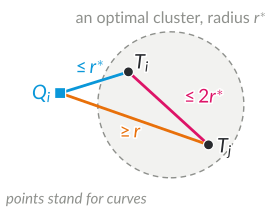

GPS tags show where animals move, when, and how their movement changes. This chapter develops algorithms for analyzing such tracking data. It accompanies Lectures 2 to 4 and grows with them: this version covers Lectures 2 and 3, on the similarity and the clustering of trajectories. A section on segmentation (Lecture 4) will follow.

After working through Sections 2.1 to 2.4, you should be able to

- explain how tracking data can inform the conservation of migratory animals, and which computational problems arise;
- define lock-step distances, the Hausdorff distance, the discrete and the continuous Fréchet distance, and dynamic time warping (DTW), and explain what each of them keeps and what it ignores;
- compute the discrete Fréchet distance and DTW by dynamic programming, prove the recurrence correct, and analyze running time and memory;
- explain what the conditional lower bound for the Fréchet distance says, and what it does not say;
- choose a similarity measure for a given question and justify the choice;
- decide whether a question calls for clustering points or curves, and compare the $k$-center, $k$-median, and $k$-means objectives;
- run Gonzalez's algorithm and prove that it is a 2-approximation for $k$-center clustering;
- define $(k, \ell)$-center clustering, compute an optimal simplification under the discrete Fréchet distance, and prove that Gonzalez's algorithm with simplified centers is a 3-approximation;
- interpret a clustering of tracking data: what it shows and what it does not show.

# 2.1 Migration and conservation

## Migratory animals under pressure

Many migratory species are in decline. A report for the UN Convention on the Conservation of Migratory Species of Wild Animals (CMS) covers the 1,189 species listed under the convention: 44% of them have declining populations, 22% are threatened with extinction, and 51% of the Key Biodiversity Areas that are important for them are not protected. Overexploitation and the loss of habitat through human activity are the greatest threats [UNEP 2024]. Migratory animals need protection in many places: where they breed, where they rest and feed on the way, where they spend the winter, and on the routes in between. This concerns [15]{.sdg .s15} Life on land, in particular target 15.5, to halt the loss of biodiversity and protect threatened species from extinction, as well as [14]{.sdg .s14} Life below water [United Nations 2015].

Two obstacles are central for migratory animals: the fragmentation of landscapes and climate change. Habitat loss, degradation, and fragmentation affect three out of four of these species; climate change, pollution, and invasive species also have profound impacts [UNEP 2024]. Fragmentation cuts apart the places that a migratory animal depends on and the connections between them. Climate change shifts when and where conditions along a route are suitable, which links the topic to [13]{.sdg .s13} Climate action. Tracking data show how animals respond to such changes.

## Animals change their routes

The white stork (*Ciconia ciconia*) is a well-studied example. Flack et al. (2016) equipped juvenile white storks from eight populations between Spain and Uzbekistan with solar-powered GPS tags in the nest and tracked them from then on (Figure 2.1). Four juveniles from south-western Germany spent their first winter at rubbish dumps in northern Morocco instead of crossing the Sahara, and some juveniles from Uzbekistan did not migrate at all. Storks that crossed the Sahara flew 3.4 times as far as those that wintered north of it, but spent only 1.3 times as much energy on movement, estimated from body acceleration. Human-associated food can thus make shorter migrations attractive. In a study of 169 GPS-tracked storks, juveniles that wintered closer to home survived more often [Cheng et al. 2019]. Among 151 juvenile storks at the European migratory divide, the timing of fledging and departure helps explain whether they take the western or the eastern flyway [Jorzik et al. 2026].

{width="75%"}

If animals change their routes or wintering areas, **where and when is protection needed now?** Answering this question requires analyzing large amounts of tracking data. The online platform Movebank hosts such data, and on the platform MoveApps volunteer coders develop analysis apps for wildlife conservation [Kölzsch et al. 2025].

## From ecological questions to computational problems

Table 2.1 lists ecological questions and the algorithmic problems behind them. The last column gives the directions we take in this chapter, not the methods of the cited studies.

| Ecological question | Example study | Algorithmic problem |
|---------------------|---------------|---------------------|
| Does an animal fly the same route every year? | marsh harriers: timing is more repeatable than the route [Vardanis et al. 2011] | similarity of two trajectories (Section 2.3) |
| Which route does a juvenile take, and is this shifting? | white storks at the migratory divide [Jorzik et al. 2026] | classification and clustering of trajectories (Section 2.4) |
| Which corridors need protection? | western and eastern flyways of white storks [Flack et al. 2016] | common subtrajectories, representative routes (Section 2.4) |
| Where does an animal rest and feed? | rest days: less than 100 km per day [Flack et al. 2016] | segmentation into phases (Section 2.5) |

: Table 2.1: From ecological questions to computational problems.

# 2.2 Trajectories

::: definition
**Definition 2.1 (time series, trajectory).** A *time series* is a sequence $X = \langle (t_1, x_1), \ldots, (t_n, x_n) \rangle$ of observations with times $t_1 < \cdots < t_n$ and values $x_i \in \mathbb{R}^d$. If the values are positions, $X$ is a *trajectory*. We then often write $P = \langle p_1, \ldots, p_n \rangle$ for its sequence of positions, and view $P$ as the *polygonal curve* that connects successive positions by line segments.
:::

The values of a time series can be electricity demand, speed, acceleration, or positions. The tags of the juvenile storks from Lake Constance record a GPS position every five minutes for 18 hours a day, so 216 positions per day and about 32,000 in five months. Figure 2.2 shows one day of two of them: Karamell, wintering in northern Morocco, stays within 2 km, while Yolo, wintering in Senegal, flies 119 km. In December 2013, the two moved on average 4.9 km and 78 km per day.

{width="75%"}

We write $\lVert p - q \rVert$ for the Euclidean distance between two points $p, q \in \mathbb{R}^d$, for instance of positions in projected coordinates. Definitions 2.2 to 2.4 below only need *some* distance between positions; for the stork examples, we use the great-circle distance on Earth in km. Section 2.3.6 uses that $\lVert \cdot \rVert$ is a norm.

# 2.3 Similarity of trajectories

Karamell, Eamy, and Yolo all started from Lake Constance. Karamell and Eamy spent the winter in Morocco, Yolo in Senegal. Intuitively, Karamell's route is similar to Eamy's and different from Yolo's. Which distance measure captures this? The answer depends on what similarity should mean: being close *at the same time*, covering the same *area*, or visiting the same places *in the same order*. This section presents measures for each of these meanings, and the algorithms to compute them.

## 2.3.1 Lock-step comparison

If two time series $X$ and $Y$ are observed at the same times $t_1, \ldots, t_N$, a **lock-step** distance compares the values at the same times, for instance
$$d_{\mathrm{RMS}}(X, Y) = \sqrt{\frac{1}{N} \sum_{i=1}^{N} d(x_i, y_i)^2},$$
where $d(x, y) = |x - y|$ for scalar values and $d(x, y) = \lVert x - y \rVert$ for positions. Instead of the root mean square, we can also take the mean or the maximum of the distances. Lock-step comparison is the right choice when being close *at the same time* matters: two animals that meet, or electricity demand at the same time of day. It needs common observation times; otherwise we first have to assign observations to common times, for instance to the same day or the nearest full hour.

For comparing routes, lock-step comparison is a poor fit. Eamy left Lake Constance one day after Karamell, and the storks rested for different times along the way. On any given day, the two storks can be at quite different points of almost the same route, so the $k$-th positions of the two trajectories need not correspond. For routes, we keep the positions and their order, but allow different times to match.

## 2.3.2 Hausdorff distance

The simplest way to ignore time is to treat the positions of a trajectory as a set of points.

::: definition
**Definition 2.2 (Hausdorff distance).** For $P = \langle p_1, \ldots, p_n \rangle$ and $Q = \langle q_1, \ldots, q_m \rangle$,
$$d_H(P, Q) = \max\Big\{ \max_{i} \min_{j} \lVert p_i - q_j \rVert,\ \max_{j} \min_{i} \lVert p_i - q_j \rVert \Big\}.$$
:::

So $d_H(P, Q) \leq r$ means that every position of $P$ lies within distance $r$ of some position of $Q$, and vice versa. By brute force, $d_H$ takes $O(nm)$ time; nearest-neighbor data structures make it faster. With one position per day, the Hausdorff distance is 89 km for Karamell and Eamy and 2,442 km for Karamell and Yolo.

The Hausdorff distance ignores the order of the positions and how often a place is visited. This can be what we want, for instance when comparing the areas that two animals cover. But it cannot tell an outward journey from the return journey: reversing a trajectory does not change its set of positions. Figure 2.3 shows Karamell's first autumn migration, from Lake Constance to northern Morocco (10 August to 15 October 2013), and her spring migration back north to near Karlsruhe (5 April to 10 June 2014). The two routes use a similar corridor in opposite directions: their Hausdorff distance is only 193 km. The discrete Fréchet distance of the next section, which respects the order, is 1,996 km; with the spring route reversed, it is also 193 km. Whether direction should matter depends on the question: for a shared corridor it may not, for the same journey it does. Since it takes a maximum over nearest-point distances, the Hausdorff distance can also be dominated by a single outlier.

{width="75%"}

## 2.3.3 The discrete Fréchet distance

The Fréchet distance, named after Maurice Fréchet [Fréchet 1906], respects the order in which places are visited. In the popular image, a person walks along one trajectory and a dog along the other. Both move forward only, but each may wait while the other moves on. The Fréchet distance is the length of the shortest leash that allows both to get from start to end. The walk need not reflect where the animals actually were at the same time: it is an *alignment* of the two trajectories, not a reconstruction of their simultaneous movement. In the **discrete** version, which we already met in Definition 1.1, both walk from position to position.

::: definition
**Definition 2.3 (coupling, discrete Fréchet distance).** A *coupling* of $P = \langle p_1, \ldots, p_n \rangle$ and $Q = \langle q_1, \ldots, q_m \rangle$ is a sequence of index pairs $(i_1, j_1), \ldots, (i_L, j_L)$ with $(i_1, j_1) = (1, 1)$ and $(i_L, j_L) = (n, m)$ such that
$$(i_{k+1}, j_{k+1}) \in \{(i_k + 1, j_k),\ (i_k, j_k + 1),\ (i_k + 1, j_k + 1)\} \quad \text{for } k = 1, \ldots, L - 1.$$
The *value* of the coupling is $\max_{k} \lVert p_{i_k} - q_{j_k} \rVert$, and the *discrete Fréchet distance* $\delta_{\mathrm{dF}}(P, Q)$ is the minimum value of a coupling of $P$ and $Q$.
:::

A coupling is a path through the $n \times m$ grid of index pairs from $(1, 1)$ to $(n, m)$, where each step advances one of the two indices or both. Every position of both trajectories is matched at least once, and neither sequence is reordered. If an index stays the same, the corresponding walker waits: one route waits while the other moves on. This makes the measure robust against stops and different speeds, up to effects of sampling (Section 2.3.6).

The number of couplings is a Delannoy number: the number of lattice paths from $(1, 1)$ to $(n, m)$ with steps $(1, 0)$, $(0, 1)$, and $(1, 1)$. It grows exponentially, so trying all couplings is out of the question.

## 2.3.4 Dynamic programming

We compute $\delta_{\mathrm{dF}}$ from the distances between prefixes. Let $P_i = \langle p_1, \ldots, p_i \rangle$ and $Q_j = \langle q_1, \ldots, q_j \rangle$, and define the table $C$ by $C[0, 0] = 0$, $C[i, 0] = C[0, j] = \infty$ for $i, j > 0$, and for $i, j \geq 1$
$$C[i, j] = \max\Big\{ \lVert p_i - q_j \rVert,\ \min\{ C[i-1, j],\ C[i, j-1],\ C[i-1, j-1] \} \Big\}.$$

::: theorem
**Lemma 2.1 [Eiter and Mannila 1994].** For all $1 \leq i \leq n$ and $1 \leq j \leq m$, $C[i, j] = \delta_{\mathrm{dF}}(P_i, Q_j)$. In particular, $\delta_{\mathrm{dF}}(P, Q) = C[n, m]$.

*Proof.* By induction on $i + j$. For $(i, j) = (1, 1)$, the only coupling of $P_1$ and $Q_1$ is $(1, 1)$, with value $\lVert p_1 - q_1 \rVert$; the recurrence gives $\max\{\lVert p_1 - q_1 \rVert, \min\{\infty, \infty, 0\}\} = \lVert p_1 - q_1 \rVert$.

Now let $i + j > 2$. Every coupling of $P_i$ and $Q_j$ ends with the pair $(i, j)$. Removing this pair leaves a coupling of $P_{i'}$ and $Q_{j'}$ for one of the predecessors $(i', j') \in \{(i-1, j), (i, j-1), (i-1, j-1)\}$ with $i', j' \geq 1$; conversely, appending $(i, j)$ to such a coupling gives a coupling of $P_i$ and $Q_j$. The value of a coupling is the maximum of $\lVert p_i - q_j \rVert$ and the value of the remaining coupling. Since $x \mapsto \max\{a, x\}$ is non-decreasing, the minimum value is attained by appending $(i, j)$ to an optimal coupling of the best predecessor:
$$\delta_{\mathrm{dF}}(P_i, Q_j) = \max\Big\{ \lVert p_i - q_j \rVert,\ \min_{(i', j')} \delta_{\mathrm{dF}}(P_{i'}, Q_{j'}) \Big\}.$$
By induction, $\delta_{\mathrm{dF}}(P_{i'}, Q_{j'}) = C[i', j']$ for the predecessors with $i', j' \geq 1$. The predecessors with a zero index have $C = \infty$ and do not affect the minimum, since at least one predecessor has both indices positive. So the right-hand side equals $C[i, j]$. [∎]{.qed}
:::

**Running time and memory.** The table has $(n + 1)(m + 1)$ entries, each computed in constant time from three earlier ones, row by row or column by column. So $\delta_{\mathrm{dF}}(P, Q)$ takes $O(nm)$ time. Each row only needs the previous one. To compute the distance alone, $O(\min(n, m))$ memory besides the input suffices: let the outer loop run over the longer sequence, so that each row has $\min(n, m) + 1$ entries. To output an optimal coupling, we store the whole table and **backtrack** from $(n, m)$: repeatedly move to a predecessor with the smallest $C$-value until we reach $(1, 1)$.

::: example
**Example 2.1.** Let $P = \langle (0, 0), (1, 0), (4, 0), (5, 0) \rangle$ and $Q = \langle (0, 1), (4, 1), (5, 1) \rangle$ in the plane (Figure 2.4). The distances $\lVert p_i - q_j \rVert$ and the table $C$ are:

| $\lVert p_i - q_j \rVert$ | $q_1$ | $q_2$ | $q_3$ |
|---|---:|---:|---:|
| $p_1$ | 1.00 | 4.12 | 5.10 |
| $p_2$ | 1.41 | 3.16 | 4.12 |
| $p_3$ | 4.12 | 1.00 | 1.41 |
| $p_4$ | 5.10 | 1.41 | 1.00 |

| $C[i, j]$ | $q_1$ | $q_2$ | $q_3$ |
|---|---:|---:|---:|
| $p_1$ | 1.00 | 4.12 | 5.10 |
| $p_2$ | 1.41 | 3.16 | 4.12 |
| $p_3$ | 4.12 | 1.41 | 1.41 |
| $p_4$ | 5.10 | 1.41 | **1.41** |

For instance, $C[2, 2] = \max\{3.16, \min\{4.12, 1.41, 1.00\}\} = 3.16$ and $C[3, 2] = \max\{1.00, \min\{3.16, 4.12, 1.41\}\} = 1.41$. Hence $\delta_{\mathrm{dF}}(P, Q) = C[4, 3] = \sqrt{2} \approx 1.41$. Backtracking, with ties broken in favor of the diagonal step, gives the optimal coupling $(1, 1), (2, 1), (3, 2), (4, 3)$: $q_1$ waits while $P$ moves from $p_1$ to $p_2$. At $(4, 3)$, all three predecessors have the value 1.41, so the other choices give two further optimal couplings. Pairing $p_2$ with $q_2$ instead would cost $\sqrt{10} \approx 3.16$.
:::

{width="55%"}

**Back to the storks.** With one position per day until 31 December 2013, the discrete Fréchet distance is 89 km for Karamell and Eamy and 2,445 km for Karamell and Yolo (Figure 2.5). Here, the Hausdorff distance gives almost the same values; the two measures differ markedly only in the example of Figure 2.3. Karamell and Yolo share the corridor to the Strait of Gibraltar and then part ways. A distance between *whole* routes is large in such a case, although the two storks share an important corridor. For protecting corridors, we should therefore also compare *parts* of trajectories; this leads to subtrajectory clustering in Section 2.4.

{width="90%"}

## 2.3.5 Dynamic time warping

Dynamic time warping (DTW) comes from speech recognition [Sakoe and Chiba 1978] and is widely used for time series [Müller 2007]. It uses the same couplings as the discrete Fréchet distance, but minimizes the *sum* of the matched distances instead of the maximum.

::: definition
**Definition 2.4 (dynamic time warping).** For $P = \langle p_1, \ldots, p_n \rangle$ and $Q = \langle q_1, \ldots, q_m \rangle$,
$$\operatorname{DTW}(P, Q) = \min_{\text{couplings } \pi} \; \sum_{(i, j) \in \pi} \lVert p_i - q_j \rVert .$$
:::

The discrete Fréchet distance minimizes the *largest* discrepancy of an alignment, DTW the *accumulated* discrepancy. The same dynamic program works, with the maximum replaced by a sum: $D[0, 0] = 0$, $D[i, 0] = D[0, j] = \infty$ for $i, j > 0$, and for $i, j \geq 1$
$$D[i, j] = \lVert p_i - q_j \rVert + \min\{ D[i-1, j],\ D[i, j-1],\ D[i-1, j-1] \}.$$
The proof of Lemma 2.1 carries over, since $x \mapsto a + x$ is non-decreasing as well. Again, this takes $O(nm)$ time, and $O(\min(n, m))$ memory for the value alone.

In Example 2.1, the coupling $(1, 1), (2, 1), (3, 2), (4, 3)$ has costs $1, \sqrt{2}, 1, 1$. It is optimal for both measures, and for DTW it is the only optimal coupling: $\delta_{\mathrm{dF}}(P, Q) = \sqrt{2}$ and $\operatorname{DTW}(P, Q) = 3 + \sqrt{2} \approx 4.41$. In general, the optimal couplings of the two measures can differ, and the two measures can rank pairs of trajectories differently (Section 2.6, question 3). The DTW value is a sum, not an average distance between routes.

DTW is not restricted to positions. For scalar time series such as electricity demand or speed, we use $|x_i - y_j|$ as local cost, and the same dynamic program applies. Figure 2.6 shows two demand profiles with the same peak, one hour apart. Their DTW distance is 0, because a coupling can match equal values throughout, whereas the lock-step RMS distance at matching hours is $\sqrt{18/7} \approx 1.60$. Which is right depends on the question: for "same daily pattern?", DTW is suitable; for energy planning, where supply and demand must coincide, the shift matters and should stay visible.

{width="60%"}

There are several conventions for DTW: squared local costs with a final square root, different weights for the three kinds of steps, normalization by the length of the coupling or by $\max(n, m)$, and restrictions on which pairs may be matched [Müller 2007; Tao et al. 2021]. Before comparing DTW values, state the convention. In these notes, DTW uses unsquared distances and no normalization. Unlike the Fréchet distances, DTW does not satisfy the triangle inequality, which matters for clustering (Section 2.4).

## 2.3.6 The continuous Fréchet distance

Sampled positions are only snapshots of a movement. If we connect successive positions by line segments, the walkers can also be matched *between* the positions.

::: definition
**Definition 2.5 (Fréchet distance).** For polygonal curves $P, Q : [0, 1] \to \mathbb{R}^d$,
$$\delta_F(P, Q) = \inf_{\alpha, \beta} \; \max_{t \in [0, 1]} \; \lVert P(\alpha(t)) - Q(\beta(t)) \rVert,$$
where $\lVert \cdot \rVert$ is the Euclidean norm and $\alpha$ and $\beta$ range over all continuous, non-decreasing, surjective functions $[0, 1] \to [0, 1]$. Here $P(s)$, $s \in [0, 1]$, parametrizes the polygonal curve through $p_1, \ldots, p_n$, for instance with $P\big(\frac{i-1}{n-1}\big) = p_i$ and linear in between; $\delta_F$ does not depend on this choice.
:::

In Example 2.1, $P$ and $Q$ are parallel segments from $x = 0$ to $x = 5$, one unit apart, so $\delta_F(P, Q) = 1$: both walkers move to the right at the same $x$-coordinate. The discrete Fréchet distance is $\sqrt{2}$, because $p_2$ must be matched with some $q_j$, and the nearest one, $q_1$, is $\sqrt{2}$ away.

::: theorem
**Lemma 2.2 [Eiter and Mannila 1994].** For polygonal curves $P$ and $Q$ with vertices $p_1, \ldots, p_n$ and $q_1, \ldots, q_m$, we have $\delta_F(P, Q) \leq \delta_{\mathrm{dF}}(P, Q)$.

*Proof.* Take an optimal coupling $(i_1, j_1), \ldots, (i_L, j_L)$ and let the two walkers perform its steps one after the other, each step in the same amount of time. In a step from $(i_k, j_k)$ to $(i_{k+1}, j_{k+1})$, each walker moves at constant speed along its segment, or stays put if its index does not change. At a fraction $s \in [0, 1]$ of the step, the two positions are $(1 - s)\, p_{i_k} + s\, p_{i_{k+1}}$ and $(1 - s)\, q_{j_k} + s\, q_{j_{k+1}}$, so their distance is
$$\big\lVert (1 - s)(p_{i_k} - q_{j_k}) + s\,(p_{i_{k+1}} - q_{j_{k+1}}) \big\rVert \leq (1 - s) \lVert p_{i_k} - q_{j_k} \rVert + s\, \lVert p_{i_{k+1}} - q_{j_{k+1}} \rVert,$$
which is at most the value of the coupling. This walk defines functions $\alpha$ and $\beta$ as in Definition 2.5, so $\delta_F(P, Q) \leq \delta_{\mathrm{dF}}(P, Q)$. [∎]{.qed}
:::

Conversely, $\delta_{\mathrm{dF}}(P, Q) \leq \delta_F(P, Q) + \max\{\ell_P, \ell_Q\}$, where $\ell_P$ and $\ell_Q$ are the lengths of the longest segments of $P$ and $Q$ [Eiter and Mannila 1994, Theorem 4]. If all segments are short, the discrete distance is therefore close to the continuous one; with sparse sampling, it can be considerably larger. For Karamell and Eamy, the discrete Fréchet distance is 89 km with one position per day and 71 km with all positions.

The continuous Fréchet distance of polygonal curves with $n$ and $m$ segments can be computed in $O(nm \log(nm))$ time [Alt and Godau 1995]. The algorithm decides for a given $r$ in $O(nm)$ time whether $\delta_F(P, Q) \leq r$, using the so-called free-space diagram, and then searches for the smallest such $r$. We do not derive it in this course.

A continuous measure is less sensitive to how the trajectories are sampled, which helps with different sampling rates and gaps in the data [Tao et al. 2021]. This assumes that interpolation is meaningful: a straight line between two GPS positions that are hours apart may cross areas that the animal never visited.

## 2.3.7 How fast can we compute the Fréchet distance?

Karamell's and Yolo's routes at full resolution, in the first 150 days after departure, have 32,491 and 32,398 positions. The table $C$ then has about $1.05 \cdot 10^9$ entries. Filling it took 4.3 s with a program in C on one core of a 2.8 GHz processor, and would take about 9 minutes in plain Python. All 91 pairs of the 14 storks with complete five-minute data took 6.5 minutes in C. With hundreds of tracked animals or many years of data, quadratic time becomes the bottleneck. Can we do better?

Algorithms that save logarithmic factors exist [Agarwal et al. 2014; Buchin et al. 2017]. Whether a polynomial factor can be saved depends on a hypothesis about Boolean satisfiability. The **Strong Exponential Time Hypothesis (SETH)** states that for every $\varepsilon > 0$ there is a $k$ such that $k$-SAT with $N$ variables cannot be solved in time $O((2 - \varepsilon)^N)$ [Impagliazzo and Paturi 2001].

::: theorem
**Theorem 2.1 [Bringmann 2014].** If there is an $\varepsilon > 0$ and an algorithm that computes the Fréchet distance of two polygonal curves with $n$ vertices each in time $O(n^{2 - \varepsilon})$, then SETH fails. This holds for the continuous and the discrete Fréchet distance, and even for approximating them within a factor of 1.001.
:::

This is a conditional bound on the *worst case* over all inputs. It does not rule out fast computations for realistic inputs. For instance, for $c$-packed curves, whose length inside any ball of radius $r$ is at most $c \cdot r$, the Fréchet distance can be approximated within a factor $1 + \varepsilon$ in near-linear time [Driemel et al. 2012]. In practice, we can also simplify trajectories, use approximations, or exploit structure in the data. Each of these choices is a modeling trade-off: fewer positions save computation, but can change the distance and hide a short detour or stopover.

## 2.3.8 Choosing a similarity measure

Table 2.2 summarizes the measures of this section by what the correspondence between the two trajectories should preserve.

| What should correspondence preserve? | Measure | What contributes? |
|---|---|---|
| matching observation times | lock-step, e.g., RMS | discrepancies at the same times |
| spatial coverage | Hausdorff on point sets | worst nearest-point distance |
| order of visits | discrete or continuous Fréchet | largest distance in an alignment |
| order of visits | DTW | sum of the distances in a coupling |

: Table 2.2: Similarity measures by what they preserve.

Two further measures use tolerance-based matching: the **longest common subsequence (LCSS)** counts positions that can be matched within a distance threshold [Vlachos et al. 2002], and the **edit distance on real sequences (EDR)** counts the edits needed to make two trajectories match within a threshold [Chen et al. 2005]. Both can skip positions, which makes them robust against outliers, but the results depend on the threshold.

Tao et al. (2021) compared DTW, LCSS, EDR, and the discrete and continuous Fréchet distance on bus trajectories and on trajectories of birds. Among their findings:

- The value and the ranking of similarities can change with the measure.
- In their data, spatial differences were easier to detect than temporal ones.
- Continuous measures cope better with different sampling rates and gaps.
- In principle, measures based on a maximum are more sensitive to outliers than measures based on a sum; in their experiments, the two kinds behaved similarly.
- LCSS and EDR need thresholds that depend on the data.

No measure fits every question. Before choosing one, decide whether to compare **routes**, **shared corridors**, or **activity patterns**, and check how sensitive your result is to the choice.

# 2.4 Clustering trajectories

Section 2.3 compared two trajectories. With many trajectories, we want an overview: which routes are typical, and how many of them are there? Figure 2.7 shows the first autumn migrations of the 34 juvenile storks of Flack et al. (2016) that migrated and were tracked into the winter, with one position per day from the day before departure until 31 December 2013. By eye, we see a western flyway via the Strait of Gibraltar, a crossing of the Sahara from Tunisia, an eastern flyway via the Bosporus and the Levant that splits toward the Sahel and toward East and southern Africa, and storks from Armenia that winter in the Middle East. **Clustering** makes such a summary precise: it partitions the trajectories into groups and describes each group by a representative.

{width="75%"}

## 2.4.1 Points or curves?

Clustering in movement data comes in several kinds (Figure 2.8). If only the places matter and not the order in which they are visited, we cluster **points**: the positions of one track, for instance to find a nest that a bird visits again and again [Picardi et al. 2020], or the positions of many tracks, for instance to find carcasses where several vultures feed [Rast et al. 2024]. Several apps on MoveApps do this kind of spatial clustering. If the order matters, we cluster **curves**: whole trajectories, to find typical routes, or parts of trajectories, to find corridors that several animals share [Buchin et al. 2011]. This section is mostly about whole trajectories; Section 2.4.8 returns to shared corridors.

{width="100%"}

## 2.4.2 k-center clustering

We first look at points. All we need is a set of objects and a distance $d$ between them that is symmetric and satisfies the triangle inequality $d(x, z) \leq d(x, y) + d(y, z)$; this holds for the Euclidean distance, for the great-circle distance on Earth, and, as we will use in Section 2.4.4, for the discrete and the continuous Fréchet distance.

::: definition
**Definition 2.6 ($k$-center clustering).** Given a finite set $S$ of objects in a space $X$ with distance $d$ and a number $k \geq 1$, find a set $C \subseteq X$ of $k$ *centers* that minimizes the *radius*
$$r(C) = \max_{s \in S} \; \min_{c \in C} \; d(s, c).$$
Each object is assigned to a nearest center; the objects assigned to the same center form a *cluster*. We write $r^*$ for the minimum radius.
:::

The radius is a worst-case measure: $r(C) \leq r$ means that *every* object lies within distance $r$ of some center. This fits questions like "can we protect a few wintering regions such that every bird winters within $r$ of one of them?". The price is that a single unusual object can determine the radius. Other objectives sum over the objects instead: $k$-median minimizes $\sum_{s} \min_{c} d(s, c)$, and $k$-means minimizes $\sum_{s} \min_{c} d(s, c)^2$. Finding an optimal $k$-center clustering is NP-hard, so we look for approximation algorithms.

## 2.4.3 Gonzalez's algorithm

The following greedy algorithm is also called *farthest-first traversal* [Gonzalez 1985].

1. Choose any object $c_1 \in S$ as the first center.
2. For $i = 2, \ldots, k$: let $c_i$ be an object whose distance to its nearest center among $c_1, \ldots, c_{i-1}$ is largest.
3. Assign every object to a nearest center.

The algorithm keeps, for every object, its distance to the nearest center chosen so far. Each new center needs one distance per object and one update, so the algorithm needs $O(kn)$ distance computations for $n$ objects.

::: example
**Example 2.2.** For 37 of the juvenile storks we know where they spent their first winter: the median of their positions in December and January (for three storks that did not migrate, this lies near the nest). With great-circle distances and $k = 4$, Gonzalez's algorithm starting at Karamell's winter site in northern Morocco chooses Pelopidas's site in South Africa (7,509 km away), then the site of Halim, a non-migrating stork in Uzbekistan (6,496 km from the nearest center), and then a site in Sudan (4,314 km). With these four centers the radius is 2,424 km, attained by Yolo's site in Senegal (Figure 2.9). Trying all $\binom{37}{4} = 66{,}045$ sets of four winter sites gives 2,302 km as the best radius with centers at winter sites, only 5% less.
:::

{width="65%"}

The first centers are *extreme* objects: Gonzalez's algorithm finds diverse representatives quickly, but an outlier, such as a GPS error far from everything else, becomes a center (Section 2.4.8). How good is the result in general?

::: theorem
**Theorem 2.2 [Gonzalez 1985].** Gonzalez's algorithm computes $k$ centers with radius $r \leq 2 r^*$. Here $r^*$ allows centers anywhere in $X$, although the algorithm only uses objects as centers.

*Proof.* If $r = 0$, there is nothing to show. Otherwise let $c_{k+1}$ be an object at distance $r$ from its nearest center, and consider the $k + 1$ objects $c_1, \ldots, c_{k+1}$. For $2 \leq j \leq k$, when $c_j$ was chosen, its distance to the nearest earlier center was the radius at that time. The radius never increases when a center is added, so this distance is at least the final radius $r$. For $j = k + 1$, the distance is exactly $r$. Hence $d(c_i, c_j) \geq r$ for all $i < j \leq k + 1$.

An optimal solution has $k$ centers, so by the pigeonhole principle (Figure 2.10) two of the $k + 1$ objects, say $c_i$ and $c_j$, are assigned to the same optimal center $c^*$. By the triangle inequality and symmetry, $r \leq d(c_i, c_j) \leq d(c_i, c^*) + d(c^*, c_j) \leq 2 r^*$. [∎]{.qed}
:::

{width="45%"}

The factor 2 is tight for the algorithm: for the points 0, 1, 2 on a line and $k = 1$, starting at 0 gives radius 2, while the center 1 gives radius 1. It is also the best possible factor for polynomial-time algorithms in general: for distances that satisfy the triangle inequality, a $(2 - \varepsilon)$-approximation for any $\varepsilon > 0$ would imply P = NP [Hsu and Nemhauser 1979]. Hochbaum and Shmoys (1985) give a different, also best-possible 2-approximation. Even for points in the Euclidean plane, approximating within a factor below about 1.82 is NP-hard [Feder and Greene 1988]. In practice, the result is often much better than the guarantee. To check this for an instance, we need a lower bound on $r^*$. In Example 2.2, the four centers and Yolo's site are pairwise at least 2,424 km apart, so by the argument of the proof $r^* \geq 1{,}212$ km. The best four centers among the winter sites are only 5% better than Gonzalez's; with centers anywhere, the optimum could be smaller.

## 2.4.4 From points to curves: (k, ℓ)-center clustering

Gonzalez's algorithm and its proof use only distances, symmetry, and the triangle inequality. The discrete and the continuous Fréchet distance are symmetric and satisfy the triangle inequality; proving this is a good exercise. So we can run Gonzalez's algorithm on trajectories with the discrete Fréchet distance and again obtain a 2-approximation, compared with the best centers among all curves. But then a center is an *input trajectory* with all its detours, for instance a bird circling in its winter area (Figure 2.11, middle). A representative route should rather show the shape of the route with few vertices (Figure 2.11, right). DTW does not satisfy the triangle inequality, and the proof of Theorem 2.2 does not carry over to it.

{width="100%"}

::: definition
**Definition 2.7 ($(k, \ell)$-center clustering [Driemel et al. 2016]).** Given polygonal curves $P_1, \ldots, P_n$ and numbers $k, \ell \geq 1$, find $k$ curves $C = \{c_1, \ldots, c_k\}$ with at most $\ell$ vertices each that minimize
$$r(C) = \max_{i} \; \min_{c \in C} \; \delta(P_i, c),$$
where $\delta$ is the discrete or the continuous Fréchet distance.
:::

Driemel, Krivošija, and Sohler (2016) introduced $(k, \ell)$-center and $(k, \ell)$-median clustering for time series, that is, for curves in one dimension. Limiting the number of vertices of the centers has two effects. The representatives become simple. And a center cannot overfit: with arbitrarily many vertices, a center could follow every detour of the curves in its cluster.

If $\ell$ is unrestricted and $k = 1$, every input curve is a 2-approximation, by the triangle inequality as in the proof of Theorem 2.2. If $\ell$ is part of the input, even approximation is hard, already for a single center:

::: theorem
**Theorem 2.3 [Buchin et al. 2025].** For every $\varepsilon > 0$, approximating $(k, \ell)$-center clustering within a factor $3 - \varepsilon$ is NP-hard when $\ell$ is part of the input, even for $k = 1$ and curves in the plane. This holds for the discrete and for the continuous Fréchet distance.
:::

Earlier lower bounds for curves in two or more dimensions were about 2.598 for the discrete and 2.25 for the continuous Fréchet distance [Buchin et al. 2019]. The reductions start from the *shortest common supersequence* problem for strings: each string is encoded as a curve, such that a center curve with few vertices corresponds to a short common supersequence. As we will see next, a factor of 3 can be achieved.

## 2.4.5 Simplifying a curve

To obtain centers with at most $\ell$ vertices, we simplify input curves. For a curve $P = \langle p_1, \ldots, p_m \rangle$ and $\ell \leq m$, the **optimal simplification** under the discrete Fréchet distance is a curve $Q$ with at most $\ell$ vertices, anywhere in the plane (or in $\mathbb{R}^d$), that minimizes $\delta_{\mathrm{dF}}(P, Q)$. It has a simple structure.

::: theorem
**Lemma 2.3.** The minimum of $\delta_{\mathrm{dF}}(P, Q)$ over all curves $Q$ with at most $\ell$ vertices equals the minimum, over all partitions of $p_1, \ldots, p_m$ into at most $\ell$ groups of consecutive vertices, of the largest radius of the smallest enclosing balls of the groups.

*Proof.* Given such a partition into groups $G_1, \ldots, G_s$ with $s \leq \ell$, let $q_j$ be the center of the smallest enclosing ball of $G_j$ and $Q = \langle q_1, \ldots, q_s \rangle$. The coupling that matches every vertex of $G_j$ with $q_j$, and steps diagonally from the last vertex of $G_j$ to the first vertex of $G_{j+1}$, has the largest radius as its value.

Conversely, take a curve $Q = \langle q_1, \ldots, q_s \rangle$ with $s \leq \ell$ and a coupling of $P$ and $Q$ with value $\rho$. Assign each $p_i$ to the smallest $j$ such that $(i, j)$ is in the coupling. Since a coupling is monotone in both indices, the vertices assigned to the same $j$ are consecutive, so the non-empty groups form a partition of $P$ into at most $\ell$ groups of consecutive vertices. Every vertex of a group lies within distance $\rho$ of its $q_j$, so the smallest enclosing ball of the group has radius at most $\rho$. [∎]{.qed}
:::

For a given radius $\rho$, we can therefore test greedily whether $\ell$ vertices suffice: start a group at $p_1$, extend it as long as its smallest enclosing ball has radius at most $\rho$, then start the next group. No partition into groups of radius at most $\rho$ has fewer groups than the greedy one: since a subset of a group never needs a larger ball, induction shows that the $t$-th greedy group ends no earlier than the $t$-th group of any such partition. Searching for the smallest feasible $\rho$ then gives the optimal simplification; Bereg et al. (2008) show how to compute it efficiently, also for curves in three dimensions.

{width="60%"}

Figure 2.12 shows an example. Pelopidas's route has 72 daily positions; the optimal simplification with six vertices has error 537 km, and its longest group holds 43 positions from his stay in the Sahel. On the sphere, smallest enclosing balls become smallest enclosing spherical caps; for the examples we computed them in an azimuthal equidistant projection, re-centered at the current center until it no longer moves; this projection keeps the distances to its center exact.

## 2.4.6 Gonzalez with simplification: a 3-approximation

We combine Gonzalez's algorithm with simplification [Buchin et al. 2019]:

1. Choose any input curve $T_1$; its optimal simplification with at most $\ell$ vertices is the first center $Q_1$.
2. For $i = 2, \ldots, k$: let $T_i$ be the input curve farthest from its nearest center curve among $Q_1, \ldots, Q_{i-1}$, and let $Q_i$ be its optimal simplification.
3. Assign every curve to its nearest center curve.

::: theorem
**Theorem 2.4 [Buchin et al. 2019].** Under the discrete Fréchet distance, in any dimension, this algorithm computes a $(k, \ell)$-center clustering with radius $r \leq 3 r^*$. For $n$ input curves with $m$ vertices each, it takes $\tilde O(kn \cdot \ell m)$ time, where $\tilde O$ hides logarithmic factors.

*Proof.* We write $\delta$ for $\delta_{\mathrm{dF}}$. If $r = 0$, there is nothing to show. Otherwise let $T_{k+1}$ be an input curve at distance $r$ from its nearest center curve. We use three inequalities (Figure 2.13).

- $\delta(T_i, Q_i) \leq r^*$ for all $i \leq k$: the curve $T_i$ lies in some optimal cluster, whose center has at most $\ell$ vertices and distance at most $r^*$ from $T_i$; the optimal simplification $Q_i$ is at least as close.
- $\delta(T_j, Q_i) \geq r$ for all $i < j \leq k + 1$: for $j \leq k$, when $T_j$ was chosen, its distance to the nearest of $Q_1, \ldots, Q_{j-1}$ was the radius at that time, and the radius never increases; for $j = k + 1$, the distance is at least $r$ by the choice of $T_{k+1}$.
- By the pigeonhole principle, two of the $k + 1$ curves $T_1, \ldots, T_{k+1}$, say $T_i$ and $T_j$ with $i < j$, lie in the same optimal cluster, so $\delta(T_i, T_j) \leq 2 r^*$ by the triangle inequality.

Together, again by the triangle inequality, $r \leq \delta(T_j, Q_i) \leq \delta(T_j, T_i) + \delta(T_i, Q_i) \leq 2 r^* + r^* = 3 r^*$. [∎]{.qed}
:::

{width="45%"}

The proof is the proof of Theorem 2.2 with one extra step: the centers $Q_i$ are not input curves, and the triangle inequality costs one more $r^*$. It only uses that $\delta(T_i, Q_i) \leq r^*$. If the simplification is only an $\alpha$-approximation, so that $\delta(T_i, Q_i) \leq \alpha r^*$, the same argument gives a factor $2 + \alpha$. For the continuous Fréchet distance, optimal simplification is harder; a 4-approximate simplification gives the factor 6, and for curves in the plane a more careful argument gives 3 [Buchin et al. 2019]. By Theorem 2.3, the factor 3 is best possible for the discrete Fréchet distance in two or more dimensions and for the continuous Fréchet distance in the plane, unless P = NP.

The running time is dominated by $kn$ Fréchet distance computations between an input curve with $m$ vertices and a center with $\ell$ vertices, each in $O(\ell m)$ time, and by $k$ simplifications.

## 2.4.7 Typical routes of the storks

::: example
**Example 2.3.** We run the algorithm on the 34 routes of Figure 2.7 with $k = 5$ and $\ell = 6$, starting at Karamell's route, with great-circle distances and optimal simplifications on the sphere. The centers come from the routes of Karamell (south-western Germany), Pelopidas (Greece), BraveHeart (Armenia), Silvia (Greece), and C708 (Spain). After each step, the radius is 7,518, 5,095, 3,719, 3,321, and 2,545 km. The five clusters are (Figure 2.14):

- south-western Germany to France, Morocco, and West Africa, five of them via Gibraltar (6 routes);
- Greece, Russia, and Poland to East and southern Africa (5);
- Armenia to eastern Turkey, Iraq, and Iran (4);
- Greece, Russia, and Poland to the Sahel and Ethiopia (10);
- Spain, Tunisia, and one stork from south-western Germany to the Sahel (9).
:::

{width="75%"}

The algorithm was told nothing about populations or flyways; that the clusters roughly follow origin and flyway is a result, not an input. **How good is the radius of 2,545 km?** The proof of Theorem 2.4 gives a lower bound for this instance: the five routes whose simplifications are the centers and the farthest route after five steps, from a Russian stork, have pairwise discrete Fréchet distance at least 2,266 km. Two of them lie in the same optimal cluster, so $r^* \geq 2{,}266 / 2 = 1{,}133$ km, and the computed radius is at most 2.25 times the optimum. **Which $k$?** With $k = 6, 7, 8$, the radius decreases only slowly, to 2,470, 2,206, and 2,115 km: the remaining large distances come from different origins and destinations within the clusters, not from new flyways. There is no single correct $k$; it depends on the question. The choice of $\ell$ matters less here: with $k = 5$ and $\ell = 4, 6, 8$, the radius is 2,621, 2,545, and 2,470 km. With the input routes themselves as centers, without simplification, Gonzalez's algorithm finds broadly similar groups with radius 2,445 km, but its centers carry every detour.

**Back to protection.** Where routes of several clusters meet, a protective measure helps many birds. Electrocution at power poles is the largest known human-induced cause of death of tracked large birds along the African-Eurasian flyway: 40.5% of 637 human-induced deaths with a known cause [Serratosa et al. 2024]. Figure 2.15 marks two bottlenecks: 9 of the 34 routes pass within 100 km of the Strait of Gibraltar (from the western cluster and the Spain–Tunisia cluster), and 15 pass within 100 km of the Jordan valley in the Levant (all routes of the two clusters from Greece, Poland, and Russia). There, making power poles safe for birds protects birds from several populations.

{width="65%"}

The clustering also has limits. Whole routes mix origin and destination: storks from Spain and Tunisia end up together because both end in the Sahel, while storks from Greece are split by destination. Gonzalez's algorithm picks extreme routes first. And the data cover 34 juveniles in one year; adults partly use other routes and wintering areas. Clustering summarizes data; decisions on protection also need data on mortality, habitats, and threats.

## 2.4.8 Shared corridors and other methods

**Shared corridors.** Routes with different origins and destinations can share a corridor, such as the flyway through the Levant. A distance between whole routes misses this. A *subtrajectory cluster* consists of at least a given number of parts of the trajectories that overlap in at most a point, have pairwise Fréchet distance at most a given threshold, and include at least one part of a given minimum length [Buchin et al. 2011]. Deciding whether such a cluster exists is NP-hard, and Buchin et al. (2011) give approximation algorithms based on a reference subtrajectory and the free-space diagram of the Fréchet distance.

**Outliers.** In $k$-center clustering with $z$ outliers, the $z$ objects farthest from their centers are ignored. A 3-approximation exists [Charikar et al. 2001]. In practice, one also cleans the data first, for instance by removing implausible positions. How many outliers to ignore is a modeling decision, like the choice of $k$.

**Other ways to cluster time series.** Table 2.3 sorts common approaches by their representatives. DTW barycenter averaging (DBA) iterates two steps: align every series to the current average with DTW, then replace each element of the average by the mean of the elements aligned to it [Petitjean et al. 2011]. It is a heuristic; computing an optimal average curve (a 1-median) is NP-hard, under the Fréchet distance as well as under DTW [Buchin, Driemel, and Struijs 2020]. The average keeps the length of the initial series; $(k, \ell)$-medians under a continuous version of DTW (CDTW) limit the complexity of the representatives [Brankovic et al. 2020]. Overviews of time-series clustering are given by Liao (2005), Kotsakos et al. (2014), and Aghabozorgi et al. (2015).

| Approach | Representative | Example |
|---|---|---|
| center-based, simple centers | curve with at most $\ell$ vertices | $(k, \ell)$-center or median, Fréchet or CDTW |
| partitional with medoids | an input series | $k$-medoids with DTW |
| partitional with averages | an average series | $k$-means with DBA |
| hierarchical | a tree of merges | single or complete linkage on pairwise distances |
| density-based | dense regions | DBSCAN [Ester et al. 1996], subtrajectory clusters |
| feature- or model-based | features, models | speed and distance with $k$-means; mixtures of hidden Markov models |

: Table 2.3: Ways to cluster time series and trajectories.

# 2.5 Segmentation

This section follows after Lecture 4 (3 November). It covers how to split a trajectory into phases of homogeneous movement, such as migrating, resting, and foraging.

# 2.6 Check your understanding

1. Let $P = \langle p_1, \ldots, p_n \rangle$ with $p_1 \neq p_n$, and let $Q = \langle p_n, \ldots, p_1 \rangle$ be $P$ reversed. What is $d_H(P, Q)$? Show that $\delta_{\mathrm{dF}}(P, Q) > 0$.

    

    
Answer

    $d_H(P, Q) = 0$, since $P$ and $Q$ have the same set of positions. Every coupling starts with the pair $(p_1, q_1) = (p_1, p_n)$, so $\delta_{\mathrm{dF}}(P, Q) \geq \lVert p_1 - p_n \rVert > 0$. The Fréchet distance distinguishes the outward from the return journey; the Hausdorff distance does not.
    

2. Let $P = \langle (0, 0), (2, 0), (4, 0) \rangle$ and $Q = \langle (0, 0), (4, 0) \rangle$. Compute $\delta_{\mathrm{dF}}(P, Q)$ and $\delta_F(P, Q)$, and check the bound of Eiter and Mannila from Section 2.3.6.

    

    
Answer

    $p_2 = (2, 0)$ must be matched with $q_1$ or $q_2$, both at distance 2, and the coupling $(1, 1), (2, 1), (3, 2)$ has value 2, so $\delta_{\mathrm{dF}}(P, Q) = 2$. As polygonal curves, $P$ and $Q$ are the same segment, so $\delta_F(P, Q) = 0$. The bound gives $2 \leq 0 + \max\{2, 4\} = 4$. The discrete distance depends on where the curves are sampled. The continuous one is unchanged here, because the extra position lies on the segment; in general, other positions give a different polygonal curve.
    

3. Consider the scalar time series $X = (0, 0, 0, 0, 0)$, $A = (0, 0, 3, 0, 0)$, and $B = (1, 1, 1, 1, 1)$ with local cost $|x - y|$. Which of $A$ and $B$ is closer to $X$ under the discrete Fréchet distance, and which under DTW?

    

    
Answer

    Discrete Fréchet: $A$ has distance 3, since the value 3 must be matched with some 0; $B$ has distance 1. So $B$ is closer. DTW: $A$ costs 3 (the diagonal coupling), $B$ costs 5, since every coupling has at least five pairs and each costs 1. So $A$ is closer. The maximum is determined by one large discrepancy, the sum accumulates many small ones.
    

4. How much memory do you need to compute only the value $\delta_{\mathrm{dF}}(P, Q)$, and how much to output an optimal coupling with the method of Section 2.3.4?

    

    
Answer

    For the value, $O(\min(n, m))$ besides the input: let the outer loop run over the longer sequence and keep only the previous row, which has $\min(n, m) + 1$ entries. For backtracking, we store the whole table, so $O(nm)$. For the full-resolution routes of Section 2.3.7, this is the difference between a few hundred kilobytes and about 8 GB with 8-byte numbers.
    

5. A colleague concludes from Theorem 2.1 that the Fréchet distance of GPS trajectories cannot be computed fast in practice. What is wrong with this conclusion?

    

    
Answer

    Theorem 2.1 is a worst-case bound over all inputs, and it is conditional on SETH. It does not say that typical trajectories are hard. Even the quadratic algorithm fills $10^9$ table entries in a few seconds in C, and for realistic curves, such as $c$-packed curves, there are fast approximation algorithms. What the theorem does say is that we should not expect an algorithm that is substantially faster than quadratic on *all* inputs.
    

6. Two animals use a similar corridor but migrate on different days, and their daily activity patterns differ. What would you compare to study the similarity of their routes, and what for the similarity of their activity? Which differences should each comparison keep, and which ignore?

    

    
Answer

    For routes: the ordered positions, with a measure that allows different times to match, such as the Fréchet distance; the different migration days should be ignored. For activity: for instance speed or acceleration over the day, compared at the same time of day, or with limited time warping if small shifts should not count. Timing differences should be ignored only if they do not matter for the question; for a shared corridor, even the direction may not matter.
    

7. For which question is a lock-step comparison the right choice, and what would DTW hide there?

    

    
Answer

    Whenever being close at the same time matters: whether two animals meet, or whether electricity demand and supply coincide at the same hour. DTW would align a shifted pattern and report a small distance, as for the demand profiles of Figure 2.6, where it gives 0 although the peaks are an hour apart.
    

8. Which kind of clustering from Figure 2.8 would you use to find (a) the sites where many animals rest on their way, (b) the flyways of a population, (c) a corridor that routes with different destinations share?

    

    
Answer

    For (a), points of many tracks: only the places matter, for instance the positions of resting animals. For (b), whole tracks: a flyway is a route, so the order of the positions matters. For (c), parts of tracks: the routes as a whole differ, only the shared part is similar.
    

9. Run Gonzalez's algorithm with $k = 2$ on the points 0, 4, 5, 9 on a line, once starting at 0 and once starting at 4. Which clusters and which radius do you get? What is the optimal radius?

    

    
Answer

    Starting at 0, the farthest point is 9, and the clusters are $\{0, 4\}$ and $\{5, 9\}$. Starting at 4, the farthest point is again 9, and the clusters are $\{0, 4, 5\}$ and $\{9\}$. Both times the radius is 4: the first center changes the clusters, not the radius. With centers anywhere on the line, the centers 2 and 7 give radius 2, so here the factor 2 of Theorem 2.2 is attained. With centers among the four points, 4 is optimal.
    

10. Why does the proof of Theorem 2.2 not work for DTW?

    

    
Answer

    The proof bounds the distance of two objects in the same optimal cluster by $2 r^*$, using the triangle inequality. DTW does not satisfy the triangle inequality, so two members of an optimal cluster can be much farther apart than $2 r^*$, and the pairwise distances of the chosen objects do not give a lower bound on $r^*$.
    

11. Where does the proof of Theorem 2.4 use that the simplifications are optimal? Which factor do you get if each $Q_i$ is only a 2-approximate simplification of $T_i$?

    

    
Answer

    Only in $\delta(T_i, Q_i) \leq r^*$: the optimal simplification is at least as close to $T_i$ as the center of the optimal cluster of $T_i$. With a 2-approximate simplification, $\delta(T_i, Q_i) \leq 2 r^*$, and the last step gives $r \leq 2 r^* + 2 r^* = 4 r^*$. In general, an $\alpha$-approximate simplification gives the factor $2 + \alpha$.
    

12. In Example 2.3, the five routes whose simplifications are the centers and the farthest route after five steps have pairwise discrete Fréchet distance at least 2,266 km. Why does this give $r^* \geq 1{,}133$ km for $k = 5$, although we do not know an optimal clustering?

    

    
Answer

    Every clustering with five centers puts two of the six routes into the same cluster. If its radius is $r$, both routes are within $r$ of the same center curve, so by the triangle inequality their distance is at most $2 r$. Hence $2{,}266 \leq 2 r$ for every clustering with five centers, in particular for an optimal one.
    

# References

::: refs
- Agarwal, P. K., Ben Avraham, R., Kaplan, H., Sharir, M. (2014). Computing the discrete Fréchet distance in subquadratic time. *SIAM Journal on Computing* 43(2), 429–449.
- Aghabozorgi, S., Shirkhorshidi, A. S., Wah, T. Y. (2015). Time-series clustering – A decade review. *Information Systems* 53, 16–38.
- Alt, H., Godau, M. (1995). Computing the Fréchet distance between two polygonal curves. *International Journal of Computational Geometry & Applications* 5(1–2), 75–91.
- Bereg, S., Jiang, M., Wang, W., Yang, B., Zhu, B. (2008). Simplifying 3D polygonal chains under the discrete Fréchet distance. *LATIN 2008*, LNCS 4957, 630–641.
- Brankovic, M., Buchin, K., Klaren, K., Nusser, A., Popov, A., Wong, S. (2020). (k, l)-medians clustering of trajectories using continuous dynamic time warping. *SIGSPATIAL 2020*, 99–110.
- Bringmann, K. (2014). Why walking the dog takes time: Fréchet distance has no strongly subquadratic algorithms unless SETH fails. *55th IEEE Symposium on Foundations of Computer Science (FOCS)*, 661–670.
- Buchin, K., Buchin, M., Gudmundsson, J., Löffler, M., Luo, J. (2011). Detecting commuting patterns by clustering subtrajectories. *International Journal of Computational Geometry & Applications* 21(3), 253–282.
- Buchin, K., Buchin, M., Meulemans, W., Mulzer, W. (2017). Four Soviets walk the dog: improved bounds for computing the Fréchet distance. *Discrete & Computational Geometry* 58(1), 180–216.
- Buchin, K., Conradi, J., Deryckere, L., Hagedoorn, M., Rehs, C. (2025). Tight lower bound for approximating (k, ℓ)-center clustering under the Fréchet distance. *XXI Spanish Meeting on Computational Geometry (EGC 2025)*, Santander. <https://egc2025.unican.es/wp-content/uploads/2025/06/paper_20.pdf>
- Buchin, K., Driemel, A., Gudmundsson, J., Horton, M., Kostitsyna, I., Löffler, M., Struijs, M. (2019). Approximating (k, ℓ)-center clustering for curves. *30th ACM-SIAM Symposium on Discrete Algorithms (SODA)*, 2922–2938.
- Buchin, K., Driemel, A., Struijs, M. (2020). On the hardness of computing an average curve. *17th Scandinavian Symposium and Workshops on Algorithm Theory (SWAT)*, LIPIcs 162, 19:1–19:19.
- Charikar, M., Khuller, S., Mount, D. M., Narasimhan, G. (2001). Algorithms for facility location problems with outliers. *12th ACM-SIAM Symposium on Discrete Algorithms (SODA)*, 642–651.
- Chen, L., Özsu, M. T., Oria, V. (2005). Robust and fast similarity search for moving object trajectories. *ACM SIGMOD International Conference on Management of Data*, 491–502.
- Cheng, Y., Fiedler, W., Wikelski, M., Flack, A. (2019). "Closer-to-home" strategy benefits juvenile survival in a long-distance migratory bird. *Ecology and Evolution* 9(16), 8945–8952. <https://doi.org/10.1002/ece3.5395>
- Driemel, A., Har-Peled, S., Wenk, C. (2012). Approximating the Fréchet distance for realistic curves in near linear time. *Discrete & Computational Geometry* 48(1), 94–127.
- Driemel, A., Krivošija, A., Sohler, C. (2016). Clustering time series under the Fréchet distance. *27th ACM-SIAM Symposium on Discrete Algorithms (SODA)*, 766–785.
- Eiter, T., Mannila, H. (1994). Computing discrete Fréchet distance. Technical Report CD-TR 94/64, TU Wien.
- Ester, M., Kriegel, H.-P., Sander, J., Xu, X. (1996). A density-based algorithm for discovering clusters in large spatial databases with noise. *2nd International Conference on Knowledge Discovery and Data Mining (KDD)*, 226–231.
- Feder, T., Greene, D. (1988). Optimal algorithms for approximate clustering. *20th ACM Symposium on Theory of Computing (STOC)*, 434–444.
- Flack, A., Fiedler, W., Blas, J., et al. (2015). Data from: Costs of migratory decisions: a comparison across eight white stork populations. Movebank Data Repository, CC0. <https://doi.org/10.5441/001/1.78152p3q>
- Flack, A., Fiedler, W., Blas, J., et al. (2016). Costs of migratory decisions: A comparison across eight white stork populations. *Science Advances* 2(1), e1500931. <https://doi.org/10.1126/sciadv.1500931>
- Fréchet, M. (1906). Sur quelques points du calcul fonctionnel. *Rendiconti del Circolo Matematico di Palermo* 22, 1–72.
- Gonzalez, T. F. (1985). Clustering to minimize the maximum intercluster distance. *Theoretical Computer Science* 38, 293–306.
- Hochbaum, D. S., Shmoys, D. B. (1985). A best possible heuristic for the k-center problem. *Mathematics of Operations Research* 10(2), 180–184.
- Hsu, W.-L., Nemhauser, G. L. (1979). Easy and hard bottleneck location problems. *Discrete Applied Mathematics* 1, 209–216.
- Impagliazzo, R., Paturi, R. (2001). On the complexity of k-SAT. *Journal of Computer and System Sciences* 62(2), 367–375.
- Jorzik, I., Fiedler, W., Kaatz, M., Rotics, S., Nathan, R., Wikelski, M., Flack, A. (2026). Timing shapes flyway selection in juvenile white storks at the European migratory divide. *Journal of Ornithology* 167(1), 131–142. <https://doi.org/10.1007/s10336-025-02322-z>
- Kölzsch, A., et al. (2025). Citizen scientists for MoveApps: Innovations and insights from volunteer coders in wildlife conservation. *Methods in Ecology and Evolution* 16, 1550–1563. <https://doi.org/10.1111/2041-210X.70101>
- Kotsakos, D., Trajcevski, G., Gunopulos, D., Aggarwal, C. C. (2014). Time-series data clustering. In C. C. Aggarwal, C. K. Reddy (eds.), *Data Clustering: Algorithms and Applications*, Chapter 15. Chapman & Hall/CRC.
- Liao, T. W. (2005). Clustering of time series data – a survey. *Pattern Recognition* 38(11), 1857–1874.
- Müller, M. (2007). Dynamic time warping. Chapter 4 in *Information Retrieval for Music and Motion*, 69–84. Springer.
- Petitjean, F., Ketterlin, A., Gançarski, P. (2011). A global averaging method for dynamic time warping, with applications to clustering. *Pattern Recognition* 44(3), 678–693.
- Picardi, S., Smith, B. J., Boone, M. E., et al. (2020). Analysis of movement recursions to detect reproductive events and estimate their fate in central place foragers. *Movement Ecology* 8, 24. <https://doi.org/10.1186/s40462-020-00201-1>
- Rast, W., Portas, R., Shatumbu, G. I., et al. (2024). Death detector: Using vultures as sentinels to detect carcasses by combining bio-logging and machine learning. *Journal of Applied Ecology* 61, 2936–2945. <https://doi.org/10.1111/1365-2664.14810>
- Sakoe, H., Chiba, S. (1978). Dynamic programming algorithm optimization for spoken word recognition. *IEEE Transactions on Acoustics, Speech, and Signal Processing* 26(1), 43–49.
- Serratosa, J., Oppel, S., Santangeli, A., et al. (2024). Tracking data highlight the importance of human-induced mortality for large migratory birds at a flyway scale. *Biological Conservation* 293, 110525. <https://doi.org/10.1016/j.biocon.2024.110525>
- Tao, Y., Both, A., Silveira, R. I., Buchin, K., Sijben, S., Purves, R. S., Laube, P., Peng, D., Toohey, K., Duckham, M. (2021). A comparative analysis of trajectory similarity measures. *GIScience & Remote Sensing* 58(5), 643–669. <https://doi.org/10.1080/15481603.2021.1908927>
- UNEP (2024). Landmark UN report reveals shocking state of wildlife: the world's migratory species. Press release, 12 February 2024. <https://www.unep.org/news-and-stories/press-release/landmark-un-report-reveals-shocking-state-wildlife-worlds-migratory>
- United Nations (2015). *Transforming our world: the 2030 Agenda for Sustainable Development*. Resolution A/RES/70/1.
- Vardanis, Y., Klaassen, R. H. G., Strandberg, R., Alerstam, T. (2011). Individuality in bird migration: routes and timing. *Biology Letters* 7, 502–505. <https://doi.org/10.1098/rsbl.2010.1180>
- Vlachos, M., Kollios, G., Gunopulos, D. (2002). Discovering similar multidimensional trajectories. *18th International Conference on Data Engineering (ICDE)*, 673–684.
:::

# License

These notes are licensed under [CC BY 4.0](https://creativecommons.org/licenses/by/4.0/). Suggested attribution: "Kevin Buchin, Algorithms and Sustainability, Lecture Notes, TU Dortmund University, CC BY 4.0". All figures are own work under the same license. The stork figures are based on data from Flack et al. (2015), Movebank Data Repository, CC0; the maps use Natural Earth (public domain). The demand profiles in Figure 2.6 and the schematic Figures 2.8, 2.10, 2.11, and 2.13 are constructed examples, not measured data. The colors of the Sustainable Development Goals are used for orientation only; these notes are not endorsed by the United Nations. Not covered by the license: the TU Dortmund logo and the Decker software and its themes.
