Route planners decide which options people see: the fastest way by car, a quiet route for a cautious cyclist, a step-free route for a wheelchair user, a connection by bike and train. This chapter develops the algorithms behind them. It accompanies the route planning block of the course and grows with it: this version covers Lecture 5 (10 November) on shortest paths in road networks, with a running example on the street network of Dortmund. Sections on several criteria and on public transport will follow.

After working through Sections 3.1 to 3.7, you should be able to

- explain why route planning matters for sustainable mobility and inclusion, and why the fastest route is often not the one people want;
- model a street network as a weighted graph and choose an edge weight for a given question;
- run Dijkstra's algorithm, prove it correct, and analyze its running time with binary and Fibonacci heaps;
- run bidirectional search and prove its stopping criterion correct;
- decide whether a heuristic for A\* is a lower bound and whether it is consistent, explain A\* as Dijkstra's algorithm on reduced costs, and derive landmark bounds from the triangle inequality;
- contract nodes, decide which shortcuts are needed, run a contraction hierarchy query, and prove that two upward searches suffice;
- explain how customizable contraction hierarchies make personal profiles practical, and what Pareto-optimal routes are.

# 3.1 Route planning and sustainable mobility

## Transport, climate, and inclusion

The Sustainable Development Goals ask for mobility that is sustainable *and* open to everyone. Target 11.2 reads: "By 2030, provide access to safe, affordable, accessible and sustainable transport systems for all, improving road safety, notably by expanding public transport, with special attention to the needs of those in vulnerable situations, women, children, persons with disabilities and older persons" [United Nations 2015]. Three numbers for Germany show what is at stake.

- [13]{.sdg .s13} **Climate.** In 2025, transport caused 146.3 of 648.9 Mt CO₂e, 23% of Germany's greenhouse gas emissions. Its emissions rose by 2.1 Mt compared with 2024, while the total fell slightly [Umweltbundesamt 2026a].
- [11]{.sdg .s11} **Short trips.** In large German cities, more than 40% of car trips are shorter than five kilometres [Umweltbundesamt 2026b, based on the survey *Mobilität in Deutschland 2023*], a distance that is easy by bike.
- [10]{.sdg .s10} **Inclusion.** At the end of 2025, just over 7.8 million people in Germany had a severe disability, 9.4% of the population [Destatis 2026]. Accessible routes matter for them, and also for older people, parents with prams, and anyone with a temporary injury.

Route planning does not build cycle tracks or bus lines. But it decides which routes people see and choose, and it is a building block of planning tools, for instance to estimate which streets cyclists would use or which places can be reached without a car.

## Travel time is not everything

Table 3.1 collects research on what matters besides travel time. All these questions lead to the same computational problem, with another edge weight or with several weights at once.

| Who | What matters besides travel time | Source | SDG |
|-----|----------------------------------|--------|-----|
| cyclists | suitability: safety, traffic volume and speed, cycle lanes, terrain; every cyclist weighs it differently | Ehrgott et al. 2012 | [3]{.sdg .s3} |
| potential cyclists | 60% of the adults in Portland (56% in the region) are "interested but concerned": they would like to cycle more, but worry about safety | Dill and McNeil 2013 | [11]{.sdg .s11} |
| blind pedestrians | length, number of turns, landmarks for orientation, type of way | Cohen and Dalyot 2021 | [10]{.sdg .s10} |
| drivers | fuel and emissions: in a field test in the Netherlands, a route of 15.6 minutes used 1.34 l of fuel, one of 15.7 minutes only 0.76 l | Minett et al. 2011 | [13]{.sdg .s13} |
| wheelchair users | steps, kerbs, slopes, surfaces such as cobbles | guest lecture on 17 November | [10]{.sdg .s10} |
| public transport users | timetables, transfers, combined trips with bike and train | Lectures 6 and 7 | [11]{.sdg .s11} |

: Table 3.1: What matters besides travel time.

The SDG chips link each row to a goal: [3]{.sdg .s3} good health, including road safety (target 3.6), [10]{.sdg .s10} reduced inequalities, [11]{.sdg .s11} sustainable cities, [13]{.sdg .s13} climate action. The choice of the weight is the sustainability question; the algorithms of this chapter work for any non-negative weight.

## A first example: two bike routes in Dortmund

::: example
**Example 3.1.** From Dortmund Hbf, the main station, to the Phoenix-See by bike, on OpenStreetMap data and the bicycle model of Section 3.2: the fastest route takes 19.2 minutes, and 5.2 of its 5.6 km run on busy main roads (along the Wall, Heiliger Weg, and Märkische Straße). A quieter route takes 21.1 minutes and uses busy roads for only 0.2 of its 5.7 km; it runs through residential streets east of the centre (Kaiserstraße, Kronprinzenstraße) and on paths such as the Hundeweg (Figure 3.1). Two minutes more buy five kilometres less on busy roads. Both routes are computed by the same algorithm, with different edge weights.
:::

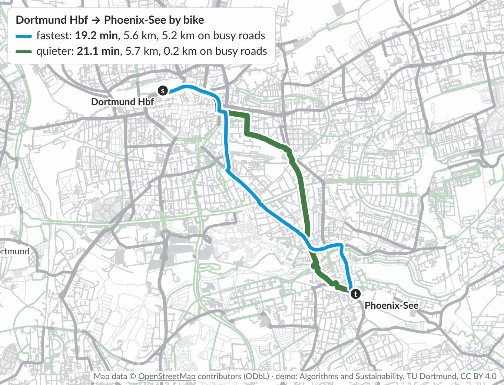{width="70%"}

The [interactive demo](../static/routing-demo/index.html) shows this example and all algorithms of this chapter on the street network of Dortmund: a click sets the start, a second click the target.

# 3.2 Street networks as graphs

::: definition
**Definition 3.1 (shortest path problem).** A *street network* is a directed graph $G = (V, E)$ with non-negative edge weights $c\colon E \to \mathbb{R}_{\geq 0}$; we write $n = |V|$ and $m = |E|$. A *path* $P = \langle v_0, \ldots, v_k \rangle$ uses the edges $(v_{i-1}, v_i) \in E$ and has the *length* $c(P) = \sum_{i=1}^{k} c(v_{i-1}, v_i)$. The *distance* $d(s, t)$ is the length of a shortest $s$–$t$ path, or $\infty$ if there is none. The *shortest path problem* asks, for given nodes $s$ and $t$, for an $s$–$t$ path of length $d(s, t)$.
:::

Nodes are junctions. Each piece of street between two junctions gives one edge for each direction in which it may be used; a one-way street gives a single edge, unless cyclists may ride both ways. The weight decides what "shortest" means: travel time, length, fuel, stress, or the effort for a wheelchair user. Impassable pieces, such as steps for a wheelchair, are left out.

::: example
**Example 3.2 (Dortmund by bike).** Our running example contains all streets and paths of Dortmund from OpenStreetMap (51.42–51.56° N, 7.30–7.55° E, downloaded on 9 November 2026). With one node per junction, the largest strongly connected part has 112,743 nodes and 264,203 directed edges, with 5,068 km of streets and paths. Two edge weights model cyclists:

- **fast**: the travel time at 18 km/h on roads and cycleways; 16 km/h on designated paths, 14 on good tracks and shared footways, 12 on other paths and service lanes, 10 on living streets; times 0.8 on unpaved and times 0.75 on cobbled surfaces; 5 km/h for pushing on footways; motorways, steps, and roads closed to bicycles are left out;
- **quiet**: the travel time times a stress factor of the road: 3 on primary roads, 2.2 on secondary, 1.6 on tertiary, 1.2 on unclassified roads, otherwise 1; with a cycle track only 20% of the extra stress counts, with a cycle lane or a speed limit of 30 km/h 50%.

This is a simple model for teaching: it ignores hills, traffic lights, turns, and the time of day. Real route planners for cyclists use similar ingredients, such as the road class, the cycle infrastructure, and the speed limit.
:::

Road networks are *sparse*: Dortmund has about 2.3 edges per node, and in general $m \leq c \cdot n$ for a small constant $c$, since only few streets meet at a junction. They can also be large: the road network of Western Europe that is used in the route planning literature has 18,010,173 nodes and 42,188,664 edges [Bast et al. 2016], about 160 times our city.

# 3.3 Dijkstra's algorithm

Dijkstra's algorithm [Dijkstra 1959] computes the distances from $s$ in increasing order. Every node $v$ has a *tentative distance* $d(v)$, the length of the best $s$–$v$ path found so far, and a *parent*, its predecessor on that path.

1. Set $d(s) = 0$ and $d(v) = \infty$ for all $v \neq s$. No node is settled.
2. Repeat: *settle* the unsettled node $u$ with the smallest $d(u)$. For each edge $(u, v)$, *relax* it: if $d(u) + c(u, v) < d(v)$, set $d(v) = d(u) + c(u, v)$ and make $u$ the parent of $v$.
3. Stop when $t$ is settled, or when no unsettled node has a finite tentative distance.

The parents of the settled nodes form a shortest-path tree; following the parents back from $t$ gives a shortest path.

::: example
**Example 3.3.** In the undirected graph of Figure 3.2, Dijkstra's algorithm settles $s$ (0), $b$ (1), $a$ (2), $c$ (4), $d$ (5), $e$ (7), and $t$ (8). Two tentative distances improve on the way: $c$ first gets 5 via $b$, then 4 via $a$; $d$ first gets 7 via $a$, then 5 via $c$. The shortest path is $s, a, c, d, t$ with length 8.
:::

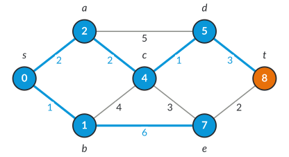{width="55%"}

## Correctness

::: theorem
**Theorem 3.1 [Dijkstra 1959].** If all edge weights are non-negative, then $d(u) = d(s, u)$ whenever Dijkstra's algorithm settles a node $u$.

*Proof.* Tentative distances are lengths of paths, so $d(u) \geq d(s, u)$ at all times. We show by induction over the settled nodes that, when $u$ is settled, every $s$–$u$ path $P$ has length $c(P) \geq d(u)$; then $d(u) \leq d(s, u)$ as well. For $u = s$, $d(s) = 0$. Otherwise let $S$ be the set of nodes settled before $u$, with $s \in S$. The path $P$ starts in $S$ and ends outside, so it has a first edge $(x, y)$ with $x \in S$ and $y \notin S$ (Figure 3.3).

- By induction, $d(x) = d(s, x)$ is at most the length of $P$ up to $x$. When $x$ was settled, the edge $(x, y)$ was relaxed, so $d(y) \leq d(x) + c(x, y)$, which is at most the length of $P$ up to $y$.
- The algorithm settles $u$ because it has the smallest tentative distance among the unsettled nodes, so $d(y) \geq d(u)$.
- The rest of $P$, from $y$ to $u$, has non-negative length.

Together, $c(P) \geq$ (length of $P$ up to $y$) $\geq d(y) \geq d(u)$. [∎]{.qed}
:::

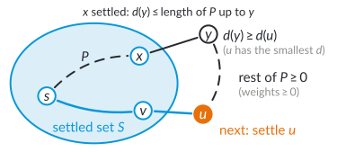{width="62%"}

The proof uses non-negative weights only in the last step: the rest of $P$ must not be negative. With a negative edge, both the proof and the algorithm fail. In the graph with the edges $s \to a$ (1), $s \to b$ (2), and $b \to a$ ($-2$), Dijkstra's algorithm settles $a$ with $d(a) = 1$, but $d(s, a) = 0$. The Bellman–Ford algorithm handles negative weights, as long as there is no cycle of negative length, in $O(nm)$ time. Travel times and lengths are never negative.

## Running time

**Adjacency lists.** The algorithm needs the outgoing edges of each settled node. In practice, all edges are stored in one array, sorted by their tail, together with an array of offsets: the edges of node $u$ are those at the positions off$[u]$ to off$[u+1] - 1$. Such an *adjacency array* (also known as the compressed sparse row format) uses $O(n + m)$ memory, and the edges of a node lie next to each other in memory, which is good for the cache. Our demo stores the Dortmund graph this way.

**Priority queue.** The unsettled nodes with finite tentative distance are kept in a priority queue, with the tentative distance as key. Over the whole run, there are at most $n$ insertions, at most $n$ delete-min operations, and at most $m$ decrease-key operations, one per relaxed edge.

- With a **binary heap**, every operation takes $O(\log n)$ time, in total $O((n + m) \log n)$.
- With a **Fibonacci heap** [Fredman and Tarjan 1987], insertions and decrease-key take $O(1)$ amortized time and delete-min $O(\log n)$, in total $O(m + n \log n)$.

For road networks, $m = O(n)$, so both bounds are $O(n \log n)$; the Fibonacci heap pays off on dense graphs. In practice, a binary heap is faster, often with *lazy deletion*: instead of decreasing a key, the node is inserted again with the new key, and outdated entries are skipped when they come out of the heap. Our demo does this.

Can we do better than $O(m + n \log n)$? Dijkstra's algorithm settles the nodes in the order of their distances, so it sorts them, and sorting $n$ numbers needs $\Omega(n \log n)$ comparisons. In this sense, $O(m + n \log n)$ is optimal for Dijkstra's algorithm. Haeupler, Hladík, Rozhoň, Tarjan, and Tětek (2024) show even more: with a suitable heap, Dijkstra's algorithm is *universally optimal* for ordering the nodes by distance; for every graph, its running time in the worst case over all edge weights is optimal up to a constant factor. Algorithms that do not sort can be faster: for directed graphs with non-negative real weights, Duan, Mao, Mao, Shu, and Yin (2025) compute all distances from $s$ in $O(m \log^{2/3} n)$ time, which beats $O(m + n \log n)$ on sparse graphs.

**In Dortmund.** From TU Dortmund to the Phoenix-See (27.4 minutes and 7.6 km by bike), Dijkstra's algorithm settles 62,880 of the 112,743 nodes, in about 15 ms in JavaScript (Figure 3.4). For a single city, this is fast enough. Faster methods are needed for continents (on the road network of Western Europe, a query takes 1.56 s [Dibbelt et al. 2014]), for route planning services with many queries per second, and for the harder problems of the following lectures, which run many such searches.

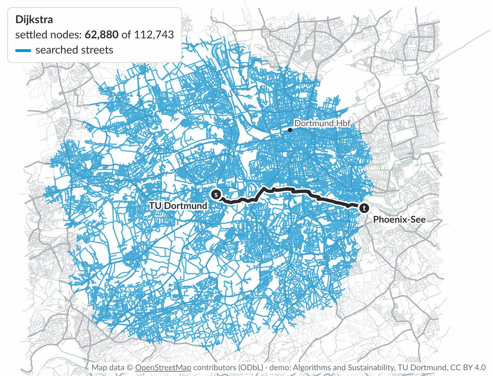{width="60%"}

# 3.4 Bidirectional search

Dijkstra's algorithm explores a disk around $s$ until it reaches $t$. *Bidirectional search* runs a *forward* search from $s$ and a *backward* search from $t$ on the reversed edges, for instance alternately, so that two smaller disks meet in the middle. If the search space grows with the area, two disks of radius $r/2$ together have half the area of one disk of radius $r$: a factor of 2.

Let $d_F$ and $d_B$ be the tentative distances of the two searches. Whenever a search relaxes an edge $(x, y)$, in its own direction, and the other endpoint already has a tentative distance from the other search, it updates
$$\mu \gets \min\{\mu,\ d_F(x) + c(x, y) + d_B(y)\},$$
the length of the best $s$–$t$ path seen so far; at the start, $\mu = \infty$.

::: theorem
**Lemma 3.2.** Let the edge weights be non-negative. If the searches stop as soon as the smallest keys $\min_F$ and $\min_B$ of their priority queues satisfy $\min_F + \min_B \geq \mu$, then $\mu = d(s, t)$.

*Proof.* $\mu$ is the length of a path, so $\mu \geq d(s, t)$. Let $P$ be a shortest $s$–$t$ path; we show $c(P) \geq \mu$.

If $P$ contains a node $v$ that neither search has settled, then $d(s, v) \geq \min_F$, because Dijkstra's algorithm settles all nodes closer than its smallest key, and likewise $d(v, t) \geq \min_B$. Hence $c(P) \geq d(s, v) + d(v, t) \geq \min_F + \min_B \geq \mu$.

Otherwise every node of $P$ is settled by at least one search. Walk along $P$ from $s$, which the forward search has settled. Let $(x, y)$ be the first edge of $P$ whose end $y$ is not settled by the forward search, so that $y$ is settled by the backward search; if there is no such edge, let $(x, y)$ be the last edge of $P$, with $y = t$. Whichever search settled its endpoint of $(x, y)$ later relaxed this edge, and at that time the other endpoint already had its final distance from the other search. Hence
$\mu \leq d_F(x) + c(x, y) + d_B(y) = d(s, x) + c(x, y) + d(y, t) \leq c(P)$. [∎]{.qed}
:::

The stopping criterion is easy to get wrong. It is tempting to stop as soon as a node is settled by both searches and to return the path through this node. Stopping at that moment is in fact correct, because then $\min_F + \min_B \geq \mu$ holds already, but the path through the node need not be a shortest one: the shortest path may cross from one search to the other over an edge. The answer is $\mu$.

::: example
**Example 3.4.** The undirected graph has the edges $s$–$x$ (5), $x$–$t$ (5), $s$–$u$ (3), $u$–$v$ (3), and $v$–$t$ (3), so $d(s, t) = 9$ via $u$ and $v$. The searches alternate. The forward search settles $s$; the backward search settles $t$ and reaches $x$, which the forward search has reached: $\mu = 5 + 5 = 10$. The forward search settles $u$ (3) and reaches $v$, which the backward search has reached: $\mu = 3 + 3 + 3 = 9$. The backward search settles $v$ (3). Now $\min_F = \min_B = 5$, both at $x$, and $5 + 5 \geq 9$: the search stops with $\mu = 9$, before any node has been settled by both searches. Continuing until the first node is settled by both would settle $x$ in both directions, and the path through $x$ has length 10.
:::

**In Dortmund.** From TU Dortmund to the Phoenix-See, bidirectional search settles 33,547 nodes instead of 62,880, a factor of 1.9 (Figure 3.5). Over 300 random pairs, it settles 34,990 instead of 54,587 nodes on average, a factor of only 1.6: for many random pairs near the border of the map, Dijkstra's disk is cut off by the border.

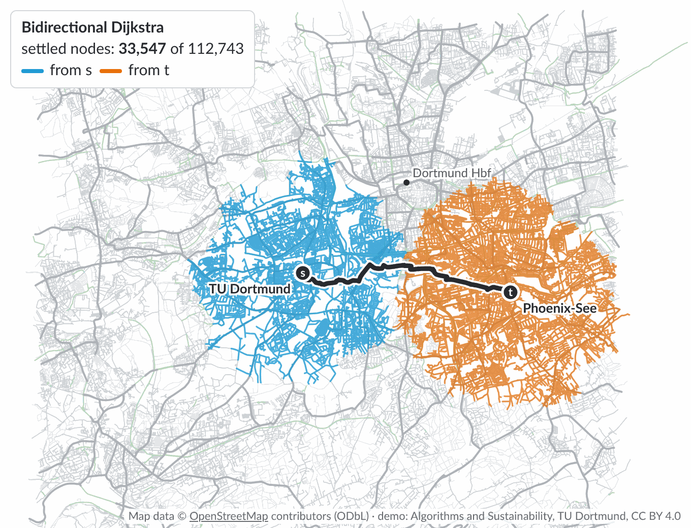{width="60%"}

# 3.5 Goal-directed search: A\* and landmarks

Dijkstra's algorithm and bidirectional search explore all directions alike. *Goal-directed* search prefers nodes that seem to lie towards the target.

::: definition
**Definition 3.2 (heuristic).** A *heuristic* for the target $t$ is a function $h\colon V \to \mathbb{R}$. It is a *lower bound* if $h(v) \leq d(v, t)$ for all $v \in V$, and *consistent* if $h(u) \leq c(u, v) + h(v)$ for every edge $(u, v)$.
:::

A\* [Hart et al. 1968] is Dijkstra's algorithm with a different key: it settles the unsettled node $v$ with the smallest $d(v) + h(v)$, the length of the best known path to $v$ plus an estimate of the rest. With $h = 0$, A\* is Dijkstra's algorithm. A lower bound is also called *admissible*. A consistent heuristic with $h(t) = 0$ is a lower bound: add up the condition along a shortest $v$–$t$ path.

**Terminology.** In artificial intelligence, $h$ is the *heuristic* of A\*. In route planning, the same function is usually called a *potential*, often written $\pi$ [Goldberg and Harrelson 2005]. The name comes from the reduced costs of Lemma 3.3, as for node potentials in network flows; a consistent heuristic is a *feasible potential*.

::: theorem
**Lemma 3.3.** Let $h$ be consistent, and define the *reduced costs* $c_h(u, v) = c(u, v) - h(u) + h(v)$. Then $c_h \geq 0$, A\* with $h$ settles the nodes in the same order as Dijkstra's algorithm with the weights $c_h$, and $d(v) = d(s, v)$ whenever A\* settles a node $v$.

*Proof.* Consistency says exactly that $c_h \geq 0$. For every $s$–$v$ path $P$, the sum telescopes: $c_h(P) = c(P) - h(s) + h(v)$. For a fixed $v$, all $s$–$v$ paths are shifted by the same amount $h(v) - h(s)$, so they keep their order: shortest paths stay shortest, and a tentative distance $d(v)$ with respect to $c$ corresponds to the tentative distance $d(v) - h(s) + h(v)$ with respect to $c_h$. These are the keys of Dijkstra's algorithm with $c_h$; they differ from the keys $d(v) + h(v)$ of A\* by the constant $h(s)$, so both algorithms make the same choices. Dijkstra's algorithm with $c_h \geq 0$ is correct by Theorem 3.1. [∎]{.qed}
:::

So A\* with a consistent heuristic settles every node at most once, and if $h(t) = 0$, it settles only nodes $v$ with $d(s, v) + h(v) \leq d(s, t)$ before it settles $t$. The better the lower bound, the fewer nodes. With the exact distance $h(v) = d(v, t)$, every node on a shortest $s$–$t$ path has the key $d(s, t)$, and every other node a larger key, so A\* settles only nodes on shortest paths. Computing exact distances to $t$, however, is a shortest path problem itself.

::: example
**Example 3.5.** In Figure 3.6 (undirected), the shortest $s$–$t$ path $s, u_1, u_2, t$ has length 6. The edge from $s$ to $\ell_1$ is cheap (1), but leads away from $t$. Dijkstra's algorithm settles $s$ (0), $\ell_1$ (1), $u_1$ (2), $\ell_2$ (3), $u_2$ (4), and $t$ (6): all six nodes. With the consistent lower bound $h(s) = 5$, $h(u_1) = 3$, $h(u_2) = 1$, $h(t) = 0$, $h(\ell_1) = 6$, $h(\ell_2) = 4$, A\* settles $s$, $u_1$, $u_2$ (key 5 each) and $t$ (key 6), and never $\ell_1$: its key is $1 + 6 = 7 > 6$.
:::

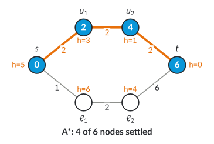{width="55%"}

## The straight-line heuristic

For travel times, a natural lower bound is the straight-line distance divided by the highest speed: $h(v) = \lVert v - t \rVert / v_{\max}$, where $\lVert v - t \rVert$ is the straight-line distance between the positions of $v$ and $t$. No route from $v$ to $t$ is shorter than the straight line, and no edge is faster than $v_{\max}$. If every edge $(u, v)$ takes at least the time $\lVert u - v \rVert / v_{\max}$, the heuristic is also consistent, by the triangle inequality $\lVert u - t \rVert \leq \lVert u - v \rVert + \lVert v - t \rVert$. In the Dortmund demo, $v_{\max} = 18$ km/h, and the travel times are rounded up and never below the straight-line time, so that the heuristic is consistent on every edge.

The straight line is a weak bound for travel times, because few routes run straight at top speed: rivers, railway lines, motorways, and parks force detours, and slow paths cost time. From TU Dortmund to the Phoenix-See, the bound at the start is 21.0 minutes, against a true travel time of 27.4 minutes. A\* settles 8,725 nodes instead of 62,880 (Figure 3.7).

## Landmarks: A\*, landmarks, triangle inequality (ALT)

Better bounds come from the network itself. Goldberg and Harrelson (2005) precompute, for a few *landmarks* $L$, the distances $d(L, v)$ and $d(v, L)$ from and to all nodes $v$.

::: theorem
**Lemma 3.4.** For every landmark $L$ and every node $v$,
$$d(v, t) \geq d(v, L) - d(t, L) \qquad\text{and}\qquad d(v, t) \geq d(L, t) - d(L, v).$$
The maximum of 0 and of these bounds over all landmarks is a consistent lower bound.

*Proof.* The bounds follow from the triangle inequalities $d(v, L) \leq d(v, t) + d(t, L)$ and $d(L, t) \leq d(L, v) + d(v, t)$. For consistency, consider an edge $(u, v)$. For the first bound, $\big(d(u, L) - d(t, L)\big) - \big(d(v, L) - d(t, L)\big) = d(u, L) - d(v, L) \leq c(u, v)$, since $d(u, L) \leq c(u, v) + d(v, L)$. For the second, $d(L, v) - d(L, u) \leq c(u, v)$ in the same way. So every bound is consistent, and so is the constant 0. A maximum of consistent functions is consistent: if $h_i(u) \leq c(u, v) + h_i(v)$ for all $i$, then $\max_i h_i(u) \leq c(u, v) + \max_i h_i(v)$. All of them are lower bounds, so their maximum is one as well. [∎]{.qed}
:::

The first bound is exact if $t$ lies on a shortest path from $v$ to $L$, that is, if $L$ lies "behind" $t$ as seen from $v$. The second bound is exact if $v$ lies on a shortest path from $L$ to $t$, so if $L$ lies behind $v$, for instance behind the start. Good landmarks therefore lie spread out, often at the border of the network. A simple way to choose them is farthest-first selection, which is Gonzalez's algorithm from Section 2.4.3, here with the distance $d(L, v) + d(v, L)$ there and back.

::: example
**Example 3.6 (landmarks in Dortmund).** The demo chooses 8 landmarks by farthest-first selection, starting from TU Dortmund. The first four lie at the border of the network, near the corners of the map. The fifth lies in the middle, just north-east of the campus: once the corners are taken, the middle is farthest from all landmarks chosen so far, as for $k$-center clustering. The last three lie near the middles of the sides. From TU Dortmund to the Phoenix-See, the landmark in the middle gives the best bound for 56% of the nodes that ALT settles, and the one at the western border for 43%: both lie behind the start as seen from the target. The bound at the start is 23.7 minutes, against 21.0 for the straight line and 27.4 for the true travel time. ALT settles 6,123 nodes, A\* with the straight line 8,725 (Figure 3.7); over 300 random pairs, 4,896 against 13,775 on average. The landmark distances take 16 runs of Dijkstra's algorithm over the whole graph, from and to each landmark, about a quarter of a second in the browser.
:::

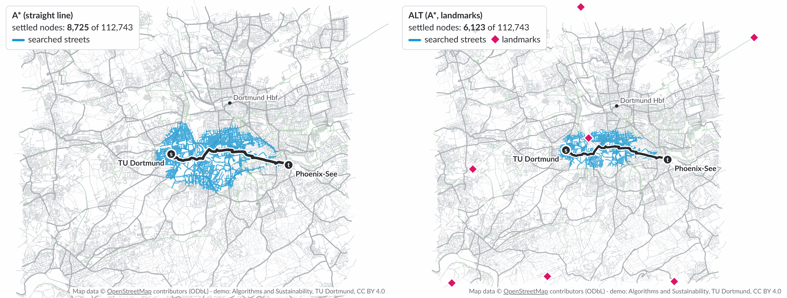{width="100%"}

# 3.6 Contraction hierarchies

Long routes use few important roads: a trip across Dortmund leaves the residential streets soon and returns to them only near the target. *Contraction hierarchies* [Geisberger et al. 2008] exploit this without being told which roads are important. They order the nodes by importance and *contract* them one by one, from the least important to the most important; a query then searches only *upwards* in this order, from $s$ and from $t$. Contraction hierarchies are, among other techniques, the basis of open-source route planners such as OSRM and GraphHopper, of the customizable variant in Section 3.7, and of the multi-criteria variant in Lecture 6.

## Contracting a node

::: definition
**Definition 3.3 (contraction, shortcut, witness).** To *contract* a node $v$, remove $v$ and its edges from the graph. For every remaining node $u$ with an edge $(u, v)$ and every remaining node $w \neq u$ with an edge $(v, w)$, add a *shortcut* $(u, w)$ of length $c(u, v) + c(v, w)$, unless there is a *witness*: a $u$–$w$ path that avoids $v$ and is at most as long as $c(u, v) + c(v, w)$. Of parallel edges, only the shortest is kept.
:::

Contracting a node keeps all distances between the remaining nodes: a shortcut is exactly as long as the path it replaces, so no distance gets shorter, and a shortest path through $v$ can use the shortcut or the witness instead, so no distance gets longer. Witnesses are found by a small Dijkstra search from $u$ that avoids $v$. This search may stop early, for instance after a fixed number of settled nodes: a missed witness only adds an unnecessary shortcut, never a wrong distance. Every shortcut remembers the node it skips, so that it can later be *unpacked* into the two edges it replaces.

::: example
**Example 3.7.** Figure 3.8 shows a small undirected network: a road $s, a, m, b, t$ with four edges of length 2, and the detours $s, x, m$ with edges of length 3 and 3 and $m, y, t$ with edges of length 2 and 3. We contract in the order $a, x, b, y, s, t, m$.

- Contracting $a$: the path $s, a, m$ has length 4, the only other path from $s$ to $m$ has length 6. Shortcut $s$–$m$ (4).
- Contracting $x$: the path $s, x, m$ has length 6, but the shortcut $s$–$m$ (4) is a witness. Witnesses may use shortcuts.
- Contracting $b$: the path $m, b, t$ has length 4, the detour via $y$ has length 5. Shortcut $m$–$t$ (4).
- Contracting $y$: the path $m, y, t$ has length 5, and the shortcut $m$–$t$ (4) is a witness.
- Then $s$ and $t$ have only $m$ as a neighbour, and contracting them adds nothing.

The hierarchy has two shortcuts. Contracting the important node $m$ first would instead add five shortcuts, between $a$ and $b$, $a$ and $y$, $b$ and $x$, $b$ and $y$, and $x$ and $y$; only the pair $a$, $x$ has a witness, the path $a, s, x$ of length 5.
:::

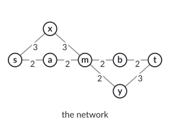{width="55%"}

The *edge difference* of a node is the number of shortcuts that its contraction adds minus the number of edges it removes. In the exercise of Lecture 5, a node $v$ has the neighbours $a$, $b$, $c$ with edges of length 2, 3, 4, and the graph also has the edges $a$–$b$ (4) and $b$–$c$ (8). Contracting $v$ adds the shortcuts $a$–$c$ (6) and $b$–$c$ (7), which replaces the longer edge $b$–$c$, but none for $a$ and $b$, which have the witness $a$–$b$ of length $4 < 5$. The graph has five edges before and three after: the edge difference is $2 - 3 = -1$, so $v$ is a good node to contract early.

## The order

Any order gives correct distances; the order only decides how many shortcuts are added and how fast the queries are. Good orders contract unimportant nodes first. Implementations keep the nodes in a priority queue whose priority combines, for instance, the edge difference and the number of neighbours already contracted, which spreads the contractions over the map [Geisberger et al. 2008]. After each contraction, the priorities of the neighbours change and are recomputed. The priorities of other nodes can change as well, because witness searches may now use the new shortcuts. Instead of recomputing all of them, the node at the top of the queue is evaluated again before it is contracted, and it goes back into the queue if its priority has become larger than the next key (*lazy updates*).

In Dortmund, with the priority 2 × edge difference + number of contracted neighbours and witness searches that stop after 100 settled nodes, the hierarchy has 185,295 shortcuts for 264,203 edges; contracting all nodes takes about 9 seconds in JavaScript (Node.js). Optimized implementations preprocess continental networks within minutes.

## The query

The *rank* of a node is its position in the contraction order. The query runs a bidirectional Dijkstra search on the original edges and all shortcuts, in which the forward search from $s$ only uses edges to nodes of higher rank, and the backward search from $t$ only uses edges from nodes of higher rank, read backwards. The answer is the best meeting value $\mu = \min_x \big(d_F(x) + d_B(x)\big)$ over the nodes $x$ reached by both searches. Each search may stop as soon as its smallest key is at least $\mu$, since it cannot improve on $\mu$ any more. Unpacking the shortcuts recursively gives the path in the original graph. In Example 3.7, the forward search from $s$ settles $s$ and $m$ (via the shortcut, 4), the backward search from $t$ settles $t$ and $m$ (4), so $\mu = 8$, and unpacking gives $s, a, m, b, t$ (Figure 3.9).

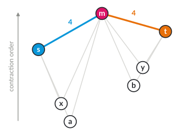{width="55%"}

::: theorem
**Theorem 3.5.** For all nodes $s$ and $t$ with $d(s, t) < \infty$, the original edges and the shortcuts contain a shortest $s$–$t$ path that first visits nodes of increasing rank and then nodes of decreasing rank. Hence the query returns $d(s, t)$.

*Proof.* With the shortcuts, the distances are the same as in the original graph, since every shortcut is as long as a path. Start with any shortest $s$–$t$ path $P$ that uses original edges and shortcuts. Call an inner node of $P$ a *valley* if both its neighbours on $P$ have a higher rank. If $P$ has no valley, it first goes up and then down. Otherwise, let $v$ be the valley of lowest rank, with the neighbours $u$ and $w$ on $P$ (Figure 3.10). When $v$ was contracted, $u$ and $w$ were not contracted yet, since their ranks are higher, and edges from $u$ to $v$ and from $v$ to $w$ at most as long as those on $P$ were present. So the contraction of $v$ either added a shortcut $(u, w)$ of length at most $c(u, v) + c(v, w)$, or it found a witness of at most this length that consists of nodes not yet contracted, of higher rank than $v$. Replacing $u, v, w$ in $P$ by the shortcut or the witness gives a path that is no longer, hence again a shortest path. It no longer contains $v$, and every node whose neighbours change, $u$, $w$, and the nodes of a witness, has a higher rank than $v$. So all valleys of the new path have a higher rank than $v$: the rank of the lowest valley increases with every step, and after at most $n$ steps no valley is left.

For the query, let $P$ be such a path and $m$ its highest node. The part of $P$ from $s$ to $m$ only goes up, so the forward search can use it; the part from $m$ to $t$, read backwards, only goes up as well. If neither search stops before settling $m$, then $d_F(m) + d_B(m) \leq c(P) = d(s, t)$. If a search stops earlier, then its smallest key was at least $\mu$, and the part of $P$ on its side is at least that long, so again $\mu \leq c(P)$. Conversely, every value $d_F(x) + d_B(x)$ is the length of an $s$–$t$ path, so $\mu = d(s, t)$. [∎]{.qed}
:::

{width="55%"}

In Dortmund, the query from TU Dortmund to the Phoenix-See settles 239 nodes, against 62,880 for Dijkstra's algorithm; over 300 random pairs, it settles 249 nodes on average (Figure 3.11). The two search trees reach important junctions all over the city, often by shortcuts: the searches only go up, to more important nodes wherever they are, and they do not know where the target lies.

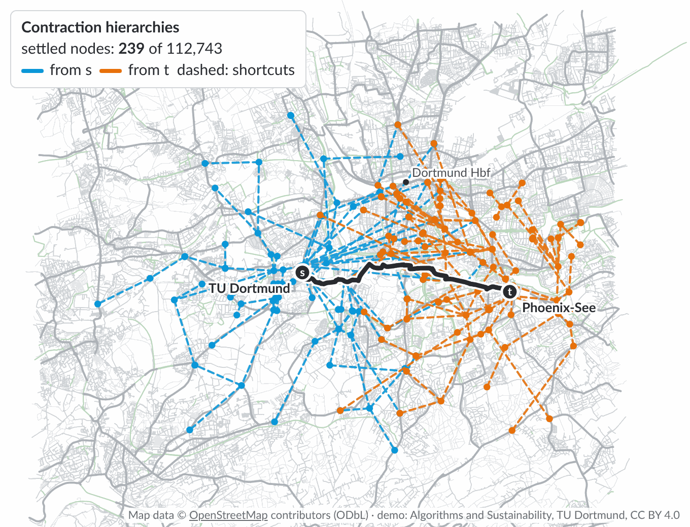{width="60%"}

## Comparison and other techniques

| Dortmund by bike | preprocessing | settled nodes, TU → Phoenix-See | mean over 300 random pairs |
|------------------|---------------|--------------------------------:|---------------------------:|
| Dijkstra | none | 62,880 | 54,587 |
| bidirectional | none | 33,547 | 34,990 |
| A\*, straight line | none | 8,725 | 13,775 |
| ALT, 8 landmarks | 16 Dijkstra runs | 6,123 | 4,896 |
| contraction hierarchy | 185,295 shortcuts, about 9 s | 239 | 249 |

: Table 3.2: Settled nodes in Dortmund. All methods give the same distances; the demo was checked against Dijkstra's algorithm on 300 random pairs.

Settled nodes measure the work independently of the computer. On the road network of Western Europe, a query takes 1.56 s with Dijkstra's algorithm and 0.41 ms with a customizable contraction hierarchy [Dibbelt et al. 2014]. The survey of Bast et al. (2016) describes many more techniques, among them:

- *Arc flags* partition the map into regions; every edge stores for which target regions it lies on a shortest path.
- *Transit node routing* [Bast et al. 2007] uses that long routes leave the neighbourhood of the start through a few *access nodes*; distances between all such transit nodes, and from every node to its access nodes, are precomputed.
- *Hub labels* store for every node a list of hubs with their distances, such that every pair of nodes has a common hub on a shortest path; a query intersects two lists. Hub labels are the fastest exact method in practice, at about a microsecond per query, at the price of a lot of memory; they are often computed from a contraction hierarchy.

# 3.7 Personal profiles and several criteria

## One profile per person: customizable contraction hierarchies

Inclusive route planning needs a weight per group or even per person: for a wheelchair user, a parent with a pram, a cautious cyclist, an e-bike. Weights also change with building sites and traffic. A contraction hierarchy is built for one weight, since its shortcuts and witnesses depend on it; the hierarchy of the Dortmund demo is built for travel time and cannot answer queries for the quiet weight. *Customizable contraction hierarchies* [Dibbelt et al. 2014, 2016] split the preprocessing into three phases:

1. **Metric-independent preprocessing**, once: an order computed from the graph alone, by nested dissection, so that small separators of the road network are contracted last; then all shortcuts for this order, without witness searches, since a witness for one weight need not be one for another.
2. **Customization**, for every new weight: the lengths of all shortcuts, in 0.74 seconds for Western Europe on 16 threads.
3. **Queries** as in a contraction hierarchy: 0.41 ms for Western Europe.

This makes personal profiles practical. The guest lecture on 17 November is about accessibility-aware route planning.

## Several criteria at once

::: definition
**Definition 3.4 (Pareto-optimal).** Let every path have several costs that are all to be minimized, such as travel time and quiet weight. A path $P$ *dominates* a path $Q$ if $P$ is at least as good as $Q$ in every criterion and better in at least one. An $s$–$t$ path is *Pareto-optimal* if no $s$–$t$ path dominates it.
:::

::: example
**Example 3.8.** From Dortmund Hbf to the Phoenix-See, there are 115 Pareto-optimal routes for travel time and quiet weight, between the fastest route (19.2 minutes) and the quietest one (21.1 minutes). Minimizing a weighted sum $\lambda \cdot \text{time} + (1 - \lambda) \cdot \text{quiet}$ for $\lambda = 0, 0.01, \ldots, 1$ finds only 13 of them (Figure 3.12). A weighted sum is a linear function: its optima lie on the lower convex hull of the Pareto front, and the routes in the dents between them are not optimal for any $\lambda$. We computed all 115 routes with the multi-criteria Dijkstra algorithm of Martins (1984), which keeps a set of non-dominated labels per node; it settled 1.36 million labels, about 12 per node, in about 7 seconds.
:::

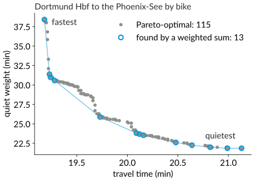{width="60%"}

How to compute Pareto-optimal routes efficiently, how many there can be, and how contraction hierarchies extend to all weighted sums at once [Funke and Storandt 2013] are topics of Lecture 6, together with public transport.

# 3.8 Check your understanding

1. Give a directed graph with a negative edge for which Dijkstra's algorithm computes a wrong distance. Which step of the proof of Theorem 3.1 fails?

    

    
Answer

    The edges $s \to a$ (1), $s \to b$ (2), $b \to a$ ($-2$): $a$ is settled with $d(a) = 1$, but $d(s, a) = 0$ via $b$. The last step fails. The path $P = s, b, a$ leaves $S = \{s\}$ over the edge $(s, b)$, and $d(b) = 2 \geq d(a) = 1$ holds, but the rest of $P$, from $b$ to $a$, has the negative length $-2$.
    

2. In Example 3.4, why is it not enough to stop when a node is settled by both searches and to return the path through this node? Is it wrong to stop at that moment?

    

    
Answer

    The first node settled by both searches is $x$, and the path through $x$ has length 10, but $d(s, t) = 9$: the shortest path crosses from the forward to the backward search over the edge $u$–$v$. Stopping at that moment is not wrong, since then $\min_F + \min_B \geq \mu$ holds already, but the answer must be $\mu$, the best path seen so far.
    

3. For which graphs does the Fibonacci heap give an asymptotically better running time for Dijkstra's algorithm than the binary heap? What do both bounds give for road networks?

    

    
Answer

    $O(m + n \log n)$ is better than $O((n + m) \log n)$ if $m$ grows faster than $n$, for instance on dense graphs with $m = \Theta(n^2)$: $O(n^2)$ against $O(n^2 \log n)$. For road networks, $m = O(n)$, and both bounds are $O(n \log n)$.
    

4. A heuristic may be a lower bound without being consistent. Give a small example in which A\* then settles a node before its distance is known.

    

    
Answer

    Take the edges $s \to a$ (4), $s \to b$ (1), $b \to a$ (1), $a \to t$ (5), so $d(s, t) = 7$ via $b$ and $a$, and the heuristic $h(s) = h(a) = h(t) = 0$, $h(b) = 6$. It is a lower bound, since $d(b, t) = 6$, but not consistent: $h(b) = 6 > c(b, a) + h(a) = 1$. A\* settles $s$, then $a$ with key $4 + 0 = 4$, although $d(s, a) = 2$; $b$ has key $1 + 6 = 7$. Only after settling $b$ does A\* find the shorter path to $a$, and it has to process $a$ again. A\* with reopening still finds a shortest path for every lower bound [Hart et al. 1968], but it may process nodes several times; with a consistent heuristic, Lemma 3.3 rules this out.
    

5. Why is the straight-line distance divided by $v_{\max}$ a lower bound on the travel time? Why does the Dortmund demo round travel times up?

    

    
Answer

    No route is shorter than the straight line, and no edge is faster than $v_{\max}$. The demo stores travel times as whole numbers (tenths of seconds). Rounding down could make an edge slightly faster than $v_{\max}$ allows, and then the heuristic would no longer be consistent on that edge.
    

6. Why is the maximum of landmark bounds a lower bound, but not the sum of two of them?

    

    
Answer

    Each bound is at most $d(v, t)$, so their maximum is as well. Two bounds can both be exact: if $t$ lies on shortest paths from $v$ to $L_1$ and from $v$ to $L_2$, both first bounds equal $d(v, t)$, and their sum is $2\,d(v, t)$.
    

7. In Example 3.7, why does contracting $m$ first add so many shortcuts? Are the distances still correct?

    

    
Answer

    $m$ is a hub: the shortest connections between most pairs of its neighbours pass through $m$, so there are few witnesses, and five shortcuts are needed. The distances stay correct for every order, but the hierarchy gets more edges, and the queries search more. This is why the priority prefers nodes with a small edge difference.
    

8. Why do the search trees of a contraction hierarchy query reach junctions all over the city instead of staying near the route?

    

    
Answer

    The searches only go up, to more important nodes, in every direction; they do not know where the target is. Important nodes are spread over the city, because the order prefers to contract nodes all over the map. The trees are tiny all the same: 239 nodes from TU Dortmund to the Phoenix-See.
    

9. Give three routes with travel time and quiet weight such that one of them is Pareto-optimal, but not optimal for any weighted sum.

    

    
Answer

    $A = (0, 10)$, $B = (6, 6)$, $C = (10, 0)$. No route dominates $B$. For every $\lambda$, $B$ has the weighted sum $6$, while the better of $A$ and $C$ has $\min\{10 - 10\lambda, 10\lambda\} \leq 5$. $B$ lies above the line from $A$ to $C$.
    

10. Why can the metric-independent phase of customizable contraction hierarchies not use witness searches?

    

    
Answer

    A witness depends on the weights: a path that is at most as long as $u, v, w$ for one weight can be longer for another. The shortcuts of the first phase must be correct for every weight, so they are added for all pairs; only the customization uses the weights, to compute the lengths of the shortcuts.
    

# References

::: refs
- Bast, H., Delling, D., Goldberg, A., Müller-Hannemann, M., Pajor, T., Sanders, P., Wagner, D., Werneck, R. F. (2016). Route planning in transportation networks. In *Algorithm Engineering*, LNCS 9220, 19–80. <https://doi.org/10.1007/978-3-319-49487-6_2>
- Bast, H., Funke, S., Matijevic, D., Sanders, P., Schultes, D. (2007). In transit to constant time shortest-path queries in road networks. *9th Workshop on Algorithm Engineering and Experiments (ALENEX)*, 46–59.
- Cohen, A., Dalyot, S. (2021). Route planning for blind pedestrians using OpenStreetMap. *Environment and Planning B* 48(6), 1511–1526.
- Destatis (2026). 7,8 Millionen schwerbehinderte Menschen leben in Deutschland. Press release 246, 13 July 2026.
- Dibbelt, J., Strasser, B., Wagner, D. (2014). Customizable contraction hierarchies. *13th International Symposium on Experimental Algorithms (SEA)*, LNCS 8504; journal version: *ACM Journal of Experimental Algorithmics* 21 (2016).
- Dijkstra, E. W. (1959). A note on two problems in connexion with graphs. *Numerische Mathematik* 1, 269–271.
- Dill, J., McNeil, N. (2013). Four types of cyclists? Examination of typology for better understanding of bicycling behavior and potential. *Transportation Research Record* 2387, 129–138.
- Duan, R., Mao, J., Mao, X., Shu, X., Yin, L. (2025). Breaking the sorting barrier for directed single-source shortest paths. *57th ACM Symposium on Theory of Computing (STOC)*. <https://arxiv.org/abs/2504.17033>
- Ehrgott, M., Wang, J. Y. T., Raith, A., van Houtte, C. (2012). A bi-objective cyclist route choice model. *Transportation Research Part A* 46(4), 652–663.
- Fredman, M. L., Tarjan, R. E. (1987). Fibonacci heaps and their uses in improved network optimization algorithms. *Journal of the ACM* 34(3), 596–615.
- Funke, S., Storandt, S. (2013). Polynomial-time construction of contraction hierarchies for multi-criteria objectives. *15th Workshop on Algorithm Engineering and Experiments (ALENEX)*.
- Geisberger, R., Sanders, P., Schultes, D., Delling, D. (2008). Contraction hierarchies: faster and simpler hierarchical routing in road networks. *7th Workshop on Experimental Algorithms (WEA)*, LNCS 5038, 319–333.
- Goldberg, A. V., Harrelson, C. (2005). Computing the shortest path: A\* search meets graph theory. *16th ACM-SIAM Symposium on Discrete Algorithms (SODA)*, 156–165.
- Haeupler, B., Hladík, R., Rozhoň, V., Tarjan, R. E., Tětek, J. (2024). Universal optimality of Dijkstra via beyond-worst-case heaps. *65th IEEE Symposium on Foundations of Computer Science (FOCS)*. <https://arxiv.org/abs/2311.11793>
- Hart, P. E., Nilsson, N. J., Raphael, B. (1968). A formal basis for the heuristic determination of minimum cost paths. *IEEE Transactions on Systems Science and Cybernetics* 4(2), 100–107.
- Martins, E. Q. V. (1984). On a multicriteria shortest path problem. *European Journal of Operational Research* 16(2), 236–245.
- Minett, C. F., Salomons, A. M., Daamen, W., van Arem, B., Kuijpers, S. (2011). Eco-routing: comparing the fuel consumption of different routes between an origin and destination using field test speed profiles and synthetic speed profiles. *IEEE Forum on Integrated and Sustainable Transportation Systems*, 32–39.
- OpenStreetMap contributors (2026). Street network of Dortmund, downloaded on 9 November 2026 via the Overpass API. Open Database License. <https://www.openstreetmap.org/copyright>
- Umweltbundesamt (2026a). Treibhausgasdaten 2025. Press release 08/2026, 14 March 2026.
- Umweltbundesamt (2026b). Radverkehr. Web page, citing *Mobilität in Deutschland 2023*.
- United Nations (2015). *Transforming our world: the 2030 Agenda for Sustainable Development*. Resolution A/RES/70/1.
:::

# License

These notes are licensed under [CC BY 4.0](https://creativecommons.org/licenses/by/4.0/). Suggested attribution: "Kevin Buchin, Algorithms and Sustainability, Lecture Notes, TU Dortmund University, CC BY 4.0". The maps and the Dortmund graph are based on data © OpenStreetMap contributors, available under the Open Database License (ODbL); the graph of the demo is a derived database and also available under the ODbL. The map images, the demo code, and all other figures are own work under CC BY 4.0. The small example graphs are constructed, not measured, and the bicycle profile is a model for teaching. The colors of the Sustainable Development Goals are used for orientation only; these notes are not endorsed by the United Nations. Not covered by the license: the TU Dortmund logo and the Decker software and its themes.
